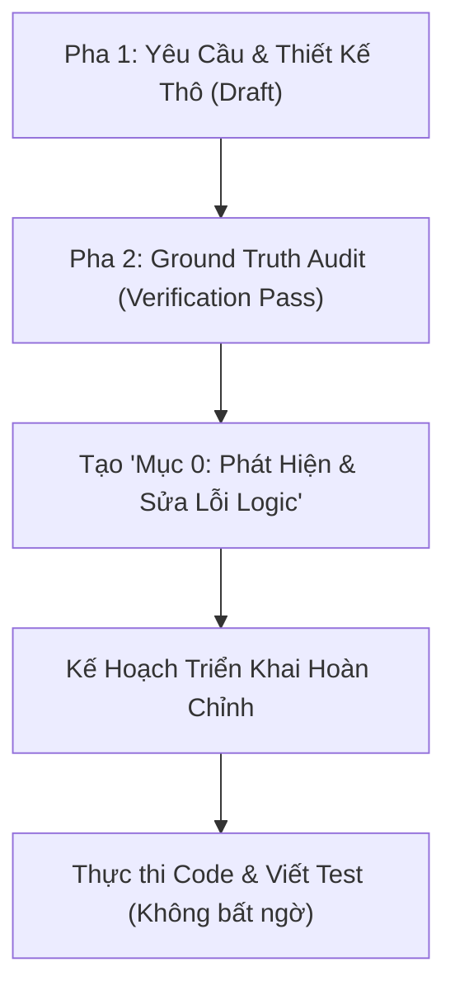

# 2-Phase Task Planning Workflow for Backend Core

> **Mục tiêu:** Loại bỏ hoàn toàn tình trạng lập kế hoạch dựa trên suy diễn/ước đoán.
> Đảm bảo kế hoạch khi chuyển sang bước code có thể thực thi chính xác 100%, không gặp lỗi runtime bất ngờ vì sai schema hoặc sai signature.

---

## 1. Kiến trúc Quy Trình Lập Kế Hoạch 2 Pha



---

## 2. Pha 1: Phân Tích Yêu Cầu & Thiết Kế Thô (Draft)

Khi nhận đề bài (từ file sprint, issue, ticket):
1. **Xác định phân hệ & vai trò:** Ai là người thực hiện (BE1/BE2), phụ thuộc vào task nào (Dependencies), tích hợp với task nào.
2. **Liệt kê các thành phần cần tạo/sửa:**
   - Schemas (Pydantic models)
   - Services / Utilities
   - API Routes & Endpoints
   - Test files
3. **Phác thảo Sequence Diagram & Luồng Nghiệp Vụ:**
   - Client gửi gì?
   - Các lớp bảo vệ (Guards/Middleware) gồm những gì?
   - Thứ tự kiểm tra lỗi (HTTP 401 -> 403 -> 404 -> 409 -> 422 -> 500).

---

## 3. Pha 2: Ground Truth Audit (Verification Pass) — BẮT BUỘC

> [!CRITICAL]
> **Không bao giờ xuất xưởng bản kế hoạch nếu chưa thực hiện Pha 2.**
> Sử dụng skill `codebase-grounding` để thực hiện 4 bước audit sau:

### Audit 1: Cơ Sở Dữ Liệu (Database Schema Audit)
* Mở `backend/scripts/schema.sql` (hoặc migrations).
* Kiểm tra từng cột trong các câu truy vấn dự kiến:
  - Cột có thực sự tồn tại trong DB không?
  - Hay cột đó chỉ là in-memory DTO trong Pydantic?
  - Bảng con có cột `session_id` không, hay phải query qua bảng trung gian?
  - RPC có hỗ trợ thao tác này chưa?

### Audit 2: Hàm Phụ Trợ & Dependencies (Signature Audit)
* Mở file định nghĩa hàm (ví dụ `app/api/dependencies.py`):
  - Hàm là `def` (sync) hay `async def` (async)?
  - Nếu là `def` $\rightarrow$ cấm dùng `await`.
  - Tham số truyền vào có thứ tự và kiểu gì?

### Audit 3: Framework & Thư viện (SDK Constraints Audit)
* Xem các file đang hoạt động tương tự trong `app/api/routes/` hoặc `app/services/`:
  - Decorator `@crud_rate_limit` có cần `request: Request` và `response: Response` không?
  - Supabase Python SDK có yêu cầu `cast(Any, ...)` khi insert không?
  - Cập nhật thời gian dùng `datetime.now(timezone.utc).isoformat()` hay chuỗi `"now()"`?
  - Query `.in_(col, list)` có bị lỗi nếu `list` rỗng không?

### Audit 4: Chiến Lược Kiểm Thử & Mocking (Test Audit)
* Xem các file test tương tự trong `backend/tests/`:
  - Có bao nhiêu lần gọi DB `.execute()` trong handler?
  - Nếu dùng `side_effect`, số lượng mock object đã khớp 100% với số lần gọi chưa?
  - Các hàm dependency có cần được patch độc lập để tránh tiêu thụ mock chain không?

---

## 4. Cấu Trúc Bắt Buộc Của File Implementation Plan

Mọi file kế hoạch triển khai chi tiết (`task_XXX_implementation_plan.md`) phải tuân theo cấu trúc chuẩn:

```markdown
# Kế Hoạch Triển Khai Chi Tiết: TASK-XXX
## [Tên Task]

> Metadata: Mã task, Nhánh git, Người thực hiện, Phụ thuộc, Ngày tạo

---

## 0. Phát Hiện & Sửa Lỗi Logic Từ Quá Trình Audit (BẮT BUỘC)
- [Liệt kê các sai lệch giữa yêu cầu lý thuyết và code thực tế phát hiện trong Pha 2]
- 0.1: ...
- 0.2: ...

---

## 1. Kiến Trúc Luồng Dữ Liệu (Mermaid Sequence Diagram)
[Sơ đồ chi tiết các bước từ Client -> Guards -> Services -> DB -> Response]

---

## 2. Thứ Tự Thực Hiện Từng Mục Nhỏ (Breakdown & Common Pitfalls)
### Bước 1: [Tên bước]
| # | Mục nhỏ | Chi tiết |
|---|---------|----------|
| 1.1 | ... | ... |
> [!WARNING]
> Lỗi thường gặp 1.A: ...

### Bước 2: ...

---

## 3. Ma Trận Kiểm Thử Tự Động (Test Cases Matrix)
| # | Tên Test | Mock Setup | Kỳ vọng | Lưu ý |
|---|----------|------------|---------|-------|
| 1 | test_... | ... | HTTP 401 | ... |

Thứ tự viết test: Auth (401/403) -> State Guards (409) -> Validation (422) -> Happy Path (200).

---

## 4. Checklist Trước Khi Commit (Scope Protection)
- [ ] Tuân thủ AGENTS.md (không reformat file người khác)
- [ ] Ruff check scoped
- [ ] Mypy type check pass
- [ ] Pytest scoped pass

---

## 5. Danh Sách File Tác Động (Scope)
| File | Hành động (Tạo mới / Sửa) | Ghi chú |
|---|---|---|
```

---

## 5. Quy Tắc Ứng Xử Khi Phát Hiện Sai Lệch Trong Code Sẵn Có
Nếu trong quá trình audit phát hiện code cũ của task trước hoặc của thành viên khác có bug tiềm ẩn (ví dụ: chỗ khác cũng dùng `"now()"` text string):
1. **Ghi nhận vào logbook / ghi chú kế hoạch.**
2. **TUYỆT ĐỐI KHÔNG tự tiện sửa file ngoài scope của task hiện tại** để tránh vi phạm quy tắc Git Discipline và gây xung đột nhánh trên `dev`.
3. Chỉ áp dụng cách viết chuẩn, an toàn vào đúng các file thuộc phạm vi task của mình.
