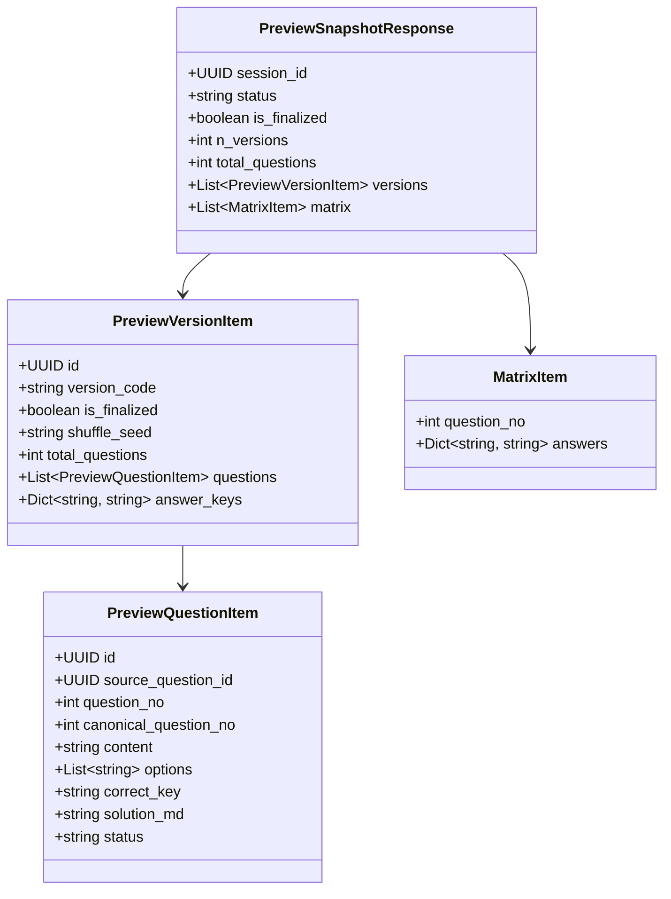

# Post-Shuffle Pre-Approval Preview Projection Contract (W4-MVP-05)

> **Document Status:** OFFICIAL CONTRACT & SPECIFICATION  
> **Task ID:** `W4-MVP-05` (P0 Critical Path Blocker)  
> **Decision Reference:** Resolves `Q06` (Preview API path, JSON projection, immutable snapshot contract)  
> **Author / Owner:** Pham Khanh Tam (`@AI-WFox`)  
> **Primary Consumers:**  
> - Frontend Stage 3 Preview UI: Boi Anh (`@htbaax`, `W4-MVP-06`)  
> - DB Export Adapter: Hung (`@benalexx007`, `W4-MVP-07`)  
> - Product / Finalize Owner: Duy (`@johannguyen015`)  
> **Golden Fixture Path:** `backend/tests/fixtures/w4_preview_snapshot_fixture.json`  

---

## 1. Executive Summary & Purpose

In Stage 3 of the exam generation workflow, after all question variants are reviewed and approved, the teacher triggers the deterministic Fisher-Yates shuffler (`POST /api/sessions/{session_id}/finalize/shuffle`).

Prior to granting final approval (`POST /api/sessions/{session_id}/finalize/approve`) and locking the exam permanently (HTTP 423), teachers need to preview the exact, authoritative rendered exam papers as they will appear in the final exported Typst PDF and DOCX packages. This includes:
1. Contiguous question slot ordering (1..M) according to the shuffled question sequence.
2. Permuted option choices (A, B, C, D) with their shuffled textual content.
3. Synchronized correct key ('A'..'D') matching the permuted options.
4. Synchronized `solution_md` text (with explanation keys dynamically updated via `_finalize_sync_solution`).
5. Cross-version answer key matrix (comparing Version 101, 102, etc. side-by-side).

The legacy `GET /api/sessions/{session_id}/finalize/matrix` endpoint enforces `status in ('approved', 'exported')` and returns only a sparse key matrix without stems or solutions. **`GET /api/sessions/{session_id}/finalize/preview`** provides the complete, read-only display projection before final approval.

---

## 2. API Endpoint Specification

### 2.1 HTTP Request

- **HTTP Method:** `GET`
- **Path:** `/api/sessions/{session_id}/finalize/preview`
- **Authentication:** `Bearer <JWT_ACCESS_TOKEN>` (Header: `Authorization: Bearer ...`)
- **Query Parameters:** None (Deterministic read of the finalized shuffle snapshot)
- **Response Headers:** `Cache-Control: no-store` (prohibits intermediate proxy or client caching of pre-approval/post-approval exam content)

### 2.2 Pre-conditions & State Guard Matrix

| Session Status | `is_finalized` Value | HTTP Response | Error Code / Meaning |
|---|---|---|---|
| Nonexistent UUID | Any | `404 Not Found` | `ERR_SESSION_NOT_FOUND` |
| Malformed UUID | Any | `400 Bad Request` | `ERR_INVALID_SESSION_ID` |
| Other User's Session | Any | `403 Forbidden` | `ERR_UNAUTHORIZED` (RLS enforced) |
| `draft`, `generating`, `partial_generated` | False | `409 Conflict` | `ERR_INVALID_SESSION_STATE` |
| `reviewed` | False | `409 Conflict` | `ERR_SHUFFLE_REQUIRED` (Must run shuffle first) |
| `reviewed` | True | `200 OK` | Returns full pre-approval preview projection |
| `approved`, `exported` | True | `200 OK` | Returns full post-approval preview projection (Read-only immutable) |

---

## 3. Schema & Field Definitions

### 3.1 Pydantic Model Hierarchy



### 3.2 Response Field Descriptions

#### `PreviewSnapshotResponse`
- `session_id` (UUID): Unique exam session identifier.
- `status` (`str`): Current lifecycle state (`"reviewed"`, `"approved"`, `"exported"`).
- `is_finalized` (`bool`): True when shuffle RPC has committed durable permutations for all versions.
- `n_versions` (`int`, 1..4): Number of distinct exam versions.
- `total_questions` (`int`, 1..20): Number of questions in each version.
- `versions` (`List[PreviewVersionItem]`): Array of version projections, sorted by `version_code`.
- `matrix` (`List[MatrixItem]`): Unified cross-version answer key matrix, sorted by display `question_no` (1..M).

#### `PreviewVersionItem`
- `id` (UUID): Exam version primary key in database.
- `version_code` (`str`): Official version code (e.g., `"101"`, `"102"`).
- `is_finalized` (`bool`): True.
- `shuffle_seed` (`Optional[str]`): Cryptographic/deterministic seed recorded during shuffle.
- `total_questions` (`int`, 1..20): Question count (M).
- `questions` (`List[PreviewQuestionItem]`): Full question items sorted contiguously 1..M.
- `answer_keys` (`Dict[str, str]`): Fast lookup map from string display question number to correct key, e.g. `{"1": "C", "2": "A", "3": "D"}`.

#### `PreviewQuestionItem`
- `id` (UUID): Version question ID (`version_questions.id`).
- `source_question_id` (UUID): Original source question ID (`source_questions.id`).
- `question_no` (`int`, 1..M): Final display slot number in this exam paper.
- `canonical_question_no` (`int`, 1..M): Source question slot number prior to question shuffling (for provenance).
- `content` (`str`): Question stem text (LaTeX/Markdown).
- `options` (`List[str]`, length 4): Exactly 4 choices rendered in shuffled display order corresponding to labels [A, B, C, D].
- `correct_key` (`Literal["A", "B", "C", "D"]`): Display correct key corresponding to the permuted `options` array.
- `solution_md` (`str`): Detailed solution text with answer labels synchronized to match `correct_key`.
- `status` (`str`): Review status (typically `"approved"`).

#### `MatrixItem`
- `question_no` (`int`): Display question number (1..M).
- `answers` (`Dict[str, str]`): Keyed by `version_code`, mapped to display correct key (e.g., `{"101": "C", "102": "B"}`).

---

## 4. Consumer Implementation Guidelines

### 4.1 Frontend UI (`W4-MVP-06`, Boi Anh)
1. **Trigger Condition:** Once all current questions have been approved in Stage 3, the teacher clicks **"Hoán vị đề thi"** (`POST /api/sessions/{session_id}/finalize/shuffle`).
2. **Preview Loading:** Upon shuffle completion, call `GET /api/sessions/{session_id}/finalize/preview`.
3. **Tabbed Version Display:**
   - Render version tabs using `data.versions` (e.g. Tab "Mã đề 101", Tab "Mã đề 102").
   - Display each question sequentially using `q.question_no`.
   - Render choices with labels `A. options[0]`, `B. options[1]`, `C. options[2]`, `D. options[3]`.
   - Highlight the correct option indicated by `q.correct_key`.
   - Display collapsible `solution_md` with synchronized explanation.
   - Show badge `Câu gốc: #canonical_question_no` for teacher traceability.
4. **Answer Matrix Table:**
   - Render a cross-version summary grid from `data.matrix`. Columns: Question No, Version 101, Version 102, ...
5. **Approval Action:**
   - Below the preview and matrix, render the confirmation button **"Phê duyệt & Khóa đề"** (`POST /api/sessions/{session_id}/finalize/approve`).
6. **Error Handling:**
   - If `409 ERR_SHUFFLE_REQUIRED`, display notice to run the shuffle step first.
   - If `423 ERR_SESSION_LOCKED`, session is already approved; switch to view-only / export mode.

### 4.2 DB Export Adapter (`W4-MVP-07`, Hung)

The preview projection contains the complete rendered display data necessary to construct the `ApprovedExportSnapshot` required by the export bundler (TASK-307/308). The explicit field mappings are:

- **`session_id`:** Directly mapped as `UUID(preview.session_id)`.
- **`title`:** Sourced from `exam_sessions.title` (or default fallback).
- **`revision`:** Sourced from `exam_sessions.updated_at` (ensuring deterministic revision tracking).
- **`status`:** Sourced as `"approved"` or `"exported"` (note: preview is accessible in `"reviewed"` pre-approval and `"approved"` post-approval; export generation is executed only post-approval).
- **`versions`:** Each `PreviewVersionItem` maps `version_code` to `DisplayVersion.code`.
- **`questions`:** Each `PreviewQuestionItem` maps to `DisplayQuestion` (`id`, `question_no`, `content`, `options`, `correct_key`, `solution_md`, `status="approved"`). Provenance fields (`source_question_id`, `canonical_question_no`) present in the preview are excluded because `DisplayQuestion` defines `extra="forbid"`.

To construct the snapshot for the export bundler:
```python
from uuid import UUID
from app.services.exporter.bundle_models import ApprovedExportSnapshot, DisplayQuestion, DisplayVersion

# Construct export versions from preview snapshot response:
export_versions = tuple(
    DisplayVersion(
        code=v.version_code,
        questions=tuple(
            DisplayQuestion(
                id=UUID(q.id),
                question_no=q.question_no,
                content=q.content,
                options=(q.options[0], q.options[1], q.options[2], q.options[3]),
                correct_key=q.correct_key,
                solution_md=q.solution_md,
                status="approved",
            )
            for q in v.questions
        ),
    )
    for v in preview_response.versions
)

# Title and revision are sourced from the exam_sessions record:
snapshot = ApprovedExportSnapshot(
    session_id=UUID(preview_response.session_id),
    revision=session_meta["updated_at"],
    title=session_meta.get("title", "Đề thi tổng hợp"),
    status="approved",
    versions=export_versions,
)
```

---

## 5. Security, Invariants & Verification

1. **Authorization & Row Level Security:** The endpoint enforces user ownership via `assert_ownership("exam_sessions", session_id, current_user.id)`. Any attempt by another user to view the preview receives HTTP 403 `ERR_UNAUTHORIZED` (or HTTP 404 `ERR_SESSION_NOT_FOUND` if filtered at the RLS database query level). Both paths fail closed securely.
2. **Determinism:** Repeated `GET` calls return identical data with zero side effects, zero background mutations, and zero state changes.
3. **Automated Verification:** 23 automated unit and integration tests are verified in `backend/tests/api/test_finalize_preview.py` covering:
   - 401 unauthenticated
   - 400 invalid UUID representation
   - 403 cross-user access
   - 404 session not found
   - 409 generating state
   - 409 shuffle required
   - 409 inconsistent answer keys (missing solutions, empty content, normalized duplicate options, unapproved questions, corrupted permutations, mismatched canonical mappings, duplicate keys, > 20 questions)
   - 200 OK Golden 3-question x 2-version OFF/OFF fixture
   - 200 OK ON/ON shuffled case
   - 200 OK approved preview
   - Repeat GET determinism
   - Direct compatibility with `ApprovedExportSnapshot` using real session title/revision.
