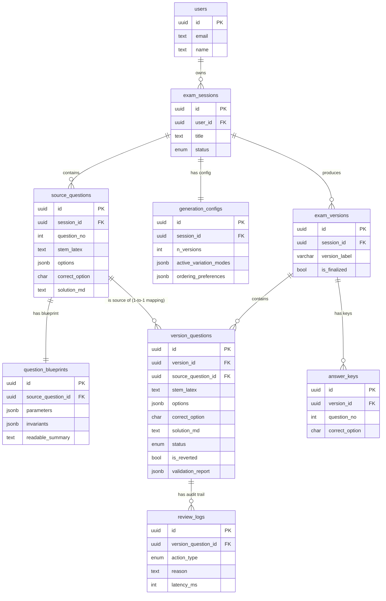
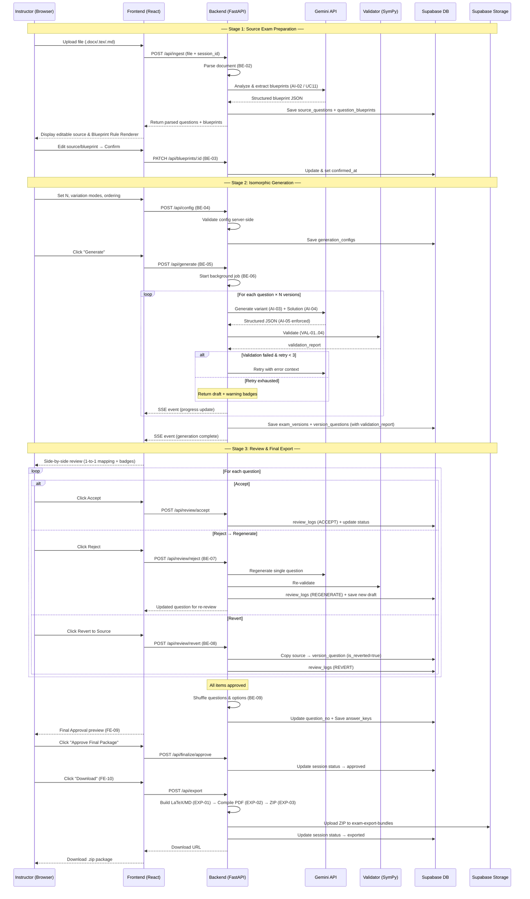

# Isomorphic Exam Synthesizer — Architecture & Component Breakdown

> **Tài liệu phân rã kiến trúc chi tiết (Architecture Breakdown) — Phiên bản hoàn chỉnh**
> Dựa trên tài liệu đặc tả MVP: [description.md](file:///c:/Users/ASUS%20Vivobook/Desktop/CT%20projects/description.md)
> **Tech Stack:** React + Vite + TypeScript (Frontend) · Python / FastAPI (Backend) · Supabase (Database / Auth / Storage) · Docker (Container) · Gemini API (AI Service) · Typst (PDF Compiler).

> [!IMPORTANT]
> **Ranh giới MVP vs Extension:** Tài liệu này chỉ mô tả các thành phần thuộc phạm vi MVP. Các tính năng mở rộng (PDF input, DOCX layout preservation, interactive difficulty adjustment, scoring rubrics, essay questions) được loại trừ rõ ràng theo description §2.1 và sẽ không xuất hiện trong kiến trúc này.

> [!NOTE]
> **Disclaimer về Validation:** Bộ kiểm tra tự động (VAL-01 đến VAL-03) chỉ đảm bảo tính đúng đắn về **cú pháp, logic phương án và miền xác định toán học**. Validator **KHÔNG** đảm bảo độ khó tương đương giữa các mã đề — đây là mục tiêu đánh giá thực nghiệm (empirical evaluation) thông qua phản hồi giảng viên và khảo sát thí sinh, theo description §2.3 và §8.

---

## 1. Sơ đồ tổng thể kiến trúc hệ thống (System Architecture)

```mermaid
flowchart TB
    subgraph ClientLayer ["1. FRONTEND LAYER (React + Vite + TypeScript)"]
        direction TB
        FE_Auth["1.1 Auth & Session Manager"]
        FE_Dash["1.2 Dashboard & Statistics"]
        FE_S1["1.3 Stage 1: Ingestion, Edit & Blueprint Confirmation"]
        FE_S2["1.4 Stage 2: Generation Configurator"]
        FE_S3["1.5 Stage 3: 1-to-1 Side-by-Side Review"]
        FE_Approve["1.6 Final Approval & Package Preview"]
        FE_Download["1.7 Export Download Center"]
        FE_Math["1.8 Math Render Engine (KaTeX)"]
        FE_Progress["1.9 Generation Progress Tracker (SSE)"]
    end

    subgraph APILayer ["2. BACKEND LAYER (Python / FastAPI — async)"]
        direction TB
        BE_Gateway["2.1 API Router & Auth Middleware"]
        BE_Parser["2.2 Document Parser Service"]
        BE_Blueprint["2.3 Blueprint Correction & Management"]
        BE_ConfigVal["2.4 Config Validator"]
        BE_Orchestrator["2.5 Generation Orchestrator (Auto-retry)"]
        BE_JobStream["2.6 Background Job & Progress Streamer (SSE)"]
        BE_Review["2.7 Targeted Regeneration Service"]
        BE_Revert["2.8 Fallback & Revert Handler"]
        BE_Sync["2.9 Shuffler & Key Synchronizer"]
        BE_Audit["2.10 Audit, Statistics & Observability Logger"]
    end

    subgraph AILayer ["3. AI SERVICE LAYER (Gemini API)"]
        direction TB
        AI_Client["3.1 Gemini Client Wrapper"]
        AI_Blueprint["3.2 Blueprint Extraction Pipeline"]
        AI_Generator["3.3 Isomorphic Variant Generator"]
        AI_Solver["3.4 Step-by-Step Solver"]
        AI_Schema["3.5 Structured Output Enforcer & Schema Repair"]
    end

    subgraph ValLayer ["4. VALIDATION ENGINE (SymPy & Rule Checker)"]
        direction TB
        VAL_Syntax["4.1 Syntax & Option Integrity"]
        VAL_Logic["4.2 Answer Logic & Duplicate Checker"]
        VAL_Math["4.3 SymPy Mathematical Evaluator"]
        VAL_Rule["4.4 Rule-Based Fallback Checker"]
    end

    subgraph ExportLayer ["5. EXPORT ENGINE"]
        direction TB
        EXP_Builder["5.1 LaTeX & Markdown Builder"]
        EXP_PDF["5.2 PDF Compiler (Typst)"]
        EXP_ZIP["5.3 ZIP Bundler"]
    end

    subgraph DataLayer ["6. DATABASE & STORAGE (Supabase)"]
        direction TB
        DB_Postgres[("PostgreSQL (RLS-protected)")]
        DB_Storage[("Supabase Storage")]
        DB_Auth["Google OAuth Provider"]
    end

    subgraph InfraLayer ["7. DEVOPS & CONTAINERIZATION (Docker)"]
        direction TB
        Docker_FE["Container: Frontend (Nginx + reverse proxy)"]
        Docker_BE["Container: Backend (FastAPI + Typst)"]
        Docker_Compose["Docker Compose Orchestration"]
    end

    %% Luồng tương tác chính
    ClientLayer <-->|"REST API + SSE (progress stream)"| APILayer
    APILayer <-->|"SDK / Structured Output (JSON Schema)"| AILayer
    APILayer <-->|"async DB queries + Storage Client"| DataLayer
    APILayer --> ValLayer
    APILayer --> ExportLayer
    ClientLayer <-->|"OAuth Redirect"| DB_Auth
    InfraLayer -.->|"Đóng gói"| ClientLayer
    InfraLayer -.->|"Đóng gói"| APILayer
```



---

## 2. Phân rã chi tiết từng thành phần (Detailed Breakdown)

### 2.1. Frontend Layer (React + Vite + TypeScript)

| Mã | Tên Module | Mô tả & Trách nhiệm | Ánh xạ UC |
| :--- | :--- | :--- | :--- |
| **FE-01** | **Auth & User State** | Đăng nhập Google OAuth qua Supabase Auth, lưu trữ/refresh JWT, điều hướng Protected Routes, hiển thị thông tin user. | UC01, UC02 |
| **FE-02** | **Dashboard & History** | Danh sách đề thi đã lưu: ngày tạo, trạng thái (Draft → Reviewed → Exported). Cho phép xem lại, tải về hoặc **tái sử dụng phiên** (reuse session — bắt đầu phiên mới từ source đã xác nhận). | UC03 |
| **FE-03** | **Analytics & Metrics View** | Thống kê: tổng số mã đề đã tạo, tỷ lệ duyệt lần đầu (*first-pass acceptance rate*), tần suất sinh lại câu (*regeneration frequency*). **Không** hiển thị "comparative time savings" (loại khỏi MVP theo description §4 UC04). | UC04 |
| **FE-04** | **Stage 1: Document Ingestor** | Kéo thả upload file (`.docx`, `.tex`, `.md`) hoặc nhập text trực tiếp. **Chặn nhận file PDF** (MVP chỉ export PDF, không input PDF — description §2.1). Giới hạn MIME types cho phép và kích thước file tối đa. | UC05 |
| **FE-05** | **Stage 1: Source Editor & Blueprint Confirmer** | Hiển thị câu hỏi đã bóc tách kèm Blueprint (biến số, khoảng giá trị, điều kiện bất biến). Cho phép giảng viên **chỉnh sửa nội dung nguồn và blueprint** trước khi bấm "Confirm" (description §4 UC05–UC06: "produce an editable structured source" và "instructor correction and confirmation"). Bao gồm **Blueprint Rule Renderer** hiển thị quy tắc biến thể dạng ngôn ngữ tự nhiên / toán học thân thiện (description §2.2: "readable rule summary"). | UC05, UC06 |
| **FE-06** | **Stage 2: Configurator** | Form cấu hình: chọn số lượng mã đề ($N \in [1, 4]$), bật/tắt chế độ biến thể (variation modes) từ Blueprint đã xác nhận, thiết lập ordering preferences. Validation phía client + server-side (BE-04). | UC07 |
| **FE-07** | **Stage 3: Side-by-Side Reviewer** | Giao diện cốt lõi: so sánh song song **ánh xạ 1-1** (1-to-1 question mapping) giữa câu gốc và câu biến thể. Hiển thị **warning badges** từ `validation_report` cho các câu bị lỗi syntax/duplicate/domain. **KHÔNG** cho phép chỉnh sửa text thủ công trên câu sinh (description §6.2: "disallowing manual text edits to preserve blueprint validity"). | UC09 |
| **FE-08** | **Stage 3: Review Action Bar** | Cung cấp thao tác nhị phân nghiêm ngặt cho từng câu: **Accept** (chấp nhận) hoặc **Reject** (từ chối → kích hoạt targeted regeneration). Nút khẩn cấp **Revert to Source** để quay về câu gốc đã xác thực khi AI sinh lại liên tục thất bại. **Tuyệt đối không** có ô nhập text thủ công. | UC09 |
| **FE-09** | **Final Approval & Package Preview** | Sau khi 100% câu được Accept: hiển thị bản xem trước toàn bộ các mã đề sau khi xáo trộn (shuffled), bảng ma trận đáp án, lời giải chi tiết. Giảng viên bấm **"Approve Final Package"** để khóa nội dung và cho phép xuất bản. Đây là bước tách biệt khỏi Download (description §5 Stage 3: Final Approval → Export). | UC09, UC10 |
| **FE-10** | **Export Download Center** | Sau khi Final Approval: nút tải về gói PDF đề thi, PDF đáp án, LaTeX/Markdown sạch (.zip). Chỉ khả dụng sau khi FE-09 hoàn tất phê duyệt. | UC10 |
| **FE-11** | **Math Renderer Component** | Component dùng chung sử dụng `KaTeX` (hoặc `react-katex`) kết hợp `react-markdown` để render mượt mà mọi công thức Toán học trên toàn bộ giao diện. | Tất cả |
| **FE-12** | **Generation Progress Tracker** | Component theo dõi tiến trình sinh đề qua kênh **SSE** (Server-Sent Events): hiển thị thanh tiến trình (progress bar), trạng thái từng câu đang sinh/đang validate/hoàn tất, và thông báo lỗi retry real-time. | UC08 |

---

### 2.2. Backend Core Layer (Python / FastAPI — async)

| Mã | Tên Module | Mô tả & Trách nhiệm | Ánh xạ UC |
| :--- | :--- | :--- | :--- |
| **BE-01** | **API Router & Auth Middleware** | Điểm tiếp nhận request, kiểm tra JWT token (Supabase), xử lý CORS, phân quyền user. Tất cả endpoints sử dụng **async** (`async def`). | Tất cả |
| **BE-02** | **Document Parsing Service** | Bóc tách câu hỏi, 4 phương án A/B/C/D, đáp án, và lời giải gốc (nếu có) từ file tải lên. Sử dụng `python-docx` (DOCX), regex/AST (LaTeX), parser (Markdown). **Chặn** file PDF ở tầng server (validate MIME + extension). Giới hạn kích thước file. | UC05 |
| **BE-03** | **Blueprint Correction & Management Service** | Quản lý vòng đời Blueprint: nhận bản trích xuất từ AI-02, cung cấp **PATCH API** cho giảng viên chỉnh sửa source và blueprint trước khi xác nhận, lưu bản đã duyệt dạng JSONB. | UC06 |
| **BE-04** | **Config Validator** | Kiểm tra tính hợp lệ **server-side** cho cấu hình sinh đề: $N \in [1, 4]$, variation modes phải thuộc tập cho phép từ Blueprint đã xác nhận, ordering preferences hợp lệ. Trả thông báo xung đột rõ ràng nếu cấu hình vi phạm ràng buộc (description §5 Stage 2: "Explain conflict"). | UC07 |
| **BE-05** | **Generation Orchestrator** | Điều phối luồng sinh $N \le 4$ mã đề: gửi prompt đến AI (AI-03, AI-04) → nhận kết quả → chuyển sang Validator (VAL-01..04) → kích hoạt Auto-retry nếu lỗi (tối đa 3 lần). **Sau 3 lần retry thất bại: vẫn trả draft kèm `validation_report` chứa warning badges** để giảng viên xem xét — KHÔNG chặn pipeline (description §4 UC08: "return drafts with validation warning badges"). | UC08 |
| **BE-06** | **Background Job & Progress Streamer** | Sinh đề cho $N$ mã đề × nhiều câu hỏi có thể mất hàng chục giây đến vài phút. Module này quản lý **background task** (FastAPI `BackgroundTasks` hoặc task queue) và **stream tiến trình real-time** qua **Server-Sent Events (SSE)** endpoint: trạng thái từng câu (generating → validating → done / retrying), phần trăm hoàn thành, thông báo lỗi. | UC08 |
| **BE-07** | **Targeted Regeneration Service** | Tiếp nhận sự kiện Reject một câu cụ thể từ FE-08: gọi AI sinh lại **duy nhất câu đó** (giữ nguyên toàn bộ các câu còn lại), chạy validate → lưu `validation_report` mới → trả kết quả về màn hình Review để giảng viên re-review bắt buộc. | UC09 |
| **BE-08** | **Fallback & Revert Handler** | Khi AI sinh lại liên tục thất bại cho một câu cụ thể: cho phép phục hồi (revert) câu biến thể về lại **nguyên bản câu hỏi gốc đã xác thực** (truy xuất qua FK `source_question_id`). Cập nhật trạng thái câu thành `approved` (với flag `is_reverted = true`). | UC09 |
| **BE-09** | **Shuffler & Key Synchronizer** | Chỉ chạy **sau khi 100% câu hỏi được Approve** (description §4, §5): thực hiện hoán vị ngẫu nhiên thứ tự câu và thứ tự các lựa chọn A/B/C/D cho từng mã đề; tự động đồng bộ lại bảng ma trận đáp án (`answer_keys`) và ánh xạ lời giải khớp chính xác với từng mã đề mới. | UC09 |
| **BE-10** | **Audit, Statistics & Observability Logger** | Ghi nhật ký tương tác chi tiết với enum `action_type` (`ACCEPT`, `REJECT`, `REGENERATE`, `REVERT`). Tổng hợp dữ liệu thống kê cho UC04: first-pass acceptance rate, regeneration frequency. Đo **latency** (thời gian phản hồi AI, thời gian validate), **failure rate** (tỷ lệ retry/revert), **recovery** (description §8: stability metrics). | UC04 |

---

### 2.3. AI Service Layer (Gemini API Integration)

| Mã | Tên Module | Mô tả & Trách nhiệm | Ánh xạ UC |
| :--- | :--- | :--- | :--- |
| **AI-01** | **Gemini Client Wrapper** | Quản lý kết nối SDK (`google-genai`), xử lý API Key, thiết lập timeout. Cơ chế **exponential backoff** khi bị rate limit. **Chiến lược batch/concurrent** cho pipeline $N \le 4$ mã đề × nhiều câu: dùng `asyncio.gather` với semaphore để kiểm soát số lượng request song song, tránh vượt rate limit. Hỗ trợ Prompt Caching nếu API cho phép (giảm token chi phí cho phần Blueprint lặp lại). | Tất cả |
| **AI-02** | **Blueprint Extraction Pipeline** | Prompt chuyên biệt phân tích câu hỏi gốc: trích xuất hằng số, biến số, khoảng giá trị tham số, điều kiện bất biến. Là **include** của UC05 (UC05 → UC11). Có cơ chế **retry/fallback** nếu AI trích xuất sai: gửi lại prompt với phản hồi lỗi; nếu thất bại, trả kết quả rỗng để giảng viên nhập tay. | UC11 |
| **AI-03** | **Isomorphic Variant Generator** | Prompt sinh câu hỏi biến thể dựa trên Blueprint đã xác nhận: đảm bảo cùng phương pháp giải, thay đổi dữ liệu theo quy tắc cho phép, tạo 3 phương án nhiễu (distractors) hợp lý. | UC12 |
| **AI-04** | **Step-by-Step Solver** | Prompt giải chi tiết từng bước cho từng câu biến thể: phục vụ giảng viên chấm thi, kiểm tra đối chiếu, và xuất bản kèm gói lời giải. | UC12 |
| **AI-05** | **Structured Output Enforcer & Schema Repair** | Ràng buộc phản hồi Gemini theo **JSON Schema** chuẩn (Pydantic models). Khi Gemini trả JSON sai schema lần đầu: thực hiện **schema repair pass** — gửi lại prompt kèm thông báo lỗi schema cụ thể (trường thiếu, kiểu sai) để AI tự sửa, trước khi kích hoạt full retry ở tầng Orchestrator. | Tất cả |

---

### 2.4. Validation Engine (Python — SymPy & Rule Checker)

> [!WARNING]
> **Giới hạn của Validator:** SymPy (VAL-03) chỉ kiểm tra hiệu quả cho các bài toán **giải tích, đại số thuần túy** (phương trình, bất phương trình, đạo hàm, tích phân, giới hạn). Đối với các dạng khó phân tích hình thức (hình học phức tạp, xác suất, tổ hợp, chứng minh, word problems), hệ thống sẽ **fallback sang Rule-Based Checker** (VAL-04). Description §7.2 quy định rõ: "Complete one targeted mathematics question family end to end before expanding where validation is feasible."

| Mã | Tên Module | Mô tả & Trách nhiệm | Ánh xạ UC |
| :--- | :--- | :--- | :--- |
| **VAL-01** | **Syntax & Option Integrity** | Kiểm tra cú pháp: đúng 4 lựa chọn (A, B, C, D), không bị lỗi cú pháp LaTeX (thiếu ngoặc, thiếu ký tự `$`), nội dung câu hỏi không trống. | UC13 |
| **VAL-02** | **Answer Logic & Duplicate Checker** | Đảm bảo duy nhất 1 đáp án đúng; kiểm tra không có 2 lựa chọn nào trùng lặp nhau về mặt giá trị toán học (dùng SymPy simplify để so sánh biểu thức tương đương). | UC13 |
| **VAL-03** | **SymPy Mathematical Evaluator** | Dùng `SymPy` tính toán lại biểu thức: kiểm tra tập xác định (mẫu $\neq 0$, căn $\ge 0$, logarit $> 0$), giải và xác nhận nghiệm khớp đáp án, phát hiện vô nghiệm hoặc vô số nghiệm. **Chỉ áp dụng cho các dạng toán hỗ trợ phân tích hình thức.** | UC13 |
| **VAL-04** | **Rule-Based Fallback Checker** | Dành cho các dạng toán mà SymPy không giải được: kiểm tra dựa trên quy tắc tĩnh (static rules) — ví dụ: format đáp án hợp lệ, khoảng giá trị số liệu nằm trong bound cho phép của Blueprint, các phương án nhiễu đủ khác biệt. Đánh dấu `validation_confidence = "rule_only"` (thấp hơn `sympy_verified`). | UC13 |

**Output của Validation Engine:**
Mỗi câu hỏi được validate sẽ sinh ra một `validation_report` (JSONB) gồm:

```jsonc
{
  "status": "passed" | "warning" | "failed",
  "confidence": "sympy_verified" | "rule_only",
  "checks": [
    { "check": "syntax_valid",      "passed": true },
    { "check": "four_options",      "passed": true },
    { "check": "one_correct",       "passed": true },
    { "check": "no_duplicates",     "passed": true },
    { "check": "domain_valid",      "passed": false, "detail": "Denominator equals zero at x=2" },
    { "check": "answer_verified",   "passed": false, "detail": "Expected 5, got 7" }
  ]
}
```

---

### 2.5. Export Engine

| Mã | Tên Module | Mô tả & Trách nhiệm | Ánh xạ UC |
| :--- | :--- | :--- | :--- |
| **EXP-01** | **LaTeX & Markdown Builder** | Ghép dữ liệu đã phê duyệt vào template LaTeX chuẩn (header trường, mã đề, bảng ma trận đáp án, phân trang). Xuất song song Markdown sạch. Đảm bảo lời giải chi tiết được ghép vào file riêng (Solutions bundle). | UC10 |
| **EXP-02** | **PDF Compiler Engine (Typst)** | Sử dụng **Typst** (đã chốt, không dùng pdflatex) — binary nhẹ (~50 MB so với TeX Live ~3–5 GB), render toán học nhanh, hỗ trợ Unicode, được đóng gói sẵn trong Docker. Biên dịch ra file PDF đề thi, PDF đáp án, PDF lời giải cho từng mã đề. | UC10 |
| **EXP-03** | **ZIP Bundler** | Nén toàn bộ file đầu ra (PDF các mã đề, LaTeX source, Markdown, lời giải) thành 1 file `.zip`. Upload lên Supabase Storage bucket `exam-export-bundles` để phục vụ tải về. | UC10 |

---

### 2.6. Database & Storage Layer (Supabase / PostgreSQL)

#### 2.6.1. Bảng dữ liệu (Tables)

| Bảng | Trách nhiệm | Các cột / quan hệ chính |
| :--- | :--- | :--- |
| **`users`** | Định danh giảng viên từ Google OAuth. | `id` (UUID PK), `email`, `name`, `avatar_url`, `created_at` |
| **`exam_sessions`** | Phiên làm việc chính. | `id` (UUID PK), `user_id` (FK → users), `title`, `subject`, `status` (ENUM: `draft`, `blueprinted`, `configured`, `generated`, `reviewed`, `approved`, `exported`), `created_at`, `updated_at` |
| **`source_questions`** | Câu hỏi gốc bóc tách từ đề ban đầu. | `id` (UUID PK), `session_id` (FK), `question_no` (INT), `stem_latex` (TEXT), `options` (JSONB — mảng 4 phương án), `correct_option` (CHAR: A/B/C/D), `solution_md` (TEXT, nullable — lời giải gốc nếu có, description §2.1: "optional source solutions"), `raw_source` (TEXT) |
| **`question_blueprints`** | Cấu trúc Blueprint dạng JSONB. | `id` (UUID PK), `source_question_id` (FK → source_questions, **1-to-1**), `parameters` (JSONB — danh sách biến, khoảng giá trị), `invariants` (JSONB — điều kiện bất biến), `variation_modes` (JSONB — các chế độ biến đổi cho phép), `readable_summary` (TEXT — mô tả thân thiện), `confirmed_at` (TIMESTAMP, nullable) |
| **`generation_configs`** | Cấu hình sinh đề cho phiên (description §4 UC07). | `id` (UUID PK), `session_id` (FK → exam_sessions, **1-to-1**), `n_versions` (INT, 1–4), `active_variation_modes` (JSONB — chế độ biến thể đang bật), `ordering_preferences` (JSONB), `created_at` |
| **`exam_versions`** | Thông tin $N$ mã đề đã sinh. | `id` (UUID PK), `session_id` (FK), `version_label` (VARCHAR — "101", "102", ...), `shuffle_seed` (INT, nullable — ghi lại seed hoán vị), `is_finalized` (BOOL) |
| **`version_questions`** | Chi tiết từng câu của từng mã đề. **Bảng trung tâm của hệ thống.** | `id` (UUID PK), `version_id` (FK → exam_versions), **`source_question_id`** (FK → source_questions — **ánh xạ 1-to-1 bắt buộc**, phục vụ side-by-side và Revert), `question_no` (INT — thứ tự sau shuffle), `original_no` (INT — thứ tự trước shuffle), `stem_latex` (TEXT), `options` (JSONB), `correct_option` (CHAR), **`solution_md`** (TEXT — lời giải chi tiết), **`solution_latex`** (TEXT, nullable), `status` (ENUM: `pending`, `approved`, `rejected`), `is_reverted` (BOOL DEFAULT false — đánh dấu câu đã revert về gốc), **`validation_report`** (JSONB — kết quả kiểm tra tự động, phục vụ warning badges), `retry_count` (INT DEFAULT 0) |
| **`answer_keys`** | Ma trận đáp án chính thức sau shuffle. | `id` (UUID PK), `version_id` (FK → exam_versions), `question_no` (INT — thứ tự sau shuffle), `correct_option` (CHAR: A/B/C/D) |
| **`review_logs`** | Nhật ký hành động duyệt chi tiết. | `id` (UUID PK), `version_question_id` (FK → version_questions), `user_id` (FK → users), **`action_type`** (ENUM: `ACCEPT`, `REJECT`, `REGENERATE`, `REVERT` — cần thiết để tính first-pass acceptance rate), `reason` (TEXT, nullable), `regenerated_from_id` (FK → version_questions, nullable — liên kết câu cũ bị thay thế), `latency_ms` (INT, nullable — đo thời gian phản hồi), `created_at` |

#### 2.6.2. Storage Buckets

| Bucket | Trách nhiệm | Chính sách |
| :--- | :--- | :--- |
| **`exam-raw-files`** | File gốc tải lên (`.docx`, `.tex`, `.md`). | RLS: chỉ user sở hữu session mới truy cập. **Chặn MIME PDF.** |
| **`exam-export-bundles`** | Gói PDF/ZIP thành phẩm sẵn sàng tải về. | RLS: chỉ user sở hữu session mới truy cập. **Retention policy:** tự động xóa sau 90 ngày không truy cập (cấu hình lifecycle rule). |

#### 2.6.3. Bảo mật — Row Level Security (RLS)

> [!CAUTION]
> Hệ thống đa người dùng (multi-user) — bắt buộc bật RLS trên **mọi bảng** để đảm bảo giảng viên A không thể đọc/ghi dữ liệu của giảng viên B, kể cả khi Frontend gọi Supabase trực tiếp.

Chính sách RLS áp dụng:

```sql
-- Ví dụ RLS cho bảng exam_sessions
ALTER TABLE exam_sessions ENABLE ROW LEVEL SECURITY;

CREATE POLICY "Users can only access their own sessions"
  ON exam_sessions
  FOR ALL
  USING (user_id = auth.uid());

-- Các bảng con (source_questions, version_questions, ...) RLS theo session_id → user_id
-- thông qua JOIN hoặc security definer functions.
```

#### 2.6.4. Sơ đồ quan hệ dữ liệu (ER Diagram)



---

### 2.7. Infrastructure & Deployment (Docker)

| File cấu hình | Trách nhiệm |
| :--- | :--- |
| **`frontend/Dockerfile`** | Multi-stage build: Stage 1 — Node.js build ứng dụng React Vite; Stage 2 — Nginx siêu nhẹ phục vụ static files + cấu hình **reverse proxy** `/api/*` → Backend container (tránh CORS phức tạp). |
| **`backend/Dockerfile`** | Môi trường Python 3.11+ (async-ready), cài đặt `sympy`, `numpy`, `python-docx`, `google-genai`, và binary **Typst** (~50 MB). **Không** cài TeX Live (quá nặng). |
| **`docker-compose.yml`** | Khởi chạy đồng bộ `frontend` và `backend`, thiết lập bridge network nội bộ, ánh xạ port, nạp `.env` (Gemini API Key, Supabase URL, Supabase Service Role Key, Supabase Anon Key). Bao gồm **health check** cho Backend (`/health` endpoint). |
| **`.env.example`** | Template biến môi trường: `GEMINI_API_KEY`, `SUPABASE_URL`, `SUPABASE_SERVICE_ROLE_KEY`, `SUPABASE_ANON_KEY`, `CORS_ORIGINS`, `MAX_UPLOAD_SIZE_MB`. **KHÔNG** commit file `.env` thật (nằm trong `.gitignore`). |

---

## 3. Cấu trúc thư mục dự án (Directory Structure)

```text
isomorphic-exam-synthesizer/
├── docker-compose.yml
├── .env.example
├── .gitignore
├── description.md
├── architecture.md
│
├── frontend/                              # REACT + VITE + TYPESCRIPT
│   ├── Dockerfile
│   ├── nginx.conf                         # Reverse proxy /api → backend
│   ├── package.json
│   ├── tsconfig.json
│   ├── src/
│   │   ├── components/                    # UI chung: Layout, KaTeX Renderer, ProgressBar
│   │   │   ├── MathRenderer.tsx           # FE-11: KaTeX + react-markdown
│   │   │   ├── ProgressTracker.tsx        # FE-12: SSE progress bar
│   │   │   └── WarningBadge.tsx           # Render validation_report badges
│   │   ├── features/
│   │   │   ├── auth/                      # FE-01: Google OAuth login
│   │   │   ├── dashboard/                 # FE-02, FE-03: History + Analytics
│   │   │   ├── stage1-ingestion/          # FE-04, FE-05: Upload, Edit & Blueprint Confirm
│   │   │   ├── stage2-config/             # FE-06: Generation configurator
│   │   │   ├── stage3-review/             # FE-07, FE-08: Side-by-side + Action bar
│   │   │   ├── approval/                  # FE-09: Final Approval & Preview
│   │   │   └── export/                    # FE-10: Download center
│   │   ├── hooks/                         # Custom hooks (useSSE, useAuth, useExamSession)
│   │   ├── services/                      # API client (axios/fetch) + Supabase client
│   │   └── types/                         # TypeScript interfaces (Exam, Blueprint, ...)
│
└── backend/                               # PYTHON / FASTAPI
    ├── Dockerfile
    ├── requirements.txt
    ├── app/
    │   ├── main.py                        # Entry point FastAPI + CORS + lifespan
    │   ├── api/
    │   │   ├── auth.py                    # BE-01: JWT validation routes
    │   │   ├── sessions.py                # CRUD exam sessions
    │   │   ├── ingest.py                  # BE-02: Upload & parse
    │   │   ├── blueprints.py              # BE-03: PATCH/confirm blueprints
    │   │   ├── config.py                  # BE-04: Validate & save generation config
    │   │   ├── generate.py                # BE-05, BE-06: Orchestrate + SSE stream
    │   │   ├── review.py                  # BE-07, BE-08: Accept/Reject/Revert
    │   │   ├── finalize.py                # BE-09: Shuffle + sync keys
    │   │   └── export.py                  # EXP-01..03: Build + compile + zip
    │   ├── core/
    │   │   ├── config.py                  # Env vars, settings (Pydantic BaseSettings)
    │   │   ├── security.py                # JWT decode, Supabase token verification
    │   │   ├── database.py                # Async connection pool (asyncpg / supabase-py)
    │   │   └── observability.py           # BE-10: Structured logging, latency tracking
    │   ├── models/
    │   │   ├── schemas.py                 # Pydantic request/response models
    │   │   └── db_models.py               # SQLAlchemy / raw SQL table definitions
    │   └── services/
    │       ├── parser/                    # BE-02: DOCX, LaTeX, MD parsers
    │       ├── ai/
    │       │   ├── client.py              # AI-01: Gemini SDK wrapper + backoff + batch
    │       │   ├── prompts/               # AI-02..04: Prompt templates (Jinja2 / f-string)
    │       │   └── schema_repair.py       # AI-05: Schema validation + repair pass
    │       ├── validator/
    │       │   ├── syntax_checker.py      # VAL-01
    │       │   ├── logic_checker.py       # VAL-02
    │       │   ├── sympy_evaluator.py     # VAL-03
    │       │   └── rule_checker.py        # VAL-04: Fallback for non-SymPy types
    │       ├── synchronizer/              # BE-09: Shuffle + key sync
    │       └── exporter/
    │           ├── latex_builder.py        # EXP-01
    │           ├── typst_compiler.py       # EXP-02: Typst binary invocation
    │           └── zip_bundler.py          # EXP-03
```

---

## 4. Luồng dữ liệu end-to-end (Data Flow Summary)


