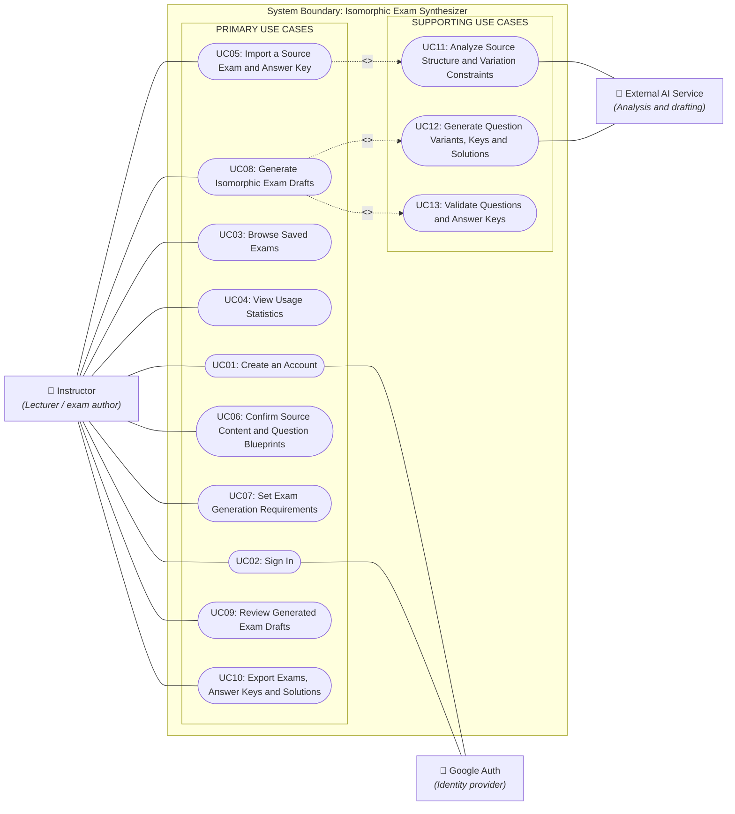
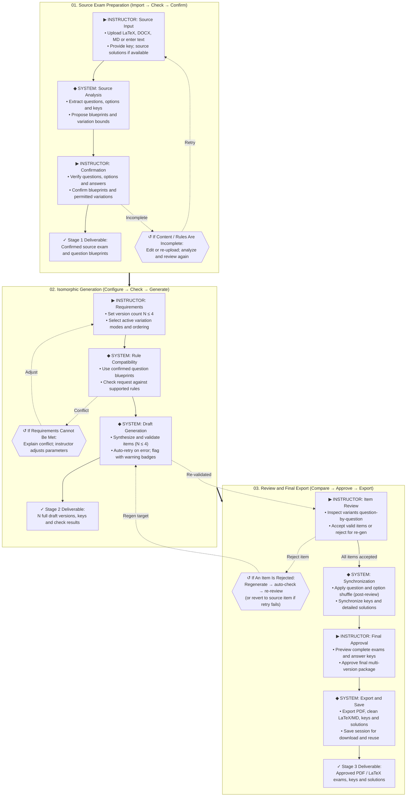

# Isomorphic Exam Synthesizer
## An AI Assistant for Instructor-Reviewed Multi-Version Mathematics Exams
**Week 2 Project Proposal: Topic, Actors, Core Functions, Platform and Workflow**

---

## Abstract

- The project develops a web-based AI assistant that helps instructors create multiple exam versions ($N \le 4$) from an existing multiple-choice mathematics exam. It supports controlled variation via question blueprints, automated validation with self-retries, question-level review with targeted regeneration in a closed feedback loop, answer-key synchronization, and multi-format export (PDF, clean LaTeX, and Markdown).
- The goal is to preserve the intended solving structure and achieve comparable difficulty. These objectives require empirical evaluation; identical difficulty is not guaranteed.

---

## 1. Topic, Primary User and Problem

### 1.1 Topic and Target User
- **Domain:** Mathematics Education.
- **Topic:** Isomorphic multiple-choice mathematics exam generation from a sample exam.

### 1.2 Current Workflow and Specific Problem
- Instructors manually change question data, solve each variant, revise answer options, check keys, and assemble exam versions. Repeating these tasks takes time and can introduce inconsistent answers or unintended difficulty changes.

### 1.3 AI/IT Assistance and Practical Output
- AI assists with question analysis, variation rules, and drafting questions and solutions. Software manages versions, checks supported constraints, synchronizes keys, and exports files. Instructors retain review and approval authority.
- **Value chain:** Import source $\to$ generate and check $\to$ instructor review $\to$ download approved exams, keys, and solutions for assessment use and manual grading. Users interact through forms and review screens.

---

## 2. Scope and Conceptual Foundation

### 2.1 Minimum Scope
- Support **multiple-choice questions with one correct option** for Mathematics.
- **Input:** Source exam and answer key as text-based DOCX, LaTeX, Markdown, or direct entry; optional source solutions. Ingestion of raw PDF is excluded from the MVP (PDF is an export-only format); DOCX input is limited to text extraction.
- **Output:** PDF and clean LaTeX/Markdown bundles for $N \le 4$ versions, synchronized answer keys, and detailed step-by-step solutions. Scoring allocation and native DOCX layout preservation are excluded.
- Scanned-document recognition, PDF input parsing, native DOCX layout preservation, interactive difficulty adjustment, scoring rubrics, and essay questions are extensions.

### 2.2 Meaning of Isomorphic Generation
- Isomorphic variants retain the learning objective and intended solving method while changing permitted data. A **blueprint** defined in Stage 1 formalizes fixed elements, permitted variations (parameter bounds and required conditions), and invariants; instructors confirm a readable rule summary before generation [[1]](#references). Generation configuration in Stage 2 selects version count $N \in [1, 4]$, ordering preferences, and toggles active variation modes from the confirmed blueprint.

### 2.3 Difficulty and Answer Consistency
- A shared solving method does not prove equal difficulty. Values, wording, prerequisites, and distractors also matter. Achieving comparable difficulty is an evaluation objective assessed through instructor review and learner pilots where feasible, distinct from interactive difficulty adjustment which is an extension.
- Automated checks verify correct keys, absence of duplicate options, exactly one correct option, and valid mathematical domains. For grading and review assistance, the system provides correct keys and detailed step-by-step solutions; item scoring and grade weighting are outside the MVP scope.

---

## 3. Actors and Use Case Model

### 3.1 Actor Roles and System Boundary
- **Instructor:** Imports, confirms blueprints, configures parameters ($N \le 4$), reviews (approves or rejects item-by-item), and exports exams.
- **Google Auth:** Supports account creation and sign-in.
- **External AI Service:** Acts as a supporting actor assisting with source analysis, variant drafting, and solution generation.
- The database and internal validators are application components, not external actors. The Use Case Diagram (Figure 1) shows participation in functions, not execution order.

### 3.2 Use Case Preconditions and Relationships
- Exam management requires sign-in; generation requires confirmed blueprints and valid configuration ($N \le 4$); export requires full instructor approval. These are function preconditions.
- **Include relationships:**
  - Import includes structural analysis (`UC05` $\to$ `UC11`).
  - Generation includes question/solution generation (`UC08` $\to$ `UC12`) and automated validation (`UC08` $\to$ `UC13`).
- **Instructor Review Loop:** Instructors review drafts question-by-question, accepting valid items or rejecting flawed items to trigger targeted re-generation. Re-generated items undergo automated validation and return to the review screen for mandatory re-evaluation; if repeated re-generation fails, instructors can revert the target item to the verified source question as a safe exit. Only when all items are approved can the instructor proceed to synchronization and final export.

### Use Case Diagram (Figure 1)

> **Figure 1: Use Case Diagram.** Solid lines show actor participation, not process order. Google Auth and External AI Service are supporting external actors.  
> - **INCLUDE:** Required behavior  
> - **ACTOR:** A role external to the system  
> - **Preconditions:** Sign-in for exam management; confirmed blueprints plus valid configuration ($N \le 4$) for generation; full approval for export.  
> - **Review decision:** Instructors inspect generated variants question-by-question with binary accept/reject choices. Rejected items trigger targeted re-generation and automated checking, returning to the review interface; persistent failures can safely revert to the original source question until all items are accepted.

---

## 4. Core Functions and Minimum Design

- **UC01–02 — Accounts:** Receive Google authentication, verify identity, and create or retrieve the account; open the instructor's signed-in workspace.
- **UC03 — Saved Exams:** Retrieve the selected session's source, rules, versions, and approval state; allow viewing, downloading, or reuse.
- **UC04 — Statistics:** Aggregate recorded sessions; show version counts, first-pass acceptance rates (percentage of items approved on initial review without requiring re-generation), and regeneration frequencies. Comparative time savings are reserved for empirical evaluation.
- **UC05 — Import:** Receive source exam and answer key; extract questions, options, formulas, and answers, flagging missing or malformed elements; produce an editable structured source.
- **UC06 — Blueprint Confirmation:** Present extracted content and proposed question blueprints for instructor correction and confirmation; save the approved source and permitted variations (parameter bounds and invariant conditions).
- **UC07 — Configuration:** Receive version count $N \in [1, 4]$, toggle active variation modes from the confirmed blueprint, and set ordering preferences; validate input constraints and save generation requirements.
- **UC08 — Generation:** Use confirmed blueprints and settings to synthesize variants, keys, and detailed solutions with automated constraint checks. Apply automated retries upon syntax or mathematical failures; if repeated retries fail, return drafts with validation warning badges for instructor review.
- **UC09 — Review and Finalization:** Spanning the entirety of Stage 3, this function presents drafts and automated check results for question-by-question comparison against source items (preserving 1-to-1 question mapping). Instructors perform per-item binary approval or rejection for targeted re-generation; re-generated items are re-validated and re-reviewed. If automated re-generation repeatedly fails, instructors can revert the target item to the verified source question as a safe exit. After all items are accepted, the system executes question/option shuffling, synchronizes keys, provides package preview, and records final instructor approval.
- **UC10 — Export:** Package approved exams into PDF and clean LaTeX/Markdown bundles, and save the session; provide exams, synchronized keys, and detailed solutions for assessment use and manual grading (automated student grading is excluded).
- **UC11–13 — Supporting Behavior:** Analyze structure and constraints, synthesize question variants, keys, and step-by-step solutions, and validate items against mathematical and syntactic constraints. Advanced features like preserved DOCX layout or interactive difficulty adjustment are extensions.

---

## 5. Proposed User Workflow and Pipeline

The end-to-end workflow comprises three core stages: **Source Exam Preparation**, **Isomorphic Generation**, and **Review and Final Export** (Figure 2). Instructors maintain granular control through question-by-question inspection with binary accept/reject decisions, allowing individual flawed variants to be selectively regenerated without discarding the entire draft. A closed review loop guarantees that every regenerated item is re-validated and re-reviewed before final export. Shuffling is applied only after all items are approved.

### Workflow and Pipeline Diagram (Figure 2)

> **Figure 2: The three-stage user/function pipeline.** Blue cards (`▶`) show instructor actions; purple and teal cards (`◆`) show system functions. Orange dashed paths (`↺`) are conditional exceptions. Stage-header arrows show the left-to-right stage order. Rejected items trigger targeted regeneration and automated validation before returning to Item Review (with a safe fallback to revert to source items); shuffling occurs only after all items are approved. Stage 3 corresponds directly to UC09.

---

## 6. Platform and Interaction Design

### 6.1 Why a Web Application
- Web supports uploads, large-screen comparison, previews, and downloads. Instructors access saved exams across computers without installation. The initial scope does not require large-scale concurrency or real-time responses.

### 6.2 Main Screens and User Control
- Provide sign-in, dashboard, import/confirmation, configuration, review/comparison, and preview/export screens.
- The review screen presents side-by-side comparison with binary Accept/Reject actions per item (disallowing manual text edits to preserve blueprint validity), automated warning badges for failed checks, targeted regeneration, and a safe fallback option to revert persistent failures to the verified source question.

### 6.3 Storage and AI Integration
- Store account references, sessions, sources, rules, configurations, versions, keys, approval decisions, and interaction history. History includes instructor requests, AI outputs, and approval/rejection decisions; the chosen authentication mechanism manages sign-in sessions.
- Use an affordable, accessible external AI API. Finalize specific technologies and processing choices during implementation.

---

## 7. Data, Feasibility and Development Priorities

### 7.1 Data Availability and Permission
- Use lecturer-provided exams with permission, openly licensed questions, or group-authored items; record origins and permissions. Interviews will be conducted with instructors to examine the evaluation process and results.

### 7.2 Scope Control and Risk Handling
- Complete one targeted mathematics question family end to end before expanding where validation is feasible.
- Prioritize generation–review–export and persistent history, with clear error handling. Assign primary and backup members for frontend, backend/database, AI integration, and validation.

---

## 8. Expected Outcomes and Evaluation Plan

- **Validity:** Measure correct-key rates, exactly one correct option, and duplicate choices; record sample size and checking methods, supplemented by instructor review.
- **Structure and difficulty:** Instructors assess objectives, solving methods, calculation burden, and distractor plausibility; compare learner performance and completion time across variants if a pilot is feasible.
- **Efficiency:** Measure time savings by comparing manual and AI-assisted preparation for equivalent tasks, accounting for review time and regeneration overhead; record accepted output counts.
- **Stability:** Test the complete workflow, incomplete input, extraction/API failures, and rejection handling; measure latency, failure rates, and recovery.
- **Usefulness:** Collect instructor feedback on usability, review effort, and practical assessment use. No results are claimed before testing.

---

## 9. Week 2 Deliverables and Next Steps

- **Week 2:** Confirm topic, users, problem, scope, functions, actors, Use Case Diagram, platform, and pipeline; document data sources, feasibility, and evaluation plans.

---

## References

1. **[cbit]** Kim, J.-H., Nam, J., Jo, G.: *Computational Blueprints: Generating Isomorphic Mathematics Problems with Large Language Models*. In: Proceedings of the 2025 Conference on Empirical Methods in Natural Language Processing: Industry Track, pp. 1389–1401. Association for Computational Linguistics (2025). https://doi.org/10.18653/v1/2025.emnlp-industry.97
