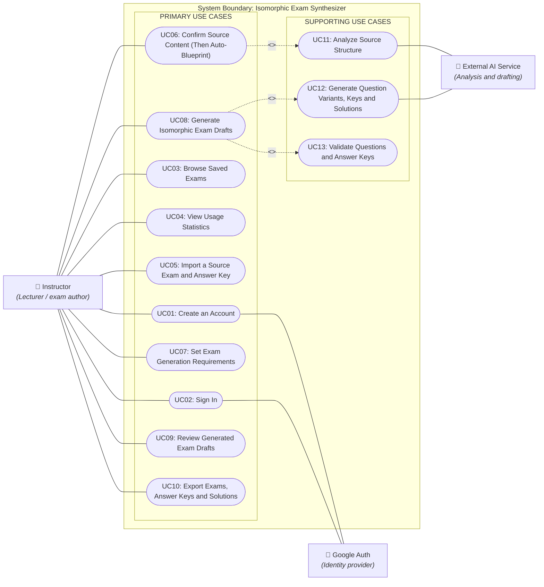
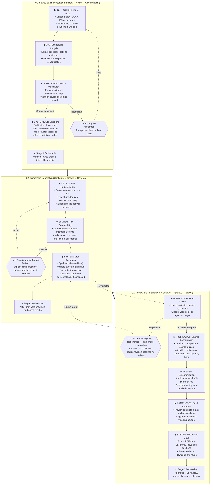

# Isomorphic Exam Synthesizer
## An AI Assistant for Instructor-Reviewed Multi-Version Mathematics Exams
**Week 2 Project Proposal: Topic, Actors, Core Functions, Platform and Workflow**

---

## Abstract

- The project develops a web-based AI assistant that helps instructors create multiple exam versions ($N \le 4$) from an existing multiple-choice mathematics exam. It supports controlled variation via question blueprints, automated validation with self-retries, question-level review with targeted regeneration in a closed feedback loop, answer-key synchronization, and multi-format export (PDF, clean LaTeX, and Markdown).
- The goal is to preserve the intended solving structure and achieve comparable difficulty. These objectives require empirical evaluation; identical difficulty is not guaranteed.

---

## 1. Topic, Primary User and Problem

### 1.1 Topic and Target User
- **Domain:** Mathematics Education.
- **Topic:** Isomorphic multiple-choice mathematics exam generation from a sample exam.

### 1.2 Current Workflow and Specific Problem
- Instructors manually change question data, solve each variant, revise answer options, check keys, and assemble exam versions. Repeating these tasks takes time and can introduce inconsistent answers or unintended difficulty changes.

### 1.3 AI/IT Assistance and Practical Output
- AI assists with question analysis, variation rules, and drafting questions and solutions. Software manages versions, checks supported constraints, synchronizes keys, and exports files. Instructors retain review and approval authority.
- **Value chain:** Import source $\to$ generate and check $\to$ instructor review $\to$ download approved exams, keys, and solutions for assessment use and manual grading. Users interact through preview, configuration, and review screens.

---

## 2. Scope and Conceptual Foundation

### 2.1 Minimum Scope
- Support **multiple-choice questions with one correct option** for Mathematics.
- **Input:** Source exam and answer key as text-based DOCX, LaTeX, Markdown, or direct entry; optional source solutions. Ingestion of raw PDF is excluded from the MVP (PDF is an export-only format); DOCX input is limited to text extraction.
- **Output:** PDF and clean LaTeX/Markdown bundles for $N \le 4$ versions, synchronized answer keys, and detailed step-by-step solutions. Scoring allocation and native DOCX layout preservation are excluded.
- Scanned-document recognition, PDF input parsing, native DOCX layout preservation, interactive difficulty adjustment, scoring rubrics, and essay questions are extensions.

### 2.2 Meaning of Isomorphic Generation
- Isomorphic variants retain the learning objective and intended solving method while changing permitted data. After instructors confirm the extracted source exam in Stage 1, the system automatically creates an internal **blueprint** that formalizes fixed elements, permitted variations (parameter bounds and required conditions), and invariants [[1]](#references). The blueprint is a backend-controlled black box: instructors do not view, confirm, edit, or select its variation modes. In Stage 2, instructors select the version count $N \in [1, 4]$ and set two independent shuffle preferences (question shuffling and option shuffling, both defaulting to OFF/`false`, supporting four valid combinations); shuffling preferences can be re-evaluated and adjusted in Stage 3 prior to final shuffle.

### 2.3 Difficulty and Answer Consistency
- A shared solving method does not prove equal difficulty. Values, wording, prerequisites, and distractors also matter. Achieving comparable difficulty is an evaluation objective assessed through instructor review and learner pilots where feasible, distinct from interactive difficulty adjustment which is an extension.
- Automated checks assess question structure, answer-key and solution consistency, and duplicate options. Independent mathematical verification (e.g., Python/SymPy) is an optional supporting check for question types it can reliably handle; it does not need to solve every generated question and does not universally guarantee that exactly one option is correct. *(Note: The 3–5-star answer-verification concept is **PROPOSED / DEFERRED PENDING RUBRIC APPROVAL** by product and validator owners. In this proposed rubric, 3 stars indicates structural and consistency checks passed without mathematical proof, 4 stars denotes partial mathematical verification, and 5 stars reflects complete independent verification. Star levels indicate the extent of automated checking, not a calibrated probability of correctness, and unsupported questions are never claimed as verified. In the Golden MVP baseline, validation relies on standard categorical status: passed, warning, or failed).* For grading and review assistance, the system provides correct keys and detailed step-by-step solutions; item scoring and grade weighting are outside the MVP scope.

---

## 3. Actors and Use Case Model

### 3.1 Actor Roles and System Boundary
- **Instructor:** Imports and confirms extracted source content, selects the number of versions ($N \le 4$), reviews (approves or rejects item-by-item), chooses post-review shuffling, and exports exams. Blueprints remain internal to the backend.
- **Google Auth:** Supports account creation and sign-in.
- **External AI Service:** Acts as a supporting actor assisting with source analysis, variant drafting, and solution generation.
- The database and internal validators are application components, not external actors. The Use Case Diagram (Figure 1) shows participation in functions, not execution order.

### 3.2 Use Case Preconditions and Relationships
- Exam management requires sign-in; generation requires instructor-confirmed source content, subsequently established internal blueprints, and a valid version count ($N \le 4$); export requires full instructor approval. These are function preconditions.
- **Include relationships:**
  - Source confirmation triggers structural analysis (`UC06` $\to$ `UC11`).
  - Generation includes question/solution generation (`UC08` $\to$ `UC12`) and automated validation (`UC08` $\to$ `UC13`).
- **Instructor Review Loop:** Instructors review drafts question-by-question, accepting valid items or rejecting flawed items to trigger targeted re-generation. Re-generated items undergo automated validation and return to the review screen for mandatory re-evaluation; if repeated re-generation fails, instructors can revert the target item to the verified source question as a safe exit. Only when all items are approved can the instructor proceed to synchronization and final export.

### Use Case Diagram (Figure 1)

> **Figure 1: Use Case Diagram.** Solid lines show actor participation, not process order. Google Auth and External AI Service are supporting external actors.  
> - **INCLUDE:** Required behavior  
> - **ACTOR:** A role external to the system  
> - **Preconditions:** Sign-in for exam management; verified source exam (with established internal blueprints) plus valid configuration ($N \le 4$) for generation; full approval for export.  
> - **Review decision:** Instructors inspect generated variants question-by-question with binary accept/reject choices. Rejected items trigger targeted re-generation and automated checking, returning to the review interface; persistent failures can safely revert to the original source question until all items are accepted.

---

## 4. Core Functions and Minimum Design

- **UC01–02 — Accounts:** Receive Google authentication, verify identity, and create or retrieve the account; open the instructor's signed-in workspace.
- **UC03 — Saved Exams:** Retrieve the selected session's source, versions, and approval state while keeping internal blueprint rules hidden from instructors; allow viewing, downloading, or reuse.
- **UC04 — Statistics:** Aggregate recorded sessions; show version counts, first-pass acceptance rates (percentage of items approved on initial review without requiring re-generation), and regeneration frequencies. Comparative time savings are reserved for empirical evaluation.
- **UC05 — Import:** Receive source exam and answer key; extract questions, options, formulas, and answers, flagging missing or malformed elements; produce a structured source representation for subsequent instructor verification (notifying instructors to re-upload if file format errors or missing answers are detected).
- **UC06 — Source Verification & Auto-Blueprint:** Present extracted source questions and keys for instructor verification and approval. Only after instructors confirm the source content does the backend automatically analyze and establish internal question blueprints (parameter bounds, invariant conditions, and variation modes). Blueprints are black-box backend artifacts: instructors cannot view, confirm, edit, enable, or disable blueprint rules or variation modes.
- **UC07 — Configuration:** Receive the version count $N \in [1, 4]$ and two independent shuffle preferences (question order and option order, both defaulting to false/unchecked, supporting all 4 valid combinations); validate and save generation requirements. Variation modes are derived automatically by the backend from canonical blueprints and are not configurable by instructors.
- **UC08 — Generation:** Use internal blueprints and the selected version count to synthesize variants, keys, and detailed solutions with automated structural and consistency checks, plus independent mathematical verification where supported. Apply at most three retries after the initial generation attempt (four attempts total per target item). If all attempts fail, the system does not emit an erroneous AI draft; instead, it safely falls back to the exact confirmed source revision corresponding to that item, persisting it as `pending_review` with `has_warning = true` and `GENERATION_RETRIES_EXHAUSTED` (requiring instructor approval; never auto-approved). If the source item lacks required answer or solution metadata for downstream export, generation fails closed.
- **UC09 — Review and Finalization:** Spanning the entirety of Stage 3, this function presents drafts, validation reports, and automated check results for question-by-question comparison against source items (preserving 1-to-1 question mapping). Instructors perform per-item binary approval or rejection for targeted re-generation; re-generated items are re-validated and re-reviewed. If automated re-generation repeatedly fails, instructors can revert the target item to the confirmed source revision as a safe exit, returning it to `pending_review` for mandatory instructor re-approval (never auto-approved). After all items are accepted, instructors review and can adjust the two independent shuffle choices (none, question order only, option order only, or both); the system applies the selected permutation, synchronizes keys and solutions, provides package preview, and records final instructor approval.
- **UC10 — Export:** Package approved exams into PDF and clean LaTeX/Markdown bundles, and save the session; provide exams, synchronized keys, and detailed solutions for assessment use and manual grading (automated student grading is excluded).
- **UC11–13 — Supporting Behavior:** Extract source structure, synthesize question variants, keys, and step-by-step solutions under internal blueprints, and check structure and answer consistency. Mathematical verification runs where supported; unsupported questions remain subject to instructor review. Advanced features like preserved DOCX layout or interactive difficulty adjustment are extensions.

---

## 5. Proposed User Workflow and Pipeline

The end-to-end workflow comprises three core stages: **Source Exam Preparation**, **Isomorphic Generation**, and **Review and Final Export** (Figure 2). Instructors maintain granular control through question-by-question inspection with binary accept/reject decisions, allowing individual flawed variants to be selectively regenerated without discarding the entire draft. A closed review loop ensures that every regenerated item is re-checked and re-reviewed before final export. After all items are approved, instructors confirm or update their shuffle preferences (choosing among four valid combinations: no shuffle, question order only, option order only, or both).

### Workflow and Pipeline Diagram (Figure 2)

> **Figure 2: The three-stage user/function pipeline.** Blue cards (`▶`) show instructor actions; purple and teal cards (`◆`) show system functions. Orange dashed paths (`↺`) are conditional exceptions. Stage-header arrows show the left-to-right stage order. In Stage 1, instructors confirm extracted questions and keys **before** the backend creates hidden internal blueprints (file errors prompt a re-upload). In Stage 2, instructors choose version count $N \in [1, 4]$ and set two independent shuffle preferences (questions/options, defaulting to OFF/OFF); variation modes are derived internally by the backend. In Stage 3, rejected items trigger targeted regeneration and automated checking before returning to Item Review (with a safe fallback to revert to the confirmed source revision for mandatory re-review; never auto-approved); after all items are approved, instructors confirm or adjust their shuffle preferences (four valid combinations) before synchronization, preview, and final approval. Stage 3 corresponds directly to UC09.

---

## 6. Platform and Interaction Design

### 6.1 Why a Web Application
- Web supports uploads, large-screen comparison, previews, and downloads. Instructors access saved exams across computers without installation. The initial scope does not require large-scale concurrency or real-time responses.

### 6.2 Main Screens and User Control
- Provide sign-in, dashboard, import/preview, configuration, review/comparison, and preview/export screens.
- The Stage 1 preview screen displays extracted source questions with KaTeX rendering, allowing instructors to verify extraction accuracy and confirm the source. Only after confirmation does the backend build hidden internal blueprints; instructors are not shown or asked to approve blueprint rules.
- The Stage 3 review screen presents side-by-side comparison with binary Accept/Reject actions per item (disallowing manual text edits to preserve blueprint validity), validation status and warning badges for checks that cannot establish correctness, targeted regeneration, and a safe fallback option to revert persistent failures to the confirmed source revision for mandatory re-review. After item approval, instructors confirm or adjust their two independent shuffle choices (supporting four valid combinations: none, question order only, option order only, or both) before final preview and export.

### 6.3 Storage and AI Integration
- Store account references, sessions, sources, rules, configurations, versions, keys, approval decisions, and interaction history. History includes instructor requests, AI outputs, and approval/rejection decisions; the chosen authentication mechanism manages sign-in sessions.
- Use an affordable, accessible external AI API. Finalize specific technologies and processing choices during implementation.

---

## 7. Data, Feasibility and Development Priorities

### 7.1 Data Availability and Permission
- Use lecturer-provided exams with permission, openly licensed questions, or group-authored items; record origins and permissions. Interviews will be conducted with instructors to examine the evaluation process and results.

### 7.2 Scope Control and Risk Handling
- Keep Mathematics as the MVP subject while supporting multiple mathematics question families, rather than restricting the product to equations solvable by Python/SymPy. Individual families may be prioritized for end-to-end testing, without making independent symbolic verification mandatory for every generated question.
- Prioritize generation–review–export and persistent history, with clear error handling. Assign primary and backup members for frontend, backend/database, AI integration, and validation.

---

## 8. Expected Outcomes and Evaluation Plan

- **Validity:** Measure correct-key rates, exactly one correct option, and duplicate choices; record sample size and checking methods, supplemented by instructor review. Evaluate proposed 3–5-star answer-verification levels (if approved and implemented; otherwise evaluating standard categorical validation reports) against independently reviewed outcomes without treating stars as calibrated correctness probabilities.
- **Structure and difficulty:** Instructors assess objectives, solving methods, calculation burden, and distractor plausibility; compare learner performance and completion time across variants if a pilot is feasible.
- **Efficiency:** Measure time savings by comparing manual and AI-assisted preparation for equivalent tasks, accounting for review time and regeneration overhead; record accepted output counts.
- **Stability:** Test the complete workflow, incomplete input, extraction/API failures, and rejection handling; measure latency, failure rates, and recovery.
- **Usefulness:** Collect instructor feedback on usability, review effort, and practical assessment use. No results are claimed before testing.

---

## 9. Week 2 Deliverables and Next Steps

- **Week 2:** Confirm topic, users, problem, scope, functions, actors, Use Case Diagram, platform, and pipeline; document data sources, feasibility, and evaluation plans.

---

## References

1. **[cbit]** Kim, J.-H., Nam, J., Jo, G.: *Computational Blueprints: Generating Isomorphic Mathematics Problems with Large Language Models*. In: Proceedings of the 2025 Conference on Empirical Methods in Natural Language Processing: Industry Track, pp. 1389–1401. Association for Computational Linguistics (2025). https://doi.org/10.18653/v1/2025.emnlp-industry.97
