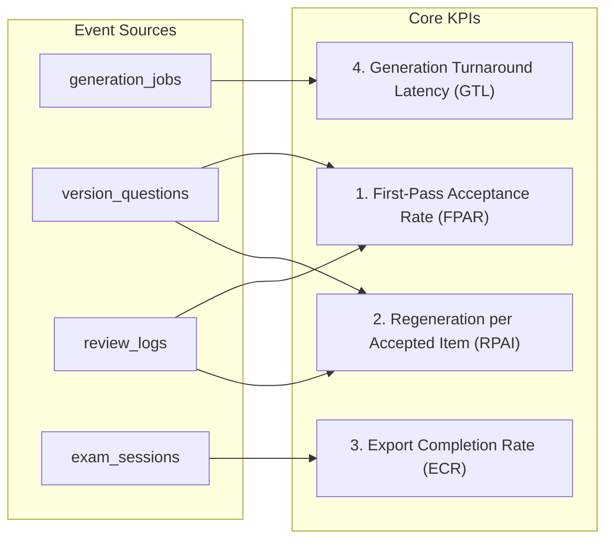

# Week 4 KPI Definitions Specification (W4-MVP-14)

> **Document Status:** OFFICIAL PROPOSAL & TECHNICAL SPECIFICATION  
> **Task ID:** `W4-MVP-14` (P1 Priority)  
> **Decision Reference:** Resolves `Q15` (Product and Technical Alignment on 4 Core KPIs)  
> **Author / Owner:** Pham Khanh Tam (`@AI-WFox`, Student ID: 25127135)  
> **Stakeholders:** Duy (`@nbduy2506`, Product/BE), Philip (`@philip-kkk`, Frontend Consumer)  

---

## 1. Executive Summary & Context

To evaluate the effectiveness of the Isomorphic Exam Synthesizer for high-school mathematics exams (UC04) and ensure that performance statistics are mathematically sound and verifiable, this specification establishes authoritative definitions for **four core KPIs**.

### Core Objectives
1. **Prevent Metric Distortion:** Ensure denominators strictly account for actual items, avoiding double-counting due to regeneration attempts or transient connection dropouts.
2. **Prevent Null vs. 0% Conflation:** Distinguish between a metric that is mathematically undefined (e.g., zero accepted items yields `null`, not `0%`) and a genuine failure.
3. **Traceable Event Lineage:** Tie every metric directly to persisted database records (`generation_jobs`, `version_questions`, `review_logs`, `exam_sessions`).
4. **No Unsubstantiated Claims:** In the absence of a verified manual teacher baseline, "Time Saved" metrics are strictly excluded until empirical data is collected.

---

## 2. Core KPI Specifications

---

### KPI 1: First-Pass Acceptance Rate (FPAR)

- **Definition:** The proportion of question candidates that are accepted by the teacher on their initial generation without requiring any regeneration or modification.
- **Business Rationale:** Measures AI generation quality, mathematical accuracy, and formatting compliance on first attempt. High FPAR indicates strong blueprint alignment and reliable distractor generation.
- **Formula:**
  $$\text{FPAR} = \frac{\sum_{i=1}^{M_{\text{accepted}}} \mathbb{I}(\text{attempts}_i = 1)}{M_{\text{accepted}}}$$
- **Components:**
  - **Numerator:** Count of accepted version questions in the session that have exactly zero regeneration attempts (`attempt_count == 1` and no associated `REGENERATE` action in `review_logs`).
  - **Denominator:** Total count of accepted version questions in the session ($M_{\text{accepted}} = N \times M$).
- **Null and Zero Handling:**
  - If $M_{\text{accepted}} = 0$ (e.g., session abandoned before review or all items rejected), return `null` with status flag `"UNMEASURED"`. **Never coerce to 0.0%**.
  - If all accepted items required at least one regeneration, return `0.0%`.
- **Unit:** Percentage (`%`, formatted to 1 decimal place).

---

### KPI 2: Regeneration Attempts per Accepted Item (RPAI)

- **Definition:** The average number of regeneration iterations dispatched by the teacher to produce an acceptable question variant.
- **Business Rationale:** Quantifies teacher review effort and friction. While FPAR is binary (pass/fail on first try), RPAI captures the depth of rework required for problematic questions.
- **Formula:**
  $$\text{RPAI} = \frac{K_{\text{regen}}}{M_{\text{accepted}}}$$
- **Components:**
  - **Numerator:** Total count of successful or completed regeneration cycles dispatched for accepted questions (`COUNT(review_logs)` where `action_type = 'REGENERATE'`).
  - **Denominator:** Total count of accepted version questions ($M_{\text{accepted}}$).
- **Null and Zero Handling:**
  - If $M_{\text{accepted}} = 0$, return `null`.
  - If no questions required regeneration, return `0.00` (optimal baseline).
- **Unit:** Decimal ratio (e.g., `0.25` attempts/item, formatted to 2 decimal places).

---

### KPI 3: Overall Export Completion Rate (ECR)

- **Definition:** The percentage of initiated exam generation sessions that successfully complete the entire pipeline through to artifact export.
- **Business Rationale:** High-level platform reliability and funnel conversion metric. Detects user drop-off, unrecoverable generation failures, or export pipeline errors.
- **Formula:**
  $$\text{ECR} = \frac{S_{\text{exported}}}{S_{\text{created}} - S_{\text{transient}}}$$
- **Components:**
  - **Numerator:** Count of sessions reaching status `'exported'` (`exam_sessions.status = 'exported'`).
  - **Denominator:** Total sessions created within the evaluation window, minus transient test sessions (`created_at` within window, excluding sessions deleted or abandoned in `< 60` seconds with zero questions ingested).
- **Null and Zero Handling:**
  - If denominator is 0, return `null`.
- **Unit:** Percentage (`%`, formatted to 1 decimal place).

---

### KPI 4: Generation Turnaround Latency (GTL)

- **Definition:** The elapsed wall-clock time required for the system to synthesize all $N$ versions for an exam of $M$ questions.
- **Business Rationale:** Evaluates infrastructure performance, LLM token generation throughput, and user waiting time during Stage 2.
- **Formula:**
  $$\text{GTL}_{\text{session}} = T_{\text{completed}} - T_{\text{started}}$$
- **Components:**
  - `T_started`: Timestamp when `generation_jobs` record was created and execution commenced (`generation_jobs.started_at`).
  - `T_completed`: Timestamp when the final version question was persisted and status updated to `'completed'` (`generation_jobs.completed_at`).
- **Aggregation:**
  - Reported as **Median (p50)** and **95th Percentile (p95)** across sessions within the reporting window.
  - Network disconnection / SSE reconnect latencies are excluded; GTL strictly reflects backend server processing duration.
- **Unit:** Seconds (`s`).

---

## 3. Verification Fixture Examples

### Scenario A: Golden Demo 3-Question Exam (2 Versions, High Quality)
- **Parameters:** $N = 2$ versions, $M = 3$ questions $\implies$ Total items = 6.
- **Events:**
  - Initial generation: 6 items created in 24 seconds.
  - Review: Teacher accepts all 6 items on first inspection. 0 regenerations requested.
  - Export: Teacher completes shuffle and downloads ZIP package.
- **Metric Calculations:**
  - **FPAR:** $6 / 6 = \mathbf{100.0\%}$
  - **RPAI:** $0 / 6 = \mathbf{0.00}$ attempts/item
  - **ECR:** $1 / 1 = \mathbf{100.0\%}$
  - **GTL:** $\mathbf{24.0\text{ s}}$

### Scenario B: Session with Targeted Rework
- **Parameters:** $N = 2$ versions, $M = 3$ questions $\implies$ Total items = 6.
- **Events:**
  - Initial generation: 6 items created in 32 seconds.
  - Review: 5 items accepted immediately. Question 2 in Version 102 had awkward wording; teacher clicked "Regenerate" twice before accepting the third variant.
  - Export: Teacher approves and exports successfully.
- **Metric Calculations:**
  - **FPAR:** $5 / 6 = \mathbf{83.3\%}$
  - **RPAI:** $2 / 6 = \mathbf{0.33}$ attempts/item
  - **ECR:** $1 / 1 = \mathbf{100.0\%}$
  - **GTL:** $\mathbf{32.0\text{ s}}$

### Scenario C: Abandoned Draft (Null Handling)
- **Parameters:** Teacher creates session, ingests text, but closes browser during Stage 2 before review.
- **Events:** 0 accepted questions. Session status remains `'partial_generated'`.
- **Metric Calculations:**
  - **FPAR:** $\mathbf{\text{null}}$ (`UNMEASURED`, avoids deceptive 0.0%)
  - **RPAI:** $\mathbf{\text{null}}$
  - **ECR:** $0 / 1 = \mathbf{0.0\%}$
  - **GTL:** Excluded from aggregate latency (job incomplete).

---

## 4. Telemetry Gap Analysis & Database Alignment

| Required Metric Component | Current Database Field / Table | Status | Action Required |
|---|---|---|---|
| First-pass vs Regenerated item | `version_questions.id`, `review_logs.action_type` | Available | Join `version_questions` with `review_logs` to count regenerations per question slot. |
| Accepted Question count | `version_questions.status = 'approved'` | Available | Filter on `is_current = True AND status = 'approved'`. |
| Session Lifecycle Status | `exam_sessions.status` | Available | States `'reviewed'`, `'approved'`, `'exported'` properly persisted. |
| Job Processing Duration | `generation_jobs.started_at`, `completed_at` | Available | Calculate interval in seconds. |
| Per-item Attempt Counter | Missing direct column on `version_questions` | Minor Gap | Compute dynamically from `COUNT(review_logs)` where `action_type = 'REGENERATE'`, or add column `attempt_number INT DEFAULT 1` in future migration. |
