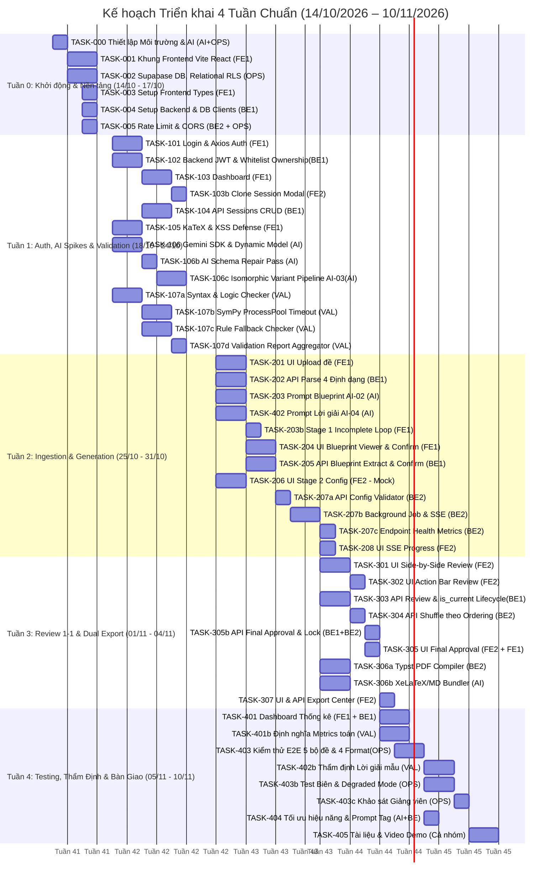

# Isomorphic Exam Synthesizer — Kế Hoạch Triển Khai

> **Kế hoạch triển khai dự án cho nhóm 7 thành viên**  
> **Thời gian:** 4 tuần (14/10/2026 – 10/11/2026)  
> **Nguyên tắc cốt lõi:** Single Ownership · Contract-first · Continuous Integration & Quality Gates

---

## 1. Phân công nhân sự & Vai trò kỹ thuật

| Ký hiệu | Vai trò | Trọng tâm phụ trách chính | Danh sách task phụ trách |
| :--- | :--- | :--- | :--- |
| **FE1** | Frontend Core 1 | Setup FE, Auth UI, Dashboard, KaTeX, Stage 1 Ingestion, Blueprint Viewer & Confirmer, Thống kê | TASK-003, 101, 103, 105, 201, 203b, 204, 401 |
| **FE2** | Frontend Core 2 | CloneModal, Stage 2 Config, SSE Progress, Review 1-1, Action Bar, Final Approval, Export Center | TASK-103b, 206, 208, 301, 302, 305, 307 |
| **BE1** | Backend Core & Lead | Setup BE, Auth JWT, Sessions CRUD, Parsers (DOCX/LaTeX/MD), Blueprint APIs, Review API, Final Approval API | TASK-004, 102, 104, 202, 205, 303, 305b |
| **BE2** | Backend Engine | Rate Limit, Config Validator, Orchestrator SSE, Health Metrics, Shuffler, Typst PDF Compiler | TASK-005, 207a, 207b, 207c, 304, 306a |
| **AI** | AI & Prompt Specialist | Gemini Client, Schema Repair, Variant Generator, Blueprint Prompt, Solution Prompt, LaTeX/MD Bundler, Prompt Tuning | TASK-106, 106b, 106c, 203, 402, 306b, 404 |
| **VAL** | Math & Validation | Syntax & Logic, SymPy ProcessPool, Rule Fallback, Validation Aggregator, Math Metrics, Thẩm định Lời giải | TASK-107a, 107b, 107c, 107d, 401b, 402b |
| **OPS** | DevOps & QA | Repo CI/CD, Docker Compose, Database RLS, E2E Golden Test, Test Biên, Khảo sát Giảng viên, Video Demo | TASK-000, 001, 002, 403, 403b, 403c, 405 |

*Mỗi task có duy nhất 1 thành viên chịu trách nhiệm chính (Owner); các thành viên hỗ trợ liên mô-đun (Contributor) phối hợp theo ma trận sở hữu mã nguồn.*

---

## 2. Quy ước trạng thái nhiệm vụ

| Ký hiệu | Ý nghĩa |
| :---: | :--- |
| ⬜ | Chưa bắt đầu |
| 🔄 | Đang thực hiện |
| ✅ | Hoàn thành |
| 🔗 | Phụ thuộc task khác *(hoặc bắt đầu sớm song song với Mock Data)* |

---

## Giai đoạn 0 — Ngày Đầu Tiên: Dựng Nền Móng Chung (Day 0)

> **Mục tiêu:** Mọi thành viên chạy được dự án ngay lập tức trên máy cá nhân với 1 lệnh, thiết lập CI tự động, an toàn bảo mật cơ bản, Relational RLS chuẩn, và thống nhất hợp đồng API giữa FE và BE.  
> **Người chịu trách nhiệm chính:** OPS  
> **Thời gian:** 1–2 ngày đầu  

---

### TASK-000 · Tạo repository, cấu trúc thư mục, CI Pipeline, Phạm vi Toán Học & Ngân Sách Quota (Scope Bounds)
- **Người làm:** OPS (Owner) + AI (Contributor)
- **Trạng thái:** ⬜

**Mô tả:** Tạo repo GitHub/GitLab với cấu trúc thư mục chuẩn theo architecture.md, thiết lập quy chuẩn đóng góp, pipeline CI tự động, khoanh vùng miền toán học mục tiêu và kiểm soát ngân sách quota có thể kiểm chứng cho MVP.

**Yêu cầu cụ thể phải làm được:**
- [ ] Tạo repo với 2 nhánh chính: `main` (production-ready) và `dev` (nhánh tích hợp hàng ngày).
- [ ] Tạo cấu trúc thư mục: `frontend/src/features/`, `frontend/src/components/`, `frontend/src/models/`, `backend/app/api/`, `backend/app/services/`, `docs/`.
- [ ] **Khoanh vùng Miền Toán Học Mục Tiêu cho MVP (Target Math Family for Deterministic Validation):**
  - **Miền trọng tâm của MVP:** Đại số & Giải tích THPT chuẩn (Khảo sát hàm số, Đạo hàm, Cực trị, Mũ & Logarit, Tích phân & Nguyên hàm, Phương trình / Bất phương trình đại số).
  - Đây là tập toán mà SymPy CAS giải tích chính xác tuyệt đối, bóc tách LaTeX xác định và AI trích xuất blueprint chuẩn hóa nhất.
  - **Dạng toán Out-of-scope cho SymPy ở MVP:** Hình học không gian đa diện và Xác suất đếm tổ hợp phức tạp. Nếu gặp các dạng này trong đề nguồn, hệ thống tự động định tuyến sang **Rule Fallback Checker (`TASK-107c`)** với cờ cảnh báo mà không ép parse qua SymPy CAS để tránh crash engine.
- [ ] **Quy định ranh giới dữ liệu & chi phí cho MVP (Finite Scope Bounds):**
  - **Giới hạn số câu hỏi đề nguồn:** **Cố định chuẩn hóa tối đa 20 câu trắc nghiệm** (bài thi chuẩn 45 phút / 1 tiết THPT). Nếu đề nguồn vượt quá 20 câu $\rightarrow$ hệ thống từ chối nạp đề và báo lỗi `ERR_QUESTION_LIMIT_EXCEEDED` ("MVP giới hạn tối đa 20 câu hỏi để đảm bảo quota và chất lượng sư phạm").
  - Giới hạn số mã đề biến thể: $N \in [1, 4]$.
  - Giới hạn số lần thử lại (Retry Caps): Tối đa 2 lần Schema Repair Pass (AI-05) + tối đa 3 lần Validation Retry / câu.
  - Giới hạn thời gian chạy Background Job: Timeout cứng **10 phút / phiên**.
  - **Tách bạch Ngân Sách Quota Gemini API theo 2 Giai Đoạn (Deterministic Two-Stage Quota):**
    - **Giai đoạn Sinh Hàng Loạt (Stage 2 Batch Generation):**
      - Tính toán cơ sở ($N = 4$): 20 trích xuất blueprint + 80 sinh biến thể + 80 sinh lời giải = **180 API calls cơ sở**.
      - Ngân sách thử lại toàn phiên: Tối đa **70 API calls dự phòng** cho Schema Repair và Validation Retry.
      - **Trần cứng Batch Generation:** Tối đa **250 API calls / session** (theo dõi qua cột `exam_sessions.gemini_call_count`).
      - **Hành vi dừng an toàn khi chạm trần:** Nếu bộ đếm gọi API chạm 250 calls $\rightarrow$ Background job lập tức dừng sinh các câu còn lại, lưu các câu đã hoàn thành vào DB, đánh dấu các câu chưa xong là `has_warning = true`, chuyển session sang trạng thái `partial_generated`, phát SSE `warning` và kết thúc job an toàn. Giảng viên được phép vào xem/thẩm định các câu đã sinh, nhưng **CẤM XUẤT BẢN** cho đến khi đủ 100% câu đạt `approved`.
    - **Giai đoạn Thẩm Định & Sinh Lại Đơn Lẻ (Stage 3 Review Re-generation):**
      - Cấp riêng ngân sách độc lập **30 API calls** (theo dõi qua `exam_sessions.gemini_review_calls`), cho phép giảng viên từ chối và sinh lại tối đa 10 câu đơn lẻ trong suốt buổi review mà không lo bị chặn bởi quota của Stage 2.
- [ ] **Thiết lập GitHub Actions CI Pipeline (`.github/workflows/ci.yml`):**
  - Chạy tự động trên mọi Pull Request vào `dev` và `main`.
  - Backend Check: Linting với `ruff`, Type check với `mypy --strict`, Unit tests với `pytest`.
  - **SymPy LaTeX Parser Smoke Test:** Chạy kiểm tra ANTLR runtime trong container Docker:
    `python -c "import sympy; from sympy.parsing.latex import parse_latex; assert parse_latex('x^2 + 1') is not None"`, đảm bảo parser toán học hoạt động hoàn hảo trước khi merge code.
  - Frontend Check: Linting với `eslint`, Build test với `npm run build`, Component tests với `vitest`.
  - Schema Consistency Check: Smoke test kiểm tra sự đồng bộ cấu trúc giữa `schemas.py` và frontend data contracts / JSON fixtures.
  - Bắt buộc pass 100% CI checks mới được merge PR.
- [ ] Tạo file `README.md` hướng dẫn cách chạy dự án (cài Docker Desktop, clone, `docker compose up`).
- [ ] Tạo file `CONTRIBUTING.md` quy định: Conventional Commits (`feat(module): ...`, `fix(module): ...`), Branch naming (`feat/task-XXX-desc`), quy trình Pull Request và ma trận Code Review.
- [ ] Tạo file `.gitignore` cho cả Node.js và Python (chặn `node_modules/`, `.env`, `__pycache__/`, `*.pyc`, `.pytest_cache/`).
- [ ] Tạo file `.env.example` liệt kê đầy đủ các biến kèm giải thích: `GEMINI_API_KEY`, `GEMINI_MODEL=gemini-3.5-flash-lite` (mô hình thế hệ mới mặc định hỗ trợ Structured Outputs, tối ưu độ trễ và chi phí; cấu hình linh hoạt qua `.env`, chạy smoke test xác minh schema JSON, quota và chi phí), `SUPABASE_URL`, `SUPABASE_ANON_KEY`, `SUPABASE_SERVICE_ROLE_KEY`, `CORS_ORIGINS`, `MAX_UPLOAD_SIZE_MB=10`.
- [ ] Thiết lập Branch Protection Rule: yêu cầu Pull Request + ít nhất 1 người review trước khi merge vào `dev`.

---

### TASK-001 · Tạo Docker Compose và Dockerfiles
- **Người làm:** OPS (Owner)
- **Trạng thái:** ⬜

**Mô tả:** Đóng gói toàn bộ môi trường Frontend và Backend vào Docker để mọi thành viên chạy được với 1 lệnh duy nhất.

**Yêu cầu cụ thể phải làm được:**
- [ ] Tạo `frontend/Dockerfile` — multi-stage: Node 20 build Vite, Nginx alpine serve static files.
- [ ] Tạo `frontend/nginx.conf` — reverse proxy `/api/*` $\rightarrow$ `http://backend:8000`, serve SPA với `try_files $uri /index.html`.
- [ ] Tạo `backend/Dockerfile` — base image Python 3.11-slim, cài dependencies, tải và cài binary **Typst** từ GitHub Release (`/usr/local/bin/typst`). *(Lưu ý: Typst là công cụ biên dịch PDF in ấn duy nhất trong container; tuyệt đối không cài đặt bộ TeX Live 3–5GB trong Docker để giữ dung lượng nhẹ và tối ưu CI/CD)*.
- [ ] Tạo `docker-compose.yml` gồm 2 services: `frontend` (port 3000) và `backend` (port 8000), cấu hình volume mount `./backend:/app` để hot-reload khi dev.
- [ ] Thêm health check endpoint cho backend trong docker-compose: `curl -f http://localhost:8000/health`.
- [ ] Kiểm tra: chạy `docker compose up --build` $\rightarrow$ cả 2 container lên bình thường, truy cập được `http://localhost:3000` và `http://localhost:8000/docs`.

---

### TASK-002 · Tạo cơ sở dữ liệu Supabase, Relational RLS, Auth Trigger & Hợp Đồng DDL Đồng Bộ (SEC-01, SEC-09)
- **Người làm:** OPS (Owner) + BE1 (Contributor)
- **Trạng thái:** ⬜

**Mô tả:** Tạo project Supabase, chạy DDL chuẩn hóa 10 bảng (9 bảng nghiệp vụ + 1 bảng `security_events` tách riêng), đồng bộ 100% các cột Canonical, Permutation, Invariant Index `is_current`, Quota Tracking Counters, Database Trigger đồng bộ tài khoản Google OAuth có bảo vệ search_path, cài đặt Relational RLS bao phủ toàn bộ bảng (gồm cả `users`) và script Storage Retention.

**Yêu cầu cụ thể phải làm được:**
- [ ] Tạo project Supabase mới (chọn region Đông Nam Á: Singapore).
- [ ] Chạy SQL script tạo đủ 10 bảng: `users`, `exam_sessions`, `source_questions`, `question_blueprints`, `generation_configs`, `exam_versions`, `version_questions`, `answer_keys`, `review_logs`, và `security_events` kèm Foreign Keys, Indexes và các ENUM types chuẩn hóa đồng bộ toàn hệ thống:
  - `session_status`: `'draft'`, `'blueprinted'`, `'configured'`, `'generating'`, `'partial_generated'`, `'generated'`, `'reviewed'`, `'approved'`, `'exported'`, `'failed'`. *(Bổ sung `partial_generated` để đại diện cho phiên có kết quả một phần khi chạm trần quota hoặc timeout, cho phép review nhưng cấm xuất bản)*.
  - `question_status`: `'pending_review'`, `'approved'`, `'rejected'`, `'regenerating'`. *(Bổ sung `regenerating` để tương thích 100% với bước khóa tạm thời trong DB transaction của TASK-303, đồng bộ sang Pydantic và Frontend)*.
  - `review_action_type`: `'ACCEPT'`, `'REJECT'`, `'REVERT'`, `'REJECT_FAILED'`. *(Chỉ chứa hành động thẩm định câu hỏi; cảnh báo prompt injection được chuyển sang bảng `security_events`)*.
- [ ] **Bổ sung các trường Quota & Kiểm soát phiên trong `exam_sessions`:**
  - `gemini_call_count`: `INTEGER NOT NULL DEFAULT 0` (bộ đếm số lần gọi API trong Batch Generation).
  - `retry_count`: `INTEGER NOT NULL DEFAULT 0` (bộ đếm số lần thử lại Validation).
  - `gemini_review_calls`: `INTEGER NOT NULL DEFAULT 0` (bộ đếm số lần gọi AI sinh lại trong pha Review).
  - `approved_at`: `TIMESTAMPTZ NULL` (lưu thời điểm duyệt cuối cùng của TASK-305b).
- [ ] **Bổ sung các trường Cảnh báo trong `source_questions`:**
  - `has_missing_answer`: `BOOLEAN NOT NULL DEFAULT FALSE` (phục vụ Stage 1 Incomplete Loop trong TASK-203b khi thiếu đáp án).
  - `has_unparsed_omml`: `BOOLEAN NOT NULL DEFAULT FALSE` (đánh dấu câu có công thức OMML không parse được sang LaTeX trong TASK-403b).
  - `has_security_warning`: `BOOLEAN NOT NULL DEFAULT FALSE` (cảnh báo chuỗi khả nghi/prompt injection trong TASK-106).
- [ ] **Đồng bộ Mô Hình Dữ Liệu Chuẩn Bất Biến trong `version_questions` (Canonical Data Model - TASK-304):**
  - `canonical_question_no`: `INTEGER NOT NULL` (thứ tự câu chuẩn 1..M từ đề gốc, bất biến, dùng xuyên suốt Stage 2 & Stage 3 Review để hiển thị đối chiếu 1-1).
  - `question_no`: `INTEGER NOT NULL` (thứ tự câu hiển thị trên đề thi; trước shuffle = `canonical_question_no`; sau shuffle được cập nhật theo `permutations.question_order`).
  - `canonical_options`: `JSONB NOT NULL` (mảng chuẩn 4 phương án gốc `[{"key": "A", "text": "..."}, {"key": "B", "text": "..."}, ...]`).
  - `canonical_correct_key`: `TEXT NOT NULL` (chữ cái đáp án đúng gốc "A", "B", "C", "D").
  - `canonical_solution_md`: `TEXT NULL` (lời giải chi tiết chuẩn, bất biến, viết theo đáp án gốc).
  - `stem_latex`: `TEXT NOT NULL` (nội dung câu hỏi).
  - `options`: `JSONB NOT NULL` (mảng 4 phương án hiển thị sau hoán vị `[{"key": "A", "text": "..."}, ...]`).
  - `correct_option`: `TEXT NOT NULL` (chữ cái đáp án đúng hiển thị sau hoán vị).
  - `solution_md`: `TEXT NULL` (lời giải hiển thị sau hoán vị, lưu bền vững trong DB, đồng bộ theo hoán vị đáp án).
  - `has_warning`: `BOOLEAN NOT NULL DEFAULT FALSE` (đánh dấu câu có cảnh báo validation để render warning badge trong TASK-207b & TASK-301).
  - `updated_at`: `TIMESTAMPTZ NOT NULL DEFAULT now()` (phục vụ Stale Regeneration Guard tự động giải phóng câu bị kẹt `regenerating` trong TASK-303).
  - `is_current`: `BOOLEAN NOT NULL DEFAULT TRUE` (đánh dấu bản ghi đang có hiệu lực trong phiên review).
  - `regenerated_from_id`: `UUID NULL REFERENCES version_questions(id)` (lưu vết chuỗi phiên bản khi bị Reject và sinh lại).
  - `is_reverted`: `BOOLEAN NOT NULL DEFAULT FALSE` (đánh dấu câu hoàn nguyên từ câu gốc).
- [ ] **Đồng bộ các trường Shuffle Xác Định trong `exam_versions` (TASK-304):**
  - `shuffle_seed`: `TEXT NULL` (seed ngẫu nhiên xác định).
  - `permutations`: `JSONB NULL` (ma trận hoán vị thứ tự câu hỏi và thứ tự phương án).
  - `is_finalized`: `BOOLEAN NOT NULL DEFAULT FALSE` (cờ đánh dấu đề thi đã shuffle xong và sẵn sàng phê duyệt).
- [ ] **Đặc tả cấu trúc bảng `answer_keys` (phục vụ xuất bảng đáp án 4 mã đề - TASK-305):**
  - `id`: `UUID PRIMARY KEY DEFAULT gen_random_uuid()`
  - `version_id`: `UUID NOT NULL REFERENCES exam_versions(id) ON DELETE CASCADE`
  - `display_no`: `INTEGER NOT NULL` (thứ tự câu sau shuffle 1..N)
  - `display_correct_key`: `CHAR(1) NOT NULL` (chữ cái đáp án đúng sau hoán vị A, B, C, D)
  - `canonical_question_no`: `INTEGER NOT NULL` (thứ tự câu gốc đối chiếu)
- [ ] **Ràng buộc toàn vẹn Database Invariant (SEC-P0.4 Partial Unique Index):**
  - Khóa chặt quy tắc "Mỗi câu tại một thời điểm chỉ có duy nhất 1 bản ghi hiện hành" ngay tại tầng CSDL PostgreSQL:
    ```sql
    CREATE UNIQUE INDEX idx_single_current_version_question 
      ON public.version_questions (version_id, source_question_id) 
      WHERE is_current = TRUE;
    ```
  - Ngăn chặn hoàn toàn race-condition hoặc lỗi logic frontend gây trùng lặp câu hỏi hiện hành.
- [ ] **Tạo bảng `public.security_events` chuyên biệt cho kiểm toán bảo mật (SEC-02, SEC-09, SEC-Audit):**
  - Tách sự kiện bảo mật khỏi `review_logs` để ghi nhận được prompt injection ngay từ giai đoạn Stage 1 Ingestion khi chưa có `version_question_id`.
  - Sử dụng `ON DELETE SET NULL` để **bảo toàn vĩnh viễn dấu vết kiểm toán (Audit Log Preservation)** ngay cả khi phiên làm việc hoặc tài khoản người dùng bị xóa:
    ```sql
    CREATE TABLE public.security_events (
      id UUID PRIMARY KEY DEFAULT gen_random_uuid(),
      session_id UUID REFERENCES public.exam_sessions(id) ON DELETE SET NULL,
      user_id UUID REFERENCES public.users(id) ON DELETE SET NULL,
      event_type TEXT NOT NULL, -- 'PROMPT_INJECTION_DETECTED', 'RATE_LIMIT_EXCEEDED'
      severity TEXT NOT NULL DEFAULT 'WARN', -- 'INFO', 'WARN', 'CRITICAL'
      sanitized_details JSONB NOT NULL DEFAULT '{}'::jsonb, -- Chi tiết đã lọc, tuyệt đối không lưu raw str(e) hay payload độc hại
      ip_address TEXT NULL, -- Địa chỉ IP client nếu có
      created_at TIMESTAMPTZ NOT NULL DEFAULT now()
    );
    ```
- [ ] **Đồng bộ tự động Supabase Auth $\rightarrow$ Bảng `public.users` (SEC-09 Hardened Trigger):**
  - Viết PostgreSQL Trigger Function `public.handle_new_user()` có khóa cứng `SET search_path = ''` và schema-qualified đầy đủ với các cột `full_name`, `avatar_url`:
    ```sql
    CREATE OR REPLACE FUNCTION public.handle_new_user()
    RETURNS trigger
    LANGUAGE plpgsql
    SECURITY DEFINER
    SET search_path = ''
    AS $$
    BEGIN
      INSERT INTO public.users (id, email, full_name, avatar_url)
      VALUES (
        new.id, 
        new.email, 
        COALESCE(new.raw_user_meta_data->>'full_name', new.raw_user_meta_data->>'name', new.email),
        new.raw_user_meta_data->>'avatar_url'
      )
      ON CONFLICT (id) DO UPDATE SET 
        email = EXCLUDED.email, 
        full_name = EXCLUDED.full_name,
        avatar_url = EXCLUDED.avatar_url;
      RETURN new;
    END;
    $$;

    CREATE TRIGGER on_auth_user_created
      AFTER INSERT ON auth.users
      FOR EACH ROW EXECUTE FUNCTION public.handle_new_user();
    ```
  - Verify `SET search_path = ''` trên trigger function để chống Search Path Hijacking.
  - Đảm bảo khi người dùng đăng nhập bằng Google OAuth, bản ghi `users` luôn sẵn sàng để khóa ngoại `exam_sessions.user_id` không bao giờ vi phạm.
- [ ] **Tạo PostgreSQL Stored Function tính toán Analytics `public.get_user_analytics` (BE-10, TASK-401):**
  - Đóng gói toàn bộ truy vấn KPI vào hàm RPC với `SECURITY DEFINER` và kiểm tra quyền sở hữu `auth.uid()`:
    ```sql
    CREATE OR REPLACE FUNCTION public.get_user_analytics(
      p_user_id UUID,
      p_session_id UUID DEFAULT NULL
    )
    RETURNS JSONB
    LANGUAGE plpgsql
    SECURITY DEFINER
    SET search_path = ''
    AS $$
    DECLARE
      v_result JSONB;
    BEGIN
      -- Chỉ cho phép user tự truy vấn dữ liệu của mình (hoặc backend service_role)
      IF auth.uid() IS NOT NULL AND auth.uid() <> p_user_id THEN
        RAISE EXCEPTION 'Access denied';
      END IF;

      WITH target_sessions AS (
        SELECT id FROM public.exam_sessions 
        WHERE user_id = p_user_id 
          AND (p_session_id IS NULL OR id = p_session_id)
      ),
      initial_questions AS (
        SELECT vq.id, vq.validation_report, vq.is_reverted
        FROM public.version_questions vq
        JOIN public.exam_versions ev ON vq.version_id = ev.id
        JOIN target_sessions ts ON ev.session_id = ts.id
        WHERE vq.regenerated_from_id IS NULL
      ),
      first_actions AS (
        SELECT DISTINCT ON (rl.version_question_id)
          rl.version_question_id,
          rl.action_type
        FROM public.review_logs rl
        JOIN initial_questions iq ON rl.version_question_id = iq.id
        ORDER BY rl.version_question_id, rl.created_at ASC
      ),
      all_rejections AS (
        SELECT rl.version_question_id
        FROM public.review_logs rl
        JOIN public.version_questions vq ON rl.version_question_id = vq.id
        JOIN public.exam_versions ev ON vq.version_id = ev.id
        JOIN target_sessions ts ON ev.session_id = ts.id
        WHERE rl.action_type = 'REJECT'
      ),
      recovered_questions AS (
        SELECT DISTINCT vq.regenerated_from_id
        FROM public.version_questions vq
        JOIN public.exam_versions ev ON vq.version_id = ev.id
        JOIN target_sessions ts ON ev.session_id = ts.id
        WHERE vq.status = 'approved' AND vq.regenerated_from_id IS NOT NULL
      )
      SELECT jsonb_build_object(
        'first_pass_rate', ROUND((COUNT(CASE WHEN fa.action_type = 'ACCEPT' THEN 1 END)::numeric / NULLIF(COUNT(iq.id), 0) * 100.0), 1),
        'recovery_rate', ROUND((COUNT(DISTINCT rq.regenerated_from_id)::numeric / NULLIF(COUNT(DISTINCT ar.version_question_id), 0) * 100.0), 1),
        'validation_confidence_ratio', ROUND((COUNT(CASE WHEN iq.validation_report->>'confidence' = 'sympy_verified' THEN 1 END)::numeric / NULLIF(COUNT(iq.id), 0) * 100.0), 1),
        'avg_latency_ms', ROUND(COALESCE(AVG(rl.latency_ms), 0)),
        'total_questions_reviewed', COUNT(iq.id),
        'revert_rate', ROUND((COUNT(CASE WHEN iq.is_reverted THEN 1 END)::numeric / NULLIF(COUNT(iq.id), 0) * 100.0), 1)
      ) INTO v_result
      FROM initial_questions iq
      LEFT JOIN first_actions fa ON iq.id = fa.version_question_id
      LEFT JOIN all_rejections ar ON true
      LEFT JOIN recovered_questions rq ON true
      LEFT JOIN public.review_logs rl ON iq.id = rl.version_question_id;

      RETURN COALESCE(v_result, '{}'::jsonb);
    END;
    $$;
    ```
  - Verify `SET search_path = ''` trên trigger function để chống Search Path Hijacking.
  - Đảm bảo khi người dùng đăng nhập bằng Google OAuth, bản ghi `users` luôn sẵn sàng để khóa ngoại `exam_sessions.user_id` không bao giờ vi phạm.
- [ ] **Thiết lập Relational Row-Level Security (RLS) toàn diện (bao gồm `users` & `security_events`):**
  - Bật RLS trên **tất cả 10 bảng**.
  - **Bảng `public.users`:**
    ```sql
    ALTER TABLE public.users ENABLE ROW LEVEL SECURITY;
    CREATE POLICY "Users can manage own profile" ON public.users
      FOR ALL USING (auth.uid() = id) WITH CHECK (auth.uid() = id);
    ```
  - Bảng gốc `exam_sessions`: `USING (auth.uid() = user_id) WITH CHECK (auth.uid() = user_id)`.
  - Các bảng con có trực tiếp `session_id` (`source_questions`, `generation_configs`, `exam_versions`):
    `USING (session_id IN (SELECT id FROM exam_sessions WHERE user_id = auth.uid()))`.
  - Bảng `question_blueprints`:
    `USING (source_question_id IN (SELECT sq.id FROM source_questions sq JOIN exam_sessions s ON sq.session_id = s.id WHERE s.user_id = auth.uid()))`.
  - Bảng `version_questions` và `answer_keys`:
    `USING (version_id IN (SELECT ev.id FROM exam_versions ev JOIN exam_sessions s ON ev.session_id = s.id WHERE s.user_id = auth.uid()))`.
  - Bảng `review_logs`:
    `USING (version_question_id IN (SELECT vq.id FROM version_questions vq JOIN exam_versions ev ON vq.version_id = ev.id JOIN exam_sessions s ON ev.session_id = s.id WHERE s.user_id = auth.uid()))`.
  - **Bảng `security_events` (Chính sách Audit Bất biến - Immutable Append-Only):**
    - `INSERT`: Chỉ backend đặc quyền (`service_role`) được phép ghi sự kiện: `WITH CHECK (auth.role() = 'service_role')`.
    - `SELECT`: Người dùng chỉ được phép xem các sự kiện an ninh thuộc tài khoản của mình: `USING (user_id = auth.uid())`.
    - `UPDATE` & `DELETE`: **CẤM HOÀN TOÀN** (`FOR UPDATE USING (FALSE)`, `FOR DELETE USING (FALSE)`), đảm bảo nhật ký kiểm toán không bao giờ bị chỉnh sửa hoặc xóa bởi người dùng.
  - Viết script kiểm thử RLS tự động cho cả 4 thao tác `SELECT`, `INSERT`, `UPDATE`, `DELETE` với vai trò `anon` và `authenticated` user khác (phải nhận 0 dòng hoặc bị chặn 403).
- [ ] **Bảo mật Service Role Key (SEC-01):**
  - Tuyệt đối **KHÔNG BAO GIỜ** log `SUPABASE_SERVICE_ROLE_KEY` ra terminal hoặc error messages.
  - Khóa service role chỉ được cấp cho Background Worker và Storage Admin nội bộ thông qua backend privileged client.
- [ ] **Cấu hình Supabase Storage & Retention Cleanup (USING & WITH CHECK):**
  - Tạo 2 private buckets: `exam-raw-files` và `exam-export-bundles`.
  - RLS cho Storage Objects: cô lập theo prefix session của user, ràng buộc cả đọc và ghi:
    ```sql
    CREATE POLICY "User storage access" ON storage.objects
      FOR ALL USING (
        bucket_id IN ('exam-raw-files', 'exam-export-bundles')
        AND (storage.foldername(name))[1] IN (SELECT id::text FROM exam_sessions WHERE user_id = auth.uid())
      ) WITH CHECK (
        bucket_id IN ('exam-raw-files', 'exam-export-bundles')
        AND (storage.foldername(name))[1] IN (SELECT id::text FROM exam_sessions WHERE user_id = auth.uid())
      );
    ```
  - **Script dọn dẹp Storage định kỳ:** OPS viết script Python `backend/scripts/cleanup_storage.py` (chạy cron hoặc scheduled job): quét cột `created_at` trong metadata và tự động xóa các bundle xuất bản sau **90 ngày kể từ lúc tạo**, ghi log số lượng file đã xóa.
- [ ] Bật Google OAuth provider trong Supabase Auth (cấu hình Google Client ID / Secret).

---

### TASK-003 · Khởi tạo project Frontend (React + Vite + JavaScript)
- **Người làm:** FE1 (Owner)
- **Trạng thái:** ⬜

**Mô tả:** Tạo project React với Vite và JavaScript (JSX), cài đặt bộ thư viện chuẩn và chuẩn bị cấu trúc thư mục, data contracts.

**Yêu cầu cụ thể phải làm được:**
- [ ] Khởi tạo thư mục `frontend/` bằng template React Vite (`.jsx`, `.js`).
- [ ] Cài đặt các thư viện: `@supabase/supabase-js`, `katex`, `react-markdown`, `rehype-katex`, `remark-math`, `axios`, `react-router-dom`, `zustand`, `lucide-react`.
- [ ] Cài đặt và cấu hình styling: `tailwindcss`, `postcss`, `autoprefixer`.
- [ ] Chuẩn bị các JSON fixtures / helpers định nghĩa toàn bộ data models: `User`, `ExamSession`, `SourceQuestion`, `QuestionBlueprint`, `GenerationConfig`, `ExamVersion`, `VersionQuestion` (kèm `is_current`, `regenerated_from_id`), `ValidationReport`, `ReviewLog`.
- [ ] Tạo `src/services/api.js` (Axios instance trỏ vào `/api`) và `src/services/supabase.js` (Supabase client).
- [ ] Cấu hình alias `@/` trỏ về `src/` trong `vite.config.js`.

---

### TASK-004 · Khởi tạo project Backend (Python + FastAPI), Phân Tách Client DB & API Contract (SEC-01, ALIGN-01)
- **Người làm:** BE1 (Owner)
- **Trạng thái:** ⬜

**Mô tả:** Tạo project FastAPI, cấu hình Pydantic v2 schemas làm hợp đồng API chuẩn, tạo tài liệu hợp đồng endpoints chi tiết `docs/api-contract.md`, bảo vệ khóa bí mật và phân tách client DB.

**Yêu cầu cụ thể phải làm được:**
- [ ] Tạo `backend/requirements.txt` gồm: `fastapi`, `uvicorn[standard]`, `pydantic`, `pydantic-settings`, `supabase`, `python-docx`, `google-genai`, `sympy`, `antlr4-python3-runtime>=4.11.0,<4.12`, `numpy`, `python-multipart`, `httpx`, `slowapi`.
- [ ] Tạo `backend/app/main.py` với health check `GET /health`.
- [ ] Tạo `backend/app/core/config.py` dùng `pydantic-settings` đọc biến môi trường:
  - Khai báo kiểu `SecretStr` cho `SUPABASE_SERVICE_ROLE_KEY` và `GEMINI_API_KEY` để tự động che giấu (masking) khi log.
  - Cấu hình biến môi trường `GEMINI_MODEL` (mặc định: `gemini-3.5-flash-lite`), tuyệt đối không hard-code tên model trong code logic.
- [ ] Cấu hình `logging` module dạng JSON structured log: log method, path, status, latency, `user_id`, tuyệt đối **không log request body chứa PII hay token**.
- [ ] Tạo `backend/app/models/schemas.py` chứa toàn bộ Pydantic models khớp 1-1 với types của Frontend (bao gồm `is_current`, `regenerated_from_id`, enum `question_status` đủ 4 trạng thái, và `security_events`).
- [ ] **Tài liệu Hợp đồng API Chi tiết (`docs/api-contract.md`) (ALIGN-01, ALIGN-04):**
  - Liệt kê toàn bộ endpoints theo cấu trúc mẫu chuẩn mực thống nhất:
    ```markdown
    ## POST /api/sessions/{session_id}/generate
    **Auth:** Bearer JWT (Required)
    **Path Params:** `session_id` (UUID v4)
    **Request Body:**
    | Field | Type | Required | Description |
    | :--- | :--- | :---: | :--- |
    | `n_versions` | int | Yes | Số mã đề cần sinh (1–4) |
    | `variation_modes` | string[] | Yes | Tập con các mode được Blueprint hỗ trợ |
    **Response 200:** `{ "job_id": "uuid", "status": "started" }`
    **Error Responses:**
    | Code | HTTP Status | Detail / Description |
    | :--- | :---: | :--- |
    | `ERR_CONFIG_CONFLICT` | 400 | Chế độ biến thể không khớp Blueprint |
    | `ERR_SESSION_GENERATING` | 409 | Phiên đề đang trong tiến trình sinh nền |
    ```
  - Bàn giao để FE1 và FE2 ký duyệt hợp đồng trước khi bước vào code tính năng.
- [ ] **Kiến trúc phân tách Supabase Client (`backend/app/core/database.py`):**
  - Hàm `get_authenticated_db(user_jwt: str)`: Tạo Supabase client gắn Header `Authorization: Bearer <user_jwt>`, bắt buộc áp dụng cho toàn bộ các endpoints thông thường để kích hoạt triệt để RLS.
  - Hàm `get_service_role_db()`: Client đặc quyền dùng `SUPABASE_SERVICE_ROLE_KEY`, chỉ export giới hạn cho Background Worker và Storage Admin.
  - Hàm helper `assert_table_allowed(table_name: str)`: Kiểm tra tên bảng trong whitelist trước khi thực thi truy vấn đặc quyền, chống SQL/table injection.
- [ ] Bàn giao ngay file `schemas.py` cho FE1, FE2 để dùng làm Mock Data.

---

### TASK-005 · Rate Limiting Middleware & Cấu hình CORS chặt chẽ (SEC-05, SEC-06, SEC-10)
- **Người làm:** BE2 (Owner) + OPS (Contributor)
- **Phụ thuộc:** TASK-004
- **Trạng thái:** ⬜

**Mô tả:** Cài đặt lớp bảo vệ chống tấn công từ chối dịch vụ (DoS), chống cạn kiệt hạn ngạch Gemini API, cấu hình CORS an toàn, định danh rate limit theo User và chốt kiến trúc Single Worker cho MVP.

**Yêu cầu cụ thể phải làm được:**
- [ ] **Kiến trúc Process cho MVP (SEC-10):** Chốt chạy **Single Uvicorn Worker** (`uvicorn app.main:app --workers 1`) ghi rõ trong `backend/Dockerfile` và `docker-compose.yml`, đảm bảo in-memory rate limiting của `slowapi` hoạt động chính xác 100% không bị phân mảnh giữa các worker processes. *(Ghi chú kiến trúc: Được ghi nhận rõ là giới hạn thiết kế cho bản MVP/demo; khi mở rộng multi-worker sẽ nâng cấp sang Redis backend storage)*.
- [ ] **Định danh Rate Limiting theo User (`get_user_or_ip_key`):**
  - Viết key function tùy biến cho `slowapi`: Giải mã JWT từ header `Authorization: Bearer <token>` để lấy `user_id` làm khóa chặn rate limit, chống xung đột nhiều giảng viên cùng trường dùng chung địa chỉ NAT/IP công cộng.
  - Fallback về client IP (`get_remote_address`) đối với các endpoint công khai chưa đăng nhập (`/health`, `/login`).
- [ ] Tích hợp thư viện `slowapi` vào ứng dụng FastAPI:
  - Giới hạn endpoint sinh đề `/api/sessions/{id}/generate`: tối đa **10 requests/phút/user**.
  - Giới hạn các endpoints CRUD thông thường: tối đa **60 requests/phút/user**.
  - Trả về mã lỗi HTTP 429 Too Many Requests kèm header `Retry-After: {seconds}` khi vượt ngưỡng.
  - Whitelist không áp dụng rate limit cho `/health` và `/api/health/metrics`.
  - Viết test case: Gọi 11 lần liên tiếp `/api/sessions/{id}/generate` $\rightarrow$ lần thứ 11 nhận HTTP 429.
- [ ] **Cấu hình CORS an toàn (SEC-06):**
  - Đọc danh sách domain từ biến môi trường `CORS_ORIGINS` (mặc định: `http://localhost:3000`).
  - Thiết lập `allow_origins = settings.cors_origins.split(",")`, `allow_credentials = True`, `allow_methods = ["GET", "POST", "PATCH", "DELETE"]`.
  - Tuyệt đối **KHÔNG** sử dụng wildcard `allow_origins = ["*"]` khi `allow_credentials = True`.

---

## Giai đoạn 1 — Tuần 1: Auth, Khung Giao Diện, Spike AI/Toán Học & Tách Validation

> **Mục tiêu:** Hoàn thiện đăng nhập Google, Dashboard, MathRenderer KaTeX an toàn, Spike Gemini chống Prompt Injection, và hoàn tất 4 tầng Validation độc lập.  
> **Định nghĩa "Done":** Giảng viên đăng nhập Google $\rightarrow$ xem Dashboard $\rightarrow$ AI sinh 1 câu toán JSON (tự sửa nếu lỗi schema) $\rightarrow$ 4 tầng Validation kiểm tra và xuất báo cáo.

---

### TASK-101 · Giao diện đăng nhập Google & Interceptor Token (FE-01)
- **Người làm:** FE1 (Owner)
- **Phụ thuộc:** TASK-002, TASK-003
- **Trạng thái:** ⬜

**Mô tả:** Màn hình đăng nhập duy nhất bằng tài khoản Google, xử lý tự động làm mới token, đồng bộ hồ sơ người dùng và interceptor Axios.

**Yêu cầu cụ thể phải làm được:**
- [ ] Trang `/login` với nút "Đăng nhập bằng Google" gọi `supabase.auth.signInWithOAuth({ provider: 'google' })`.
- [ ] Lắng nghe `supabase.auth.onAuthStateChange`: Khi nhận sự kiện `SIGNED_IN`, kiểm tra và xác nhận bản ghi hồ sơ đã tồn tại trong `public.users` (thông qua Database Trigger của TASK-002) trước khi cập nhật Zustand store và chuyển hướng.
- [ ] **Kiểm thử Đăng nhập Google Lần đầu (First-time Login Smoke Test):** Kiểm tra tài khoản Google mới chưa từng tồn tại trong hệ thống đăng nhập $\rightarrow$ trigger `handle_new_user` tự động tạo bản ghi `users` với đầy đủ `id`, `email`, `full_name`, `avatar_url` $\rightarrow$ frontend nhận diện thông tin và render dashboard mượt mà, không gặp lỗi `user_id` không tồn tại khi tạo session.
- [ ] Cấu hình Axios Interceptor trong `src/services/api.ts`: tự động gắn header `Authorization: Bearer <jwt>`. Nếu nhận lỗi 401 $\rightarrow$ gọi `supabase.auth.refreshSession()` 1 lần; nếu vẫn lỗi $\rightarrow$ tự động đăng xuất và chuyển về `/login`.
- [ ] Tạo component `ProtectedRoute` bảo vệ các route nội bộ.
- [ ] Tạo thanh điều hướng (Navbar) hiển thị avatar, tên người dùng và nút Đăng xuất (`signOut`).

---

### TASK-102 · API xác thực JWT phía Backend & Whitelist Ownership (BE-01, SEC-07)
- **Người làm:** BE1 (Owner)
- **Phụ thuộc:** TASK-004
- **Trạng thái:** ⬜

**Mô tả:** Dependency FastAPI xác thực JWT token từ Supabase Auth và helper kiểm tra quyền sở hữu tài nguyên với danh sách bảng an toàn.

**Yêu cầu cụ thể phải làm được:**
- [ ] Viết dependency `get_current_user` trích xuất Bearer token từ header và gọi `supabase.auth.get_user(token)`.
- [ ] Trả về HTTP 401 khi token thiếu, sai hoặc hết hạn.
- [ ] **Helper kiểm tra quyền sở hữu (SEC-07):** Viết hàm dùng chung `async def assert_ownership(table: str, resource_id: str, user_id: str)`:
  - Whitelist tên bảng cho phép: `ALLOWED_TABLES = {"exam_sessions", "source_questions", "question_blueprints", "generation_configs", "exam_versions", "version_questions", "answer_keys", "review_logs"}`. Nếu `table` không nằm trong danh sách $\rightarrow$ lập tức ném lỗi 400 Bad Request.
  - Sử dụng quan hệ truy vấn trực tiếp kiểm tra tài nguyên có thuộc về `user_id` không. Bắt buộc áp dụng cho mọi endpoint có tham số ID để phòng thủ tầng sâu (Defense-in-Depth).
- [ ] Trả về HTTP 403 nếu resource không thuộc về `user_id`.

---

### TASK-103 · Dashboard danh sách phiên làm việc (FE-02)
- **Người làm:** FE1 (Owner)
- **Phụ thuộc:** TASK-101
- **Trạng thái:** ⬜

**Mô tả:** Màn hình chính sau khi đăng nhập, hiển thị danh sách các đề thi đã tạo và trạng thái.

**Yêu cầu cụ thể phải làm được:**
- [ ] Trang `/dashboard` gọi `GET /api/sessions` hiển thị danh sách đề thi dạng thẻ (cards) hoặc bảng.
- [ ] Tách component `src/features/dashboard/DashboardSessionCard.jsx`: hiển thị Tên đề, Môn học, Ngày tạo, Badge trạng thái. Component này expose prop `onClone(session)` để bàn giao kết nối cho FE2.
- [ ] Nút "Tạo đề mới" chuyển hướng đến `/session/new/stage1`.
- [ ] Nút "Tiếp tục" chuyển hướng trực tiếp đến đúng Stage đang dở dựa trên trạng thái của session.
- [ ] Empty state thân thiện khi chưa có đề nào.

---

### TASK-103b · Tái sử dụng phiên làm việc cũ — Reuse Session Modal (FE2, UC03)
- **Người làm:** FE2 (Owner)
- **Phụ thuộc:** TASK-103 *(Mock UI)*; Phụ thuộc tích hợp: TASK-104 *(API Clone)*
- **Trạng thái:** ⬜

**Mô tả:** Xây dựng modal nhân bản/tái sử dụng phiên làm việc cũ theo Use Case UC03.

**Yêu cầu cụ thể phải làm được:**
- [ ] Tạo riêng component `src/features/dashboard/CloneSessionModal.jsx` (tránh xung đột code trong `Dashboard.jsx`).
- [ ] Lắng nghe sự kiện `onClone` từ `DashboardSessionCard` của FE1 $\rightarrow$ mở Modal nhập tiêu đề mới cho bản sao chép.
- [ ] Gọi API `POST /api/sessions/{session_id}/clone` $\rightarrow$ nhận `new_session_id`.
- [ ] Chuyển hướng người dùng vào phiên mới tại màn hình Stage 1 để sẵn sàng tùy biến.

---

### TASK-104 · API quản lý Exam Sessions CRUD (BE-01)
- **Người làm:** BE1 (Owner)
- **Phụ thuộc:** TASK-102
- **Trạng thái:** ⬜

**Mô tả:** Các endpoints CRUD cho phiên làm việc, kèm tính năng nhân bản phiên (clone session).

**Yêu cầu cụ thể phải làm được:**
- [ ] `POST /api/sessions` — tạo phiên mới với `{ title, subject }` và gán `status = "draft"`.
- [ ] `GET /api/sessions` — lấy danh sách phiên thuộc về `current_user.id` (áp dụng RLS).
- [ ] `GET /api/sessions/{session_id}` — gọi `assert_ownership` $\rightarrow$ lấy chi tiết phiên kèm danh sách câu hỏi nguồn và mã đề.
- [ ] `DELETE /api/sessions/{session_id}` — gọi `assert_ownership` $\rightarrow$ xóa phiên và cascade dữ liệu liên quan.
- [ ] `POST /api/sessions/{session_id}/clone` — gọi `assert_ownership` $\rightarrow$ nhân bản toàn bộ câu hỏi nguồn và blueprint sang session mới với trạng thái `draft`.

---

### TASK-105 · Component MathRenderer KaTeX & Chống XSS (FE-11)
- **Người làm:** FE1 (Owner)
- **Phụ thuộc:** TASK-003
- **Trạng thái:** ⬜

**Mô tả:** Component render công thức toán học KaTeX, hỗ trợ Markdown, xử lý chuẩn Unicode tiếng Việt và chống tấn công XSS.

**Yêu cầu cụ thể phải làm được:**
- [ ] Tạo `src/components/MathRenderer.jsx` nhận `content: string`.
- [ ] Tích hợp `react-markdown` + `remark-math` + `rehype-katex`, import CSS của KaTeX tại `main.jsx`.
- [ ] **Chống tấn công XSS:** Cấu hình `react-markdown` bật cờ `skipHtml={true}` hoặc tích hợp `rehype-sanitize` để tự động lọc bỏ các thẻ `<script>`, `<iframe>` hay `onerror` nếu người dùng cố tình chèn mã độc vào đề thi.
- [ ] Hỗ trợ cả công thức nội dòng (`$...$`) và khối công thức riêng (`$$...$$`).
- [ ] Xử lý an toàn: nếu công thức LaTeX lỗi cú pháp $\rightarrow$ hiển thị text gốc kèm icon cảnh báo thay vì làm sập trang web.
- [ ] Kiểm thử hiển thị chuẩn xác tiếng Việt có dấu (Unicode NFC) xen kẽ giữa các ký tự toán học $\sqrt{x}$, $\frac{a}{b}$, $\int$.

---

### TASK-106 · Gemini SDK Client, Structured Outputs & Phòng chống Prompt Injection (AI-01, SEC-02)
- **Người làm:** AI (Owner)
- **Phụ thuộc:** TASK-004
- **Trạng thái:** ⬜

**Mô tả:** Kết nối Google Gemini API với biến cấu hình động `GEMINI_MODEL`, cơ chế ép kiểu JSON nghiêm ngặt, làm sạch đầu vào và phòng vệ Prompt Injection nhiều tầng.

**Yêu cầu cụ thể phải làm được:**
- [ ] Tạo `backend/app/services/ai/client.py` khởi tạo `google.genai.Client` với model lấy từ biến môi trường `settings.gemini_model` (mặc định: `gemini-3.5-flash-lite`), tuyệt đối không hardcode tên model.
- [ ] **Chính sách Ghi nhận Quota Gọi Gemini Thực tế (Precise Quota Tracking - Issue 8):**
  - Mọi request HTTP thực tế phát sinh gửi tới Google Gemini API (kể cả request thành công, thất bại mã lỗi 4xx/5xx, retry exponential backoff, schema repair pass hay prompt giải chi tiết) đều là 1 API call tiêu tốn ngân sách.
  - Tầng Client Wrapper (`generate_structured`) bắt buộc nhận `session_id` và thực hiện tăng bộ đếm CSDL tương ứng (`gemini_call_count` trong Stage 1/2 hoặc `gemini_review_calls` trong Stage 3) ngay trước khi gửi request tới API, đảm bảo bộ đếm phản ánh chính xác 100% chi phí và hạn ngạch, không bỏ sót bất kỳ request nào.
- [ ] **Phòng chống Prompt Injection & Bảo toàn dữ liệu nguồn (SEC-02, Safe Escaping):**
  - **Nguyên tắc bảo toàn dữ liệu gốc:** Giữ nguyên 100% nguyên văn văn bản câu hỏi trong Database (`source_questions`), **tuyệt đối không âm thầm cắt bỏ hay thay thế chuỗi ký tự** của người dùng trong dữ liệu gốc.
  - **Tách biệt ngữ cảnh qua SDK:** Hướng dẫn hệ thống luôn nằm trong `system_instruction` của Gemini Client, hoàn toàn độc lập với User Input.
  - **Giám sát & Ghi vết chuỗi khả nghi:** Dùng Regex quét phát hiện các mẫu chỉ thị độc hại (`ignore previous instructions`, `disregard above`, các chuỗi điều khiển LLM). Nếu phát hiện chuỗi khả nghi $\rightarrow$ **không âm thầm sửa nội dung**, mà ghi log vào `public.security_events` (kèm `session_id`, `user_id`, `event_type = 'PROMPT_INJECTION_DETECTED'`) và gắn cờ cảnh báo `has_security_warning = true` trên câu hỏi để người dùng xác nhận ở giao diện.
  - **Đóng gói an toàn khi đưa vào AI Prompt (Safe Delimitation & XML Escaping):**
    - Chuẩn hóa Unicode NFC và giới hạn độ dài $\le 2000$ ký tự / câu hỏi.
    - Escape các ký tự đặc biệt XML (`<` $\rightarrow$ `&lt;`, `>` $\rightarrow$ `&gt;`, `&` $\rightarrow$ `&amp;`) trong nội dung câu hỏi trước khi đưa vào prompt template để triệt tiêu nguy cơ thoát thẻ XML (XML Tag Escape Injection).
    - Bọc câu hỏi đã escape bằng thẻ XML có định danh nonce ngẫu nhiên hoặc truyền qua Structured Content Parts của Gemini SDK làm dữ liệu thụ động.
  - **Ràng buộc cấu trúc đầu ra:** Ép kiểu tuyệt đối qua `response_mime_type="application/json"` và Pydantic `response_schema`.
- [ ] Viết hàm `generate_structured(prompt, schema, system_instruction)` kèm cơ chế Exponential Backoff (1s, 2s, 4s) khi gặp mã lỗi rate limit `429`.
- [ ] Viết script smoke test độc lập (`backend/tests/test_ai_smoke.py`) kiểm tra model đang hoạt động, trả về JSON chuẩn xác.

---

### TASK-106b · Cơ chế sửa lỗi cấu trúc tự động — Schema Repair Pass (AI-05)
- **Người làm:** AI (Owner)
- **Phụ thuộc:** TASK-106
- **Trạng thái:** ⬜

**Mô tả:** Xây dựng module tự động sửa lỗi JSON khi Gemini trả về kết quả không khớp với Pydantic schema (AI-05).

**Yêu cầu cụ thể phải làm được:**
- [ ] Bắt lỗi `pydantic.ValidationError` hoặc `json.JSONDecodeError` từ kết quả của Gemini.
- [ ] Nếu gặp lỗi: trích xuất thông điệp lỗi chi tiết $\rightarrow$ tạo Repair Prompt gửi ngược lại cho Gemini: *"Output JSON bị lỗi cấu trúc: {error_details}. Hãy sửa lại và trả về duy nhất JSON hợp lệ."*
- [ ] Cho phép tối đa 2 lần Schema Repair Pass trước khi kích hoạt ngoại lệ `AIGenerationError`.
- [ ] Viết unit test giả lập JSON hỏng để kiểm chứng hàm repair khôi phục thành công.

---

### TASK-106c · Pipeline sinh câu hỏi biến thể đẳng cấu — Isomorphic Variant Generator (AI-03)
- **Người làm:** AI (Owner) + VAL (Contributor)
- **Phụ thuộc:** TASK-106b
- **Trạng thái:** ⬜

**Mô tả:** Xây dựng pipeline prompt và logic sinh câu hỏi biến thể đẳng cấu (AI-03) theo Blueprint đã xác nhận và cấu hình variation modes. Đây là động cơ tạo giá trị cốt lõi của toàn bộ sản phẩm.

**Yêu cầu cụ thể phải làm được:**
- [ ] Thiết kế Prompt sinh biến thể đẳng cấu chuyên sâu:
  - Đầu vào: Câu hỏi gốc, `QuestionBlueprint` đã xác nhận (parameters, invariants), và danh sách `active_variation_modes` được chọn (thay số, đổi ngữ cảnh, hoán đổi ẩn số).
  - Ràng buộc sư phạm: Giữ nguyên tuyệt đối phương pháp giải toán (bất biến), thay đổi số liệu trong khoảng `min`–`max` cho phép, tạo 3 phương án nhiễu (distractors) hợp lý dựa trên các sai lầm toán học phổ biến của học sinh THPT.
- [ ] Định nghĩa Pydantic Schema `IsomorphicVariant` (đồng bộ 100% với JSONB của Database và Frontend Data Contract):
  ```python
  class OptionItem(BaseModel):
      key: Literal["A", "B", "C", "D"]
      text: str

  class IsomorphicVariant(BaseModel):
      stem_latex: str
      options: list[OptionItem]  # Đúng 4 phần tử có key "A", "B", "C", "D"
      correct_option: Literal["A", "B", "C", "D"]
      solution_outline: str
      variation_rationale: str  # Giải thích cách thức biến thể
  ```
- [ ] **Feedback-guided Regeneration:** Cơ chế sinh lại khi bị từ chối: Cho phép truyền lịch sử các lỗi validation trước đó (`validation_report.checks`) vào prompt để AI tự định hướng tránh lặp lại sai lầm toán học cũ.
- [ ] Viết bộ test cases xác nhận phương pháp giải được bảo toàn trên 5 câu hỏi mẫu đại diện cho 5 chuyên đề Toán THPT.
- [ ] Đóng gói hàm gọi chuẩn: `generate_isomorphic_variant(blueprint, variation_modes, feedback=None) -> IsomorphicVariant` để `TASK-207b` gọi trực tiếp.

---

### TASK-107a · Syntax Checker & Logic Checker (VAL-01, VAL-02)
- **Người làm:** VAL (Owner)
- **Phụ thuộc:** TASK-004, TASK-106
- **Trạng thái:** ⬜

**Mô tả:** Xây dựng tầng kiểm tra cú pháp và logic cơ bản của câu hỏi trắc nghiệm toán học.

**Yêu cầu cụ thể phải làm được:**
- [ ] `syntax_checker.py` (VAL-01): Kiểm tra thân câu không rỗng, danh sách phương án có đúng 4 phần tử (A, B, C, D), kiểm tra cân bằng dấu ngoặc LaTeX `{}` và `$`.
- [ ] `logic_checker.py` (VAL-02): Kiểm tra duy nhất 1 đáp án đúng, kiểm tra 4 phương án không trùng lặp giá trị bằng phép toán hình thức `sympy.simplify(opt_a - opt_b) == 0`.
- [ ] Viết unit test cho các trường hợp: phương án bị trùng đáp số, ngoặc LaTeX bị thiếu.

---

### TASK-107b · SymPy Evaluator với ProcessPool Isolation Timeout (VAL-03)
- **Người làm:** VAL (Owner)
- **Phụ thuộc:** TASK-107a
- **Trạng thái:** ⬜

**Mô tả:** Module phân tích cú pháp LaTeX và giải toán bằng đại số hình thức SymPy, cô lập tiến trình tính toán để timeout triệt để (VAL-03).

**Yêu cầu cụ thể phải làm được:**
- [ ] `sympy_evaluator.py`: Chuyển đổi công thức toán trong câu hỏi từ LaTeX sang biểu thức SymPy bằng `sympy.parsing.latex`.
- [ ] Giới hạn độ dài công thức đầu vào ($\le 500$ ký tự) để ngăn chặn biểu thức quá tải trước khi parse.
- [ ] **Phòng thủ chuỗi LaTeX trước khi parse (SEC-14):** Sử dụng Regex kiểm tra chuỗi biểu thức, phát hiện và chặn đứng ngay các lệnh độc hại (ví dụ `r"\\(write|input|include|def|catcode|openout|csname)"`) trước khi truyền vào `sympy.parsing.latex`, phòng chống triệt để rủi ro injection qua parser.
- [ ] Tự động giải phương trình / tính đạo hàm / tính tích phân đối với các dạng toán giải tích phổ biến THPT.
- [ ] Đối chiếu nghiệm tính được với giá trị tại `correct_option`. Nếu sai lệch $\rightarrow$ đánh dấu `passed: False` kèm mô tả sai lệch.
- [ ] **Bảo vệ tài nguyên bằng Process Isolation trong Python 3.11 Docker:**
  - Vì `signal.alarm` chỉ hoạt động tại main thread (không hỗ trợ trong FastAPI background thread) và `Future.cancel()` không thể ngắt tiến trình đang tính toán CPU-bound, triển khai bọc phép tính SymPy bằng worker process độc lập (`multiprocessing.Process` kết hợp `multiprocessing.Queue` trao đổi dữ liệu, hoặc custom ProcessPool wrapper).
  - Thiết lập `join(timeout=5.0)`. Nếu quá 5 giây mà chưa hoàn tất $\rightarrow$ gọi `process.terminate()` hoặc `process.kill()` và `process.join()` để thu hồi triệt để tài nguyên, đảm bảo 100% không để lại luồng tính toán CPU chạy ngầm gây nghẽn server và không rò rỉ zombie process.

---

### TASK-107c · Rule-Based Fallback Checker Độc Lập (VAL-04)
- **Người làm:** VAL (Owner)
- **Phụ thuộc:** TASK-107a *(Độc lập về mặt logic với SymPy, không chạy tuần tự)*
- **Trạng thái:** ⬜

**Mô tả:** Module kiểm tra dựa trên luật (Rule Checker) hoạt động độc lập hoặc làm phao cứu sinh khi SymPy timeout / không parse được (VAL-04).

**Yêu cầu cụ thể phải làm được:**
- [ ] `rule_checker.py`: Kiểm tra các giá trị số sinh ra trong câu hỏi có nằm đúng khoảng giá trị cho phép (`bounds.min <= val <= bounds.max`) đã định nghĩa trong Blueprint.
- [ ] Kiểm tra các điều kiện bất biến toán học (ví dụ: mẫu số khác 0, biểu thức dưới căn $\ge 0$, $\Delta > 0$).
- [ ] Tự động kích hoạt Rule-Based Fallback khi `sympy_evaluator` bị quá thời gian (timeout > 5s) hoặc gặp dạng toán hình học/lời văn mà SymPy không giải được.

---

### TASK-107d · Validation Aggregator & ValidationReport Schema
- **Người làm:** VAL (Owner)
- **Phụ thuộc:** TASK-107b, TASK-107c
- **Trạng thái:** ⬜

**Mô tả:** Module tổng hợp kết quả từ các tầng thẩm định thành báo cáo hoàn chỉnh `ValidationReport`.

**Yêu cầu cụ thể phải làm được:**
- [ ] Tạo hàm điều phối `validate_question(question, blueprint) -> ValidationReport` tổng hợp kết quả từ Syntax, Logic, SymPy (nếu giải được) và Rule Fallback.
- [ ] Đóng gói schema `ValidationReport`: `status` (`passed`, `warning`, `failed`), `confidence` (`sympy_verified` hoặc `rule_only`), danh sách chi tiết các `checks` đã thực hiện.
- [ ] Viết bộ test suite bao phủ toàn bộ các tình huống thẩm định.

---

## Giai đoạn 2 — Tuần 2: Ingestion, Blueprint & Async Generation Pipeline

> **Mục tiêu:** Nạp đề nguồn $\rightarrow$ trích xuất Blueprint $\rightarrow$ cấu hình $\rightarrow$ background job sinh đề với thanh tiến trình SSE thời gian thực.  
> **Định nghĩa "Done":** Upload file DOCX $\rightarrow$ bóc tách câu hỏi $\rightarrow$ AI trích xuất Blueprint $\rightarrow$ giảng viên xác nhận $\rightarrow$ cấu hình $N$ mã đề $\rightarrow$ bấm Generate $\rightarrow$ SSE stream tiến độ $\rightarrow$ lưu bản nháp vào DB.

---

### TASK-201 · Giao diện Upload đề nguồn (FE-04)
- **Người làm:** FE1 (Owner)
- **Phụ thuộc:** TASK-103 *(Mock UI)*; Phụ thuộc tích hợp: TASK-104
- **Trạng thái:** ⬜

**Mô tả:** Màn hình Stage 1 — kéo thả upload file (.docx, .tex, .md) hoặc nhập văn bản trực tiếp.

**Yêu cầu cụ thể phải làm được:**
- [ ] Trang `/session/:id/stage1` với 2 tab riêng biệt:
  - **Tab 1 ("Tải file lên"):** Khu vực kéo thả chỉ chấp nhận `.docx`, `.tex`, `.md`. Hiển thị thông báo đỏ chặn ngay lập tức nếu người dùng chọn file `.pdf` (MVP chỉ xuất PDF, không nhận PDF).
  - **Tab 2 ("Nhập trực tiếp"):** Text editor cho phép dán hoặc nhập trực tiếp văn bản đề thi thô, công thức LaTeX và bảng đáp án văn bản.
- [ ] Giới hạn kích thước file rõ ràng trên giao diện (tối đa 10MB).
- [ ] Hiển thị thanh tiến trình tải file lên server.

---

### TASK-202 · API nhận và bóc tách đề thi an toàn — File & Direct Input (BE-02, SEC-04)
- **Người làm:** BE1 (Owner)
- **Phụ thuộc:** TASK-102; Phụ thuộc tích hợp: TASK-104
- **Trạng thái:** ⬜

**Mô tả:** Endpoints nhận file hoặc văn bản nhập trực tiếp, kiểm tra an toàn và bóc tách câu hỏi theo 3 parser độc lập (DOCX, LaTeX, Markdown) kèm cơ chế nhận diện bảng đáp án riêng.

**Yêu cầu cụ thể phải làm được:**
- [ ] **2 Endpoints Ingestion chuyên biệt:**
  - `POST /api/sessions/{session_id}/ingest-file`: Nhận `multipart/form-data` cho file upload (.docx, .tex, .md).
  - `POST /api/sessions/{session_id}/ingest-text`: Nhận JSON `{ "raw_text": "..." }` cho tab nhập trực tiếp, kiểm tra độ dài $\le 100,000$ ký tự.
  - Cả hai endpoints đều gọi `assert_ownership` kiểm tra quyền sở hữu phiên.
- [ ] **Bảo vệ File Upload & Cấu trúc Tệp (SEC-04):**
  - Làm sạch tên file chống Path Traversal: `re.sub(r'[^a-zA-Z0-9._-]', '_', filename)`.
  - Lưu file lên Supabase Storage với prefix: `{session_id}/{uuid}_{clean_name}`.
  - Kiểm tra Magic Bytes và Cấu trúc tệp DOCX thực tế: Không chỉ kiểm tra `PK\x03\x04`, mà phải mở tệp zip kiểm tra bắt buộc chứa `[Content_Types].xml` và `word/document.xml`. Giới hạn tỷ lệ nén (tối đa 50MB sau khi giải nén) để chống tấn công Zip Bomb.
- [ ] **Bộ 3 Parser độc lập:**
  - `docx_parser.py`: Dùng `python-docx` bóc tách từng câu theo mẫu "Câu X:", bóc tách 4 phương án A/B/C/D.
  - `latex_parser.py`: Regex bóc tách môi trường câu hỏi `\begin{enumerate}` / `\item`.
  - `markdown_parser.py`: Bóc tách cú pháp Markdown chuẩn và công thức LaTeX `$...$`.
- [ ] **Nhận diện Bảng đáp án riêng biệt (Separate Answer Key Parsing):**
  - Quét tìm bảng đáp án ở cuối đề thi (dạng `1.A 2.B...` hoặc `1-A, 2-B...`) để tự động map vào `correct_option` của từng câu.
  - Nếu câu hỏi không tìm thấy đáp án hoặc không thể xác định $\rightarrow$ gắn cờ `has_missing_answer = true` và kích hoạt luồng HTTP 422 (`TASK-203b`).
- [ ] **Xử lý OMML / Equation Editor cũ:** Nếu DOCX chứa công thức dạng ảnh hoặc OMML mà không trích xuất được text $\rightarrow$ đánh dấu câu đó là `incomplete` (cờ `has_unparsed_omml = true`). Do Stage 1 tuân thủ triệt để Zero-Editing (không sửa tay trên web), câu có cờ này cũng được kích hoạt luồng HTTP 422 (`TASK-203b`) yêu cầu người dùng chuẩn hóa lại công thức trong file gốc trước khi nạp lại.
- [ ] Chuẩn hóa bảng mã tiếng Việt sang **Unicode NFC** để tránh lỗi font chữ.
- [ ] **Cơ chế Tiền kiểm tra In-Memory & Ghi đè An toàn (Atomic Ingestion & Idempotent Replace - Issue 2):**
  - **Tiền kiểm tra 100% In-Memory:** Toàn bộ quá trình bóc tách tệp, trích xuất văn bản, nhận diện bảng đáp án và phát hiện công thức OMML được thực hiện hoàn toàn trong bộ nhớ (In-Memory).
  - **Khi phát hiện lỗi dữ liệu / cấu trúc:** Nếu phát hiện bất kỳ câu nào thiếu đáp án, lỗi công thức OMML không trích xuất được text, hoặc số câu không thuộc $[1, 20]$:
    - Backend **tuyệt đối không can thiệp vào CSDL (Database is untouched)**: Giữ nguyên vẹn dữ liệu đề nguồn hợp lệ cũ của phiên (nếu có); nếu là phiên mới thì giữ nguyên 0 câu hỏi.
    - Không lưu bất kỳ bản ghi lỗi nào vào DB. Các cờ lỗi (`has_missing_answer`, `has_unparsed_omml`) chỉ được sử dụng làm trường dữ liệu trong response payload của mã lỗi **HTTP 422 `UNPROCESSABLE_ENTITY`** kèm danh sách chi tiết các câu lỗi để Frontend hiển thị hướng dẫn.
  - **Khi 100% câu hỏi bóc tách hợp lệ:** Backend mở một PostgreSQL Transaction duy nhất:
    1. Xóa sạch dữ liệu `source_questions` và `question_blueprints` cũ (nếu có) của `session_id` này để chống trùng lặp dữ liệu.
    2. Chèn toàn bộ danh sách câu hỏi mới vào bảng `source_questions` (tất cả đều có `has_missing_answer = false, has_unparsed_omml = false`).
    3. Commit transaction nguyên tử.
    4. Trả về HTTP 200/201 kèm danh sách câu hỏi và tự động kích hoạt pipeline trích xuất Blueprint ban đầu (`AI-02`).

---

### TASK-203 · Prompt trích xuất Blueprint từ câu hỏi gốc (AI-02)
- **Người làm:** AI (Owner)
- **Phụ thuộc:** TASK-106b
- **Trạng thái:** ⬜

**Mô tả:** Thiết kế prompt yêu cầu Gemini phân tích câu hỏi nguồn và trích xuất cấu trúc quy tắc biến thể Blueprint (AI-02), đóng gói hàm xử lý cho luồng trích xuất ban đầu.

**Yêu cầu cụ thể phải làm được:**
- [ ] Định nghĩa Pydantic model `QuestionBlueprint`: danh sách `parameters` (tên biến, giá trị hiện tại, khoảng giá trị `min`–`max`), danh sách `invariants` (điều kiện giữ nguyên phương pháp giải), các `variation_modes` cho phép, và `readable_summary` tiếng Việt.
- [ ] Xây dựng prompt Few-shot hướng dẫn AI nhận diện đúng các tham số có thể biến thiên mà không làm thay đổi phương pháp giải bài toán.
- [ ] **Quy trình Trích xuất Blueprint Ban đầu (Initial Pipeline):** Ngay sau khi bóc tách hợp lệ toàn bộ đề nguồn từ `TASK-202`, backend tự động gọi pipeline trích xuất hàng loạt (kết hợp `asyncio.Semaphore(3)`) hoặc qua endpoint `POST /api/sessions/{session_id}/blueprints/extract-all` để tạo trước Blueprint cho toàn bộ câu nguồn và lưu vào bảng `question_blueprints`.
- [ ] Kiểm thử prompt với 3 chuyên đề toán: Phương trình bậc 2, Khảo sát hàm số, Tích phân.

---

### TASK-402 · Prompt sinh lời giải chi tiết từng bước (AI-04)
- **Người làm:** AI (Owner)
- **Phụ thuộc:** TASK-106b
- **Trạng thái:** ⬜

**Mô tả:** Thiết kế prompt yêu cầu Gemini tạo lời giải sư phạm chi tiết từng bước cho câu hỏi biến thể (AI-04) để tích hợp vào luồng sinh đề.

**Yêu cầu cụ thể phải làm được:**
- [ ] Định nghĩa Pydantic model `StepByStepSolution`: danh sách các bước giải (diễn giải văn bản và công thức toán LaTeX), kết luận đáp số cuối cùng.
- [ ] Đóng gói hàm sinh lời giải chi tiết theo câu hỏi biến thể: lưu kết quả vào trường `solution_md` của bảng `version_questions`.
- [ ] Kiểm thử chất lượng lời giải trên 5 bài toán mẫu: bảo đảm kết luận đáp số cuối cùng khớp 100% với `correct_option`.

---

### TASK-203b · Xử lý vòng lặp nội dung không đầy đủ — Stage 1 Incomplete Loop (FE1 + BE1)
- **Người làm:** FE1 (Owner) + BE1 (Contributor)
- **Phụ thuộc:** TASK-201, TASK-202
- **Trạng thái:** ⬜

**Mô tả:** Xử lý trường hợp file đề thi bị thiếu cấu trúc, thiếu đáp án hoặc parser gặp công thức OMML không đọc được text (`S1_Warn`).

**Yêu cầu cụ thể phải làm được:**
- [ ] Phía Backend: Tiền kiểm tra tính toàn vẹn câu hỏi hoàn toàn in-memory:
  - Nếu parser nhận diện ít hơn 1 câu, vượt quá 20 câu, thiếu phương án A/B/C/D, thiếu đáp án đúng, hoặc chứa công thức OMML không trích xuất được text $\rightarrow$ không thực hiện bất kỳ thao tác ghi DB nào (giữ nguyên DB cũ) và trả về mã HTTP 422 Unprocessable Entity.
  - Payload lỗi chi tiết gồm: mã lỗi (`ERR_MISSING_ANSWER`, `ERR_UNPARSED_OMML`, `ERR_STRUCTURE_INVALID`) kèm danh sách số thứ tự câu hỏi và nguyên nhân cụ thể (`errors: [{"question_no": 3, "error_type": "MISSING_ANSWER"}]`).
- [ ] Phía Frontend: Bắt mã lỗi HTTP 422 và hiển thị hộp thoại cảnh báo `Content Incomplete Warning`:
  - Liệt kê chi tiết danh sách câu lỗi kèm hướng dẫn hành động (ví dụ: bổ sung đáp án vào bảng đáp án cuối file, hoặc chuyển đổi công thức Equation Word sang chuẩn tương thích).
  - Cung cấp nút bấm "Tải lại file khác" để giảng viên chọn file đã sửa từ máy tính hoặc chuyển sang Tab "Nhập trực tiếp" để dán mã LaTeX thô (loại bỏ hoàn toàn cơ chế sửa tay trực tiếp trên giao diện để bảo toàn tính toàn vẹn của tệp nguồn theo ADR-002).

---

### TASK-204 · Giao diện xem Blueprint và Xác nhận — Blueprint Viewer & Confirmer (FE-05)
- **Người làm:** FE1 (Owner)
- **Phụ thuộc:** TASK-201 *(Mock UI)*; Phụ thuộc tích hợp: TASK-203 *(Dữ liệu Blueprint thật)*
- **Trạng thái:** ⬜

**Mô tả:** Giao diện hiển thị chỉ đọc (Read-only) cho phép giảng viên thẩm định câu nguồn và các quy tắc biến thể Blueprint, cung cấp nút trích xuất lại từng câu và xác nhận chuyển sang Stage 2.

**Yêu cầu cụ thể phải làm được:**
- [ ] Hiển thị danh sách câu hỏi gốc bằng `MathRenderer` ở chế độ chỉ đọc (Read-only, tuyệt đối không bố trí ô nhập văn bản sửa đề).
- [ ] Hiển thị thẻ Blueprint bên cạnh từng câu hỏi: danh sách tham số, các điều kiện bất biến, và tóm tắt quy tắc tiếng Việt ở chế độ chỉ đọc.
- [ ] **Nút "Trích xuất lại" cho từng câu:** Cung cấp nút bấm gọi `POST /api/sessions/{session_id}/blueprints/{blueprint_id}/regenerate` (hoặc `/re-extract`) nếu AI phân tích chưa chuẩn xác, cập nhật lại Blueprint của câu đó (chỉ khả dụng khi phiên đang ở trạng thái `draft`).
- [ ] **Nút "Xác nhận tất cả và tiếp tục":** Gọi `POST /api/sessions/{session_id}/blueprints/confirm-all` để khóa toàn bộ cấu trúc Blueprint của phiên và chuyển thẳng sang Stage 2 (tự động disable nếu còn câu chưa có Blueprint hợp lệ).
- [ ] **Tiêu chí hiển thị Cảnh báo An ninh & Chốt chặn xác nhận (SEC-02, P1.9):**
  - Nếu câu nguồn mang cờ `has_security_warning == true` (do phát hiện nguy cơ Prompt Injection / ký tự điều khiển bất thường từ `TASK-202`):
    - Hiển thị **Amber Security Badge** ("⚠️ Cảnh báo an ninh") nổi bật trên đầu thẻ câu hỏi kèm tooltip/popover giải thích chi tiết cảnh báo an ninh.
    - **Hộp kiểm xác nhận an toàn bắt buộc:** Nếu phiên có ít nhất 1 câu mang cờ `has_security_warning == true`, nút *"Xác nhận tất cả và tiếp tục"* bị vô hiệu hóa (disabled) cho đến khi giảng viên tích chọn hộp kiểm: `[ ] Tôi đã đọc và kiểm tra các câu hỏi có cảnh báo an ninh, xác nhận nội dung an toàn để tiếp tục sinh đề.` Khi đó, request `POST /api/sessions/{session_id}/blueprints/confirm-all` sẽ gửi kèm `{ "acknowledged_security_warnings": true }` để backend xác thực.
- [ ] Loại bỏ hoàn toàn cơ chế sửa tay đề gốc, sửa tay khoảng giá trị min/max và cơ chế Auto-save debounce (tuân thủ ADR-002: Zero-Editing Stage 1).

---

### TASK-205 · API trích xuất và xác nhận Blueprint (BE-03)
- **Người làm:** BE1 (Owner)
- **Phụ thuộc:** TASK-202; Phụ thuộc tích hợp: TASK-203
- **Trạng thái:** ⬜

**Mô tả:** Các endpoints phục vụ trích xuất quy tắc, tái trích xuất đơn lẻ và khóa dữ liệu Blueprint của phiên làm việc kèm kiểm tra điều kiện chuyển trạng thái nghiêm ngặt (loại bỏ PUT /api/source-questions và PATCH /api/blueprints theo ADR-002).

**Yêu cầu cụ thể phải làm được:**
- [ ] `POST /api/sessions/{session_id}/blueprints/extract-all`:
  - Gọi `assert_ownership` kiểm tra quyền sở hữu phiên.
  - Điều kiện tiên quyết: Phiên phải ở trạng thái `draft` và đã có dữ liệu câu nguồn từ `TASK-202`.
  - Thực thi trích xuất Blueprint hàng loạt lần đầu cho toàn bộ câu nguồn trong phiên và lưu vào `question_blueprints`.
- [ ] `POST /api/sessions/{session_id}/blueprints/{blueprint_id}/regenerate` (hoặc `/re-extract`):
  - Gọi `assert_ownership` kiểm tra quyền sở hữu.
  - **Ràng buộc trạng thái (Precondition):** Chỉ cho phép thực hiện khi phiên làm việc đang ở trạng thái `draft`. Nếu phiên đã được xác nhận (`blueprinted` hoặc các trạng thái sau) $\rightarrow$ từ chối và trả về HTTP `409 Conflict`.
  - Kích hoạt AI trích xuất lại quy tắc cho câu hỏi nguồn chỉ định, ghi đè bản ghi Blueprint cũ của câu đó.
- [ ] `POST /api/sessions/{session_id}/blueprints/confirm-all`:
  - Gọi `assert_ownership` kiểm tra quyền sở hữu.
  - **Kiểm tra tính toàn vẹn 100% (Strict Validation):** Kiểm tra toàn bộ câu hỏi nguồn trong phiên đã có bản ghi Blueprint hợp lệ và không có câu nào mang cờ lỗi (`has_missing_answer == false`, `has_unparsed_omml == false`). Nếu còn bất kỳ câu nào chưa có Blueprint hoặc không hợp lệ $\rightarrow$ trả về HTTP `422 Unprocessable Entity` kèm danh sách câu chưa hoàn tất.
  - **Kiểm tra xác nhận an ninh (Security Guard - SEC-02, P1.9):** Nếu có câu mang `has_security_warning == true`, bắt buộc request body phải có `{ "acknowledged_security_warnings": true }`. Nếu không có hoặc `false` $\rightarrow$ trả về HTTP `422 Unprocessable Entity` yêu cầu người dùng xác nhận đã kiểm tra an toàn trước khi tiếp tục.
  - Khi 100% hợp lệ $\rightarrow$ cập nhật trạng thái session sang `blueprinted`, đóng băng dữ liệu cấu trúc Blueprint và cho phép chuyển tiếp sang Stage 2.

---

### TASK-206 · Giao diện cấu hình sinh đề Stage 2 (FE-06)
- **Người làm:** FE2 (Owner)
- **Phụ thuộc:** TASK-003 *(Mock UI)*; Phụ thuộc tích hợp: TASK-204, TASK-205
- **Trạng thái:** ⬜

**Mô tả:** Màn hình cấu hình số lượng mã đề, chế độ biến thể và tùy chọn xáo trộn ban đầu trước khi bấm sinh đề.

**Yêu cầu cụ thể phải làm được:**
- [ ] Trang `/session/:id/stage2`.
- [ ] Bộ chọn số lượng mã đề $N \in [1, 4]$ (slider hoặc nút bấm số).
- [ ] Danh sách chọn các chế độ biến thể (`variation_modes`: thay số, đổi ngữ cảnh, hoán đổi ẩn số) — chỉ cho chọn các chế độ mà Blueprint đã hỗ trợ.
- [ ] **Tùy chọn xáo trộn ban đầu (`ordering_preferences`):**
  - Checkbox `shuffle_questions`: Xáo trộn thứ tự câu hỏi giữa các mã đề (mặc định: bật).
  - Checkbox `shuffle_options`: Xáo trộn thứ tự 4 đáp án A/B/C/D trong từng câu (mặc định: bật).
- [ ] Thẻ tóm tắt thông số: *"Hệ thống sẽ sinh N mã đề, mỗi mã gồm X câu hỏi tương đương"*.
- [ ] Nút "Bắt đầu sinh đề" gửi cấu hình và chuyển hướng sang màn hình theo dõi tiến trình SSE.

---

### TASK-207a · API xác thực cấu hình sinh đề (BE-04)
- **Người làm:** BE2 (Owner)
- **Phụ thuộc:** TASK-205
- **Trạng thái:** ⬜

**Mô tả:** Endpoint lưu trữ và kiểm tra tính hợp lệ của cấu hình sinh đề trước khi khởi chạy job, chuyển trạng thái session sang `configured`.

**Yêu cầu cụ thể phải làm được:**
- [ ] `POST /api/sessions/{session_id}/config` nhận cấu hình từ Frontend. Gọi `assert_ownership`.
- [ ] Kiểm tra ràng buộc server-side: $N \in [1, 4]$, `active_variation_modes` phải là tập con của các chế độ mà Blueprint cho phép.
- [ ] Phát hiện xung đột (Config Conflict): Nếu cấu hình yêu cầu chế độ biến thể mà Blueprint không hỗ trợ $\rightarrow$ trả về mã lỗi HTTP 400 kèm `code: "ERR_CONFIG_CONFLICT"` và chi tiết xung đột.
- [ ] Lưu vào bảng `generation_configs` và cập nhật `session.status = "configured"`.

---

### TASK-207b · Background Job Orchestrator & SSE Protocol Chuẩn Hóa (BE-05, BE-06)
- **Người làm:** BE2 (Owner) + AI (Contributor)
- **Phụ thuộc:** TASK-106c, TASK-107d, TASK-207a, TASK-402
- **Trạng thái:** ⬜

**Mô tả:** Động cơ điều phối tiến trình nền sinh đề $N$ mã đề, kết nối AI-03, AI-04, 4 tầng Validator và phát luồng sự kiện Server-Sent Events (SSE) theo schema chuẩn mực.

**Yêu cầu cụ thể phải làm được:**
- [ ] `POST /api/sessions/{session_id}/generate`:
  - Kiểm tra trạng thái: Nếu session đang ở `generating` $\rightarrow$ trả về `409 Conflict` (chống chạy trùng lặp).
  - Cập nhật trạng thái session sang `generating`, kích hoạt FastAPI `BackgroundTasks` chạy `run_generation_job(session_id)`.
- [ ] **Cơ chế Xác thực SSE & Tự động kết nối lại (SEC-05, SEC-13, Reconnect Support):**
  - Do `EventSource` của trình duyệt không hỗ trợ custom header `Authorization`, tạo endpoint Session-Nested `POST /api/sessions/{session_id}/events/ticket` nhận JWT Bearer token, trả về ticket có thời hạn sống ngắn (**TTL: 60 giây**) gắn chặt với cặp `(session_id, user_id)`.
  - **Cấu trúc & Xác thực Ticket (SEC-13):**
    - Cấu trúc: `{ ticket_id: UUID, session_id: UUID, user_id: UUID, expires_at: ISO8601 }`.
    - Lưu in-memory dictionary với `asyncio.Lock()` (đảm bảo an toàn luồng trong Single Worker).
    - Endpoint `GET /api/sessions/{session_id}/events?ticket={ticket}&last_event_id={id}` xác thực: ticket tồn tại + chưa hết hạn + đúng `user_id` sở hữu + đúng `session_id` của phiên. Ticket bị hủy ngay sau khi thiết lập kết nối (one-time handshake).
  - **Quy trình Tái cấp Ticket & Reconnect chuẩn xác (Robust Reconnection Flow):**
    - Nếu mạng chập chờn, đóng tab, reload hoặc rớt kết nối SSE giữa chừng: Trình duyệt không thể reconnect tự động bằng URL cũ vì ticket cũ đã hết hạn hoặc đã bị tiêu thụ.
    - **Frontend Reconnection Handler (FE2):** Bắt sự kiện `EventSource.onerror` $\rightarrow$ đóng kết nối cũ $\rightarrow$ dùng Axios mang JWT Bearer token hợp lệ gọi lại `POST /api/sessions/{session_id}/events/ticket` để lấy `ticket_id` mới $\rightarrow$ khởi tạo `EventSource` mới kèm URL `/api/sessions/{session_id}/events?ticket={new_ticket}&last_event_id={last_received_id}`.
    - Backend duy trì in-memory ring-buffer 50 events gần nhất của phiên: Khi nhận `last_event_id` (qua query parameter hoặc HTTP header `Last-Event-ID`), backend tự động phát lại các sự kiện có `id > last_event_id` bị bỏ lỡ trong cửa sổ rớt mạng ngắn trước khi tiếp tục truyền stream mới, đảm bảo giao diện không mất đồng bộ.
- [ ] **Chính sách Đếm Quota Gemini Tuyệt Đối (Comprehensive Quota Accounting - P1.8):**
  - Mọi request thực tế gửi tới Gemini API (bao gồm request sinh variant, sinh solution, request gặp lỗi/timeout từ Google, và các lượt gọi bổ sung của Schema Repair Pass AI-05) đều bắt buộc phải tăng bộ đếm `exam_sessions.gemini_call_count += 1` ngay trước khi thực thi hoặc ngay khi nhận phản hồi. Tuyệt đối không chỉ đếm các request thành công để ngăn chặn việc vượt trần quota 250 calls của phiên.
- [ ] **Lưu trữ Tiến độ Bền vững & Phục hồi khi Crash (Durable DB Progress & Crash Recovery):**
  - Background Job cập nhật bền vững (Durable Persistence) vào PostgreSQL: Mỗi khi hoàn thành sinh và thẩm định 1 câu hỏi $\rightarrow$ commit ngay bản ghi vào bảng `version_questions` và cập nhật `exam_sessions.updated_at = now()`.
  - **Xử lý sự cố khi Server sập/khởi động lại (Process Restart):** Vì `BackgroundTasks` chạy in-memory, nếu tiến trình bị kill, in-memory event buffer sẽ mất. Hệ thống không giả định tự động khôi phục luồng in-memory kỳ diệu, mà xử lý thực tế:
    - **Stale Job Guard:** Bất kỳ truy vấn nào đến session có `status = "generating"` mà không có cập nhật `updated_at > 12 minutes` (hoặc khi worker backend khởi động lại phát hiện session treo `generating`) $\rightarrow$ chuyển trạng thái session sang `failed` kèm mã `ERR_GENERATION_INTERRUPTED`.
    - **Endpoint Sinh bù Thông minh (Incremental Retry):** `POST /api/sessions/{session_id}/retry-generation`: Gọi `assert_ownership`. Backend đọc từ DB các câu hỏi đã sinh thành công (đã có trong `version_questions`), giữ nguyên 100% các câu này, chỉ kích hoạt background job sinh bù các câu còn thiếu hoặc bị lỗi, tiết kiệm tối đa quota Gemini API và thời gian chờ của người dùng.
- [ ] **Định dạng SSE Event Schema chuẩn (thống nhất với FE2):**
  ```json
  {
    "id": 14,
    "event": "progress" | "question_done" | "warning" | "error" | "done",
    "data": {
      "timestamp": "2026-10-14T10:30:00Z",
      "question_no": 3,
      "version_index": 1,
      "status": "generating" | "validating" | "retrying" | "done" | "warning",
      "percent_complete": 45.0,
      "retry_count": 1,
      "error_message": null
    }
  }
  ```
- [ ] **Hành vi an toàn khi chạm trần Quota Batch (250 calls) & Phân cấp trạng thái phiên:**
  - **Cơ sở hạn mức Quota Batch (250 calls):** Tính toán dựa trên phiên tối đa 20 câu nguồn $\times$ 4 mã đề: 20 blueprint calls + 80 variant calls + 80 solution calls = 180 calls cơ sở; dự phòng tối đa 70 calls cho validation retry & schema repair $\rightarrow$ trần cứng toàn phiên: **250 calls**.
  - **Phân định rõ 2 nhánh kết quả:**
    1. **Nhánh 1 (`generated`):** Sinh đủ 100% số lượng câu hỏi của $N$ mã đề, kể cả khi có câu mang cờ cảnh báo `has_warning = true` (do retry validation $\ge 3$ lần thất bại) hoặc `has_security_warning = true`. Cho phép chuyển sang Stage 3 Review, Approve, và Export bình thường; các câu có vấn đề được gắn thẻ warning badge để giảng viên lưu ý thẩm định.
    2. **Nhánh 2 (`partial_generated`):** Thiếu câu hỏi so với yêu cầu do chạm trần quota 250 calls (`exam_sessions.gemini_call_count >= 250`) hoặc timeout tiến trình nền khi đang sinh dở. Trạng thái phiên chuyển sang `partial_generated`. Giao diện hiển thị các câu đã sinh xong kèm placeholder các câu bị thiếu và nút "Sinh bù variant thiếu" gọi endpoint `POST /api/sessions/{session_id}/retry-generation`. Hệ thống chặn xuất bản file (`/export`), chặn xáo trộn (`/finalize/shuffle`) và chặn phê duyệt cuối (`/finalize/approve`) cho đến khi đủ 100% câu hợp lệ.
  - **Sự kiện `warning` (Lỗi cục bộ từng câu):** Nếu một câu hỏi sinh thất bại sau 3 lần retry validation $\rightarrow$ lưu bản nháp kèm `has_warning = true` để giảng viên thẩm định ở Stage 3; Background job vẫn tiếp tục sinh các câu còn lại mà không làm dừng cả job.
  - **Sự kiện `error` (Lỗi nghiêm trọng không thể hồi phục):** Khi gặp sự cố hạ tầng nghiêm trọng (Database disconnect không thể tái lập, hoặc chạm trần Timeout 10 phút toàn phiên mà 0 câu nào được tạo) $\rightarrow$ cập nhật session `status = "failed"`, phát sự kiện `error` kèm `error_message` và đóng stream an toàn. Nếu đã sinh được một phần câu $\rightarrow$ chuyển sang `partial_generated` để bảo toàn dữ liệu và cho phép sinh bù.
- [ ] **Bảo vệ kết nối:** Gửi heartbeat comment `: heartbeat\n\n` mỗi 15 giây một lần để ngăn proxy hoặc browser ngắt kết nối.
- [ ] **Kiểm soát đồng thời:** Dùng `asyncio.Semaphore(3)` giới hạn tối đa 3 request gọi Gemini đồng thời, tránh cạn kiệt hạn ngạch API.
- [ ] **Xử lý Timeout tổng:**
  - Tổng timeout của Background Job: tối đa **10 phút**. Nếu quá thời gian mà chưa sinh xong $\rightarrow$ lưu toàn bộ tiến độ đã đạt và chuyển session sang `partial_generated` (hoặc `failed` nếu 0 câu nào được ghi nhận).
  - Khi hoàn tất trọn vẹn 100% câu hỏi cho toàn bộ $N$ mã đề $\rightarrow$ cập nhật session `status = "generated"`, phát sự kiện `done`.

---

### TASK-207c · Endpoint Health & Observability Metrics có Auth (BE-10)
- **Người làm:** BE2 (Owner)
- **Phụ thuộc:** TASK-004
- **Trạng thái:** ⬜

**Mô tả:** Xây dựng endpoint theo dõi sức khỏe và chỉ số vận hành hệ thống thời gian thực (Runtime Metrics) có bảo vệ quyền truy cập theo module BE-10, tách bạch với các chỉ số sư phạm dài hạn tại TASK-401.

**Yêu cầu cụ thể phải làm được:**
- [ ] Tạo endpoint `GET /api/health/metrics` bảo vệ bằng dependency `get_current_user` (chỉ cho phép truy cập với role admin hoặc môi trường dev).
- [ ] Trả về JSON Runtime Health:
  - `uptime_seconds`: Thời gian server hoạt động liên tục.
  - `active_sse_connections`: Số lượng client đang kết nối SSE theo dõi tiến trình.
  - `gemini_call_count` & `gemini_error_rate`: Thống kê số lần gọi và tỷ lệ lỗi từ Gemini trong runtime hiện tại.
  - `background_jobs_running`: Số lượng phiên đang trong tiến trình sinh đề nền.
  - `process_memory_mb`: Dung lượng RAM tiến trình backend đang sử dụng.

---

### TASK-208 · Giao diện thanh tiến trình thời gian thực SSE (FE-12)
- **Người làm:** FE2 (Owner)
- **Phụ thuộc:** TASK-206 *(UI Flow)*; Phụ thuộc tích hợp: TASK-207b *(SSE Protocol)*
- **Trạng thái:** ⬜

**Mô tả:** Màn hình hiển thị tiến trình sinh đề thời gian thực qua kết nối Server-Sent Events, xử lý kết nối lại an toàn.

**Yêu cầu cụ thể phải làm được:**
- [ ] Xây dựng custom hook `useSSE(sessionId)`:
  - Gọi `POST /api/sessions/{session_id}/events/ticket` mang JWT Bearer token để lấy ticket xác thực ngắn hạn.
  - Khởi tạo `EventSource` trỏ đến `GET /api/sessions/{session_id}/events?ticket={ticket}&last_event_id={lastId}`.
  - **Tự động kết nối lại thông minh (P1.6 Reconnection):** Khi kết nối bị gián đoạn (`onerror`), hook tự động xin ticket mới và kết nối lại kèm `last_event_id` của event cuối cùng đã nhận để nhận replay các sự kiện bị gián đoạn.
- [ ] Parse payload chuẩn theo cấu trúc đã thống nhất ở TASK-207b.
- [ ] Hiển thị thanh tiến trình tổng thể (% hoàn thành) kèm ước lượng thời gian còn lại.
- [ ] Danh sách thẻ câu hỏi với icon trạng thái thời gian thực: Đang sinh ⏳, Đang kiểm tra 🔍, Đạt chuẩn ✅, Cảnh báo ⚠️, Thử lại 🔄.
- [ ] Tự động chuyển hướng sang màn hình Stage 3 (`/session/:id/stage3`) ngay khi nhận sự kiện `done`.
- [ ] Tự động dọn dẹp kết nối (`eventSource.close()`) khi rời khỏi trang.

---

## Giai đoạn 3 — Tuần 3: Stage 3 — Review 1-1, Shuffle & Dual Export Bundling

> **Mục tiêu:** Giảng viên thẩm định từng câu hỏi song song 1-1 $\rightarrow$ xáo trộn đề thi và ma trận đáp án $\rightarrow$ xuất bản cả PDF in ấn và mã nguồn LaTeX/Markdown.  
> **Định nghĩa "Done":** Giảng viên duyệt đủ 100% câu của $N$ mã đề $\rightarrow$ bấm Phê duyệt $\rightarrow$ shuffle và biên dịch PDF bằng Typst $\rightarrow$ tải về file ZIP hoàn chỉnh.

---

### TASK-301 · Giao diện Review 1-1 & Chốt chặn Review đồng thời (FE-07)
- **Người làm:** FE2 (Owner)
- **Phụ thuộc:** TASK-003, TASK-105 *(Mock UI)*; Phụ thuộc tích hợp: TASK-207b
- **Trạng thái:** ⬜

**Mô tả:** Màn hình cốt lõi của Stage 3 — bố cục 2 cột so sánh trực tiếp câu gốc và câu biến thể, tích hợp chốt chặn an toàn khi phiên chưa hoàn tất sinh hoặc đã bị khóa sau phê duyệt.

**Yêu cầu cụ thể phải làm được:**
- [ ] Bố cục chia đôi màn hình: Cột trái hiển thị câu hỏi gốc (cố định), Cột phải hiển thị câu biến thể của mã đề đang chọn.
- [ ] **Chốt chặn Review đồng thời (Frontend Guard):**
  - Nếu `session.status === "generating"`, hiển thị banner thông báo *"Phiên đề đang trong tiến trình sinh nền, vui lòng chờ hoàn tất"* và disable toàn bộ thanh Action Bar.
  - Nếu `session.status in ["approved", "exported"]`, hiển thị banner *"Phiên đề đã được phê duyệt và khóa nội dung"* (chế độ chỉ đọc hoàn toàn).
- [ ] **Cơ chế cập nhật trạng thái tự động:** Lắng nghe sự kiện `done` từ hook `useSSE` (kết hợp polling kiểm tra `GET /api/sessions/:id` mỗi 3s nếu mất kết nối) để tự động mở khóa Action Bar ngay khi quá trình sinh đề nền hoàn tất (`status = "generated"`).
- [ ] Bộ chọn chuyển đổi giữa các mã đề (101, 102, 103, 104).
- [ ] Render đầy đủ thân câu, 4 phương án lựa chọn và đáp án đúng bằng `MathRenderer`.
- [ ] **Warning Badge & Security Badge (P1.9):**
  - Hiển thị huy hiệu cảnh báo toán học màu đỏ/vàng trên câu có `validation_report.status !== "passed"`. Click vào badge mở panel chi tiết lỗi thẩm định toán học.
  - Hiển thị **Amber Security Badge** ("⚠️ Cảnh báo an ninh") trên câu biến thể mang cờ `has_security_warning == true`. Click vào badge hiển thị tooltip/popover giải thích chi tiết cảnh báo an ninh.
- [ ] **TUYỆT ĐỐI KHÔNG** bố trí bất kỳ ô nhập văn bản (`input`, `textarea`, `contenteditable`) nào đối với nội dung câu biến thể — tuân thủ nghiêm ngặt nguyên tắc chỉ thẩm định (read-only review).

---

### TASK-302 · Action Bar — Duyệt, Từ chối sinh lại, Hoàn nguyên (FE-08)
- **Người làm:** FE2 (Owner)
- **Phụ thuộc:** TASK-301
- **Trạng thái:** ⬜

**Mô tả:** Thanh công cụ hành động thẩm định cho từng câu hỏi trong phiên review.

**Yêu cầu cụ thể phải làm được:**
- [ ] Nút **"✓ Chấp nhận"** (màu xanh lá) $\rightarrow$ nếu câu có `has_security_warning == true`, mở popup hộp thoại xác nhận: *"Câu hỏi này có cảnh báo an ninh. Bạn xác nhận đã kiểm tra an toàn?"* $\rightarrow$ sau khi xác nhận, gọi API accept $\rightarrow$ câu chuyển thành `approved`, tự động nhảy sang câu tiếp theo.
- [ ] Nút **"✗ Từ chối và sinh lại"** (màu đỏ) $\rightarrow$ gọi API reject $\rightarrow$ hiển thị loading spinner tại chỗ. Câu mới sinh ra được đưa vào danh sách với trạng thái `pending_review` và bắt buộc phải duyệt lại từ đầu.
- [ ] **Xử lý sự cố khi Sinh lại thất bại (V3-05 Guard):** Nếu API trả về lỗi hoặc `REJECT_FAILED` (do mạng hoặc Gemini timeout) $\rightarrow$ hiển thị Toast đỏ *"Hệ thống AI đang bận hoặc sinh lại thất bại, vui lòng thử lại"*, reset trạng thái câu hỏi về `pending_review` (không để câu bị kẹt ở `regenerating`), và khôi phục nút bấm để người dùng thao tác lại, tránh hoàn toàn lỗi treo giao diện khi demo.
- [ ] Nút **"↺ Dùng lại câu gốc"** (màu cam) $\rightarrow$ mở modal xác nhận hoàn nguyên $\rightarrow$ gọi API revert thay thế câu biến thể bằng đúng nguyên bản câu gốc.
- [ ] Thanh tiến trình thẩm định: hiển thị số câu đã duyệt trên tổng số câu hiện hành (`is_current = true`) (ví dụ: "Đã duyệt 38/40 câu").

---

### TASK-303 · API Review — Vòng đời câu hỏi (is_current), Revert Nguyên Tử & Vô Hiệu Hóa Shuffle (BE-07, BE-08, BE-10)
- **Người làm:** BE1 (Owner) + VAL (Contributor)
- **Phụ thuộc:** TASK-207b
- **Trạng thái:** ⬜

**Mô tả:** Các endpoints xử lý quyết định thẩm định của giảng viên, quản lý vòng đời chuỗi phiên bản câu hỏi qua cờ `is_current`, bảo vệ Invariant "duy nhất 1 câu hiện hành", ghi vết kiểm toán (Audit Trail) và bảo vệ tính toàn vẹn phiên.

**Yêu cầu cụ thể phải làm được:**
- [ ] **Chốt chặn Review đồng thời (Backend Guard):** Kiểm tra `session.status`. Nếu `session.status === "generating"` $\rightarrow$ trả về `HTTP 409 Conflict`. Nếu `session.status in ["approved", "exported"]` $\rightarrow$ trả về `HTTP 423 Locked` (nội dung đã bị khóa sau phê duyệt).
- [ ] Gọi `assert_ownership` kiểm tra quyền sở hữu câu hỏi trước khi xử lý.
- [ ] `POST /api/sessions/{session_id}/questions/{version_question_id}/accept` (alias: `POST /api/review/{version_question_id}/accept`): Cập nhật `status = "approved"`, ghi `review_logs` (`action_type = "ACCEPT"`).
- [ ] **Cơ chế Vòng đời Rejection & Sinh lại (`is_current` lifecycle):**
  - **Kiểm soát đồng thời (Concurrency Guard):** Endpoint Reject sử dụng Semaphore riêng (`asyncio.Semaphore(1)` theo phiên) độc lập với background job, giới hạn tối đa 1 thao tác sinh lại đồng thời trên mỗi phiên để tránh nghẽn tài nguyên và loại trừ xung đột dữ liệu.
  - `POST /api/sessions/{session_id}/questions/{version_question_id}/reject` (alias: `POST /api/review/{version_question_id}/reject`):
    - **Kiểm soát Ngân sách Stage 3 Toàn diện (Dedicated Review Quota Ceiling - P1.8):** Trước khi gọi AI sinh lại, kiểm tra `exam_sessions.gemini_review_calls < 30`. Mọi request thực tế gửi tới Gemini API (kể cả request lỗi, timeout, hay retry của Schema Repair Pass AI-05 và sinh lời giải AI-04) đều phải tăng bộ đếm `exam_sessions.gemini_review_calls += 1`. Nếu đã đạt 30 calls $\rightarrow$ trả về mã `ERR_REVIEW_QUOTA_EXHAUSTED` (HTTP 429) kèm hướng dẫn giảng viên bấm Hoàn nguyên (Revert) câu gốc hoặc chấp nhận phiên bản sinh hiện tại để bảo vệ ngân sách quota (tuyệt đối không hỗ trợ chỉnh sửa trực tiếp nội dung trên giao diện web theo ADR-002).
    - **Bước 1 (Short DB Transaction 1):** Kiểm tra câu hỏi đang có `is_current = true`, cập nhật câu cũ sang `status = "regenerating"` và bắt buộc cập nhật `updated_at = now()` để khóa tạm thời (ngăn chặn thao tác duyệt/từ chối trùng lặp từ giao diện và cấp mốc thời gian cho Stale Guard).
    - **Bước 2 (Outside DB Transaction — Xử lý AI 10–30s):** Gọi pipeline sinh biến thể AI-03 (`TASK-106c`) kèm ngữ cảnh lý do từ chối $\rightarrow$ chạy 4 tầng validation (`TASK-107d`) $\rightarrow$ tạo lời giải chi tiết (`TASK-402`). Tuyệt đối không mở/giữ DB transaction hay connection pool trong suốt thời gian chờ API Gemini hoặc SymPy nhằm chống cạn kiệt kết nối Supabase.
    - **Bước 3 (Short DB Transaction 2):**
      - Cập nhật câu cũ: `is_current = false`, `status = "rejected"`.
      - Chèn câu mới vào `version_questions`: `is_current = true`, `regenerated_from_id = old_id`, `status = "pending_review"`.
      - Chèn bản ghi vào `review_logs`: `action_type = "REJECT"`, `reason = reason`.
    - **Xử lý sự cố nếu Bước 2 thất bại hoặc Server Process Crash (Stale Regeneration Guard):**
      - Nếu Gemini hoặc Validator gặp lỗi runtime/timeout $\rightarrow$ rollback câu cũ về `status = "pending_review"` và ghi `review_logs` (`action_type = "REJECT_FAILED"`, `reason = str(e)`) để giảng viên thử lại ngay.
      - **Tự động phục hồi khi Server Crash giữa chừng (Orphan Regeneration Recovery):** Nếu process bị tắt/restart đột ngột sau Bước 1 (khi câu đang mang `status = "regenerating"` nhưng chưa sang Bước 3), câu hỏi có nguy cơ bị kẹt khóa. Endpoint `GET /api/sessions/{session_id}/review/progress` và API nạp danh sách câu hỏi review được tích hợp Stale Regeneration Guard: Tự động quét và phát hiện mọi câu có `status = "regenerating"` mà `updated_at < now() - interval '3 minutes'` $\rightarrow$ tự động rollback trạng thái về `status = "pending_review"` và ghi `review_logs` (`action_type = "REJECT_FAILED"`, `reason = "Process crashed or timed out during regeneration - Auto-unlocked"`). Đảm bảo giao diện không bao giờ bị tê liệt do câu hỏi kẹt khóa.
- [ ] **Quy trình Hoàn nguyên Nguyên tử (Atomic Revert Flow):**
  - `POST /api/sessions/{session_id}/questions/{version_question_id}/revert` (alias: `POST /api/review/{version_question_id}/revert`):
    - Thực thi nguyên tử trong 1 Transaction duy nhất:
      1. Kiểm tra bản ghi câu biến thể hiện tại có `is_current = true`.
      2. Đánh dấu bản ghi biến thể hiện tại: `is_current = false`.
      3. Chèn bản ghi mới sao chép nguyên văn nội dung từ câu gốc (`source_questions`): gán `is_current = true`, `is_reverted = true`, `status = "approved"`, `regenerated_from_id = old_id`.
      4. Ghi `review_logs` (`action_type = "REVERT"`).
    - Cam kết tuân thủ tuyệt đối Invariant: Không bao giờ xảy ra tình trạng tồn tại 2 bản ghi `is_current = true` cho cùng một câu trong mã đề.
- [ ] **Cơ chế Tự động Vô hiệu hóa khi Sửa đổi (Reviewed & Shuffle Invalidation):**
  - Nếu giảng viên thực hiện Reject hoặc Revert một câu khi phiên đang ở trạng thái `reviewed` (hoặc sau khi đã từng bấm shuffle `exam_versions.is_finalized = true`) $\rightarrow$ tự động hạ trạng thái session về lại `generated`, đồng thời reset `exam_versions.is_finalized = false`. Bắt buộc giảng viên phải bấm Shuffle lại (`TASK-304`) trước khi thực hiện Phê duyệt cuối cùng (`TASK-305b`), đảm bảo đề thi và đáp án luôn khớp 100%.
- [ ] `GET /api/sessions/{session_id}/review/progress`:
  - Tính tổng số câu yêu cầu: `required_count = source_question_count * n_versions`.
  - Đếm số lượng câu hiện hành: `current_count = COUNT(*) FROM version_questions WHERE session_id = :id AND is_current = true`.
  - Đếm số lượng câu đã duyệt: `approved_count = COUNT(*) FROM version_questions WHERE session_id = :id AND is_current = true AND status = 'approved'`.
  - **Chốt chặn Chuyển trạng thái Reviewed Nghiêm ngặt (P0.3 Guard):**
    - Trạng thái phiên CHỈ ĐƯỢC CẬP NHẬT thành `reviewed` khi thỏa mãn **đồng thời cả 3 điều kiện**:
      1. Phiên đang ở trạng thái `generated` (tuyệt đối **CẤM** chuyển từ `partial_generated` hoặc `generating`).
      2. Số lượng câu hiện hành đủ 100%: `current_count == required_count`.
      3. 100% câu hiện hành đã được duyệt: `approved_count == required_count`.
    - **Trường hợp phiên thiếu câu (`partial_generated`):** Dù `approved_count == current_count`, phiên **vẫn giữ nguyên trạng thái `partial_generated`**, trả về payload `{ is_complete: false, missing_count: required_count - current_count }` và hướng dẫn người dùng bấm nút *"Sinh bù variant thiếu"* (`POST /api/sessions/{session_id}/retry-generation`) trước khi có thể kết thúc thẩm định. Tuyệt đối không cho phép chuyển nhầm sang `reviewed`.

---

### TASK-304 · API Shuffle tuân thủ Ordering Preferences, Mô hình Dữ liệu Chuẩn & Đồng bộ Đáp án (BE-09)
- **Người làm:** BE2 (Owner) + VAL (Contributor)
- **Phụ thuộc:** TASK-303
- **Trạng thái:** ⬜

**Mô tả:** Xáo trộn thứ tự câu hỏi và thứ tự phương án sau khi duyệt đủ 100%, tuân thủ cấu hình `ordering_preferences` của giảng viên dựa trên Mô hình Dữ liệu Chuẩn Bất Biến (Canonical Data Model) để đảm bảo tái lập 100% xác định khi shuffle lại.

**Yêu cầu cụ thể phải làm được:**
- [ ] `POST /api/sessions/{session_id}/finalize/shuffle` — gọi `assert_ownership`. Chỉ cho phép thực thi khi session ở trạng thái `reviewed` (100% câu hiện hành đã đạt `approved`).
- [ ] **Mô hình Dữ liệu Chuẩn Bất Biến (Canonical Data Model - DB Design):**
  - Trong bảng `version_questions`, bảo tồn cấu trúc dữ liệu chuẩn không thay đổi:
    - `canonical_question_no`: Số thứ tự câu chuẩn kế thừa từ đề nguồn (1, 2, ..., M).
    - `canonical_options`: JSONB mảng 4 phương án gốc `[{"key": "A", "text": "..."}, {"key": "B", "text": "..."}, ...]`.
    - `canonical_correct_key`: Chữ cái đáp án đúng gốc ("A", "B", "C", "D").
    - `canonical_solution_md`: Văn bản lời giải chi tiết gốc viết theo đáp án chuẩn.
  - Các trường `canonical_*` là **Bất biến (Immutable)** — tuyệt đối không bao giờ bị ghi đè hay biến đổi bởi bất kỳ thao tác shuffle nào.
- [ ] **Lưu trữ Ma trận Hoán vị & Seed Xác định (Permutation Storage in `exam_versions`):**
  - Bảng `exam_versions` lưu trữ cấu hình xáo trộn trong các cột:
    - `shuffle_seed`: Seed ngẫu nhiên xác định (ví dụ hash dẫn xuất từ `session_id + version_index`).
    - `permutations`: Cột JSONB lưu toàn bộ ánh xạ hoán vị:
      ```json
      {
        "question_order": [3, 1, 4, 2],
        "option_permutations": {
          "vq_uuid_1": [2, 0, 3, 1],
          "vq_uuid_2": [1, 3, 0, 2]
        }
      }
      ```
- [ ] **Quy trình Shuffle Lại Xác định & An toàn (Deterministic Re-shuffle Workflow):**
  - Khi giảng viên Reject hoặc Revert làm mất hiệu lực shuffle (`exam_versions.is_finalized = false`) và bấm Shuffle lại:
  - Backend **luôn luôn đọc dữ liệu gốc từ `canonical_*` của các câu hiện hành (`is_current = true`)**, áp dụng hoán vị tạo ra từ seed (sử dụng thuật toán Fisher-Yates xác định):
    - Đảo câu theo `ordering_preferences.shuffle_questions` (nếu `false` giữ nguyên thứ tự câu chuẩn).
    - Đảo 4 phương án theo `ordering_preferences.shuffle_options` (nếu `false` giữ nguyên A, B, C, D).
    - Xác định vị trí mới của đáp án đúng (`display_correct_key`).
    - Đồng bộ hóa lời giải `display_solution_md`: Cập nhật các chỉ dẫn đáp án khớp 100% với chữ cái phương án mới.
  - Cập nhật đồng bộ bảng `answer_keys`: `(version_id, display_no, display_correct_key, canonical_question_no)`.
  - **Triệt tiêu sai số:** Tuyệt đối không áp dụng mù hoán vị mới lên dữ liệu đã bị biến đổi trước đó. Chạy lại cùng seed luôn tạo ra 100% kết quả đồng nhất.
- [ ] Đánh dấu `exam_versions.is_finalized = true`.

---

### TASK-305 · Giao diện Phê duyệt cuối cùng — Final Approval (FE2 + FE1 hỗ trợ) (FE-09)
- **Người làm:** FE2 (Owner) + FE1 (Contributor: Bảng đáp án tổng hợp)
- **Phụ thuộc:** TASK-302, TASK-304
- **Trạng thái:** ⬜

**Mô tả:** Màn hình xem trước bản đề thi hoàn chỉnh sau khi xáo trộn và bước xác nhận xuất bản.

**Yêu cầu cụ thể phải làm được:**
- [ ] **Thống nhất cấu trúc Props giữa FE1 và FE2:**
  ```javascript
  // MatrixAnswerTable Props:
  // - versions: Array<ExamVersion>
  // - answerKeys: Array<AnswerKey>
  // - activeVersionCode?: string
  ```
- [ ] **FE1 hỗ trợ:** Xây dựng component `src/features/review/MatrixAnswerTable.jsx` nhận đúng props trên, hiển thị bảng ma trận đối chiếu đáp án N mã đề $\times$ X câu (Câu 1 $\rightarrow$ Đề 101: A, Đề 102: C...).
- [ ] **FE2 chủ trì:** Trang `/session/:id/approval` tích hợp xem trước từng mã đề (đã đánh số lại từ 1) và nhúng component `MatrixAnswerTable` của FE1 vào Tab Đáp án.
- [ ] Nút **"Phê duyệt toàn bộ gói đề"** mở modal cảnh báo: *"Sau khi phê duyệt, đề thi sẽ được khóa vĩnh viễn và chuyển sang bước xuất bản file"*.
- [ ] Bấm xác nhận $\rightarrow$ gọi API phê duyệt (`TASK-305b`) và chuyển hướng sang màn hình tải về.

---

### TASK-305b · API Phê duyệt cuối cùng & Khóa nội dung (BE-09, SEC-08)
- **Người làm:** BE1 (Owner) + BE2 (Contributor)
- **Phụ thuộc:** TASK-304
- **Trạng thái:** ⬜

**Mô tả:** Endpoint phê duyệt chính thức toàn bộ gói đề thi, kiểm tra điều kiện nghiệm thu toàn vẹn và kích hoạt cơ chế khóa nội dung (Content Lock).

**Yêu cầu cụ thể phải làm được:**
- [ ] Xây dựng endpoint `POST /api/sessions/{session_id}/finalize/approve` — gọi `assert_ownership`.
- [ ] **Kiểm tra điều kiện tiên quyết (Preconditions Check):**
  - Toàn bộ câu hỏi hiện hành (`is_current = true`) của tất cả $N$ mã đề phải có trạng thái `approved`.
  - Tất cả mã đề phải có `exam_versions.is_finalized = true` (đã qua bước shuffle và đồng bộ đáp án).
- [ ] Cập nhật trạng thái session sang `approved`, ghi nhận `approved_at = now()`.
- [ ] **Cơ chế Khóa nội dung bất biến (Content Immutability Lock):**
  - Sau khi session chuyển sang `approved`, từ chối toàn bộ các request chỉnh sửa, accept, reject, regenerate, revert hoặc shuffle lại đối với session này (`HTTP 423 Locked`).
- [ ] Đảm bảo tính Idempotent: Nếu gọi lại khi session đã `approved` $\rightarrow$ trả về HTTP 200 kèm trạng thái hiện tại, không gây lỗi side-effects.

---

### TASK-306a · Export Engine — Biên dịch PDF bằng Typst An Toàn (EXP-02, EXP-03, SEC-03)
- **Người làm:** BE2 (Owner)
- **Phụ thuộc:** TASK-001; Phụ thuộc tích hợp: TASK-305b
- **Trạng thái:** ⬜

**Mô tả:** Pipeline 1 trong cơ chế Dual Export — Biên dịch đề thi, bảng đáp án và lời giải ra PDF chuẩn in ấn bằng công cụ Typst từ canonical data model đã được phê duyệt.

**Yêu cầu cụ thể phải làm được:**
- [ ] Thiết kế file template Typst (`backend/app/services/exporter/templates/exam.typ`): định dạng trang in A4, tiêu đề trường/kỳ thi, khung mã đề, trình bày công thức toán học sắc nét.
- [ ] **Bảo vệ Subprocess Execution (SEC-03):**
  - Tuyệt đối **KHÔNG sử dụng `shell=True`** khi gọi subprocess `typst compile`. Luôn truyền đối số dạng danh sách: `["/usr/local/bin/typst", "compile", input_path, output_path]`.
  - Giới hạn kích thước file `.typ` đầu vào không vượt quá **5MB**.
  - Kiểm tra kết quả đầu ra: File PDF sinh ra phải hợp lệ và bắt đầu bằng Magic Bytes `%PDF-`.
- [ ] Quản lý an toàn tài nguyên: sử dụng `tempfile.TemporaryDirectory` để tự động dọn sạch các file tạm sau khi biên dịch xong, tránh rò rỉ bộ nhớ.
- [ ] Biên dịch ra các file PDF: `exam_{code}.pdf` cho từng mã đề, `answers.pdf` cho bảng đáp án, `solutions.pdf` cho lời giải chi tiết.

---

### TASK-306b · Clean LaTeX & Markdown Export Bundler (EXP-01)
- **Người làm:** AI (Owner)
- **Phụ thuộc:** TASK-305b, TASK-306a *(Phải có các file PDF do TASK-306a biên dịch trước khi đóng gói vào ZIP)*
- **Trạng thái:** ⬜

**Mô tả:** Pipeline 2 trong cơ chế Dual Export — Đóng gói mã nguồn tài liệu sạch (Clean LaTeX cho XeLaTeX và Markdown) cùng các file PDF thành gói nén ZIP hoàn chỉnh.

**Yêu cầu cụ thể phải làm được:**
- [ ] **Quy chuẩn LaTeX Document độc lập với Typst (Onboarding):**
  - File LaTeX `.tex` được sinh trực tiếp từ canonical data model bằng Jinja2 template chuyên biệt cho **XeLaTeX + `fontspec`** (hỗ trợ Unicode tiếng Việt chuẩn).
  - Sử dụng documentclass `article`, tích hợp các package chuẩn: `amsmath`, `amssymb`, `geometry`, `enumitem`, `fontspec`.
  - Lưu file `.tex` ở định dạng UTF-8 không BOM.
- [ ] Tạo module `bundle_builder.py` chuyển đổi dữ liệu đề thi đã xáo trộn sang:
  - File mã nguồn LaTeX sạch chuẩn mực (`exam_{code}.tex`) có thể biên dịch lại độc lập bằng XeLaTeX.
  - File Markdown chuẩn (`exam_{code}.md`) phục vụ lưu trữ số.
- [ ] **Phân định Môi trường Kiểm thử LaTeX (P1.11 Scope Guard):**
  - **Trong Docker Backend Container:** Chạy kiểm tra tính hợp lệ cú pháp (syntax check / template rendering test), đảm bảo file `.tex` sinh ra đầy đủ cấu trúc preamble, fontspec và không có lỗi ký tự escaping. Tuyệt đối không cài bộ TeX Live 3–5GB vào Docker.
  - **Ngoài Docker (Host Machine / Dedicated CI Job):** Chạy kiểm thử biên dịch thực tế bằng lệnh `xelatex -interaction=nonstopmode exam_{code}.tex` trên máy có TeX Live để xác minh tài liệu in ra PDF sắc nét và khớp 100% nội dung.
- [ ] Tạo file nén `.zip` chứa toàn bộ: các file PDF (từ TASK-306a), file mã nguồn `.tex`, `.md`, bảng đáp án và file `README.txt` hướng dẫn sử dụng.
- [ ] Tải file ZIP lên Supabase Storage bucket `exam-export-bundles` và sinh Signed URL có hiệu lực tải trong **1 giờ** (SEC-15: TTL 3600 giây nhằm thu hẹp cửa sổ rủi ro rò rỉ URL).

---

### TASK-307 · Giao diện & Hợp đồng API Tải gói đề thi — Export Download Center (FE-10)
- **Người làm:** FE2 (Owner) + BE2 (Contributor)
- **Phụ thuộc:** TASK-305, TASK-305b, TASK-306a, TASK-306b
- **Trạng thái:** ⬜

**Mô tả:** Endpoint backend khởi tạo xuất bản có tính Idempotent cao và màn hình frontend tải về gói đề thi hoàn chỉnh, hỗ trợ tái cấp Signed URL 1 giờ.

**Yêu cầu cụ thể phải làm được:**
- [ ] **Hợp đồng Backend API Xuất bản Idempotent (`POST /api/sessions/{session_id}/export`):**
  - Gọi `assert_ownership`. Kiểm tra session bắt buộc phải ở trạng thái `approved` hoặc `exported`.
  - **Tái cấp Signed URL an toàn (SEC-15):** Nếu session đã có bundle trong bucket `exam-export-bundles` (ví dụ link cũ hết hạn sau 1 giờ) $\rightarrow$ chỉ cần tái tạo Signed URL mới 1 giờ (`expires_in = 3600`) và trả về ngay lập tức, không tốn tài nguyên biên dịch lại Typst hay nén lại ZIP.
  - Cập nhật trạng thái session trong DB: `status = "exported"`.
  - Trả về JSON: `{ "download_url": "...", "expires_in_seconds": 3600, "bundle_size_bytes": 1048576 }`.
- [ ] Cung cấp endpoint tra cứu nhanh: `GET /api/sessions/{session_id}/export-status` trả về trạng thái xuất bản và download URL hiện hành.
- [ ] **Phía Frontend (`/session/:id/export`):**
  - Gọi `POST /api/sessions/{id}/export` khi vào trang $\rightarrow$ nhận thông tin gói đề thi.
  - Hiển thị tóm tắt gói đề thi: số lượng mã đề, tổng số câu, dung lượng file ZIP.
  - Nút **"Tải về gói đề thi (.ZIP)"** kích hoạt tải file từ Signed URL.
  - Nút "Quay về Dashboard" để quản lý các kỳ thi khác.

---

## Giai đoạn 4 — Tuần 4: Thống Kê, Thẩm Định Lời Giải, Đo Lường Thực Nghiệm & Bàn Giao

> **Mục tiêu:** Dashboard thống kê sư phạm, thẩm định chất lượng lời giải chi tiết, kiểm thử E2E 5 bộ đề trên cả 4 cách thức nạp đề, khảo sát thực tế giảng viên và bàn giao sản phẩm.  
> **Định nghĩa "Done":** Hệ thống chạy mượt mà qua 5 bộ đề toán thực tế với cả 4 phương thức nhập liệu, có dữ liệu khảo sát giảng viên thật, thu thập đủ các chỉ số theo description §8, CI xanh hoàn toàn, video demo hoàn tất.

---

### TASK-401 · Dashboard thống kê chỉ số tương tác (FE1 + BE1) (FE-03, BE-10)
- **Người làm:** FE1 (UI) + BE1 (API & SQL)
- **Phụ thuộc:** TASK-303
- **Trạng thái:** ⬜

**Mô tả:** Thu thập và trực quan hóa các chỉ số tương tác của giảng viên từ nhật ký `review_logs` và chuỗi phiên bản câu hỏi, áp dụng công thức First-pass Rate chuẩn xác dựa trên hành động thẩm định đầu tiên, đồng bộ 4 thẻ KPI bắt buộc cho MVP.

**Yêu cầu cụ thể phải làm được:**
- [ ] Phía BE1: Xây dựng endpoint `GET /api/users/me/analytics` (hoặc `GET /api/stats`) gọi PostgreSQL Stored Function `get_user_analytics(p_user_id)`:
  - `first_pass_rate`: **Tỷ lệ chấp nhận lần đầu chuẩn xác (Dựa trên Hành động Thẩm định Đầu Tiên):**
    $$\text{First-pass acceptance rate} = \frac{\text{Số câu sinh ban đầu có hành động review đầu tiên là ACCEPT}}{\text{Tổng số câu sinh ra ban đầu ở Pass 1}} \times 100\%$$
    Quy tắc nghiệp vụ: Một câu sinh ban đầu (`regenerated_from_id IS NULL`) chỉ được công nhận là "First-Pass" nếu hành động thẩm định đầu tiên trong `review_logs` theo thứ tự thời gian (`created_at ASC`) **chính xác là `ACCEPT`**. Bất kỳ hành động đầu tiên nào là `REJECT`, `REJECT_FAILED`, hay `REVERT` đều loại câu đó khỏi diện first-pass.
    Thực thi query SQL chính xác sử dụng `DISTINCT ON` bên trong Stored Function:
    ```sql
    WITH initial_questions AS (
      SELECT vq.id
      FROM version_questions vq
      JOIN exam_versions ev ON vq.version_id = ev.id
      WHERE ev.session_id = :session_id AND vq.regenerated_from_id IS NULL
    ),
    first_actions AS (
      SELECT DISTINCT ON (rl.version_question_id)
        rl.version_question_id,
        rl.action_type
      FROM review_logs rl
      JOIN initial_questions iq ON rl.version_question_id = iq.id
      ORDER BY rl.version_question_id, rl.created_at ASC
    )
    SELECT 
      COUNT(CASE WHEN fa.action_type = 'ACCEPT' THEN 1 END)::float / 
      NULLIF(COUNT(*), 0) * 100.0 AS first_pass_rate
    FROM initial_questions iq
    LEFT JOIN first_actions fa ON iq.id = fa.version_question_id;
    ```
  - **4 Chỉ số KPI bắt buộc cho MVP (Hiển thị 4 Thẻ KPI chính trên UI):**
    1. **First-Pass Acceptance Rate (%)**: Tính theo query SQL chuẩn xác ở trên.
    2. **Recovery Rate (%)**: Tỷ lệ câu reject được sinh lại thành công và accept (VAL định nghĩa ở TASK-401b).
    3. **Validation Confidence Ratio (%)**: Tỷ lệ câu xác minh bằng SymPy CAS so với Fallback (VAL định nghĩa ở TASK-401b).
    4. **Average Pipeline Latency (ms hoặc s)**: Thời gian xử lý trung bình mỗi câu qua pipeline AI & validation.
  - **Các chỉ số thứ cấp (Secondary Metrics):**
    - `regen_frequency`: Số lần phát sinh hành động `REJECT` trung bình trên mỗi mã đề.
    - `revert_rate`: Tỷ lệ câu hỏi có cờ `is_reverted = true` trên tổng số câu đã duyệt.
    - `total_versions_count`: Số lượng mã đề $N$ đã tạo.
    - *Vị trí hiển thị:* Đặt tại **Thanh Tóm tắt Phiên (Session Summary Overview Bar)** ngay phía dưới 4 thẻ KPI chính hoặc trong dialog "Chi tiết thống kê phiên", giữ giao diện 4 thẻ KPI chính gọn gàng, trực quan.
- [ ] **Đóng gói truy vấn vào PostgreSQL Stored Function & Bảo mật (SEC-12, RPC Integration):**
  - Đóng gói toàn bộ logic truy vấn CTE phức tạp vào Postgres Stored Function `public.get_user_analytics(p_user_id UUID)` (đã tạo tại TASK-002 / BE-10).
  - Phía backend FastAPI: Endpoint `GET /api/users/me/analytics` (hoặc `GET /api/stats`) xác thực `current_user.id` và gọi trực tiếp `supabase.rpc('get_user_analytics', {'p_user_id': str(current_user.id)})`.
  - Triệt tiêu 100% rủi ro SQL Injection do không ghép chuỗi SQL ở tầng backend server, giảm băng thông mạng và tận dụng tối đa chỉ mục PostgreSQL.
- [ ] Phía FE1: Hiển thị đúng 4 thẻ số liệu thống kê (Metric Cards) cốt lõi kèm thanh tóm tắt chỉ số thứ cấp.
- [ ] Lưu ý: Không hiển thị chỉ số "Comparative time savings" (đã loại khỏi MVP theo description §4 UC04).

---

### TASK-401b · Định nghĩa công thức & Tính toán Metrics toán học (VAL) (BE-10)
- **Người làm:** VAL (Owner)
- **Phụ thuộc:** TASK-303 *(Bắt đầu sớm song song với TASK-401 ngay khi có dữ liệu review_logs)*
- **Trạng thái:** ⬜

**Mô tả:** Định nghĩa công thức toán học và kiểm thử các chỉ số thực nghiệm nâng cao theo yêu cầu của description §8.

**Yêu cầu cụ thể phải làm được:**
- [ ] VAL cung cấp công thức toán học, test cases đối chứng, xử lý trường hợp biên và ngưỡng hiển thị màu (Color Thresholds):
  - **Recovery Rate**: $\frac{\text{Số câu Reject được sinh lại thành công và Accept}}{\text{Tổng số câu bị Reject}}$.
    - *Ngưỡng màu:* $\ge 70\%$ (Xanh - Tốt), $40\%\text{--}70\%$ (Vàng - Trung bình), $< 40\%$ (Đỏ - Cảnh báo AI sinh lại chưa tối ưu).
    - *Xử lý biên:* Nếu tổng số câu bị Reject = 0 $\rightarrow$ trả về giá trị `null` (Frontend hiển thị `"--"`).
  - **Validation Confidence Ratio**: $\frac{\text{Số câu được kiểm chứng bởi SymPy}}{\text{Tổng số câu hợp lệ}}$ so với tỷ lệ chỉ dùng Rule Fallback.
    - *Ngưỡng màu:* $\ge 60\%$ (Xanh - Độ tin cậy toán học cao từ SymPy CAS), $30\%\text{--}60\%$ (Vàng - Đáng kể câu rơi vào Heuristic Fallback), $< 30\%$ (Đỏ - Cảnh báo SymPy parser cần tinh chỉnh).
    - *Xử lý biên:* Nếu SymPy verify = 0 $\rightarrow$ hiển thị `0%` kèm nhãn cảnh báo vàng/đỏ.
- [ ] **Đồng bộ với BE1 (Sync Point):** Tổ chức họp ngắn 30 phút giữa VAL và BE1 để chốt cấu trúc SQL query, đối chiếu công thức và bàn giao test data giả định trước khi BE1 implement query trên DB.
- [ ] Bàn giao công thức, ngưỡng màu và bộ kiểm thử cho BE1 tích hợp vào hàm RPC `get_user_analytics` của endpoint `GET /api/users/me/analytics` và FE1 trực quan hóa thẻ KPI.
- [ ] Lập bảng số liệu thống kê đưa vào báo cáo nghiệm thu.

---

### TASK-402b · Thẩm định chất lượng lời giải chi tiết qua mẫu thực tế (VAL)
- **Người làm:** VAL (Owner)
- **Phụ thuộc:** TASK-403 *(Trích xuất mẫu từ kết quả chạy test 5 bộ đề thực tế)*
- **Trạng thái:** ⬜

**Mô tả:** Đánh giá chất lượng toán học của 20–30 lời giải chi tiết do AI-04 sinh ra từ đợt chạy test thực tế, phòng chống hiện tượng ảo giác (hallucination).

**Yêu cầu cụ thể phải làm được:**
- [ ] Trích xuất mẫu 20–30 lời giải chi tiết (`solution_md`) từ kết quả chạy 5 bộ đề thực tế của TASK-403.
- [ ] **Thang đo đánh giá chất lượng sư phạm (0–2 điểm):**
  - **0 điểm:** Sai toán học (có bước tính toán sai hoặc kết luận sai).
  - **1 điểm:** Đúng đáp số nhưng thiếu bước trung gian hoặc giải thích lủng củng.
  - **2 điểm:** Lời giải chính xác, sư phạm chuẩn mực và đầy đủ các bước.
- [ ] **Ngưỡng chấp nhận dự án:** Đạt tối thiểu **$\ge 80\%$ số mẫu** ở mức 2 điểm.
- [ ] Lập biên bản thẩm định độ tin cậy của lời giải đưa vào tài liệu nghiệm thu.

---

### TASK-403 · Kiểm thử toàn diện E2E với 5 bộ đề và 4 phương thức nhập liệu
- **Người làm:** OPS (Owner) + FE2 (Contributor)
- **Phụ thuộc:** Tất cả các task Giai đoạn 1–3 hoàn thành
- **Trạng thái:** ⬜

**Mô tả:** Chạy thử nghiệm thực tế toàn bộ quy trình với 5 bộ đề thi Toán THPT thật, bao phủ đầy đủ cả 4 cách thức nạp đề (DOCX, LaTeX, Markdown, Nhập trực tiếp) theo chiến lược kiểm thử phân tầng (1 bộ đề Full-Lifecycle Manual Review + 4 bộ đề Automated Regression).

**Yêu cầu cụ thể phải làm được:**
- [ ] **Quy chuẩn dữ liệu đầu vào (Finite Bounds):**
  - Mỗi bộ đề giới hạn cố định **20 câu trắc nghiệm**, cấu hình sinh **$N = 4$ mã đề** (tổng cộng 80 câu/bộ đề).
  - 5 chuyên đề Toán THPT: (1) Hàm số, (2) Mũ & Logarit, (3) Tích phân, (4) Hình học không gian Oxyz, (5) Số phức.
- [ ] **Chiến lược kiểm thử phân tầng (Tiered E2E Testing Strategy):**
  - **Bộ đề 1 (Golden Test Set - Full-Lifecycle Manual E2E):** Trải nghiệm đầy đủ 100% các bước của giảng viên qua giao diện web: Nạp file `.docx` $\rightarrow$ thẩm định danh sách Blueprint và bấm Xác nhận tất cả (tuân thủ Zero-Editing Stage 1) $\rightarrow$ theo dõi SSE tiến độ $\rightarrow$ thực hiện đầy đủ các thao tác Review 1-1 (Accept, Reject sinh lại, Revert) $\rightarrow$ Shuffle $\rightarrow$ Final Approval $\rightarrow$ Tải Dual Export ZIP $\rightarrow$ kiểm tra đối chiếu in ấn (Chạy Live 100% qua Gemini API thực tế; tiêu tốn ~180–220 API calls [20 blueprint + 80 variant + 80 solution = 180 calls cơ sở, cộng thêm retry/repair], nằm an toàn dưới trần cứng 250 calls của Stage 2).
  - **Bộ đề 2, 3, 4, 5 (Automated Pipeline & Format Regression):** Kiểm thử tự động qua test script sử dụng Fixture/Mock data ghi nhận trước (Offline Mocking/Recorded AI Responses) nhằm kiểm tra toàn diện 4 định dạng nạp đề mà không làm cạn kiệt API Quota:
    - Bộ đề 2: File `.docx` chứa cấu trúc phức tạp.
    - Bộ đề 3: File mã nguồn LaTeX `.tex`.
    - Bộ đề 4: File Markdown `.md`.
    - Bộ đề 5: Nhập trực tiếp văn bản qua Tab "Nhập trực tiếp".
    - Xác nhận: 100% parser trích xuất đủ 20 câu, AI-03 sinh thành công biến thể, 4 tầng validator chấm điểm không crash, Typst biên dịch PDF thành công trong Docker, và mã nguồn LaTeX `.tex` sinh sạch vượt qua kiểm tra cú pháp (xác minh biên dịch XeLaTeX thực tế chạy trên host/CI riêng có TeX Live).
- [ ] **Bộ tiêu chí đo lường định lượng & Ngưỡng nghiệm thu (Acceptance Thresholds):**
  - [ ] **First-pass acceptance rate:** Ngưỡng nghiệm thu $\ge 60\%$ $\rightarrow$ PASS (Đạt mục tiêu tự động hóa sư phạm; nếu thấp hơn, phân tích nguyên nhân do prompt để đưa vào báo cáo).
  - [ ] **SymPy verify rate:** Ngưỡng nghiệm thu $\ge 50\%$ $\rightarrow$ PASS (Chứng minh năng lực CAS giải quyết đa số câu đại số/giải tích THPT).
  - [ ] **Total generation latency:** Thời gian sinh và validate $N=4$ mã đề qua Background Job $\le 10$ phút $\rightarrow$ PASS.
  - [ ] **PDF compile time:** Thời gian biên dịch Typst $\le 3$ giây / đề $\rightarrow$ PASS.
  - [ ] **Tính nhất quán đáp án:** Bảng ma trận đáp án giữa PDF, Markdown, LaTeX và DB khớp nhau chính xác $100\%$ $\rightarrow$ PASS (Bắt buộc).
  - [ ] **Regeneration count:** Trung bình $\le 1.5$ lần / câu $\rightarrow$ PASS.

---

### TASK-403b · Kiểm thử các trường hợp biên & Chế độ suy giảm (Degraded Mode)
- **Người làm:** OPS (Owner) + BE2 (Contributor)
- **Phụ thuộc:** TASK-403
- **Trạng thái:** ⬜

**Mô tả:** Kiểm thử độ bền vững của hệ thống trước các tình huống dữ liệu bất thường, lỗi mạng và cô lập bảo mật.

**Yêu cầu cụ thể phải làm được:**
- [ ] Kiểm thử file DOCX chứa Equation Editor cũ / OMML không thể parse thành LaTeX $\rightarrow$ xác nhận hệ thống từ chối toàn bộ với HTTP 422 `UNPROCESSABLE_ENTITY`, gắn cờ `has_unparsed_omml = true`, trả danh sách câu lỗi kèm thông báo hướng dẫn chuyển sang Tab 'Nhập trực tiếp' (paste mã LaTeX thô) hoặc sửa file DOCX trên máy rồi nạp lại, không bị crash server.
- [ ] Giả lập lỗi Gemini API trả về mã 429 / 503 $\rightarrow$ kiểm tra cơ chế Exponential Backoff và thông báo thân thiện cho người dùng.
- [ ] Kiểm thử timeout SymPy: đưa biểu thức giải tích cực kỳ phức tạp $\rightarrow$ xác nhận ProcessPool ngắt sau 5s và kích hoạt Rule Fallback mượt mà.
- [ ] **Kiểm thử tích hợp bảo mật Relational RLS:** Đăng nhập User B kiểm tra tuyệt đối không đọc/sửa/xóa được đề thi, câu hỏi, hoặc file storage của User A.

---

### TASK-403c · Khảo sát thực tế & Thu thập phản hồi giảng viên (Instructor Pilot)
- **Người làm:** OPS (Owner) + VAL (Contributor)
- **Phụ thuộc:** TASK-403b *(Thực hiện khi hệ thống đã ổn định)*
- **Trạng thái:** ⬜

**Mô tả:** Mời giảng viên thực tế trải nghiệm sản phẩm để thu thập bằng chứng thực nghiệm cho báo cáo [description.md §8](description.md).

**Yêu cầu cụ thể phải làm được:**
- [ ] **Giai đoạn 1 (Chuẩn bị):** Soạn phiếu câu hỏi khảo sát định lượng (thang đo 1–5) và mời 1–2 giáo viên/giảng viên dạy Toán THPT.
- [ ] **Giai đoạn 2 (Thực nghiệm):** Giảng viên trực tiếp thao tác trên web với 1 bộ đề thật và thẩm định sản phẩm đầu ra:
  - Phương pháp giải có được bảo toàn không?
  - Độ khó giữa các mã đề có tương đương không?
  - Các phương án nhiễu (distractors) có hợp lý và đánh trúng lỗi sai của học sinh không?
- [ ] Đóng gói kết quả khảo sát thành biểu đồ định lượng đưa vào slide báo cáo và bài thuyết trình.

---

### TASK-404 · Tối ưu hiệu năng và Quản trị Prompt Versioning
- **Người làm:** AI (Owner: Prompt Tuning) + OPS (Contributor)
- **Phụ thuộc:** TASK-403
- **Trạng thái:** ⬜

**Mô tả:** Tối ưu hóa tốc độ xử lý và tinh chỉnh prompt có kiểm soát chất lượng, lưu vết phiên bản nghiêm ngặt.

**Yêu cầu cụ thể phải làm được:**
- [ ] **Quy trình Live Prompt Tuning có kiểm soát:**
  - AI đo baseline chất lượng prompt hiện tại trên tập 5 câu đối chứng.
  - Mỗi lần sửa prompt phải test lại với tập đối chứng $\rightarrow$ chỉ giữ bản mới nếu chất lượng tăng.
  - Tuyệt đối không thay đổi prompt tự do ngay trước nghiệm thu.
- [ ] Lưu vết các lần sửa prompt vào `backend/app/services/ai/prompts/CHANGELOG.md` kèm version tag và diff cụ thể.
- [ ] Cơ chế Cache Blueprint: Không gọi lại AI phân tích nếu nội dung câu hỏi nguồn chưa thay đổi.
- [ ] Chuẩn hóa toàn bộ thông báo lỗi trả về giao diện sang tiếng Việt tự nhiên và dễ hiểu.

---

### TASK-405 · Hoàn thiện tài liệu và video demo sản phẩm
- **Người làm:** OPS (Owner) + FE1 (Contributor)
- **Phụ thuộc:** TASK-402b, TASK-403, TASK-403b, TASK-403c, TASK-404 *(Có thể chuẩn bị kịch bản sớm, hoàn thiện tài liệu sau khi có kết quả thực nghiệm và biên bản thẩm định lời giải)*
- **Trạng thái:** ⬜

**Mô tả:** Đóng gói tài liệu bàn giao, hướng dẫn cài đặt và video clip minh họa kịch bản sử dụng.

**Yêu cầu cụ thể phải làm được:**
- [ ] Cập nhật hoàn chỉnh `README.md` với hình ảnh minh họa và hướng dẫn chạy 1 lệnh bằng Docker.
- [ ] Quay video demo hoàn chỉnh (thời lượng 5–7 phút) minh họa toàn bộ kịch bản 3 giai đoạn của người dùng.
- [ ] Đóng gói báo cáo kết quả thực nghiệm với các biểu đồ thống kê phục vụ bảo vệ đồ án/nghiệm thu dự án.

---

## 3. Bảng chuyển trạng thái phiên làm việc (Session State Machine)

Bảng nguồn chân lý duy nhất (Single Source of Truth) định nghĩa vòng đời của `exam_sessions.status` áp dụng thống nhất giữa Frontend, Backend và Database:

| Trạng thái (`status`) | Ý nghĩa nghiệp vụ | Điều kiện chuyển vào (Trigger) | Thao tác được phép | Thao tác bị chặn |
| :--- | :--- | :--- | :--- | :--- |
| **`draft`** | Đang tải lên và bóc tách đề nguồn | Tạo session mới (`POST /api/sessions`) | Upload file (`POST /api/sessions/{id}/ingest-file`), nhập text (`POST /api/sessions/{id}/ingest-text`), trích xuất lại Blueprint (`POST /api/sessions/{id}/blueprints/{blueprint_id}/regenerate` hoặc `/extract-all`) | Sửa nội dung đề gốc bằng tay, Cấu hình sinh đề, Review |
| **`blueprinted`** | Tất cả Blueprint câu nguồn đã xác nhận (100% không lỗi) | Bấm "Xác nhận tất cả" (`POST /api/sessions/{id}/blueprints/confirm-all`) | Chuyển sang Stage 2, thiết lập cấu hình (`POST /api/sessions/{id}/config`) | Sửa tay đề gốc và Blueprint, Bấm Generate khi chưa lưu config |
| **`configured`** | Đã lưu cấu hình sinh đề hợp lệ | Gửi cấu hình thành công (`POST /api/sessions/{id}/config`) | Xem tóm tắt cấu hình, bấm "Bắt đầu sinh đề" (`POST /api/sessions/{id}/generate`) | Sửa đề nguồn Stage 1 |
| **`generating`** | Background job đang sinh đề & validate | Bấm "Generate" (`POST /api/sessions/{id}/generate`) | Xem thanh tiến trình SSE real-time (`GET /api/sessions/{id}/events?ticket=...`) | Bấm Generate lần 2, gọi API Review (chặn 409) |
| **`partial_generated`** | Sinh thiếu số lượng câu hỏi yêu cầu (do chạm trần quota 250 calls hoặc timeout tiến trình nền) | Background job kết thúc nhưng còn slot câu chưa sinh xong | Xem các câu đã sinh, thẩm định/duyệt (Accept, Reject, Revert) câu hiện có, bấm nút "Sinh bù variant thiếu" (`POST /api/sessions/{id}/retry-generation`) | Sửa tay câu hỏi, Shuffle mã đề (`/finalize/shuffle`), Phê duyệt toàn bộ (`/finalize/approve`), Xuất bản file (`/export`) (chặn 409 Locked/Conflict cho đến khi đủ câu) |
| **`generated`** | Đã sinh đủ 100% số lượng câu hỏi của $N$ mã đề (có thể có câu gắn cờ warning), sẵn sàng review | Background job hoàn tất sinh đủ câu cho tất cả các mã đề, phát SSE `done` | Duyệt từng câu (Accept, Reject, Revert), xem so sánh 1-1, xem chi tiết cảnh báo validation/security | Shuffle mã đề (chỉ cho phép sau khi 100% câu đã duyệt), Xuất bản file |
| **`reviewed`** | 100% câu hiện hành của $N$ mã đề đã duyệt (`status = 'approved'`) | Đang ở `generated`, đủ `source_question_count × n_versions` câu VÀ 100% câu đều `approved` | Xem trước bản đề, bấm "Xáo trộn mã đề" (`POST /api/sessions/{id}/finalize/shuffle`), bấm "Phê duyệt toàn bộ" (`POST /api/sessions/{id}/finalize/approve`) | Sửa Blueprint. Nếu có câu bị Reject/Revert lại $\rightarrow$ tự động hạ về `generated` và reset shuffle để bảo toàn tính toàn vẹn |
| **`approved`** | Giảng viên đã duyệt gói cuối (Khóa nội dung) | Bấm "Phê duyệt toàn bộ" (`POST /api/sessions/{id}/finalize/approve`) | Xem trước bản in, khởi tạo xuất bản (`POST /api/sessions/{id}/export`) | **Khóa cứng:** Cấm mọi sửa đổi câu, reject, shuffle (chặn 423) |
| **`exported`** | Gói xuất bản ZIP đã tạo và sẵn sàng tải | Khởi tạo xuất bản thành công (`POST /api/sessions/{id}/export`) | Tải file ZIP qua Signed URL (`GET /api/sessions/{id}/export/download`), xem Dashboard thống kê (`GET /api/users/me/analytics`) | Sửa đổi nội dung |
| **`failed`** | Job sinh đề gặp sự cố hạ tầng hoặc timeout quá 10 phút mà 0 câu nào được tạo | Quá 10 phút hoặc lỗi hệ thống không thể hồi phục | Bấm nút "Thử sinh lại" (`POST /api/sessions/{id}/retry-generation`) $\rightarrow$ reset về `configured`, xóa câu lỗi để sinh bù | Chuyển sang Review, Xuất bản file |

---

## 4. Timeline triển khai trực quan (Gantt Chart)



---

## 5. Checklist kiểm thử tích hợp cuối kỳ (Integration Checklist)

Trước khi nghiệm thu toàn bộ dự án, OPS và cả nhóm đối chiếu các tiêu chí sau:

- [ ] **Khởi động một lệnh:** Chạy `docker compose up --build` từ trạng thái git sạch $\rightarrow$ cả Frontend và Backend đều khởi động không lỗi.
- [ ] **CI xanh 100%:** GitHub Actions CI vượt qua toàn bộ linting, type checking và tests tự động.
- [ ] **Đăng nhập & Đồng bộ User:** Đăng nhập thành công bằng tài khoản Google $\rightarrow$ tự động tạo bản ghi trong `public.users`, hiển thị thông tin và danh sách đề thi.
- [ ] **Tái sử dụng phiên:** Thử tính năng **Reuse Session** $\rightarrow$ tạo được bản sao phiên cũ thành công qua modal độc lập `CloneSessionModal`.
- [ ] **Chặn PDF đầu vào:** Kéo file PDF vào Stage 1 $\rightarrow$ hệ thống chặn ngay và báo lỗi đỏ rõ ràng.
- [ ] **Bao phủ 4 phương thức nạp đề:** Kiểm tra nạp thành công đề từ cả 4 nguồn: `.docx`, `.tex`, `.md`, và Tab "Nhập trực tiếp".
- [ ] **Bảo vệ DOCX & Xử lý OMML:** Nạp file DOCX chứa Equation Editor cũ không đọc được text $\rightarrow$ parser phát hiện cờ `has_unparsed_omml = true`, kích hoạt mã lỗi HTTP 422 và hộp thoại `Content Incomplete Warning` hướng dẫn người dùng chuẩn hóa file và tải lại.
- [ ] **Trích xuất & Xác nhận Blueprint:** AI-02 trích xuất được Blueprint kèm tóm tắt tiếng Việt $\rightarrow$ xác nhận thành công $\rightarrow$ chuyển trạng thái sang `blueprinted`.
- [ ] **Cấu hình & Xung đột:** Thử chọn variation mode không có trong Blueprint $\rightarrow$ hệ thống chặn và giải thích xung đột rõ ràng; chọn mode hợp lệ $\rightarrow$ chuyển trạng thái sang `configured`.
- [ ] **Tiến trình sinh đề SSE:** Bấm sinh $N=4$ mã đề $\rightarrow$ thanh tiến trình SSE hiển thị phần trăm thời gian thực mượt mà $\rightarrow$ hoàn tất chuyển sang `generated`.
- [ ] **Kiểm tra Chốt chặn Review đồng thời:** Thử gọi API Review khi phiên đang ở trạng thái `generating` $\rightarrow$ Backend chặn với mã lỗi `409 Conflict`, giao diện Frontend hiển thị banner cảnh báo và disable Action Bar.
- [ ] **Thẩm định 1-1 & Vòng đời câu hỏi:**
  - [ ] Xác nhận **KHÔNG THỂ** chỉnh sửa trực tiếp nội dung văn bản câu biến thể.
  - [ ] Nút Chấp nhận $\rightarrow$ câu chuyển sang `approved`.
  - [ ] Nút Từ chối $\rightarrow$ AI-03 sinh câu mới, gán `is_current = true`, đánh dấu câu cũ `is_current = false`, và bắt buộc duyệt lại.
  - [ ] Nút Hoàn nguyên $\rightarrow$ phục hồi nguyên văn nội dung câu gốc, `is_reverted = true`.
- [ ] **Xáo trộn theo Ordering Preferences:** Sau khi duyệt đủ 100% $\rightarrow$ xáo trộn đề $\rightarrow$ tuân thủ đúng lựa chọn giữ nguyên hay đảo câu/đáp án $\rightarrow$ bảng ma trận đáp án khớp hoàn toàn với đề thi.
- [ ] **Phê duyệt cuối cùng & Khóa nội dung:** Bấm Phê duyệt toàn bộ $\rightarrow$ chuyển trạng thái session sang `approved` $\rightarrow$ thử gọi API sửa đổi câu bị chặn ngay với mã `423 Locked`.
- [ ] **Dual Export Độc Lập:** Tải về file ZIP $\rightarrow$ giải nén kiểm tra có đủ cả PDF in ấn (sinh từ Typst), mã nguồn LaTeX `.tex` (chuẩn UTF-8, sẵn sàng biên dịch bằng XeLaTeX) và Markdown `.md`.
- [ ] **Chất lượng hiển thị:** Mở file PDF: công thức toán học KaTeX/Typst hiển thị sắc nét, không bị lỗi font chữ tiếng Việt.
- [ ] **Dashboard thống kê:** Hiển thị đúng 4 thẻ KPI chuẩn MVP: First-Pass Acceptance Rate, Recovery Rate, Validation Confidence Ratio, Average Latency; kèm thanh tóm tắt tần suất sinh lại và tỷ lệ hoàn nguyên.
- [ ] **Thẩm định lời giải:** Biên bản thẩm định của VAL (`TASK-402b`) đạt $\ge 80\%$ lời giải ở mức điểm tối đa (chuẩn xác sư phạm).
- [ ] **Biên bản khảo sát giáo viên:** Kết quả khảo sát thực tế giảng viên (`TASK-403c`) xác nhận phương pháp giải được bảo toàn, phương án nhiễu hợp lý.
- [ ] **Quản trị Prompt:** File `CHANGELOG.md` của prompt (`TASK-404`) ghi nhận đầy đủ version tag và test case đối chứng.
- [ ] **Bảo mật Relational RLS:** Đăng nhập bằng tài khoản Google khác $\rightarrow$ xác nhận hoàn toàn không nhìn thấy bất kỳ dữ liệu nào của tài khoản trước trên cả 10 bảng DB (bao gồm bảng security_events bất biến) và Storage buckets.

---

## 6. Quy ước phối hợp & Hợp đồng nhóm (Team Alignment Contract)

> **Mục tiêu:** Thống nhất ngôn ngữ giao tiếp chung, loại bỏ hoàn toàn các câu hỏi *"Cái này gọi là gì?"* hay *"Ai duyệt PR của ai?"* giữa sprint.

### 6.1. Quy chuẩn đặt tên (Naming Conventions)

| Hạng mục | Quy chuẩn (Convention) | Ví dụ cụ thể |
| :--- | :--- | :--- |
| **Python Functions / Variables** | `snake_case` | `validate_question()`, `stem_latex` |
| **Python Classes / Pydantic** | `PascalCase` | `QuestionBlueprint`, `ValidationReport` |
| **React JSX Components** | `PascalCase` | `MathRenderer.jsx`, `CloneSessionModal.jsx` |
| **JavaScript Functions / Hooks** | `camelCase` | `useAuth()`, `fetchSessions()` |
| **Database Tables** | `snake_case` (số nhiều) | `exam_sessions`, `version_questions` |
| **Database Columns / Foreign Keys** | `snake_case` | `created_at`, `source_question_id`, `is_current` |
| **RESTful API Routes** | Session-Nested `kebab-case` | `/api/sessions`, `/api/sessions/{session_id}/blueprints` |
| **Environment Variables** | `SCREAMING_SNAKE_CASE` | `SUPABASE_URL`, `GEMINI_API_KEY`, `GEMINI_MODEL` |
| **Timestamp Format** | **ISO 8601 UTC** | `2026-10-15T10:30:00Z` |
| **ID Format** | **UUID v4 (String)** | `3fa85f64-5717-4562-b3fc-2c963f66afa6` |

### 6.2. Quy trình Git & Ma trận Review (Git Workflow)

* **Commit Message Format:** Tuân thủ Conventional Commits:  
  `feat(auth): add google oauth login`  
  `fix(parser): handle empty docx paragraph`  
  `test(validator): add sympy processpool timeout test cases`
* **Branch Naming:**  
  `feat/task-101-google-auth`, `fix/task-202-docx-parser`
* **Ma trận thẩm định Pull Request (Who Reviews Whom):**
  * PR thuộc **Frontend** (`frontend/*`): FE1 review code cho FE2 (hoặc ngược lại); BE1 review API contracts.
  * PR thuộc **Backend** (`backend/app/*`): BE1 review cho BE2 (hoặc ngược lại).
  * PR thuộc **AI / Math** (`ai/*`, `validator/*`): BE1 hoặc BE2 review tính tương thích interface.
  * Nhánh `dev` lên `main`: Bắt buộc **OPS** kiểm tra CI và duyệt merge.

### 6.3. Xử lý lỗi & Bản địa hóa giao tiếp (Error Handling & Localization)

* **Phía Backend:** Trả về mã lỗi HTTP chuẩn kèm JSON format:
  ```json
  {
    "code": "ERR_CONFIG_CONFLICT",
    "detail": "Selected variation mode is not supported by confirmed blueprint"
  }
  ```
* **Phía Frontend:** Tạo file từ điển `src/constants/errorMessages.js` để map từ `code` của Backend sang câu thông báo tiếng Việt thân thiện:
  ```javascript
  export const ERROR_MESSAGES = {
    ERR_CONFIG_CONFLICT: "Cấu hình không tương thích với Blueprint đã xác nhận.",
    ERR_SESSION_GENERATING: "Phiên đề đang trong tiến trình sinh nền, vui lòng chờ.",
    ERR_SESSION_LOCKED: "Phiên đề đã được phê duyệt và khóa nội dung.",
    ERR_GEMINI_TIMEOUT: "Dịch vụ AI phản hồi chậm, vui lòng thử lại sau giây lát.",
    ERR_FILE_TOO_LARGE: "File vượt quá giới hạn cho phép (tối đa 10MB)."
  };
  ```

### 6.4. Các cột mốc đồng bộ nhóm (Cross-team Sync Points)

| Thời điểm | Mục đích họp đồng bộ (Sync) | Thành viên tham gia | Kết quả đầu ra bắt buộc (Output) |
| :---: | :--- | :--- | :--- |
| **Day 0** | **Kick-off toàn đội & CI Setup** | Cả 7 người | Docker chạy trên 7 máy; CI pipeline xanh; chốt Naming & Scope Bounds. |
| **Day 1** | **Chốt hợp đồng Dữ liệu (Schema Sync)** | BE1, FE1, FE2 | Khớp 1-1 giữa `schemas.py` và models/fixtures Frontend. Tạo mock data. |
| **Day 5** | **Chốt giao thức SSE & Event Schema** | BE2, FE2 | Thống nhất JSON schema của Server-Sent Events (TASK-207b). |
| **Day 7** | **Bàn giao Prompt AI-03 & AI-04** | AI, BE1, BE2 | Chốt định dạng đầu vào/đầu ra của Isomorphic Variant và Solution. |
| **Day 12** | **Chốt cấu trúc Dual Export** | BE2, AI, FE2 | Thống nhất cấu trúc template Typst và XeLaTeX ZIP bundle. |
| **Day 20** | **Duyệt nghiệm thu nội bộ (Pre-flight)** | Cả 7 người | Chạy toàn bộ Integration Checklist với 5 bộ đề trước khi demo. |

### 6.5. Ma trận quyền sở hữu mã nguồn (Code Ownership Matrix)

| Đường dẫn thư mục / File | Người chịu trách nhiệm chính (Owner) | Người phản biện (Reviewer) |
| :--- | :---: | :---: |
| `frontend/src/models/*` | **FE1** | BE1 |
| `backend/app/models/schemas.py` | **BE1** | FE1 |
| `frontend/src/components/MathRenderer.jsx` | **FE1** | FE2 |
| `frontend/src/features/dashboard/CloneSessionModal.jsx` | **FE2** | FE1 |
| `frontend/src/features/review/MatrixAnswerTable.jsx` | **FE1** | FE2 |
| `frontend/src/features/review/*` | **FE2** | FE1 |
| `backend/app/services/ai/*` | **AI** | BE1 |
| `backend/app/services/validator/*` | **VAL** | BE2 |
| `backend/app/services/exporter/typst_*` | **BE2** | BE1 |
| `backend/app/services/exporter/bundle_*` | **AI** | BE2 |
| `docker-compose.yml`, `*Dockerfile*`, `.github/workflows/*` | **OPS** | BE1 |

---

### 6.6. Cơ chế Cắt giảm Dự phòng khi Chậm Tiến độ (Fallback Cut-List)

> **Mục tiêu:** Định nghĩa trước các hạng mục được phép cắt giảm hoặc hạ cấp kỹ thuật (Graceful Degradation) nếu tiến độ Tuần 2 hoặc Tuần 3 bị chậm, đảm bảo sản phẩm cốt lõi luôn sẵn sàng nghiệm thu đúng hạn vào cuối Tuần 4.

| Mức độ ưu tiên | Tính năng / Module | Phương án dự phòng (Fallback Plan) | Tác động đến nghiệm thu |
| :--- | :--- | :--- | :--- |
| **P0: Cốt lõi cấm cắt (Non-negotiable)** | • Xác thực Google Auth & RLS bảo mật 10 bảng (kèm bảng `security_events` bất biến, audit log không thể sửa/xóa)<br>• Bóc tách đề nguồn (DOCX / LaTeX / Markdown / Nhập tay)<br>• Blueprint & Sinh biến thể $N \le 4$ mã đề (tối đa 20 câu nguồn / 250 API calls)<br>• Giao diện Thẩm định 1-1 (Accept/Reject/Revert)<br>• Xuất bản PDF in ấn (Typst) & Bảng đáp án | **Tuyệt đối không cắt.** Bắt buộc hoàn thành 100% để đáp ứng yêu cầu môn học CSC10014. | Không ảnh hưởng; là linh hồn của đồ án. |
| **P1: Hạ cấp kỹ thuật (Graceful Downgrade)** | • **SymPy ProcessPool (`TASK-107b`):** Nếu môi trường cục bộ gặp trục trặc IPC/multiprocessing $\rightarrow$ ngắt gọi SymPy an toàn và chuyển thẳng sang **Rule Fallback Checker (`TASK-107c`)** với cờ cảnh báo `validation_status = 'passed_rule_fallback'`, tuyệt đối không chạy timeout in-process gây nghẽn GIL/CPU.<br>• **Parser OMML phức tạp (`TASK-202`):** Không cố parse 100% biểu thức lạ; nếu không đọc được text thì gắn cờ `has_unparsed_omml = true` và kích hoạt lỗi HTTP 422 để hướng dẫn người dùng chuẩn hóa lại file Word hoặc chuyển sang LaTeX/Markdown.<br>• **Dual Export XeLaTeX (`TASK-306b`):** Trọng tâm hoàn thiện xuất sắc file PDF in ấn chuẩn đẹp qua Typst (`TASK-306a`) + file `.tex` chuẩn cú pháp UTF-8 sạch sẽ kèm template chuẩn; nếu môi trường máy phát triển thiếu TeXLive/XeLaTeX compiler, cho phép hoãn bước tự động compile XeLaTeX tại local và kiểm tra tính toàn vẹn cú pháp qua script parser. | Chấp nhận được; hệ thống vẫn vận hành an toàn và mượt mà. |
| **P2: Cắt giảm an toàn nếu quá tải (Safe Cuts)** | • **Tùy chọn Shuffle riêng biệt (`TASK-206`, `TASK-304`):** Mặc định bật cả đảo câu và đảo phương án, tạm ẩn giao diện toggle tùy biến nâng cao.<br>• **Biểu đồ thống kê nâng cao (`TASK-401`):** Giữ lại các thẻ KPI số liệu cơ bản (First-pass rate, Recovery rate), hoãn biểu đồ Chart.js phân bố phức tạp.<br>• **Metrics Observability (`TASK-207c`):** Trả về JSON trạng thái tối giản, hoãn các metric đo lường uptime/call_rate chi tiết. | Hoàn toàn không ảnh hưởng đến kịch bản demo và tiêu chí chấm điểm của giảng viên. |

---

### 6.7. Hợp đồng Biến Môi trường Phân tách Client vs Server (Environment Variables Contract - ALIGN-06)

> **Mục tiêu:** Ngăn chặn tuyệt đối lỗi bảo mật nghiêm trọng thường gặp khi các khóa bí mật của Backend (Service Role Key, Gemini Key) bị đưa nhầm vào bundle Vite của Frontend.

| Tên biến môi trường | Phạm vi (Scope) | Thiết lập bởi | Truy cập từ Frontend | Truy cập từ Backend | Ý nghĩa & Nguyên tắc bảo mật |
| :--- | :---: | :---: | :---: | :---: | :--- |
| `VITE_SUPABASE_URL` | Public (Client) | OPS | ✅ | ❌ | Địa chỉ API Supabase công khai của dự án. |
| `VITE_SUPABASE_ANON_KEY` | Public (Client) | OPS | ✅ | ❌ | Khóa Anon Supabase (chỉ hoạt động qua RLS). |
| `VITE_API_BASE_URL` | Public (Client) | OPS | ✅ | ❌ | URL gốc gọi backend FastAPI (`http://localhost:8000`). |
| `SUPABASE_URL` | Private (Server) | OPS | ❌ | ✅ | URL Supabase cho backend server. |
| `SUPABASE_ANON_KEY` | Private (Server) | OPS | ❌ | ✅ | Khóa xác thực token người dùng. |
| `SUPABASE_SERVICE_ROLE_KEY` | **Secret (Admin)** | OPS | ❌ (**CẤM**) | ✅ | **Tuyệt mật:** Khóa Admin bypass RLS, chỉ dùng cho worker nền. |
| `GEMINI_API_KEY` | **Secret (AI)** | OPS | ❌ (**CẤM**) | ✅ | **Tuyệt mật:** API Key Google Gemini, chỉ gọi từ backend. |
| `GEMINI_MODEL` | Server Config | OPS | ❌ | ✅ | Tên model Gemini (`gemini-3.5-flash-lite`). |
| `CORS_ORIGINS` | Server Config | OPS | ❌ | ✅ | Danh sách origin FE được phép gọi (`http://localhost:3000`). |
| `MAX_UPLOAD_SIZE_MB` | Server Config | OPS | ❌ | ✅ | Giới hạn dung lượng file nạp (`10`). |

---

### 6.8. Quy ước Cập nhật & Migration CSDL Tinh gọn (DB Migration Convention - ALIGN-07)

> **Mục tiêu:** Thống nhất quy trình thay đổi schema nhẹ nhàng trong suốt 4 tuần sprint, không dùng công cụ cồng kềnh nhưng đảm bảo không xung đột dữ liệu giữa các thành viên.

1. **Vị trí lưu trữ:** Mọi thay đổi cấu trúc bảng sau Day 0 được lưu thành file SQL tuần tự trong thư mục `backend/db/migrations/`:  
   *Ví dụ:* `001_initial_schema.sql`, `002_add_has_unparsed_omml.sql`.
2. **Nguyên tắc Idempotent:** Tất cả câu lệnh SQL phải hỗ trợ chạy lại mà không báo lỗi:  
   `ALTER TABLE ... ADD COLUMN IF NOT EXISTS ...`, `CREATE INDEX IF NOT EXISTS ...`.
3. **Phân quyền thực thi:** **Chỉ OPS** có quyền thực thi file migration trên Supabase Database Production/Shared.
4. **Đồng bộ mã nguồn bắt buộc:** Mọi Pull Request có file migration SQL **bắt buộc phải cập nhật đồng thời** cả Pydantic schema (`schemas.py`) và Frontend models / JSON fixtures trong cùng 1 PR.


