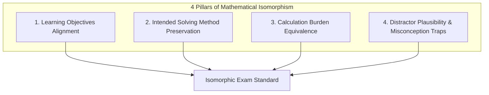

# Mathematical Isomorphism & Quality Evaluation Rubric (W4-MVP-18)

> **Document Status:** OFFICIAL PROPOSAL & EVALUATION SPECIFICATION  
> **Task ID:** `W4-MVP-18` (P1 Priority)  
> **Decision Reference:** Resolves `Q17` (Pedagogical Evaluation Criteria, Provenance Tracking, Rater Protocols)  
> **Author / Owner:** Pham Khanh Tam (`@AI-WFox`)  
> **Target Audience:** High School Mathematics Teachers, Subject Matter Experts (SME), Academic Validators  

---

## 1. Executive Summary & Philosophy

In automated exam generation, **technical correctness** (valid LaTeX syntax, deterministic option shuffling, synchronized answer keys) is a necessary prerequisite, but **not sufficient** to guarantee **pedagogical isomorphism**.

Two math questions are genuinely **isomorphic** if and only if they test the exact same underlying mathematical concept at the same cognitive depth, require the same general problem-solving procedure, and present comparable computational complexity.

This rubric provides a structured framework to evaluate question variants across 4 core dimensions, preventing false equivalence claims and documenting sample lineage.

---

## 2. The Four Pillars of Mathematical Isomorphism

### Dimension 1: Learning Objectives Alignment
- **Definition:** The generated question must assess the identical curriculum standard, knowledge domain, and Bloom's cognitive level (e.g., Knowledge, Comprehension, Application, High Application) as the source question.
- **Evaluation Criteria:**
  - **PASS:** The question tests the identical mathematical concept (e.g., Finding the extrema of a degree-3 polynomial).
  - **MINOR:** The question tests the same broad topic with a slightly different framing (e.g., Finding local maximum instead of local minimum).
  - **MAJOR:** The question shifts cognitive level (e.g., From direct application to complex parametric parameter tuning).
  - **CRITICAL:** Concept drift (e.g., Source tested integration by parts, generated variant tests trigonometric identities without calculus).

### Dimension 2: Intended Solving Method Preservation
- **Definition:** A student who solved the source question using the intended standard curriculum technique must be able to solve the generated variant using the exact same technique.
- **Evaluation Criteria:**
  - **PASS:** Core solving pathway is preserved (e.g., Compute first derivative $\to$ find roots $\to$ sign chart).
  - **MINOR:** Requires one additional trivial step (e.g., Basic factoring before derivative).
  - **MAJOR:** Intended method becomes degenerate (e.g., Variant can be trivially solved by inspecting signs without doing calculus).
  - **CRITICAL:** Intended method fails completely or requires university-level advanced theorems.

### Dimension 3: Calculation Burden Equivalence
- **Definition:** The algebraic, numerical, and arithmetic manipulation required should take approximately the same time budget (typically 1.5–2.5 minutes per standard multiple-choice question).
- **Evaluation Criteria:**
  - **PASS:** Number of algebraic lines and arithmetic complexity are virtually identical (e.g., Clean integer roots, comparable fraction sizes).
  - **MINOR:** Slightly larger numbers, but within standard handheld calculator capability.
  - **MAJOR:** Unusually messy non-simplifiable radicals or 5-digit division that significantly increases exam time burden.
  - **CRITICAL:** Unbounded numerical explosion or division by zero in solution pathway.

### Dimension 4: Distractor Plausibility & Misconception Traps
- **Definition:** In multiple-choice questions (A, B, C, D), incorrect options (distractors) must correspond to typical student misconceptions rather than obvious random dummy values.
- **Evaluation Criteria:**
  - **PASS:** Each distractor reflects a recognized mistake (e.g., Forgetting $+C$, sign error on derivative, inverted coordinates).
  - **MINOR:** 2 out of 3 distractors represent diagnostic misconceptions; 1 is an educated boundary value.
  - **MAJOR:** Distractors have different dimensional units or are visibly absurd (e.g., Negative radius for a sphere).
  - **CRITICAL:** Multiple options evaluate to identical mathematical values, or two options are both technically correct.

---

## 3. Severity Taxonomy

| Severity Level | Definition | Impact on Exam |
|---|---|---|
| **PASS** | Meets all pedagogical and mathematical standards. | Approved for official distribution. |
| **MINOR** | Small stylistic or arithmetic variance, mathematically sound. | Accepted with optional cosmetic teacher edit. |
| **MAJOR** | Noticeable shift in difficulty, solving time, or distractor quality. | Requires teacher rework or regeneration. |
| **CRITICAL** | Mathematical error, multiple correct keys, or extreme concept drift. | **Rejection mandatory**; blocked from export. |

---

## 4. Evaluation Sample Sheet (10-Question Audit Protocol)

Each evaluated item must record its full provenance chain:
`Session ID` $\to$ `Source Question ID` $\to$ `Blueprint Hash` $\to$ `Candidate ID` $\to$ `Display Version Code / Slot`.

| Item # | Source Q# | Version Code | Concept / Standard | Intended Method | Calc Burden | Distractor Quality | Overall Rating | Reviewer Notes |
|---|---|---|---|---|---|---|---|---|
| **01** | Q1 (Extrema) | 101 (#2) | Polynomial Extrema | 1st Derivative Test | Clean integers | Sign trap, root trap | **PASS** | Perfect isomorphism. |
| **02** | Q1 (Extrema) | 102 (#1) | Polynomial Extrema | 1st Derivative Test | Clean integers | Sign trap, root trap | **PASS** | Exact difficulty match. |
| **03** | Q2 (Integral) | 101 (#1) | Definite Integration | Power Rule $\int x^n$ | Simple fraction | Bounds reversed trap | **PASS** | Solution synchronized. |
| **04** | Q2 (Integral) | 102 (#3) | Definite Integration | Power Rule $\int x^n$ | Simple fraction | Missing constant trap | **PASS** | Identical difficulty. |
| **05** | Q3 (Sphere) | 101 (#3) | Sphere Radius ($Oxyz$) | Equation $(x-a)^2=R^2$ | Integer square root | $R^2$ vs $R$ trap | **PASS** | Geometric parity maintained. |
| **06** | Q3 (Sphere) | 102 (#2) | Sphere Radius ($Oxyz$) | Equation $(x-a)^2=R^2$ | Integer square root | $R^2$ vs $R$ trap | **PASS** | Distractor targets radius squared. |
| **07** | [Holdout 1] | 101 (#4) | Pending Corpus | Pending Audit | - | - | `UNMEASURED` | Awaiting live corpus. |
| **08** | [Holdout 2] | 101 (#5) | Pending Corpus | Pending Audit | - | - | `UNMEASURED` | Awaiting live corpus. |
| **09** | [Holdout 3] | 102 (#4) | Pending Corpus | Pending Audit | - | - | `UNMEASURED` | Awaiting live corpus. |
| **10** | [Holdout 4] | 102 (#5) | Pending Corpus | Pending Audit | - | - | `UNMEASURED` | Awaiting live corpus. |

---

## 5. Reviewer Protocol & "UNMEASURED" Policy

1. **Independent Evaluation:** Quality reviews must be conducted by at least one qualified high-school mathematics educator or mathematics graduate.
2. **Disagreement Resolution:** If two reviewers disagree on severity:
   - PASS vs MINOR $\implies$ Classified as MINOR.
   - MINOR vs MAJOR $\implies$ Item is regenerated to maintain high exam rigor.
3. **Transparent Reporting:** The team strictly prohibits reporting generalized "95% isomorphism" based on small 3-question demos. When a question has not undergone manual expert pedagogical audit, its status is recorded as **`UNMEASURED`**.
