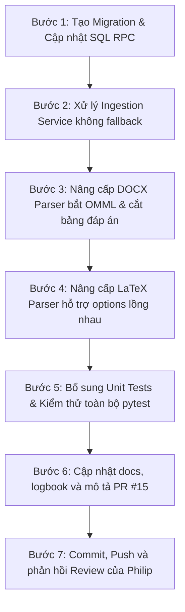

# Kế hoạch khắc phục phản hồi Review PR #15

**Nhánh**: `feat/be1-task-202-ingestion-parsers`  
**PR**: [#15](https://github.com/Computational-Thinking-Project/isomorphic-exam-synthesizer/pull/15)  
**Người review**: Philip (`philip-kkk`)  
**Trạng thái review**: `CHANGES_REQUESTED`  
**Mục tiêu**: Xử lý triệt để 2 câu hỏi kiến trúc, 2 vấn đề P1, 3 vấn đề P2, đồng thời bổ sung các bài kiểm thử unit test & regression test để đảm bảo 100% pass và sẵn sàng merge.

---

## I. Tổng hợp các đầu mục cần khắc phục

| Mã mục | Mức độ | Phạm vi | Mô tả ngắn gọn | File liên quan |
| :--- | :---: | :--- | :--- | :--- |
| **M-01** | **P1** | Database Security | Thắt chặt quyền thực thi RPC `replace_source_questions`, từ chối caller nặc danh, kiểm tra trạng thái session `draft` trong SQL. | [`backend/scripts/schema.sql`](file:///c:/Users/ASUS%20Vivobook/Desktop/CT%20projects/isomorphic-exam-synthesizer/backend/scripts/schema.sql), migration mới |
| **M-02** | **P1** | Backend Service | Xóa bỏ hoàn toàn fallback xóa/chèn ngoài transaction khi RPC thất bại để đảm bảo Zero Mutation. | [`backend/app/services/parser/ingestion_service.py`](file:///c:/Users/ASUS%20Vivobook/Desktop/CT%20projects/isomorphic-exam-synthesizer/backend/app/services/parser/ingestion_service.py) |
| **M-03** | **P2** | Parser DOCX | Đánh dấu cờ `has_unparsed_omml = True` với mọi cấu trúc công thức OMML chưa convert sang LaTeX (ví dụ số mũ `m:sSup`, `m:sSub`, v.v.). | [`backend/app/services/parser/docx_parser.py`](file:///c:/Users/ASUS%20Vivobook/Desktop/CT%20projects/isomorphic-exam-synthesizer/backend/app/services/parser/docx_parser.py) |
| **M-04** | **P2** | Parser DOCX | Cắt bỏ phần bảng đáp án khỏi danh sách paragraphs trước khi tách câu để tránh dính đáp án vào phương án D. | [`backend/app/services/parser/docx_parser.py`](file:///c:/Users/ASUS%20Vivobook/Desktop/CT%20projects/isomorphic-exam-synthesizer/backend/app/services/parser/docx_parser.py) |
| **M-05** | **P2** | Parser LaTeX | Phân biệt `\item` của câu hỏi và `\item` của phương án (ví dụ `\item[A.]`), tránh làm vỡ 1 câu thành nhiều câu. | [`backend/app/services/parser/latex_parser.py`](file:///c:/Users/ASUS%20Vivobook/Desktop/CT%20projects/isomorphic-exam-synthesizer/backend/app/services/parser/latex_parser.py) |
| **M-06** | **Q1** | Migration SQL | Tạo file migration SQL độc lập để thêm RPC trên database đã có dữ liệu mà không cần chạy lại toàn bộ schema. | `backend/migrations/002_replace_source_questions_rpc.sql` |
| **M-07** | **Q2** | Docs & PR | Cập nhật mô tả PR, logbook và code docstrings làm rõ giới hạn placeholder của `trigger_blueprint_pipeline`. | PR #15 body, [`docs/logbook.md`](file:///c:/Users/ASUS%20Vivobook/Desktop/CT%20projects/isomorphic-exam-synthesizer/docs/logbook.md), [`ingestion_service.py`](file:///c:/Users/ASUS%20Vivobook/Desktop/CT%20projects/isomorphic-exam-synthesizer/backend/app/services/parser/ingestion_service.py) |
| **M-08** | **Test** | Quality Assurance | Bổ sung unit tests cho từng lỗi được Philip chỉ ra, kiểm tra hồi quy toàn bộ test suite. | [`backend/tests/test_parsers.py`](file:///c:/Users/ASUS%20Vivobook/Desktop/CT%20projects/isomorphic-exam-synthesizer/backend/tests/test_parsers.py), [`backend/tests/api/test_ingest.py`](file:///c:/Users/ASUS%20Vivobook/Desktop/CT%20projects/isomorphic-exam-synthesizer/backend/tests/api/test_ingest.py) |

---

## II. Chi tiết phương án kỹ thuật từng hạng mục

### 1. M-01 [P1]: Bảo vệ quyền gọi RPC và trạng thái phiên trong SQL
* **Nguyên nhân**:
  * Điều kiện `IF auth.uid() IS NOT NULL THEN` hiện tại khiến caller nặc danh (`auth.uid() IS NULL`) vượt qua kiểm tra quyền sở hữu và được phép xóa dữ liệu.
  * Thiếu kiểm tra trạng thái phiên: nếu phiên thi đã được chốt (không còn là `draft`), người dùng vẫn có thể gọi RPC xóa và nạp lại câu hỏi.
  * Hàm `replace_source_questions` khai báo `SECURITY DEFINER` nhưng chưa thu hồi quyền `EXECUTE` mặc định từ role `PUBLIC`.
* **Giải pháp khắc phục**:
  1. Kiểm tra xác thực chặt chẽ:
     * Nếu `auth.uid() IS NULL`, kiểm tra xem caller có phải role backend hệ thống (`service_role`) hay không:
       ```sql
       IF auth.uid() IS NULL AND current_setting('request.jwt.claim.role', true) != 'service_role' THEN
         RAISE EXCEPTION 'Unauthorized: caller must be authenticated' USING ERRCODE = '42501';
       END IF;
       ```
     * Nếu `auth.uid() IS NOT NULL`, xác thực quyền sở hữu phiên:
       ```sql
       IF NOT EXISTS (
         SELECT 1 FROM public.exam_sessions 
         WHERE id = p_session_id AND user_id = auth.uid()
       ) THEN
         RAISE EXCEPTION 'Access denied or session not found' USING ERRCODE = '42501';
       END IF;
       ```
  2. Kiểm tra trạng thái phiên:
     ```sql
     IF NOT EXISTS (
       SELECT 1 FROM public.exam_sessions 
       WHERE id = p_session_id AND status = 'draft'
     ) THEN
       RAISE EXCEPTION 'Session is not in draft status' USING ERRCODE = '22023';
     END IF;
     ```
  3. Thu hồi quyền thực thi mặc định và cấp phát tối thiểu (Least Privilege):
     ```sql
     REVOKE EXECUTE ON FUNCTION public.replace_source_questions(UUID, JSONB) FROM PUBLIC;
     GRANT EXECUTE ON FUNCTION public.replace_source_questions(UUID, JSONB) TO authenticated, service_role;
     ```
  4. Đặt cấu hình `search_path` an toàn:
     ```sql
     SECURITY DEFINER
     SET search_path = public, auth, pg_temp;
     ```

---

### 2. M-02 [P1]: Bỏ Fallback không giao dịch trong `ingestion_service.py`
* **Nguyên nhân**:
  * Khi RPC thất bại, hàm `replace_session_questions_atomic` fallback sang xóa blueprint, xóa câu hỏi cũ, rồi insert câu hỏi mới thông qua 3 lệnh REST API rời rạc.
  * Nếu lệnh insert gặp sự cố mạng hoặc lỗi cú pháp dữ liệu, câu hỏi cũ đã bị xóa sạch mà không được rollback, vi phạm nguyên lý **Zero Cloud Mutation** khi gặp lỗi.
* **Giải pháp khắc phục**:
  * Xóa bỏ hoàn toàn khối `if not use_rpc_success: try: ... delete ... insert ...`.
  * Nếu RPC không thành công (lỗi database hoặc RPC chưa được migrate), lập tức ghi log `logger.error` và ném ra ngoại lệ:
    ```python
    raise HTTPException(
        status_code=status.HTTP_500_INTERNAL_SERVER_ERROR,
        detail="Database atomic replacement failed. Session state was not modified."
    )
    ```
  * Đảm bảo tính nguyên tử 100%: hoặc RPC thành công toàn bộ, hoặc không có bản ghi nào bị xóa hay thay đổi.

---

### 3. M-03 [P2]: Gắn cờ mọi công thức OMML chưa parse được trong DOCX
* **Nguyên nhân**:
  * Hàm `inspect_paragraph_omml` hiện chỉ kiểm tra `<m:f` (phân số) và `<m:rad` (căn thức).
  * Các thẻ công thức khác như số mũ `<m:sSup>`, chỉ số dưới `<m:sSub>`, ma trận `<m:m>`, v.v. khi nằm trong `m:oMath` không xuất hiện trong `paragraph.text` và bị bỏ qua, dẫn đến `has_unparsed_omml = False`.
* **Giải pháp khắc phục**:
  * Mở rộng kiểm tra trong `inspect_paragraph_omml`:
    Nếu paragraph chứa phần tử OMML (`<m:oMath>`, `<w:oMath>`, `<m:sSup>`, `<m:sSub>`, `<m:f>`, `<m:rad>`, v.v.) mà text của paragraph **không chứa** công thức LaTeX đã được chuyển đổi (không chứa cặp ký tự `$`), ta coi toàn bộ khối công thức đó là chưa parse được:
    ```python
    if has_omml:
        # Nếu có thẻ OMML nhưng đoạn text không có biểu thức toán LaTeX ($...$)
        # hoặc chứa bất kỳ cấu trúc toán chưa convert
        return True, True
    ```
  * Bổ sung unit test kiểm tra paragraph có `<m:sSup>` ($x^2$).

---

### 4. M-04 [P2]: Cắt bỏ bảng đáp án trước khi duyệt paragraphs trong DOCX
* **Nguyên nhân**:
  * `parse_docx` đã gọi `parse_separate_answer_key(all_text)` để trích xuất đáp án, nhưng sau đó vẫn lặp qua toàn bộ `full_paragraphs`.
  * Các đoạn text của bảng đáp án ở cuối tài liệu (ví dụ: `BẢNG ĐÁP ÁN: 1.A 2.B`) bị append vào câu hỏi cuối cùng, dẫn đến phương án D bị dính chuỗi bảng đáp án.
* **Giải pháp khắc phục**:
  1. Xác định vị trí bắt đầu của bảng đáp án trong danh sách paragraphs:
     * Dựa vào regex nhận diện tiêu đề đáp án (`BẢNG ĐÁP ÁN`, `ĐÁP ÁN:`, v.v.).
     * Hoặc cắt danh sách paragraphs ngay tại paragraph đầu tiên khớp với tiêu đề đáp án:
       ```python
       cutoff_index = len(full_paragraphs)
       for i, p_text in enumerate(full_paragraphs):
           if re.search(r"^\s*(?:BẢNG\s+)?ĐÁP\s+ÁN", p_text, re.IGNORECASE):
               cutoff_index = i
               break
       content_paragraphs = full_paragraphs[:cutoff_index]
       content_omml_flags = paragraph_omml_flags[:cutoff_index]
       ```
  2. Chỉ chạy vòng lặp tách câu hỏi trên `content_paragraphs` và `content_omml_flags`.

---

### 5. M-05 [P2]: Phân biệt `\item` câu hỏi và `\item` phương án trong LaTeX
* **Nguyên nhân**:
  * Trong `latex_parser.py`, biểu thức `re.split(r"\\item(?![a-zA-Z])", enum_body)` tách bừa mọi `\item`.
  * Khi người dùng viết các phương án trắc nghiệm bằng `\item[A.]`, `\item[B.]` hoặc lồng môi trường `\begin{enumerate} ... \end{enumerate}` bên trong câu hỏi, câu hỏi bị tách vụn thành 5 câu.
* **Giải pháp khắc phục**:
  1. Cải tiến regex tách câu hỏi: chỉ tách những `\item` đại diện cho câu hỏi, loại trừ các `\item` đi kèm nhãn phương án:
     ```python
     # Không tách nếu \item đi kèm [A.], [B.], [C.], [D.] hoặc [A)], [B)], v.v.
     ITEM_OPTION_LOOKAHEAD = r"\\item(?!\s*\[\s*[A-Da-d][\.\)]\s*\])(?![a-zA-Z])"
     ```
  2. Với các môi trường lồng nhau (nested `enumerate` / `itemize` dành cho options):
     * Bảo tồn môi trường con hoặc bóc tách danh sách lựa chọn lồng nhau trước khi phân rã cấp độ câu hỏi.
  3. Bổ sung bài test mẫu LaTeX có `\item[A.]`, `\item[B.]` trong 1 câu hỏi.

---

### 6. M-06 [Q1]: Script Migration riêng cho RPC `replace_source_questions`
* **Vấn đề**: DB staging/production đã có dữ liệu, không thể chạy lại toàn bộ `schema.sql`.
* **Giải pháp khắc phục**:
  * Tạo file `backend/migrations/002_replace_source_questions_rpc.sql` độc lập và idempotent (`CREATE OR REPLACE FUNCTION`).
  * File bao gồm:
    * Định nghĩa hàm `replace_source_questions` với logic bảo mật mới.
    * Các câu lệnh `REVOKE` và `GRANT`.
    * Comment hướng dẫn chạy script qua Supabase SQL Editor hoặc `psql`.

---

### 7. M-07 [Q2]: Làm rõ giới hạn của `trigger_blueprint_pipeline`
* **Vấn đề**: Nhóm cần phân biệt rõ hook hiện tại với pipeline TASK-203 đã tích hợp.
* **Giải pháp khắc phục**:
  * Cập nhật docstring của `trigger_blueprint_pipeline` trong [ingestion_service.py](file:///c:/Users/ASUS%20Vivobook/Desktop/CT%20projects/isomorphic-exam-synthesizer/backend/app/services/parser/ingestion_service.py):
    * Ghi chú rõ: *Đây là async event hook / placeholder logging, chưa kết nối trực tiếp với LLM generation pipeline của TASK-203.*
  * Cập nhật nội dung mô tả của PR #15 trên GitHub:
    * Thêm mục "Known Scope Limitations" ghi rõ tiến độ bàn giao giữa TASK-202 (BE-02) và TASK-203.
  * Cập nhật [docs/logbook.md](file:///c:/Users/ASUS%20Vivobook/Desktop/CT%20projects/isomorphic-exam-synthesizer/docs/logbook.md).

---

## III. Kế hoạch kiểm thử bổ sung (M-08)

Các ca kiểm thử mới cần bổ sung vào `backend/tests/`:

1. **`test_docx_parser_omml_superscript`**:
   * Tạo DOCX có công thức $x^2$ bằng XML `<m:sSup>`.
   * Kỳ vọng: Parser phát hiện `has_unparsed_omml = True` và trả lỗi `UNPARSED_OMML`.
2. **`test_docx_parser_trailing_answer_table_clean_options`**:
   * Tạo DOCX có 2 câu hỏi và kết thúc bằng bảng `BẢNG ĐÁP ÁN: 1.A 2.B`.
   * Kỳ vọng: Phương án D của câu 2 sạch sẽ, không chứa chuỗi `BẢNG ĐÁP ÁN:`.
3. **`test_latex_parser_nested_item_options`**:
   * Kiểm thử tài liệu LaTeX có danh sách phương án trắc nghiệm dùng `\item[A.] ... \item[D.]`.
   * Kỳ vọng: Nhận diện chính xác 1 câu hỏi với 4 phương án, không bị chia thành 5 câu.
4. **`test_ingestion_service_rpc_failure_no_mutation`**:
   * Giả lập RPC trả về lỗi (raise DatabaseError).
   * Kỳ vọng: Service ném `HTTPException(500)`, không thực hiện bất kỳ lệnh delete hay insert nào trên DB.

---

## IV. Lộ trình thực hiện từng bước



1. **Giai đoạn 1 (Database & Security)**:
   * Sửa [`backend/scripts/schema.sql`](file:///c:/Users/ASUS%20Vivobook/Desktop/CT%20projects/isomorphic-exam-synthesizer/backend/scripts/schema.sql).
   * Viết `backend/migrations/002_replace_source_questions_rpc.sql`.
   * Sửa [`backend/app/services/parser/ingestion_service.py`](file:///c:/Users/ASUS%20Vivobook/Desktop/CT%20projects/isomorphic-exam-synthesizer/backend/app/services/parser/ingestion_service.py) để loại bỏ fallback không an toàn.
2. **Giai đoạn 2 (Parser Engine Fixes)**:
   * Sửa [`backend/app/services/parser/docx_parser.py`](file:///c:/Users/ASUS%20Vivobook/Desktop/CT%20projects/isomorphic-exam-synthesizer/backend/app/services/parser/docx_parser.py) (OMML tags + trailing answer key cutoff).
   * Sửa [`backend/app/services/parser/latex_parser.py`](file:///c:/Users/ASUS%20Vivobook/Desktop/CT%20projects/isomorphic-exam-synthesizer/backend/app/services/parser/latex_parser.py) (phân biệt item câu hỏi vs item đáp án).
3. **Giai đoạn 3 (Verification & Regression Tests)**:
   * Thêm các test case mới vào [`backend/tests/test_parsers.py`](file:///c:/Users/ASUS%20Vivobook/Desktop/CT%20projects/isomorphic-exam-synthesizer/backend/tests/test_parsers.py) và [`backend/tests/api/test_ingest.py`](file:///c:/Users/ASUS%20Vivobook/Desktop/CT%20projects/isomorphic-exam-synthesizer/backend/tests/api/test_ingest.py).
   * Chạy `pytest`, `mypy`, `ruff`.
4. **Giai đoạn 4 (Documentation & Communication)**:
   * Cập nhật [`docs/logbook.md`](file:///c:/Users/ASUS%20Vivobook/Desktop/CT%20projects/isomorphic-exam-synthesizer/docs/logbook.md) và [`docs/change_log.md`](file:///c:/Users/ASUS%20Vivobook/Desktop/CT%20projects/isomorphic-exam-synthesizer/docs/change_log.md).
   * Soạn phản hồi trên GitHub PR #15 gửi Philip giải thích chi tiết các điểm đã tiếp thu và sửa đổi.
