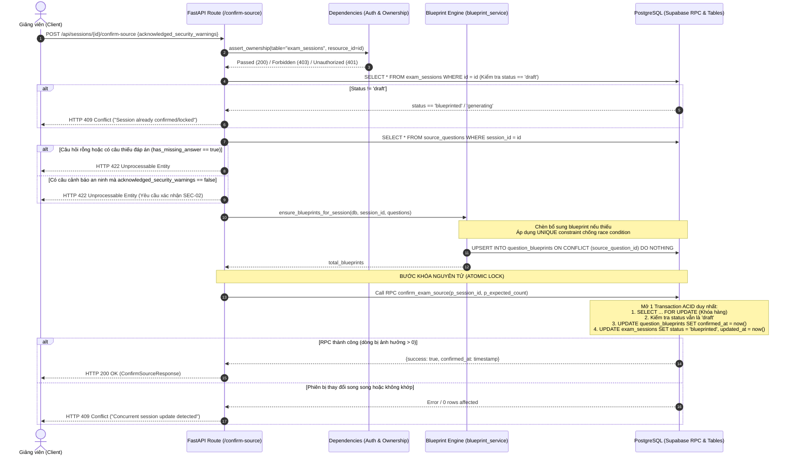

# Kế Hoạch Khắc Phục & Hoàn Thiện PR #16 Theo Code Review (TASK-205)
## Confirm Source Exam & Blueprint Activation Guard

> **Metadata:**
> - **Mã Task:** TASK-205 (BE-03)
> - **PR Liên Quan:** [PR #16](https://github.com/Computational-Thinking-Project/isomorphic-exam-synthesizer/pull/16) (`feat/be1-task-205-confirm-source` -> `dev`)
> - **Người Review:** `philip-kkk` (Review ID: #5637938756 — Trạng thái: `CHANGES_REQUESTED`)
> - **Commit Được Review:** `2bfa4d83399c33a045289eb369172dcca7ebff23`
> - **Người Phụ Trách:** BE1 (`johannguyen015` / Nguyễn Bá Duy)
> - **Ngày Lập Kế Hoạch:** 25/10/2026
> - **File Lưu Trữ:** [task_205_review_remediation_plan.md](file:///c:/Users/ASUS%20Vivobook/Desktop/CT%20projects/isomorphic-exam-synthesizer/docs/task_205_review_remediation_plan.md)

---

## 0. Phát Hiện & Sửa Lỗi Logic Từ Quá Trình Audit Thực Chứng (BẮT BUỘC)

Sau khi rà soát toàn diện phản hồi từ reviewer `philip-kkk` và đối chiếu thực tế với mã nguồn trên nhánh `feat/be1-task-205-confirm-source`, nhánh `feat/be1-task-202-ingestion-parsers` (PR #15), và [schema.sql](file:///c:/Users/ASUS%20Vivobook/Desktop/CT%20projects/isomorphic-exam-synthesizer/backend/scripts/schema.sql), phát hiện 6 điểm kỹ thuật trọng yếu:

### 0.1. Lỗ Hổng Bảo Mật & Thiếu State Guard Trong Stored Procedure `replace_source_questions` (P1)
- **Vấn đề:** Trong [schema.sql:367–382](file:///c:/Users/ASUS%20Vivobook/Desktop/CT%20projects/isomorphic-exam-synthesizer/backend/scripts/schema.sql#L367-L382), hàm RPC dùng `SECURITY DEFINER` nhưng chỉ kiểm tra `IF auth.uid() IS NOT NULL`. Khi gọi mà không có JWT (`auth.uid() IS NULL`), RPC bỏ qua hoàn toàn bước kiểm tra chủ sở hữu. Đồng thời, `PUBLIC` có quyền `EXECUTE` mặc định, và RPC không kiểm tra xem phiên có đang ở trạng thái `draft` hay không. Hậu quả: Kẻ tấn công có thể xóa trắng dữ liệu câu hỏi và blueprint của phiên người khác nếu biết `session_id`, hoặc ghi đè phiên đã bị khóa (`blueprinted`).
- **Thực tế mã nguồn:** Trên nhánh nguồn PR #15 (`feat/be1-task-202-ingestion-parsers`), lỗi này **đã được fix triệt để** tại commit `c61c2fc` & `82fbf96` (bổ sung khóa dòng `FOR UPDATE`, kiểm tra xác thực người gọi, chặn nếu status khác `draft`, `REVOKE EXECUTE` từ `PUBLIC/anon` và `GRANT` riêng cho `authenticated/service_role`).
- **Giải pháp:** Đồng bộ (merge) nhánh PR #15 vào nhánh PR #16 để cập nhật định nghĩa RPC an toàn vào `schema.sql`.

### 0.2. Chốt Nguồn Không Nguyên Tử & Rủi Ro Báo Thành Công Giả 200 (P1)
- **Vấn đề:** Trong [sessions.py:588–602](file:///c:/Users/ASUS%20Vivobook/Desktop/CT%20projects/isomorphic-exam-synthesizer/backend/app/api/routes/sessions.py#L588-L602), thao tác cập nhật `confirmed_at` trên bảng `question_blueprints` và cập nhật `status = 'blueprinted'` trên `exam_sessions` được thực hiện qua **hai lệnh REST UPDATE client-side độc lập**:
  1. Nếu lệnh UPDATE thứ hai thất bại (lỗi mạng, timeout), `question_blueprints` đã bị đánh dấu xác nhận nhưng session vẫn ở `draft`.
  2. Supabase Python REST `update().execute()` trả về danh sách bản ghi đã sửa trong `res.data`. Nếu không có dòng nào khớp (ví dụ session bị xóa hoặc chuyển trạng thái song song), `res.data == []` nhưng code hiện tại vẫn coi là thành công và trả về `HTTP 200 OK`.
  3. **Race Condition:** Nếu người dùng gửi request nhập lại đề (`ingest-file`/`ingest-text`) song song với lệnh `confirm-source`, tập câu hỏi được kiểm duyệt ở Guard 3 có thể bị thay thế bởi tập câu hỏi mới trước khi session kịp đổi trạng thái sang `blueprinted`.
- **Giải pháp:** 
  1. Triển khai PostgreSQL RPC `confirm_exam_source(p_session_id UUID, p_expected_question_count INT)` khóa phiên nguyên tử (`FOR UPDATE`), kiểm tra trạng thái và cập nhật đồng thời cả 2 bảng trong 1 transaction ACID duy nhất.
  2. Bổ sung fallback kiểm tra kết quả ghi thực tế: Kiểm tra số dòng được update, nếu không có dòng nào bị ảnh hưởng thì trả về `HTTP 409 Conflict` thay vì 200.

### 0.3. Cơ Chế Fallback Nhập Lại Đề Xóa-Chèn Client-Side Gây Mất Dữ Liệu Nguồn Cũ (P1)
- **Vấn đề:** Trong [ingestion_service.py:52–100](file:///c:/Users/ASUS%20Vivobook/Desktop/CT%20projects/isomorphic-exam-synthesizer/backend/app/services/parser/ingestion_service.py#L52-L100), khi RPC không khả dụng, code chuyển sang fallback: xóa blueprints -> xóa source_questions -> insert source_questions mới. Nếu thao tác insert bị lỗi giữa chừng, toàn bộ đề cũ bị xóa sạch mà đề mới không được lưu (mất dữ liệu, vi phạm Zero Cloud Mutation).
- **Thực tế mã nguồn:** Điểm này đã được giải quyết ở PR #15 commit `c61c2fc`: Loại bỏ hoàn toàn fallback non-transactional xóa-chèn riêng lẻ; khi RPC lỗi thì ném ngoại lệ ngay để CSDL nguyên vẹn (Zero Cloud Mutation).
- **Giải pháp:** Kế thừa tự động khi đồng bộ PR #15 vào PR #16.

### 0.4. Nguy Cơ Nhân Bản (Trùng Lặp) Blueprint Khi Background Worker và Confirm Chạy Đồng Thời (P2)
- **Vấn đề:** Trong [schema.sql:94–105](file:///c:/Users/ASUS%20Vivobook/Desktop/CT%20projects/isomorphic-exam-synthesizer/backend/scripts/schema.sql#L94-L105), bảng `question_blueprints` hiện chỉ có `id UUID PRIMARY KEY`, `source_question_id UUID REFERENCES ...` nhưng **chưa có ràng buộc UNIQUE (`source_question_id`)**. Trong [blueprint_service.py:74–98](file:///c:/Users/ASUS%20Vivobook/Desktop/CT%20projects/isomorphic-exam-synthesizer/backend/app/services/parser/blueprint_service.py#L74-L98), hàm `ensure_blueprints_for_session` đọc các blueprint hiện có, tìm các câu chưa có rồi chèn mới. Nếu tác vụ nền (TASK-203 `trigger_blueprint_pipeline`) và tác vụ xác nhận (`confirm-source`) chạy cùng lúc trên 2 tiến trình, cả 2 đều thấy thiếu và cùng chèn $\rightarrow$ tạo ra 2 blueprint cho cùng 1 câu hỏi nguồn.
- **Giải pháp:**
  1. Bổ sung ràng buộc toàn vẹn vào `schema.sql`: `CONSTRAINT uq_question_blueprints_source_question UNIQUE (source_question_id)`.
  2. Trong `blueprint_service.py`: Sử dụng cơ chế chèn an toàn chống trùng lặp (`upsert` với `on_conflict="source_question_id"` hoặc bắt lỗi xung đột), bảo vệ nguyên vẹn các bản ghi blueprint đã có và đã được `confirmed_at`.

### 0.5. Làm Rõ Bản Chất Fallback Trích Số ±5 & Hợp Đồng Với TASK-203 (Question)
- **Vấn đề từ Reviewer:** Reviewer yêu cầu làm rõ liệu việc trích xuất số và đặt khoảng biến thiên $\pm 5$ trong `extract_default_blueprint` là giải pháp tạm hay blueprint dùng để sinh đề thật, và hợp đồng với TASK-203 ra sao.
- **Làm rõ kỹ thuật:**
  1. `extract_default_blueprint` là **cơ chế dự phòng tất định (Deterministic Fallback / Mock Engine)** nhằm phục vụ kiểm thử cục bộ, đảm bảo tính liên tục của hệ thống (resilience) khi AI Provider (Gemini API / TASK-203) gặp sự cố quota/nghẽn mạng, hoặc phục vụ các câu hỏi toán đơn giản không thể bóc tách qua AI.
  2. Bổ sung trường đánh dấu nguồn gốc vào Blueprint: Thêm cờ `extraction_source: "FALLBACK_DETERMINISTIC"` vs `"AI_PIPELINE"` trong payload JSONB hoặc `rule_summary` để Stage 2 (Generator) nhận biết được mức độ tin cậy toán học của Blueprint.
  3. Bổ sung tài liệu đặc tả hợp đồng với TASK-203 trong [confirm-source-endpoint.md](file:///c:/Users/ASUS%20Vivobook/Desktop/CT%20projects/isomorphic-exam-synthesizer/docs/api/confirm-source-endpoint.md).

### 0.6. Vệ Sinh PR Description & Quy Chuẩn Git (Checklist)
- **Vấn đề:** PR #16 hiện có 27 file thay đổi (do tích hợp cả backend endpoints, services, tests, và tài liệu), do đó việc tích chọn checklist `< ~300 lines` là không chính xác với diff thực tế.
- **Giải pháp:** Cập nhật PR description, phân tách rõ: Code chức năng chính (~250 dòng), bộ test suite (~400 dòng), tài liệu và các file đồng bộ từ nhánh cơ sở.

---

## 1. Kiến Trúc Luồng Xác Nhận Đề Nguồn Nguyên Tử Mới



---

## 2. Kế Hoạch Triển Khai Chi Tiết Từng Hạng Mục

### Giai đoạn 1: Đồng Bộ PR #15 & Giải Quyết Xung Đột Nhánh Cơ Sở
- [x] **Mục 1.1:** Fetch nhánh remote mới nhất: `git fetch origin`
- [x] **Mục 1.2:** Merge nhánh `origin/feat/be1-task-202-ingestion-parsers` vào nhánh hiện tại `feat/be1-task-205-confirm-source`
- [x] **Mục 1.3:** Kiểm tra và nghiệm thu các phần đã được PR #15 sửa:
  - Hàm `replace_source_questions` trong `backend/scripts/schema.sql` đã có bảo mật SEC-04 đầy đủ.
  - Hàm `replace_source_questions_atomically` trong `backend/app/services/parser/ingestion_service.py` đã loại bỏ hoàn toàn fallback xóa-chèn client-side.
  - Các bài test regression của parser và ingestion pass 100%.

---

### Giai đoạn 2: Gia Cố CSDL (`backend/scripts/schema.sql`)
- [x] **Mục 2.1:** Thêm ràng buộc toàn vẹn duy nhất cho bảng `question_blueprints`:
  ```sql
  ALTER TABLE public.question_blueprints 
    ADD CONSTRAINT uq_question_blueprints_source_question UNIQUE (source_question_id);
  ```
- [x] **Mục 2.2:** Xây dựng Stored Procedure `confirm_exam_source` thực hiện chốt đề nguyên tử:
  - Khóa phiên với `FOR UPDATE`.
  - Kiểm tra quyền sở hữu (`user_id == auth.uid()`).
  - Kiểm tra trạng thái phiên `status == 'draft'`.
  - Kiểm tra số lượng câu hỏi khớp kỳ vọng (`expected_question_count`).
  - Khóa `confirmed_at` trên `question_blueprints` và chuyển `exam_sessions.status = 'blueprinted'` trong 1 transaction.
  - Thu hồi quyền `EXECUTE` từ `PUBLIC` và `anon`, phân quyền cho `authenticated` và `service_role`.

---

### Giai đoạn 3: Tái Cấu Trúc Blueprint Engine Service (`blueprint_service.py`)
- [x] **Mục 3.1:** Bổ sung metadata phân định xuất xứ blueprint trong `extract_default_blueprint`:
  - Đánh dấu `extraction_source: "FALLBACK_DETERMINISTIC"`
  - Thêm cờ `is_fallback: True`
- [x] **Mục 3.2:** Tái cấu trúc hàm `ensure_blueprints_for_session`:
  - Dùng `upsert(..., on_conflict="source_question_id")` hoặc kiểm tra chặt chẽ, không bao giờ tạo 2 blueprint cho 1 câu hỏi.
  - Giữ nguyên các blueprint đã có và đã được đóng dấu `confirmed_at`.
  - Trả về số lượng blueprint thực tế từ DB.

---

### Giai đoạn 4: Gia Cố Endpoint Chốt Nguồn (`backend/app/api/routes/sessions.py`)
- [x] **Mục 4.1:** Tích hợp gọi RPC `confirm_exam_source` làm luồng chính.
- [x] **Mục 4.2:** Triển khai cơ chế phòng vệ hai lớp (sau đó nâng cấp loại bỏ hoàn toàn client-side fallback ở Vòng 2 theo nguyên tắc 100% RPC ACID):
  - Bắt lỗi mạng / timeout trả về `HTTP 504 Gateway Timeout` trung thực.
  - Không bao giờ để blueprints bị đóng dấu `confirmed_at` mồ côi nếu cập nhật session thất bại.

---

### Giai đoạn 5: Mở Rộng Bộ Kiểm Thử Tự Động (`test_confirm_source.py` & SQL Permissions)
- [x] **Mục 5.1:** Triển khai đầy đủ ma trận test cases kiểm thử tự động (mở rộng lên 30 unit tests trong `test_confirm_source.py` và 11 scenarios trong `verify_migration_003_permissions.sql`):
  - Tính nguyên tử và chống partial mutation (HTTP 500 kèm khẳng định rollback khi có bằng chứng DB).
  - Chống báo thành công giả và race condition sửa đổi đồng thời (HTTP 409).
  - Loại trừ ngoại lệ mạng timeout (HTTP 504) và phân loại lỗi kết nối Class 08 (HTTP 500 trung tính).
  - Tránh trùng lặp blueprint và bảo tồn blueprint đã có `confirmed_at`.

---

### Giai đoạn 6: Cập Nhật Tài Liệu Kỹ Thuật & PR Checklist
- [x] **Mục 6.1:** Cập nhật `docs/api/confirm-source-endpoint.md` (làm rõ hợp đồng TASK-203/TASK-205).
- [x] **Mục 6.2:** Cập nhật `docs/change_log.md` (ghi nhận `ADR-003`).
- [x] **Mục 6.3:** Cập nhật checklist trên PR #16.

---

## 3. Khắc Phục Phản Hồi Code Review Vòng 2 (26/10/2026)

### 3.1. Trả Lời Câu Hỏi Kiến Trúc (Question)
* **Vấn đề:** Stage 2 xử lý blueprint `FALLBACK_DETERMINISTIC` và `variation_modes=["NONE"]` thế nào: cho sinh, yêu cầu giáo viên duyệt hay chặn?
* **Quy chuẩn chốt:**
  1. **Với `variation_modes = ["NONE"]`:**
     - Cho phép sinh đề bình thường, nhưng **bảo tồn nguyên văn nội dung câu hỏi (`PRESERVE_CONTENT_VERBATIM`)**.
     - Hệ thống chỉ áp dụng các tùy chọn trật tự (`ordering_preferences`): xáo trộn thứ tự câu (`shuffle_questions`) và xáo trộn vị trí đáp án ABCD (`shuffle_options`).
     - Không chặn đề thi vì bài thi thực tế có thể chứa câu hỏi lý thuyết / khái niệm không chứa tham số số học.
  2. **Với `extraction_source = "FALLBACK_DETERMINISTIC"` (heuristic $\pm 5$):**
     - Tại **Stage 1 (Preview & Confirm):** UI hiển thị cảnh báo/badge rõ ràng: `Blueprint dự phòng (Heuristic ±5)`. Thao tác bấm "Xác nhận đề nguồn" chính là bước giáo viên duyệt đề gốc.
     - Tại **Stage 2 (Generator / TASK-207b):** Các câu hỏi sinh từ `FALLBACK_DETERMINISTIC` **bắt buộc chạy qua SymPy Evaluator & Validator (TASK-207b / VAL)**. Nếu biến thể vi phạm tính giải được (chia 0, căn âm, vô nghiệm), validator reject và retry; nếu vượt quá retry thì **fallback về giữ nguyên câu hỏi gốc (verbatim)** để bảo toàn tính toàn vẹn đề thi mà không làm sập background job.

### 3.2. Đồng Bộ Schema & Migration với Payload Blueprint Service (P1)
* **Lỗi:** Schema thiếu 2 cột `is_fallback` và `extraction_source`, gây lỗi `column is_fallback does not exist` trên DB thật.
* **Khắc phục:**
  - Bổ sung 2 cột `is_fallback BOOLEAN NOT NULL DEFAULT FALSE` và `extraction_source TEXT NOT NULL DEFAULT 'AI_PIPELINE'` vào bảng `question_blueprints` trong `backend/scripts/schema.sql`.
  - Bổ sung DDL idempotent trong `backend/migrations/003_confirm_exam_source_rpc.sql`.
  - Gia cố `ensure_blueprints_for_session` trong `blueprint_service.py` tự động sanitize nếu chạy trên DB cũ chưa chạy migration.

### 3.3. Loại Bỏ Hoàn Toàn Client-Side Non-Transactional Update Fallback (P1)
* **Lỗi:** Khi RPC lỗi, fallback cập nhật rời từng bảng có nguy cơ gây partial lock hoặc trả 200 giả khi không khớp dòng nào.
* **Khắc phục:**
  - Loại bỏ hoàn toàn khối `if not rpc_success:` cập nhật client-side trong `backend/app/api/routes/sessions.py`.
  - Mọi thao tác xác nhận phải đi qua transaction nguyên tử trong PostgreSQL RPC `confirm_exam_source`.
  - Phân loại lỗi mạng/timeout: trả về `HTTP 504 Gateway Timeout` thông báo trạng thái chưa chắc chắn thay vì tự ý ghi tiếp.

### 3.4. Kiểm Tra Toàn Vẹn Đề Nguồn & Blueprint Ngay Trong RPC (P1)
* **Lỗi:** So sánh số câu chưa đủ để phát hiện thay đổi đề nguồn song song; RPC không kiểm tra cờ an ninh SEC-02 và không bảo đảm 100% câu có blueprint trước khi chuyển `blueprinted`.
* **Khắc phục:**
  - Bổ sung tham số `p_expected_updated_at` và `p_acknowledged_security_warnings` vào RPC `confirm_exam_source`.
  - Trong transaction khóa `FOR UPDATE`:
    1. Kiểm tra `updated_at == p_expected_updated_at`.
    2. Kiểm tra `v_security_warning_count > 0` yêu cầu `p_acknowledged_security_warnings = TRUE`.
    3. Kiểm tra số lượng blueprint được update `v_bp_count >= v_current_count`; nếu thiếu thì `ROLLBACK` ngay lập tức với lỗi `22023`.
    4. Trả về số lượng blueprint thực tế từ DB (`total_blueprints: v_bp_count`).

### 3.5. Phân Biệt Người Gọi (session_user) Với Chủ Hàm (current_user) trong SECURITY DEFINER (P2)
* **Lỗi:** Trong hàm `SECURITY DEFINER`, `current_user` luôn là chủ hàm (`postgres`), khiến caller `authenticated` với UID rỗng vượt qua xác thực.
* **Khắc phục:**
  - Thay `current_user` bằng `session_user IN ('postgres', 'supabase_admin')` kết hợp `v_role = 'service_role'` trong cả `002_replace_source_questions_rpc.sql`, `003_confirm_exam_source_rpc.sql` và `schema.sql`.
  - Viết script kiểm thử SQL 10 kịch bản: `backend/tests/verify_migration_003_permissions.sql`.

### 3.6. Ma Trận Kiểm Thử Nghiệm Thu Vòng 2

| # | Test Case | File | Kịch Bản & Kết Quả Kỳ Vọng |
|---|---|---|---|
| 1 | `test_confirm_source_rpc_missing_blueprints_returns_409` | `test_confirm_source.py` | RPC từ chối nếu có câu chưa có blueprint (HTTP 409). |
| 2 | `test_confirm_source_rpc_concurrent_modification_returns_409` | `test_confirm_source.py` | RPC từ chối nếu `updated_at` phiên bị thay đổi song song (HTTP 409). |
| 3 | `test_confirm_source_rpc_network_timeout_returns_504` | `test_confirm_source.py` | Lỗi timeout mạng trả về HTTP 504 Gateway Timeout với thông báo trung thực. |
| 4 | `test_confirm_source_rpc_db_error_returns_500_rollback` | `test_confirm_source.py` | Lỗi CSDL nội bộ trả về HTTP 500 kèm khẳng định rollback. |
| 5 | `test_confirm_source_returns_real_db_counts` | `test_confirm_source.py` | API trả về đúng số lượng blueprint và câu hỏi thực tế từ CSDL. |
| 6 | `verify_migration_003_permissions.sql` (10 scenarios) | PostgreSQL Script | Kiểm thử toàn diện ma trận phân quyền: `anon`, attacker non-owner, UID rỗng, non-draft, concurrent, warning, missing BP, count mismatch, valid owner, và service_role. |

