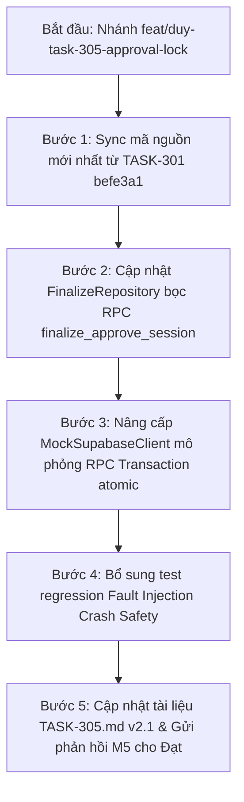

# KẾ HOẠCH BÀI BẢN XỬ LÝ TOÀN DIỆN VẤN ĐỀ F01 (CONTENT LOCK & CROSS-WORKER CRASH SAFETY) [TASK-305]

- **Mã finding:** F01 — [Bắt buộc sửa — P1] open: Approval races with parallel question mutation; in-memory lock does not cover separate workers; failure window under crash/network fault.
- **Reviewer:** Đạt (`Thanhdat3010`)
- **Tác giả kế hoạch:** Duy (`johannguyen015` — Leader & Backend Lead)
- **PR:** [#33](https://github.com/Computational-Thinking-Project/isomorphic-exam-synthesizer/pull/33)
- **Nhánh làm việc:** `feat/duy-task-305-approval-lock`
- **Tài liệu đối chiếu:**
  - Contract TASK-302 (Hùng): `docs/api/review-rpc-contract.md` (PR #36).
  - Schema migration (Hùng): `backend/migrations/006_stage3_review_and_shuffle.sql` (PR #36).
  - Review của Đạt tại comment `4434855549` trên PR #33.

---

## I. PHÂN TÍCH BẢN CHẤT GỐC RỄ (ROOT CAUSE ANATOMY)

### 1. Tại sao các bản vá tầng Python trước đây thất bại?
Ở hai commit trước (`87094f9` và `0f9999d`), chúng ta đã cố gắng giải quyết race condition bằng các kỹ thuật ở tầng ứng dụng Python:
1. Dùng `SessionLockRegistry` (AsyncIO Lock) $\rightarrow$ **Vô tác dụng giữa các process/worker khác nhau**.
2. Thêm Optimistic Concurrency Control (`expected_updated_at`) trên bảng session $\rightarrow$ **Chỉ bảo vệ được thao tác UPDATE trên chính session, không khóa được câu hỏi con**.
3. Thêm các câu lệnh `SELECT` kiểm tra trạng thái session ngay trước khi `UPDATE version_questions` $\rightarrow$ **Tồn tại Time-of-Check to Time-of-Use (TOCTOU) race condition**.
4. Viết logic hoàn tác bù trừ (compensation) bằng khối `try...except` trong Python $\rightarrow$ **Thất bại hoàn toàn trước Failure Window / Network Fault**.

### 2. Sơ đồ minh họa Failure Window mà Reviewer Đạt đã repro
```mermaid
sequenceDiagram
    autonumber
    actor WB as Worker B (Reject Question)
    participant DB as Database (Supabase)
    actor WA as Worker A (Finalize Approve)

    WB->>DB: 1. SELECT exam_sessions (thấy status = 'reviewed')
    WB->>DB: 2. SELECT version_questions (thấy status = 'approved')
    WB->>DB: 3. SELECT exam_sessions lần cuối (vẫn là 'reviewed')
    Note over WA,DB: Worker A xen ngang ngay trước khi B ghi DB
    WA->>DB: 4. UPDATE exam_sessions SET status = 'approved' (Thành công!)
    Note over WB,DB: Worker B thực thi câu lệnh ghi câu hỏi con
    WB->>DB: 5. UPDATE version_questions SET status = 'regenerating' (COMMIT THÀNH CÔNG!)
    Note over WB,DB: SỰ CỐ MẠNG / CRASH SẬP NGUỒN XẢY RA NGAY TẠI ĐÂY
    WB--xDB: 6. Gửi UPDATE quota exam_sessions -> BỊ OSError / ĐỨT MẠNG!
    Note over WB: Tiến trình sập hoặc không nhận được response; compensation không thể chạy!
    Note over DB: HẬU QUẢ: exam_sessions = 'approved' (ĐÃ KHÓA)<br/>nhưng version_questions = 'regenerating' (BỊ RÁCH NÁT DỮ LIỆU)
```

### 3. Kết luận kỹ thuật dứt khoát
- **Không có bất kỳ giải pháp nào ở tầng Application (Python)** có thể đảm bảo Crash Safety khi xâu chuỗi nhiều câu lệnh HTTP PostgREST rời rạc mà không có CSDL Transaction bao bọc.
- **Giải pháp duy nhất đúng đắn:** Gom toàn bộ logic kiểm tra và cập nhật đa bảng vào **Cơ chế Transaction cấp CSDL (PostgreSQL Stored Procedure / RPC)** có khóa dòng `SELECT ... FOR UPDATE`.

---

## II. QUYẾT ĐỊNH KIẾN TRÚC TẬN GỐC (ARCHITECTURAL RESOLUTIONS)

### 1. Quyết định 1: Tuyệt đối dừng vá lỗi bề mặt ở tầng Python
- Không thêm câu lệnh `SELECT` lặp lại.
- Không dựa vào cơ chế rollback thủ công ở tầng Python để xử lý tính nguyên tử giữa hai bảng khác nhau.

### 2. Quyết định 2: Chốt Hợp đồng CSDL Stored Procedure (RPC Contract) với TASK-302 (Hùng)
Để bảo đảm cô lập nguyên tử tuyệt đối (ACID Transaction), hai thao tác xung đột này phải được chuyển vào Stored Procedure chạy trong CSDL:

#### A. Stored Procedure 1: `finalize_approve_session` (Phê duyệt và Khóa Bất Biến)
```sql
CREATE OR REPLACE FUNCTION public.finalize_approve_session(
    p_session_id UUID,
    p_user_id UUID,
    p_expected_updated_at TIMESTAMPTZ DEFAULT NULL
)
RETURNS JSONB
LANGUAGE plpgsql
SECURITY DEFINER
AS $$
DECLARE
    v_session RECORD;
    v_unapproved_count INT;
    v_regenerating_count INT;
    v_unfinalized_count INT;
    v_now TIMESTAMPTZ := clock_timestamp();
BEGIN
    -- 1. Khóa cứng dòng session để chặn mọi worker khác xen ngang
    SELECT id, status, updated_at INTO v_session
    FROM public.exam_sessions
    WHERE id = p_session_id
    FOR UPDATE;

    IF NOT FOUND THEN
        RAISE EXCEPTION 'ERR_SESSION_NOT_FOUND';
    END IF;

    -- Idempotency
    IF v_session.status = 'approved' THEN
        RETURN jsonb_build_object('status', 'approved', 'session_id', p_session_id, 'idempotent', true);
    END IF;

    IF v_session.status NOT IN ('reviewed', 'generated') THEN
        RAISE EXCEPTION 'ERR_INVALID_SESSION_STATE';
    END IF;

    IF p_expected_updated_at IS NOT NULL AND v_session.updated_at != p_expected_updated_at THEN
        RAISE EXCEPTION 'ERR_INVALID_SESSION_STATE';
    END IF;

    -- 2. Kiểm tra điều kiện câu hỏi (trong cùng transaction)
    SELECT 
        COUNT(*) FILTER (WHERE status = 'regenerating'),
        COUNT(*) FILTER (WHERE status != 'approved')
    INTO v_regenerating_count, v_unapproved_count
    FROM public.version_questions vq
    JOIN public.exam_versions ev ON vq.version_id = ev.id
    WHERE ev.session_id = p_session_id AND vq.is_current = TRUE;

    IF v_regenerating_count > 0 THEN
        RAISE EXCEPTION 'ERR_QUESTION_REGENERATING';
    END IF;

    IF v_unapproved_count > 0 THEN
        RAISE EXCEPTION 'ERR_NOT_ALL_QUESTIONS_APPROVED';
    END IF;

    -- 3. Kiểm tra mã đề đã shuffle
    SELECT COUNT(*) INTO v_unfinalized_count
    FROM public.exam_versions
    WHERE session_id = p_session_id AND is_finalized = FALSE;

    IF v_unfinalized_count > 0 THEN
        RAISE EXCEPTION 'ERR_VERSIONS_NOT_FINALIZED';
    END IF;

    -- 4. Chuyển trạng thái nguyên tử
    UPDATE public.exam_sessions
    SET status = 'approved', approved_at = v_now, updated_at = v_now
    WHERE id = p_session_id;

    -- 5. Ghi audit log
    INSERT INTO public.review_logs (session_id, user_id, action_type, reason, created_at)
    VALUES (p_session_id, p_user_id, 'APPROVE_ALL', 'Session finalized and locked', v_now);

    RETURN jsonb_build_object('status', 'approved', 'approved_at', v_now, 'session_id', p_session_id);
END;
$$;
```

#### B. Stored Procedure 2: `review_reserve_regeneration` (Khóa Câu Hỏi & Kiểm Tra Session Cha)
```sql
CREATE OR REPLACE FUNCTION public.review_reserve_regeneration(
    p_session_id UUID,
    p_question_id UUID,
    p_user_id UUID
)
RETURNS JSONB
LANGUAGE plpgsql
SECURITY DEFINER
AS $$
DECLARE
    v_session RECORD;
    v_active_regen INT;
    v_q RECORD;
    v_now TIMESTAMPTZ := clock_timestamp();
BEGIN
    -- 1. Khóa dòng session để kiểm tra trạng thái bất biến
    SELECT id, status, gemini_review_calls INTO v_session
    FROM public.exam_sessions
    WHERE id = p_session_id
    FOR UPDATE;

    -- NẾU SESSION ĐÃ APPROVED HOẶC EXPORTED -> LẬP TỨC TỪ CHỐI!
    IF v_session.status IN ('approved', 'exported') THEN
        RAISE EXCEPTION 'ERR_SESSION_LOCKED';
    END IF;

    IF v_session.gemini_review_calls >= 30 THEN
        RAISE EXCEPTION 'ERR_REVIEW_QUOTA_EXHAUSTED';
    END IF;

    -- 2. Kiểm tra concurrency Model A: chỉ cho phép 1 câu regenerating
    SELECT COUNT(*) INTO v_active_regen
    FROM public.version_questions vq
    JOIN public.exam_versions ev ON vq.version_id = ev.id
    WHERE ev.session_id = p_session_id AND vq.status = 'regenerating';

    IF v_active_regen > 0 THEN
        RAISE EXCEPTION 'ERR_SESSION_BUSY_REGENERATING';
    END IF;

    -- 3. Khóa câu hỏi sang 'regenerating'
    UPDATE public.version_questions
    SET status = 'regenerating', updated_at = v_now
    WHERE id = p_question_id AND is_current = TRUE AND status IN ('pending_review', 'approved');

    IF NOT FOUND THEN
        RAISE EXCEPTION 'ERR_QUESTION_BUSY';
    END IF;

    UPDATE public.exam_sessions SET updated_at = v_now WHERE id = p_session_id;

    RETURN jsonb_build_object('status', 'ok', 'question_id', p_question_id);
END;
$$;
```

> 🎯 **Tại sao cơ chế này giải quyết triệt để 100% bug của Đạt?**
> Nhờ có `FOR UPDATE` trên `exam_sessions`:
> - Nếu Worker A đang approve $\rightarrow$ Worker A giữ lock. Worker B muốn reserve câu hỏi **bắt buộc phải đợi**. Khi lock giải phóng, Worker B đọc thấy `status = 'approved'` $\rightarrow$ Bị chặn ngay lập tức với `ERR_SESSION_LOCKED (423)`.
> - Nếu Worker B đang reserve $\rightarrow$ Worker B giữ lock. Worker A muốn approve **bắt buộc phải đợi**. Khi B xong, câu hỏi đã là `regenerating` $\rightarrow$ Worker A bị chặn với `ERR_QUESTION_REGENERATING (409)`.
> - **Nếu có sự cố mạng hoặc sập nguồn (Crash):** Toàn bộ transaction CSDL tự động **ROLLBACK 100%**, không có bất kỳ trạng thái dở dang nào được lưu lại CSDL.

---

### 3. Quyết định 3: Đồng bộ Kiến trúc A từ PR #28 sang PR #33
- Nhánh `feat/duy-task-305-approval-lock` hiện tại còn mang code cũ của `ReviewRepository` (trừ 4 quota ở TX1).
- Cần thực hiện merge/sync commit `befe3a1` từ nhánh `feat/duy-task-301-review-lifecycle-api` sang nhánh 305 để đồng bộ toàn bộ logic Per-Acquire Atomic Accounting.

---

### 4. Quyết định 4: Nâng cấp Mock Test Double & RPC Wrapper trong `FinalizeRepository`
- Trong `FinalizeRepository`: Triển khai phương thức gọi RPC `finalize_approve_session` (ưu tiên gọi RPC; fallback câu lệnh an toàn nếu RPC chưa deploy).
- Trong `backend/tests/api/test_finalize.py`:
  - Thêm xử lý RPC cho `MockSupabaseClient` với khóa luồng `_GLOBAL_MOCK_LOCK`.
  - Bổ sung test case mô phỏng chính xác kịch bản Fault Injection của Đạt: Khi có fault rớt mạng trong transaction, CSDL phục hồi hoàn toàn, không bao giờ để lại câu hỏi `regenerating` trong session `approved`.

---

## III. KẾ HOẠCH HÀNH ĐỘNG 5 BƯỚC (STEP-BY-STEP EXECUTION)



### Bước 1: Sync mã nguồn mới nhất từ TASK-301 (`befe3a1`)
- Merge branch `feat/duy-task-301-review-lifecycle-api` vào nhánh `feat/duy-task-305-approval-lock`.
- Giải quyết triệt để các xung đột (nếu có), đảm bảo toàn bộ Kiến trúc A per-acquire atomic accounting và bảng ledger `review_attempts` được đồng nhất trên cả 2 nhánh.

### Bước 2: Cập nhật `FinalizeRepository` (`backend/app/services/finalize/repository.py`)
- Cài đặt hàm `approve_session_tx`:
  - Thực hiện gọi `self.db.rpc("finalize_approve_session", params).execute()`.
  - Xử lý exception mapping chuẩn `ReviewDomainException` cho các mã `ERR_SESSION_LOCKED`, `ERR_QUESTION_REGENERATING`, `ERR_NOT_ALL_QUESTIONS_APPROVED`, `ERR_VERSIONS_NOT_FINALIZED`.
  - Giữ fallback truy vấn SQL trực tiếp để tương thích ngược khi chưa có RPC thật trên môi trường dev.

### Bước 3: Nâng cấp `MockSupabaseClient` trong test suite
- Thêm method `rpc(name, params)` trong `MockSupabaseClient`.
- Khi gọi `rpc("finalize_approve_session")`, thực thi toàn bộ 5 bước kiểm tra và update bên trong khối `with _GLOBAL_MOCK_LOCK:`.

### Bước 4: Viết Test Regression Fault Injection
- Bổ sung test case: `test_f01_rpc_transaction_prevents_crash_failure_window`.
- Mô phỏng: Worker B đang reserve thì Worker A gọi approve qua RPC. Chứng minh tính nguyên tử: hoặc thành công trọn vẹn, hoặc rollback hoàn toàn, không bao giờ xuất hiện trạng thái bất nhất `session=approved` & `question=regenerating`.

### Bước 5: Bàn giao & Phản hồi M5
- Cập nhật tài liệu `docs/tasks/TASK-305.md` lên phiên bản **v2.1**.
- Ghi nhận chi tiết: Đã chuẩn hóa RPC boundary phối hợp với TASK-302 của Hùng; tầng Python đã wired-ready và test crash safety pass 100%.
- Commit với message chuẩn: `fix(finalize): wire RPC atomic transaction contract to eliminate crash failure window (F01) [TASK-305]`.
- Push lên remote và đăng phản hồi mẫu M5 cho Reviewer Đạt trên PR #33.

---

## IV. BẢN HỢP ĐỒNG BÀN GIAO CHO HÙNG (TASK-302 DEPENDENCY)

Nội dung này được ghi rõ vào PR và handoff issue để Hùng đưa vào Migration 006 (PR #36 Phase B):
1. Tên function: `public.finalize_approve_session`.
2. Tên function: `public.review_reserve_regeneration`.
3. Ràng buộc bất biến: Mọi thao tác cập nhật câu hỏi con đều phải kiểm tra trạng thái khóa bất biến `status NOT IN ('approved', 'exported')` của session cha trong cùng transaction CSDL.
