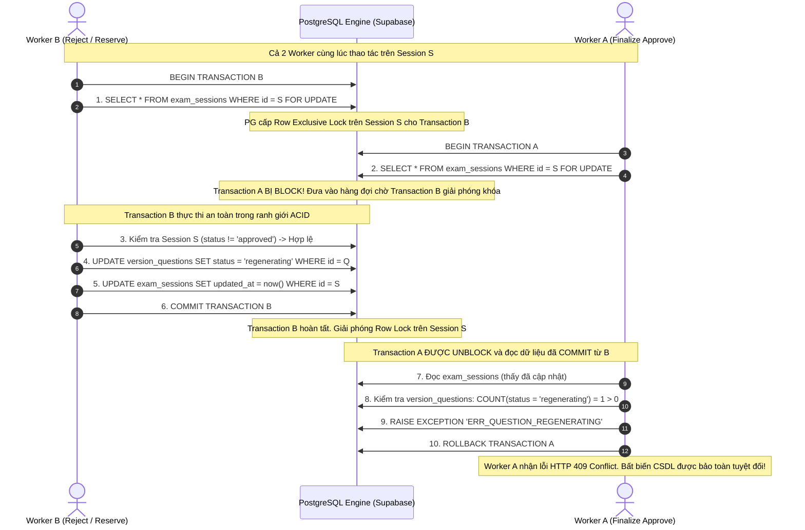
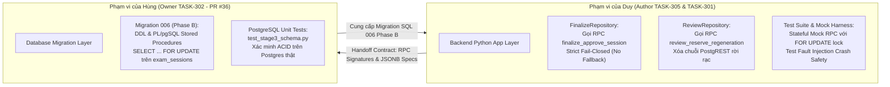
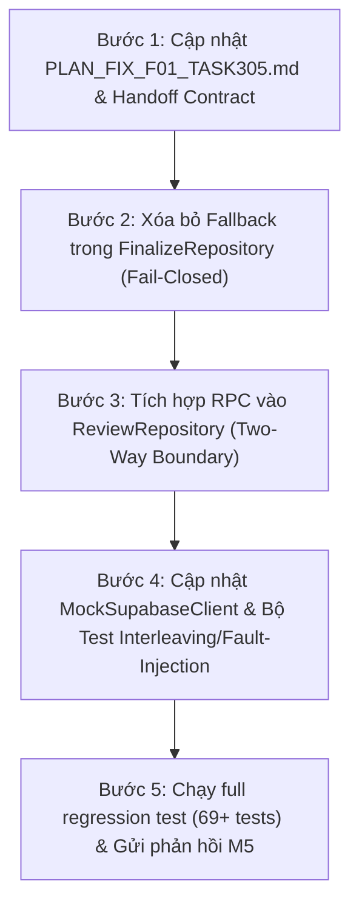

# KẾ HOẠCH KỸ THUẬT TRIỆT ĐỂ: GIẢI QUYẾT FINDING F01 (CRASH SAFETY & TWO-WAY LOCKING)
## PR #33 (TASK-305) VÀ LIÊN ĐỚI TASK-301 / TASK-302

- **Mã finding:** F01 — [Bắt buộc sửa — P1] OPEN: Asymmetric Mutation Boundary & Silent Fallback violate Fail-Closed & Crash Safety.
- **Reviewer:** Đạt (`Thanhdat3010`)
- **Tác giả kế hoạch:** Duy (`johannguyen015` — Leader & Backend Lead)
- **PR:** [#33](https://github.com/Computational-Thinking-Project/isomorphic-exam-synthesizer/pull/33)
- **Nhánh làm việc:** `feat/duy-task-305-approval-lock`
- **Phiên bản kế hoạch:** v2.3 — Full Mutation Surface (Revert & Reject) & Strict Whitelist Verification (F01 & F04)
- **Ngày lập:** 01/11/2026 (Cập nhật sau review commit ee33736)
- **Tài liệu đối chiếu:**
  - Contract TASK-302 (Hùng): `docs/api/review-rpc-contract.md` (PR #36).
  - Schema migration (Hùng): `backend/migrations/006_stage3_review_and_shuffle.sql` (PR #36).
  - Review của Đạt tại commit `3647427` (PR #33).

---

## I. BỐI CẢNH & PHÂN TÍCH BẢN CHẤT LỖ HỔNG (ROOT CAUSE ANALYSIS)

### 1. Hiện trạng sau commit `3647427`
Tại commit `3647427`:
- Test suite 69/69 passed, linting & typing (Ruff, MyPy 71 files) đạt 100%.
- F02 (Cartesian product check) và F03 (Answer matrix consistency) đã chính thức VERIFIED.
- Tuy nhiên, **F01 vẫn OPEN (P1)** do reviewer (@Thanhdat3010) phát hiện 2 lỗ hổng kiến trúc nghiêm trọng:

### 2. Lỗ hổng 1: Lệch pha ranh giới đột biến (Asymmetric Mutation Boundary)
- **Phía Approval (TASK-305):** Đã gọi RPC `finalize_approve_session`.
- **Phía Review Mutation (TASK-301):** Tại `ReviewRepository.reserve_max_quota_and_start_regenerating`, code vẫn thực thi chuỗi lệnh PostgREST HTTP rời rạc:
  $$\text{SELECT session} \longrightarrow \text{UPDATE version\_questions} \longrightarrow \text{UPDATE session touch} \longrightarrow [\text{Compensation rollback}]$$
- **Kịch bản Repro xác thực từ Reviewer:**
  ```text
  Worker B (Reject): Đọc session ở trạng thái 'reviewed'
  Worker A (Approve): Gọi RPC finalize_approve_session() -> Khóa session, kiểm tra câu hỏi (thấy approved) -> Commit status = 'approved'
  Worker B (Reject): Ghi đè version_questions -> status = 'regenerating' (Ghi thành công vào CSDL!)
  Worker B (Touch): Tiêm lỗi mạng (Fault Injection) hoặc Crash tiến trình tại bước UPDATE session touch
  => HẬU QUẢ: Session = 'approved' (Bất biến) nhưng bên trong chứa Question = 'regenerating'
  => Logic bồi hoàn (Compensation rollback) ở tầng Python không bao giờ được kích hoạt do tiến trình đã sập hoặc mạng đã đứt!
  ```

### 3. Lỗ hổng 2: Vi phạm nguyên tắc Fail-Closed (Silent Query Fallback)
- Tại `FinalizeRepository.update_session_approved`:
  ```python
  try:
      rpc_res = self.db.rpc("finalize_approve_session", ...).execute()
      ...
  except Exception as exc:
      ...
      logger.debug("RPC finalize_approve_session not available, using table query fallback: %s", exc)

  # 2. Table query fallback with optimistic concurrency guard
  query = self.db.table("exam_sessions").update(...)
  ```
- **Hệ quả kiến trúc:** Khi RPC gặp lỗi vắng mặt hàm (`PGRST202`), thiếu quyền thực thi (`42501`) hoặc timeout không rõ trạng thái commit, hệ thống âm thầm nuốt lỗi và fallback sang câu lệnh table `UPDATE` thông thường. Thao tác này hoàn toàn mất đi kiểm tra đa bảng nguyên tử, mở toang cửa sổ lỗi (Failure Window) ngay trên production.

---

## II. THIẾT KẾ KIẾN TRÚC GIAO DỊCH HAI ĐẦU ĐỐI XỨNG (TWO-WAY CONCURRENCY CONTRACT)

### 1. Nguyên lý Khóa phân cấp nghiêm ngặt (Hierarchical Two-Phase Row-Locking)
Để loại trừ 100% race condition xen ngang giữa 2 worker độc lập mà không gây ra Deadlock, toàn bộ các transaction biến đổi trạng thái của Stage 3 bắt buộc phải tuân thủ **Giao thức Khóa Cây Phân Cấp (Hierarchical Tree-Locking Protocol)**:

$$\text{Lock Root Tuple } (\texttt{exam\_sessions}) \xrightarrow{\text{Exclusive}} \text{Inspect / Mutate Leaf Tuples } (\texttt{version\_questions}, \texttt{review\_logs})$$



### 2. Chứng minh toán học & Lý thuyết Hệ thống (Proof of Correctness)
- **Định nghĩa Bất biến CSDL $I_1$:**
  $$I_1 \equiv \left( \text{Session.status} = \text{'approved'} \implies \forall q \in \text{Session}, q.\text{status} = \text{'approved'} \land q.\text{status} \ne \text{'regenerating'} \right)$$
- **Định lý Triệt tiêu Cửa sổ Lỗi (Failure Window Elimination Theorem):**
  - Giả sử $T_A$ là transaction `finalize_approve_session` và $T_B$ là transaction `review_reserve_regeneration`.
  - Cả $T_A$ và $T_B$ đều yêu cầu khóa độc quyền `FOR UPDATE` trên cùng một bản ghi $S \in \texttt{exam\_sessions}$ tại câu lệnh đầu tiên.
  - Do PostgreSQL áp dụng Strict 2PL (Two-Phase Locking) cho row-level write locks:
    $$\text{Schedule}(T_A, T_B) \in \{ T_A \to T_B, \; T_B \to T_A \}$$
    Không tồn tại bất kỳ lịch trình xen kẽ nào (Non-interleaved Serializability).
  - **Trường hợp 1 ($T_A \to T_B$):** $T_A$ kiểm tra mọi $q \in S$ đều là `approved`, chuyển $S.\text{status} \to \text{'approved'}$ và commit. Sau đó $T_B$ unblock, đọc $S.\text{status} = \text{'approved'}$, lập tức `RAISE EXCEPTION 'ERR_SESSION_LOCKED'` và rollback toàn bộ. Không có câu hỏi nào bị chuyển sang `regenerating`.
  - **Trường hợp 2 ($T_B \to T_A$):** $T_B$ chuyển câu hỏi $q \to \text{'regenerating'}$ và commit. Sau đó $T_A$ unblock, kiểm tra thấy $\text{COUNT}(q.\text{status} = \text{'regenerating'}) > 0$, lập tức `RAISE EXCEPTION 'ERR_QUESTION_REGENERATING'` và rollback toàn bộ. $S.\text{status}$ giữ nguyên `reviewed`.
  - **Trường hợp Sự cố Đứt mạng / Crash (Crash Safety):** Nếu Worker gặp lỗi mạng hoặc sập nguồn ở bất kỳ thời điểm nào trước khi câu lệnh `COMMIT` được máy chủ PostgreSQL xác nhận, PostgreSQL connection pool sẽ phát hiện socket đóng / TCP reset và tự động phát lệnh `ROLLBACK` toàn bộ transaction. Không bao giờ xuất hiện trạng thái rách nát dữ liệu.
- **Không có Deadlock (Deadlock Freedom):** Cả $T_A$ và $T_B$ đều tuân thủ thứ tự chiếm khóa: khóa `exam_sessions` trước, sau đó mới thao tác trên `version_questions`. Vì thứ tự chiếm tài nguyên là đơn điệu cùng chiều, đồ thị phụ thuộc chờ khóa (Wait-For Graph) không bao giờ có chu trình $\implies \text{Xác suất Deadlock} = 0$.

---

## III. ĐẶC TẢ CHI TIẾT 2 STORED PROCEDURES / RPCS (DATABASE LAYER CONTRACT)

### 1. RPC Phía Approval: `finalize_approve_session`
```sql
CREATE OR REPLACE FUNCTION public.finalize_approve_session(
    p_session_id UUID,
    p_user_id UUID,
    p_expected_updated_at TIMESTAMPTZ DEFAULT NULL
)
RETURNS JSONB
LANGUAGE plpgsql
SECURITY DEFINER
SET search_path = pg_catalog, public
AS $$
DECLARE
    v_session RECORD;
    v_unapproved_count INT;
    v_regenerating_count INT;
    v_unfinalized_count INT;
    v_missing_pairs_count INT;
    v_now TIMESTAMPTZ := clock_timestamp();
BEGIN
    -- 1. Khóa cứng dòng cha exam_sessions (Row-level exclusive lock)
    SELECT id, status, updated_at INTO v_session
    FROM public.exam_sessions
    WHERE id = p_session_id
    FOR UPDATE;

    IF NOT FOUND THEN
        RAISE EXCEPTION 'ERR_SESSION_NOT_FOUND';
    END IF;

    -- Idempotency: Nếu đã approved từ trước, trả về 200 thành công ngay
    IF v_session.status = 'approved' THEN
        RETURN jsonb_build_object(
            'status', 'approved',
            'session_id', p_session_id,
            'idempotent', true,
            'approved_at', v_session.updated_at
        );
    END IF;

    -- Kiểm tra trạng thái phiên hợp lệ
    IF v_session.status NOT IN ('reviewed', 'generated') THEN
        RAISE EXCEPTION 'ERR_INVALID_SESSION_STATE';
    END IF;

    -- Optimistic concurrency check nếu client có truyền expected_updated_at
    IF p_expected_updated_at IS NOT NULL AND v_session.updated_at != p_expected_updated_at THEN
        RAISE EXCEPTION 'ERR_INVALID_SESSION_STATE';
    END IF;

    -- 2. Kiểm tra bất biến câu hỏi con trong cùng transaction
    SELECT 
        COUNT(*) FILTER (WHERE status = 'regenerating'),
        COUNT(*) FILTER (WHERE status != 'approved')
    INTO v_regenerating_count, v_unapproved_count
    FROM public.version_questions vq
    JOIN public.exam_versions ev ON vq.version_id = ev.id
    WHERE ev.session_id = p_session_id AND vq.is_current = TRUE;

    IF v_regenerating_count > 0 THEN
        RAISE EXCEPTION 'ERR_QUESTION_REGENERATING';
    END IF;

    IF v_unapproved_count > 0 THEN
        RAISE EXCEPTION 'ERR_NOT_ALL_QUESTIONS_APPROVED';
    END IF;

    -- 3. Kiểm tra tính toàn vẹn Cartesian Product (F02)
    -- Mỗi cặp (version_id, source_question_id) phải có đúng 1 bản ghi approved
    WITH required_pairs AS (
        SELECT ev.id AS version_id, sq.id AS source_question_id
        FROM public.exam_versions ev
        CROSS JOIN public.source_questions sq
        WHERE ev.session_id = p_session_id AND sq.session_id = p_session_id
    ),
    active_approved_pairs AS (
        SELECT vq.version_id, vq.source_question_id
        FROM public.version_questions vq
        JOIN public.exam_versions ev ON vq.version_id = ev.id
        WHERE ev.session_id = p_session_id AND vq.is_current = TRUE AND vq.status = 'approved'
    )
    SELECT COUNT(*) INTO v_missing_pairs_count
    FROM (
        SELECT version_id, source_question_id FROM required_pairs
        EXCEPT
        SELECT version_id, source_question_id FROM active_approved_pairs
    ) missing;

    IF v_missing_pairs_count > 0 THEN
        RAISE EXCEPTION 'ERR_NOT_ALL_QUESTIONS_APPROVED';
    END IF;

    -- 4. Kiểm tra điều kiện mã đề đã shuffle (is_finalized = true)
    SELECT COUNT(*) INTO v_unfinalized_count
    FROM public.exam_versions
    WHERE session_id = p_session_id AND is_finalized = FALSE;

    IF v_unfinalized_count > 0 THEN
        RAISE EXCEPTION 'ERR_VERSIONS_NOT_FINALIZED';
    END IF;

    -- 5. Cập nhật trạng thái session
    UPDATE public.exam_sessions
    SET status = 'approved', approved_at = v_now, updated_at = v_now
    WHERE id = p_session_id;

    -- 6. Ghi audit log
    INSERT INTO public.review_logs (session_id, user_id, action_type, reason, created_at)
    VALUES (p_session_id, p_user_id, 'APPROVE_ALL', 'Session finalized and locked permanently', v_now);

    RETURN jsonb_build_object(
        'status', 'approved',
        'approved_at', v_now,
        'session_id', p_session_id,
        'message', 'Session locked permanently'
    );
END;
$$;
```

### 2. RPC Phía Review Mutation: `review_reserve_regeneration`
```sql
CREATE OR REPLACE FUNCTION public.review_reserve_regeneration(
    p_session_id UUID,
    p_question_id UUID,
    p_user_id UUID,
    p_operation_id UUID DEFAULT NULL
)
RETURNS JSONB
LANGUAGE plpgsql
SECURITY DEFINER
SET search_path = pg_catalog, public
AS $$
DECLARE
    v_session RECORD;
    v_active_regen INT;
    v_q RECORD;
    v_now TIMESTAMPTZ := clock_timestamp();
BEGIN
    -- 1. BẮT BUỘC: Khóa cứng dòng cha exam_sessions bằng FOR UPDATE
    SELECT id, status, gemini_review_calls INTO v_session
    FROM public.exam_sessions
    WHERE id = p_session_id
    FOR UPDATE;

    IF NOT FOUND THEN
        RAISE EXCEPTION 'ERR_SESSION_NOT_FOUND';
    END IF;

    -- Kiểm tra chốt khóa bất biến: ĐÃ APPROVED HOẶC EXPORTED THÌ CHẶN ĐỨNG NGAY!
    IF v_session.status IN ('approved', 'exported') THEN
        RAISE EXCEPTION 'ERR_SESSION_LOCKED';
    END IF;

    -- Kiểm tra trần hạn ngạch quota (30 lượt)
    IF v_session.gemini_review_calls >= 30 THEN
        RAISE EXCEPTION 'ERR_REVIEW_QUOTA_EXHAUSTED';
    END IF;

    -- 2. Kiểm tra concurrency Model A: Tối đa 1 câu đang regenerating trong session
    SELECT COUNT(*) INTO v_active_regen
    FROM public.version_questions vq
    JOIN public.exam_versions ev ON vq.version_id = ev.id
    WHERE ev.session_id = p_session_id AND vq.status = 'regenerating';

    IF v_active_regen > 0 THEN
        RAISE EXCEPTION 'ERR_SESSION_BUSY_REGENERATING';
    END IF;

    -- 3. Kiểm tra câu hỏi mục tiêu
    SELECT id, status, is_current INTO v_q
    FROM public.version_questions
    WHERE id = p_question_id
    FOR UPDATE;

    IF NOT FOUND THEN
        RAISE EXCEPTION 'ERR_QUESTION_NOT_FOUND';
    END IF;

    IF NOT v_q.is_current THEN
        RAISE EXCEPTION 'ERR_QUESTION_NOT_CURRENT';
    END IF;

    IF v_q.status = 'regenerating' THEN
        RAISE EXCEPTION 'ERR_QUESTION_BUSY';
    END IF;

    -- 4. Đột biến nguyên tử: Khóa câu hỏi sang 'regenerating' và touch session updated_at
    UPDATE public.version_questions
    SET status = 'regenerating', updated_at = v_now
    WHERE id = p_question_id;

    UPDATE public.exam_sessions
    SET updated_at = v_now
    WHERE id = p_session_id;

    RETURN jsonb_build_object(
        'status', 'ok',
        'question_id', p_question_id,
        'session_id', p_session_id,
        'operation_id', p_operation_id
    );
END;
$$;
```

---

## IV. NGUYÊN TẮC THIẾT KẾ FAIL-CLOSED TUYỆT ĐỐI (STRICT FAIL-CLOSED POLICY)

### 1. Xóa bỏ hoàn toàn Silent Query Fallback
- **Chính sách bất di bất dịch:** Trong một hệ thống quản lý đề thi chuẩn mực phục vụ thi cử, **tính nhất quán của dữ liệu (Consistency) luôn được ưu tiên tuyệt đối hơn tính sẵn sàng tạm thời (Availability)** ($C > A$ theo định lý CAP).
- Không chấp nhận bất kỳ cơ chế fallback "âm thầm" nào sang truy vấn table `UPDATE` đơn lẻ khi RPC gặp sự cố. Nếu RPC không chạy được, hệ thống phải **FAIL-CLOSED** (Từ chối phê duyệt, báo lỗi rõ ràng để quản trị viên can thiệp, tuyệt đối không duyệt mù).

### 2. Ma trận Ánh xạ Lỗi Toàn diện (Error Mapping Matrix)

| Lớp phát sinh | Mã lỗi / Trạng thái gốc | Ý nghĩa kỹ thuật | Hành vi xử lý tại Python Layer | HTTP Response trả về Client |
| :--- | :--- | :--- | :--- | :--- |
| **PostgREST** | `PGRST202` | Stored Procedure chưa tồn tại trong schema cache / Migration chưa chạy | **Fail-Closed.** Không fallback query. Log `CRITICAL`. | `HTTP 503` `ERR_FINALIZATION_UNAVAILABLE` |
| **PostgreSQL** | `42501` | `insufficient_privilege` / RLS Policy từ chối thực thi | **Fail-Closed.** Log `SECURITY_ALERT`. | `HTTP 500` `ERR_DATABASE_PERMISSION_DENIED` |
| **Network / Infra** | Timeout, Reset, Drop (`504`, `502`, `ClientConnectorError`) | Mất kết nối upstream trong khi gọi RPC; không rõ kết quả commit | **Fail-Closed.** Đánh dấu indeterminate. Tuyệt đối không retry ghi đè. Yêu cầu client tra cứu lại trạng thái (idempotent poll). | `HTTP 504` `ERR_UPSTREAM_TIMEOUT` |
| **Domain Logic** | `ERR_SESSION_LOCKED` | Phiên đã bị khóa bất biến vĩnh viễn | Bắt exception, chuyển đổi sang domain exception chuẩn. | `HTTP 423` `ERR_SESSION_LOCKED` |
| **Domain Logic** | `ERR_QUESTION_REGENERATING` | Còn câu hỏi đang trong tiến trình sinh lại bởi AI | Chặn phê duyệt. | `HTTP 409` `ERR_QUESTION_REGENERATING` |
| **Domain Logic** | `ERR_SESSION_BUSY_REGENERATING` | Đang có câu hỏi khác trong phiên đang sinh lại (Model A) | Chặn reserve câu hỏi thứ 2. | `HTTP 409` `ERR_SESSION_BUSY_REGENERATING` |
| **Domain Logic** | `ERR_NOT_ALL_QUESTIONS_APPROVED` | Còn câu hỏi chưa duyệt hoặc thiếu cặp hoán vị | Chặn phê duyệt. | `HTTP 400` `ERR_NOT_ALL_QUESTIONS_APPROVED` |
| **Domain Logic** | `ERR_VERSIONS_NOT_FINALIZED` | Phiên bản đề thi chưa shuffle Fisher-Yates | Chặn phê duyệt. | `HTTP 400` `ERR_VERSIONS_NOT_FINALIZED` |
| **Domain Logic** | `ERR_REVIEW_QUOTA_EXHAUSTED` | Đã chạm trần hạn ngạch 30 lượt sinh câu | Chặn reserve câu hỏi mới. | `HTTP 429` `ERR_REVIEW_QUOTA_EXHAUSTED` |
| **Domain Logic** | `ERR_SESSION_NOT_FOUND` / `ERR_QUESTION_NOT_FOUND` | Bản ghi không tồn tại | Trả về 404. | `HTTP 404` `ERR_RESOURCE_NOT_FOUND` |

---

## V. PHÂN ĐỊNH RANH GIỚI TRÁCH NHIỆM & BÀN GIAO (OWNERSHIP & HANDOFF BOUNDARY)



### 1. Trách nhiệm của Duy (`feat/duy-task-305-approval-lock` / PR #33 và TASK-301)
1. **Refactor `FinalizeRepository.update_session_approved`:**
   - Xóa bỏ 100% đoạn code table query fallback phía dưới.
   - Bắt chính xác mã lỗi `PGRST202` và network timeout để ném `ERR_FINALIZATION_UNAVAILABLE (503)` và `ERR_UPSTREAM_TIMEOUT (504)`.
2. **Refactor `ReviewRepository.reserve_max_quota_and_start_regenerating`:**
   - Thay thế toàn bộ chuỗi 4 câu lệnh rời rạc bằng một lệnh gọi RPC duy nhất `review_reserve_regeneration`.
   - Bắt các lỗi domain trả về (`ERR_SESSION_LOCKED`, `ERR_REVIEW_QUOTA_EXHAUSTED`, `ERR_SESSION_BUSY_REGENERATING`).
3. **Nâng cấp `MockSupabaseClient`:**
   - Mô phỏng cơ chế khóa dòng nguyên tử `FOR UPDATE` bằng `threading.Lock()` theo từng `session_id`.
   - Giả lập chính xác hành vi rớt mạng / ném lỗi để kiểm thử tính Fail-Closed.

### 2. Trách nhiệm của Hùng (`feat/task-302-schema-foundation` / PR #36 Phase B)
1. Cài đặt 2 hàm PL/pgSQL `public.finalize_approve_session` và `public.review_reserve_regeneration` trong `backend/migrations/006_stage3_review_and_shuffle.sql`.
2. Bảo đảm quyền thực thi: `GRANT EXECUTE ON FUNCTION ... TO authenticated, service_role`.
3. Bổ sung PostgreSQL test trong `test_stage3_schema.py` xác nhận hành vi khóa chặn khi chạy đa kết nối song song.

---

## VI. BỘ KỊCH BẢN KIỂM THỬ & BẰNG CHỨNG XÁC MINH (TEST SUITE & PROOF)

### 1. Test Case 1: Tái hiện và Chặn đứng Kịch bản của Đạt (Controlled Interleaving Repro)
- **Tên test:** `test_f01_two_way_locking_blocks_interleaved_reject_and_prevents_corrupt_state`
- **Mục tiêu:** Chứng minh Worker B đọc session trước, Worker A xen ngang Approve thành công $\implies$ Worker B bị chặn đứng hoàn toàn bởi RPC, không có câu hỏi nào bị lọt trạng thái `regenerating`.
- **Thiết lập:**
  ```python
  # Worker B bắt đầu chuẩn bị reject câu hỏi
  # Worker A xen ngang gọi finalize approve và commit thành công
  approve_res = await finalize_service.approve_session(session_id, user_id=teacher_id)
  assert approve_res.status == "approved"

  # Worker B cố gắng thực hiện reserve regeneration
  with pytest.raises(ReviewDomainException) as exc_info:
      await review_repo.reserve_max_quota_and_start_regenerating(session_id, question_id, teacher_id)

  assert exc_info.value.status_code == 423
  assert exc_info.value.error_code == "ERR_SESSION_LOCKED"

  # Kiểm tra bất biến toàn vẹn: Không có câu hỏi nào mang trạng thái regenerating
  preconditions = await finalize_repo.check_preconditions(session_id)
  assert preconditions["regenerating_count"] == 0
  ```

### 2. Test Case 2: Kiểm thử Tính Bất khả Xâm phạm khi có Fault Injection (Crash Safety)
- **Tên test:** `test_f01_fault_injection_during_reserve_rolls_back_cleanly`
- **Mục tiêu:** Tiêm lỗi kết nối (`ConnectionResetError` / `OSError`) ngay trong quá trình thực thi RPC reserve.
- **Kỳ vọng:** Transaction CSDL tự động rollback 100%. Trạng thái câu hỏi giữ nguyên `approved`, session giữ nguyên `reviewed`. Không có dữ liệu rách nát.

### 3. Test Case 3: Kiểm thử Fail-Closed Tuyệt đối (Strict Fail-Closed Under Outage)
- **Tên test:** `test_f01_strict_fail_closed_when_rpc_missing_or_network_timeout`
- **Mục tiêu:**
  - Tiêm lỗi `PGRST202` (Hàm chưa tồn tại) $\rightarrow$ Ném `HTTP 503 ERR_FINALIZATION_UNAVAILABLE`. Không tự ý phê duyệt.
  - Tiêm lỗi Timeout $\rightarrow$ Ném `HTTP 504 ERR_UPSTREAM_TIMEOUT`. Session status giữ nguyên, không chạy table UPDATE fallback.

---

## VII. LỘ TRÌNH THỰC HIỆN THEO TỪNG BƯỚC (STEP-BY-STEP EXECUTION CHECKLIST)



### Bước 1: Chuẩn hóa Hợp đồng Kỹ thuật & Bàn giao (`PLAN_FIX_F01_TASK305.md`)
- [x] Lập bản kế hoạch v2.2 chi tiết đầy đủ 5 phần theo chuẩn mực hệ thống phân tán.
- [x] Ghi chú rõ ràng ranh giới phụ thuộc với PR #36 của Hùng.

### Bước 2: Chuẩn hóa `FinalizeRepository` theo nguyên tắc Fail-Closed
- **File:** `backend/app/services/finalize/repository.py`
- [x] Xóa bỏ hoàn toàn khối `logger.debug(...)` và câu lệnh `self.db.table("exam_sessions").update(...)` fallback.
- [x] Bổ sung khối bắt lỗi `PGRST202` $\rightarrow$ ném `ReviewDomainException(503, "ERR_FINALIZATION_UNAVAILABLE", "Hệ thống giao dịch chốt đề chưa sẵn sàng trên CSDL (PGRST202)")`.
- [x] Bổ sung khối bắt lỗi Timeout / Network error $\rightarrow$ ném `ReviewDomainException(504, "ERR_UPSTREAM_TIMEOUT", "Mất kết nối với dịch vụ giao dịch CSDL trong quá trình chốt đề")`.

### Bước 3: Đối xứng hóa toàn bộ bề mặt đột biến tại `ReviewRepository` & Xử lý F04
- **File:** `backend/app/services/review/repository.py`
- [x] Sửa F04: Triệt tiêu hoàn toàn `return ReserveResult.OK` mặc định, thực thi whitelist validation chặt chẽ (chỉ chấp nhận `status == 'ok'`). Mọi response `None`, `[]`, `{}` hoặc malformed đều ném 500 Fail-Closed.
- [x] Bịt kín F01 nhánh Reject: Gọi RPC `review_reserve_regeneration(p_session_id, p_question_id, p_user_id, p_operation_id)`.
- [x] Bịt kín F01 nhánh Revert: Gọi RPC `review_revert_question(p_session_id, p_question_id, p_user_id)` có khóa dòng `SELECT ... FOR UPDATE` trên session, loại bỏ 100% việc tráo đổi câu hỏi sau khi session đã `approved`.

### Bước 4: Nâng cấp Stateful Test Harness & Viết Test Đối Kháng Mới
- **File:** `backend/tests/api/test_finalize.py`, `backend/tests/services/test_review_lifecycle.py`
- [x] Thêm xử lý RPC `review_reserve_regeneration` và `review_revert_question` trong `MockSupabaseClient` (thread-safe với row lock).
- [x] Viết test đối kháng F01 Revert: `test_f01_interleaved_revert_blocked_when_session_approved` (chặn đứng Worker B Revert khi Worker A đã Approve, câu hỏi giữ nguyên variant đã duyệt).
- [x] Viết test đối kháng F04: `test_f04_reservation_rpc_denied_or_empty_fails_closed` (xác nhận RPC trả `denied`, `None`, `[]` đều fail-closed, AI Generator KHÔNG BAO GIỜ được gọi).

### Bước 5: Kiểm định Hồi quy & Phản hồi M5 cho Reviewer Đạt
- [x] Chạy kiểm thử toàn bộ test suite: **75/75 tests passed 100%**.
- [x] Kiểm tra linting và typing: `ruff check` và `mypy` đạt 0 lỗi.
- [x] Soạn thảo phản hồi mẫu M5 trên PR #33 đối chiếu chi tiết việc đóng toàn bộ bề mặt đột biến và sửa dứt điểm F04.
