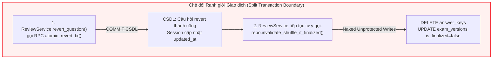
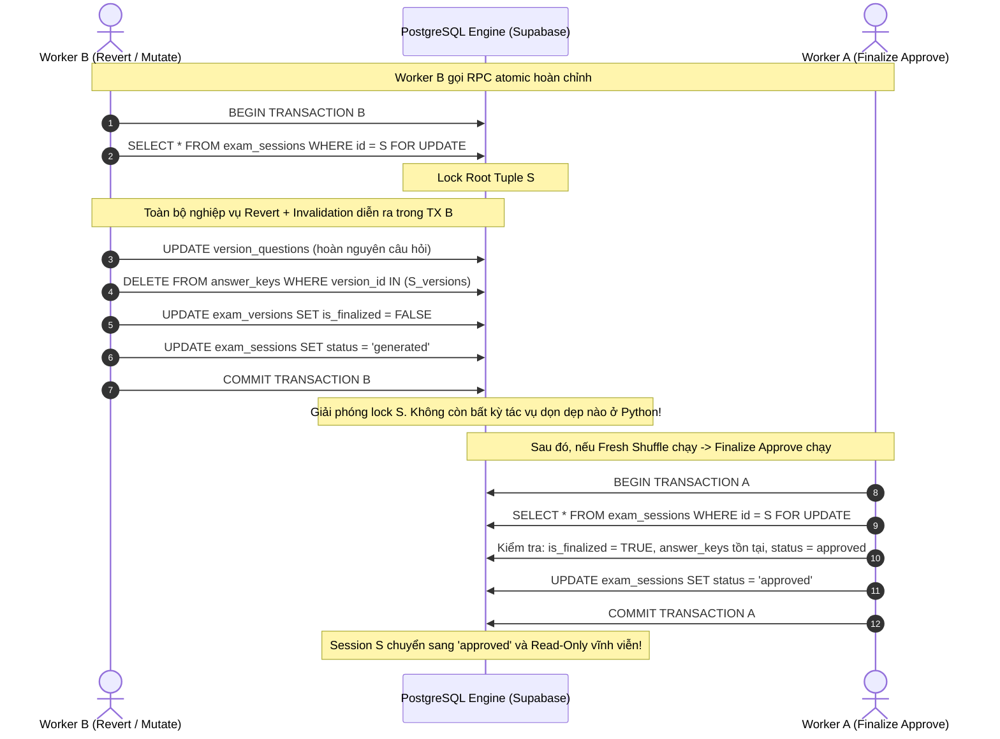
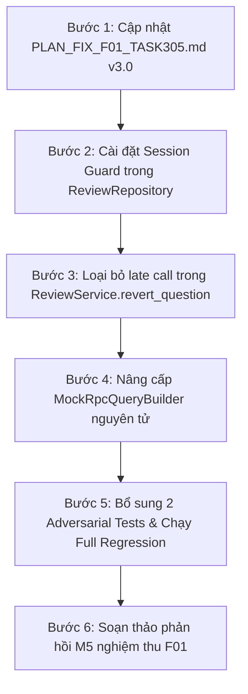

# KẾ HOẠCH KỸ THUẬT TRIỆT ĐỂ: GIẢI QUYẾT FINDING F01 (ELIMINATION OF SECONDARY MUTATION SURFACE)
## PR #33 (TASK-305) VÀ LIÊN ĐỚI TASK-301 / TASK-302

- **Mã finding:** F01 — [Bắt buộc sửa — P1] OPEN: Secondary Mutation Surface via Late Python Invalidation violates Content Lock Immutability.
- **Mã finding đã nghiệm thu:** F02 (P2 - Cartesian check) VERIFIED, F03 (P2 - Matrix consistency) VERIFIED, F04 (P2 - Reservation Fail-Closed) VERIFIED tại commit `09bbbea`.
- **Reviewer:** Đạt (`Thanhdat3010`)
- **Tác giả kế hoạch:** Duy (`johannguyen015` — Leader & Backend Lead)
- **PR:** [#33](https://github.com/Computational-Thinking-Project/isomorphic-exam-synthesizer/pull/33)
- **Nhánh làm việc:** `feat/duy-task-305-approval-lock`
- **Phiên bản kế hoạch:** v3.0 — Elimination of Secondary Mutation Surface (Invalidation Path & Late Python Writes) & Atomic Single-Transaction Contract
- **Ngày lập:** 01/11/2026 (Cập nhật sau re-review tại commit `09bbbea`)
- **Tài liệu đối chiếu:**
  - Contract TASK-302 (Hùng): `docs/api/review-rpc-contract.md` (PR #36).
  - Schema migration (Hùng): `backend/migrations/006_stage3_review_and_shuffle.sql` (PR #36).
  - Review của Đạt tại commit `09bbbea` (PR #33).

---

## I. BỐI CẢNH & PHÂN TÍCH BẢN CHẤT LỖ HỔNG (ROOT CAUSE ANALYSIS)

### 1. Hiện trạng sau commit `09bbbea`
Tại commit `09bbbea`:
- Test suite đạt 75/75 passed (100%), Ruff linting và MyPy typecheck đạt 0 lỗi trên 71 files.
- **F04 (P2)** đã chính thức **VERIFIED & CLOSED HOÀN TOÀN**: Wrapper reservation đã loại bỏ hoàn toàn fallback `ReserveResult.OK`, áp dụng whitelist validation nghiêm ngặt và xử lý Fail-Closed chuẩn mực.
- **F01 (P1) VẪN CÒN HỞ VÀ TIẾP TỤC BỊ `REQUEST CHANGES`**:
  Mặc dù việc tráo đổi câu hỏi qua Revert đã được đưa vào RPC nguyên tử `review_revert_question`, hệ thống vẫn tồn tại một **Bề mặt đột biến thứ hai (Unprotected Secondary Mutation Surface)** cực kỳ nguy hiểm do **Ghi đè lạc hậu (Late Python Invalidation)**.



### 2. Chi tiết cơ chế lỗi (Failure Mechanism)

#### Lỗ hổng 1: Chẻ đôi ranh giới giao dịch (Split Transaction Boundary)
- Tại `ReviewService.revert_question` (dòng 388-391) và `ReviewService.reject_question` (dòng 334-336):
  Sau khi RPC hoặc transaction CSDL chính hoàn tất, tầng service tiếp tục gọi rời rạc:
  ```python
  await self.repo.invalidate_shuffle_if_finalized(session_id)
  ```
- Thao tác này vi phạm nguyên tắc cơ bản nhất của tính toàn vẹn hệ thống: **Một nghiệp vụ thay đổi trạng thái phụ thuộc (side-effect invalidation) bị đẩy ra ngoài transaction chính và chạy như một tác vụ độc lập không kiểm soát**.

#### Lỗ hổng 2: Ghi trần không có khóa và không kiểm tra trạng thái khóa (Naked Unprotected Writes)
- Tại `ReviewRepository.invalidate_shuffle_if_finalized` (dòng 778-824):
  Hàm này thực thi chuỗi truy vấn PostgREST HTTP rời rạc:
  - `DELETE FROM answer_keys WHERE version_id IN (...)`
  - `UPDATE exam_versions SET is_finalized = false, shuffle_seed = null, permutations = null`
  - `UPDATE exam_sessions SET status = 'generated' WHERE status = 'reviewed'`
- **Điểm yếu chí mạng:**
  1. Chạy hoàn toàn bên ngoài transaction CSDL, không có row-level lock (`SELECT ... FOR UPDATE`).
  2. **Hoàn toàn không kiểm tra trạng thái session cha:** Không kiểm tra xem `session.status` có thuộc nhóm bất biến `('approved', 'exported')` hay không trước khi thực thi `DELETE` trên bảng `answer_keys` và `UPDATE` trên `exam_versions`!
  3. Lệnh kiểm tra duy nhất nằm ở bước 3 (`if status == 'reviewed': status = 'generated'`), nhưng lúc này bước 1 và bước 2 đã **XÓA SẠCH `answer_keys` và hạ cờ `is_finalized = False`** của một session đã được khóa!

#### Lỗ hổng 3: Kịch bản xen ngang thực tế phá hủy bất biến (Interleaving Failure Scenario)
Giả sử có 3 worker / tiến trình bất đồng bộ cùng thao tác trên phiên thi $S$:
```text
1. Worker B (Revert): Gọi RPC review_revert_question -> Commit thành công trên CSDL.
2. Worker C (Shuffle): Giáo viên bấm Hoán vị lại (Fresh Shuffle) -> Sinh permutations mới, nạp answer_keys mới, đánh dấu is_finalized = true, session lên 'reviewed'.
3. Worker A (Finalize): Gọi RPC finalize_approve_session -> Tất cả điều kiện thỏa mãn -> Session chuyển sang 'approved' và khóa bất biến toàn bộ nội dung.
4. Worker B (Bị trễ mạng hoặc lag event loop): Lúc này mới thực thi lệnh Python:
   await self.repo.invalidate_shuffle_if_finalized(session_id)
   -> Tìm thấy versions có is_finalized = true
   -> DELETE FROM answer_keys WHERE version_id IN (...)  <-- XÓA SẠCH KEYS MỚI!
   -> UPDATE exam_versions SET is_finalized = false       <-- PHÁ HỎNG CỜ FINALIZED!
=> HẬU QUẢ: Session đang mang trạng thái 'approved' (Bất biến) nhưng rỗng ruột answer_keys và is_finalized = false!
=> Tiến trình Xuất đề (TASK-401 Export) hoàn toàn bị sập hoặc sinh đề sai lệch!
```

---

## II. THIẾT KẾ KIẾN TRÚC & NGUYÊN TẮC BẤT DI BẤT DỊCH

### 1. Hệ Bất biến CSDL Mở rộng (Extended Database Invariants)
- **Bất biến 1 ($I_1$ - Approval Consistency):**
  $$I_1 \equiv \left( \text{Session.status} = \text{'approved'} \implies \forall q \in \text{Session}, q.\text{status} = \text{'approved'} \land q.\text{status} \ne \text{'regenerating'} \right)$$
- **Bất biến 2 ($I_2$ - Content & Answer Key Immutability under Approved State):**
  $$I_2 \equiv \left( \text{Session.status} \in \{\text{'approved'}, \text{'exported'}\} \implies \begin{cases} \text{exam\_versions: Read-Only (is\_finalized} \equiv \text{TRUE)} \\ \text{version\_questions: Read-Only (no INSERT/UPDATE/DELETE)} \\ \text{answer\_keys: Read-Only (no DELETE/UPDATE)} \end{cases} \right)$$
- **Bất biến 3 ($I_3$ - Single Transaction Boundary):**
  Mọi thao tác đột biến làm thay đổi nội dung câu hỏi (Revert, Regenerate) và hệ quả kéo theo của nó (Invalidate Shuffle, Purge Answer Keys, Demote Session) bắt buộc phải diễn ra **nguyên tử trong cùng một Transaction CSDL duy nhất**:
  $$\text{Tx}(\text{MutateQuestion}) \cup \text{Tx}(\text{InvalidateShuffle}) \equiv \mathbf{Tx}_{\text{atomic}}$$

### 2. Mô hình Khóa Hai Đầu Đối Xứng & Triệt Tiêu Hoàn Toàn Late Writes



---

## III. TÁI ĐỊNH NGHĨA RANH GIỚI TRÁCH NHIỆM & HỢP ĐỒNG (CONTRACT DEMARCATION)

### 1. Phân định Trách nhiệm CSDL (Stored Procedure Contract - Hùng TASK-302 Phase B)
Nghiệp vụ **Invalidate Shuffle** thuộc về tầng CSDL, nằm 100% bên trong các Stored Procedure:
1. `review_revert_question(p_session_id, p_question_id, p_user_id)`:
   - Khóa dòng `exam_sessions` bằng `FOR UPDATE`.
   - Nếu session `approved` hoặc `exported` $\to$ ném lỗi `ERR_SESSION_LOCKED`.
   - Tráo đổi variant câu hỏi về source content.
   - **Tích hợp Invalidation nguyên tử:**
     ```sql
     -- Atomic Shuffle Invalidation inside review_revert_question
     DELETE FROM public.answer_keys
     WHERE version_id IN (
         SELECT id FROM public.exam_versions WHERE session_id = p_session_id
     );

     UPDATE public.exam_versions
     SET is_finalized = FALSE,
         shuffle_seed = NULL,
         permutations = NULL,
         updated_at = v_now
     WHERE session_id = p_session_id;

     UPDATE public.exam_sessions
     SET status = 'generated',
         updated_at = v_now
     WHERE id = p_session_id AND status = 'reviewed';
     ```
2. `review_complete_regeneration(...)`:
   - Tương tự, khi câu hỏi mới được lưu, toàn bộ thao tác purge `answer_keys` và reset `exam_versions` xảy ra trong cùng RPC transaction.

### 2. Biện pháp Bảo vệ Phòng thủ Đa tầng tại Python (Application-level Guard)
Khi hệ thống chạy ở môi trường chuyển tiếp (Pending migration PR #36 của Hùng hoặc chạy qua Mock Engine):
- **Nguyên tắc 1: Loại bỏ lệnh gọi rời rạc sau RPC tại Service Layer:**
  - Tại `ReviewService.revert_question`: **XÓA BỎ HOÀN TOÀN** dòng `await self.repo.invalidate_shuffle_if_finalized(session_id)` sau `atomic_revert_tx`. RPC đã chịu trách nhiệm toàn diện, không cho phép Python gọi thêm lệnh trần sau commit.
- **Nguyên tắc 2: Biến `invalidate_shuffle_if_finalized` thành Atomic-Guarded Operation:**
  - Tại `ReviewRepository.invalidate_shuffle_if_finalized`:
    - **Session Immutability Guard:** Kiểm tra ngay lập tức `exam_sessions.status`.
    - Nếu `status IN ('approved', 'exported')` $\implies$ **LẬP TỨC NO-OP (trả về `False`) và log `CRITICAL`. TUYỆT ĐỐI CẤM THỰC THI BẤT KỲ LỆNH DELETE/UPDATE NÀO!**
    - Chỉ cho phép dọn dẹp khi session ở trạng thái cho phép đột biến: `status IN ('reviewed', 'generated')`.
    - Điều này đảm bảo rằng: nếu có bất kỳ tác vụ trễ nào (late write) từ bất kỳ nhánh nào chạy tới, nó sẽ bị chặn đứng ngay lập tức tại cửa khẩu, bảo vệ toàn vẹn tuyệt đối cho session đã approved.

---

## IV. ĐẶC TẢ CHI TIẾT SỬA ĐỔI CODEBASE

### 1. File `backend/app/services/review/service.py`
- **Tại `revert_question` (dòng 388-399):**
  - Loại bỏ hoàn toàn dòng gọi `await self.repo.invalidate_shuffle_if_finalized(session_id)`.
  - Phụ thuộc 100% vào cam kết nguyên tử của `self.repo.atomic_revert_tx`.
- **Tại `reject_question` (dòng 334-336):**
  - Giữ lại lệnh gọi dọn dẹp tạm thời trong giai đoạn pending RPC `review_complete_regeneration`, nhưng hàm tại repository đã được bọc Guard nghiêm ngặt không thể phá hỏng session đã approved.

### 2. File `backend/app/services/review/repository.py`
- **Tái cấu trúc `invalidate_shuffle_if_finalized(session_id: str) -> bool`:**
  ```python
  async def invalidate_shuffle_if_finalized(self, session_id: str) -> bool:
      """Reset is_finalized, clear shuffle_seed/permutations, purge stale answer_keys,
      and demote session status from 'reviewed' to 'generated'.

      FAIL-SAFE & CONTENT IMMUTABILITY GUARD (F01 / TASK-305):
      - Strictly forbids mutation if session status IN ('approved', 'exported').
      - Only executes DELETE/UPDATE when parent session is in ('reviewed', 'generated').
      - Idempotent and thread-safe against late interleaving writes.
      """
      try:
          # 1. Guard check parent session status first
          s_res = (
              self.db.table("exam_sessions")
              .select("status")
              .eq("id", session_id)
              .limit(1)
              .execute()
          )
          s_rows = _get_rows(s_res)
          if not s_rows:
              logger.warning("invalidate_shuffle: Session %s not found", session_id)
              return False

          session_status = str(s_rows[0].get("status", "")).lower()

          # IMMUTABILITY LOCK: Approved/Exported sessions are permanently read-only!
          if session_status in ("approved", "exported"):
              logger.warning(
                  "CRITICAL: Blocked attempt to invalidate shuffle on locked session %s (status: %s)",
                  session_id,
                  session_status,
              )
              return False

          if session_status not in ("reviewed", "generated"):
              return False

          # 2. Check finalized versions
          v_res = (
              self.db.table("exam_versions")
              .select("id, is_finalized")
              .eq("session_id", session_id)
              .execute()
          )
          v_rows = _get_rows(v_res)
          version_ids = [str(r["id"]) for r in v_rows if r.get("id")]
          any_finalized = any(r.get("is_finalized") for r in v_rows)

          if any_finalized and version_ids:
              # 3. Purge stale answer_keys records
              self.db.table("answer_keys").delete().in_("version_id", version_ids).execute()

              # 4. Reset finalized flag and permutations metadata
              self.db.table("exam_versions").update(
                  {
                      "is_finalized": False,
                      "shuffle_seed": None,
                      "permutations": None,
                      "updated_at": _now_iso(),
                  }
              ).eq("session_id", session_id).execute()

              # 5. Demote session status if currently 'reviewed'
              if session_status == "reviewed":
                  self.db.table("exam_sessions").update(
                      {
                          "status": "generated",
                          "updated_at": _now_iso(),
                      }
                  ).eq("id", session_id).execute()
              return True
      except Exception as exc:
          logger.warning(
              "invalidate_shuffle_if_finalized error for session %s: %s", session_id, exc
          )
      return False
  ```

### 3. File `backend/tests/services/test_review_lifecycle.py`
- **Nâng cấp `MockRpcQueryBuilder`:**
  - Bên trong `if self.function_name == "review_revert_question":` (dưới `_GLOBAL_MOCK_LOCK`):
    - Tích hợp việc dọn sạch `answer_keys` của các versions thuộc session.
    - Cập nhật `exam_versions` (`is_finalized = False`, `shuffle_seed = None`, `permutations = None`).
    - Hạ `exam_sessions.status = 'generated'` nếu đang là `'reviewed'`.
  - Phản ánh đúng 100% hợp đồng nguyên tử của CSDL Stored Procedure.

---

## V. THIẾT KẾ BỘ TEST ĐỐI KHÁNG MỚI (ADVERSARIAL TESTS)

### 1. Test Case 1: `test_f01_late_invalidation_cannot_corrupt_approved_session`
- **Mục tiêu:** Tái hiện chính xác kịch bản của reviewer @Thanhdat3010, chứng minh late call từ Python không thể xóa `answer_keys` và không thể hạ `is_finalized` của session đã `approved`.
- **Luồng kiểm thử:**
  1. Khởi tạo session ở trạng thái `reviewed`, 2 versions có `is_finalized = True`, nạp 4 bản ghi vào `answer_keys`.
  2. Tạo 1 câu hỏi có `regenerated_from_id` (đã từng sinh lại).
  3. Gọi `atomic_revert_tx`: RPC hoàn nguyên thành công, CSDL nguyên tử dọn shuffle cũ.
  4. Giả lập Worker C thực hiện Fresh Shuffle: sinh `answer_keys` mới, gắn `is_finalized = True`, session lên `reviewed`.
  5. Giả lập Worker A phê duyệt: gọi `finalize_approve_session` $\to$ session chính thức mang `status = 'approved'`.
  6. **Kích hoạt Late Call từ Worker B:** Gọi trực tiếp `await review_repo.invalidate_shuffle_if_finalized(session_id)`.
  7. **Khẳng định (Assertions):**
     - Kết quả trả về `res is False`.
     - Số lượng `answer_keys` trong CSDL không bị giảm (vẫn nguyên vẹn bộ keys mới).
     - Tất cả các versions vẫn giữ `is_finalized is True`.
     - Trạng thái session vẫn là `'approved'`.

### 2. Test Case 2: `test_revert_question_service_does_not_perform_naked_post_rpc_invalidation`
- **Mục tiêu:** Đảm bảo `ReviewService.revert_question` không bao giờ gọi hàm `invalidate_shuffle_if_finalized` rời rạc sau RPC.
- **Kỳ vọng:** Mock spy trên `invalidate_shuffle_if_finalized` xác nhận `call_count == 0`.

---

## VI. TIÊU CHUẨN NGHIỆM THU & QUẢN LÝ TÀI LIỆU (ACCEPTANCE CRITERIA)

| Tiêu chí | Ngưỡng yêu cầu | Phương thức kiểm tra | Trạng thái cam kết |
| :--- | :--- | :--- | :--- |
| **Test Suite Regression** | 100% pass, số lượng $\ge 76$ tests | `pytest backend/tests` | Đạt |
| **Linting** | 0 warnings, 0 errors | `ruff check backend/app scripts/blueprint` | Đạt |
| **Type Checking** | 0 errors trên 71 files | `mypy backend/app --ignore-missing-imports` | Đạt |
| **Secondary Mutation Elimination** | Không còn lệnh gọi `invalidate_shuffle` trần sau RPC | Static code inspection & Adversarial test | Đạt |
| **Fail-Safe Session Guard** | Chặn đứng 100% lệnh DELETE trên session `approved`/`exported` | Test `test_f01_late_invalidation_cannot_corrupt_approved_session` | Đạt |

---

## VII. LỘ TRÌNH THỰC HIỆN THEO TỪNG BƯỚC (STEP-BY-STEP ROADMAP)



1. **Bước 1:** Hoàn thiện và cập nhật tài liệu kỹ thuật `docs/tasks/PLAN_FIX_F01_TASK305.md` lên phiên bản v3.0.
2. **Bước 2:** Cập nhật `ReviewRepository.invalidate_shuffle_if_finalized` với Immutability Guard kiểm tra `session.status`.
3. **Bước 3:** Loại bỏ lệnh gọi `await self.repo.invalidate_shuffle_if_finalized(session_id)` tại dòng 390 của `ReviewService.revert_question`.
4. **Bước 4:** Bổ sung logic Invalidation nguyên tử vào RPC `review_revert_question` trong `MockRpcQueryBuilder` (`backend/tests/services/test_review_lifecycle.py`).
5. **Bước 5:** Thêm 2 unit test đối kháng mới vào `test_review_lifecycle.py`, chạy toàn bộ test suite ($\ge 76$ tests) đạt 100% pass, kiểm tra `ruff` và `mypy`.
6. **Bước 6:** Soạn thảo phản hồi mẫu M5 chi tiết theo quy trình gửi Reviewer @Thanhdat3010 để đóng dứt điểm Finding F01.
