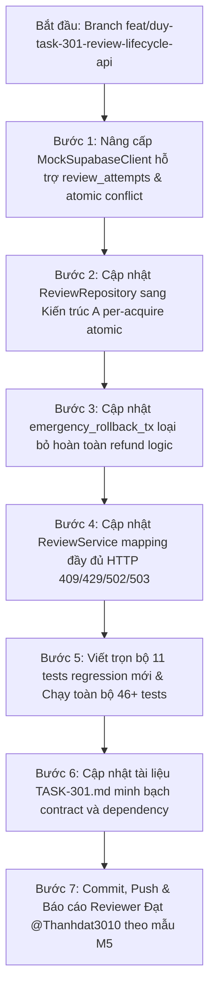

# KẾ HOẠCH BÀI BẢN XỬ LÝ TOÀN DIỆN VẤN ĐỀ F07 (ATTEMPT ACCOUNTING & RPC WRAPPER) [TASK-301] — BẢN v2.0 (ĐÃ TIẾP THU TOÀN DIỆN FEEDBACK)

- **Mã finding:** F07 — [Bắt buộc sửa — P1] open: callback hiện chưa bảo đảm durable attempt accounting
- **Reviewer:** Đạt (`Thanhdat3010`)
- **Tác giả kế hoạch:** Duy (`johannguyen015` — Lead)
- **PR:** [#28](https://github.com/Computational-Thinking-Project/isomorphic-exam-synthesizer/pull/28)
- **Nhánh làm việc:** `feat/duy-task-301-review-lifecycle-api`
- **Tài liệu đối chiếu:**
  - Handoff TASK-304 (Đạt): `docs/ai-w3-targeted-regeneration.md` tại head `a8f61d5` (PR #26).
  - Implementation TASK-304: `backend/app/services/generation/attempts.py`, `backend/app/services/generation/targeted_service.py`.
  - Contract TASK-302 (Hùng): `docs/api/review-rpc-contract.md` (PR #36).
  - Schema migration (Hùng): `backend/migrations/006_stage3_review_and_shuffle.sql` (PR #36).

---

## I. CHỐT CÁC QUYẾT ĐỊNH KIẾN TRÚC THEN CHỐT (ARCHITECTURAL DECISIONS)

Sau khi rà soát phản biện kỹ thuật, kế hoạch v2.0 **chốt dứt khoát 5 quyết định kiến trúc cốt lõi**:

### 1. Quyết định 1: Chọn Kiến trúc A (Pure Per-Acquire Atomic Accounting, KHÔNG Upfront Quota Reservation)
- **Lý do:** Khắc phục triệt để mâu thuẫn "vừa trừ trước ở TX1 vừa kiểm tra ở acquire", đồng thời xóa sổ bài toán "hoàn trả quota khi rollback".
- **Hành vi:**
  - **TX1 (`reserve_regeneration`):** CHỈ làm nhiệm vụ kiểm tra session guards, chuyển câu hỏi sang `regenerating` và khởi tạo bản ghi `operation` (gán lease/owner). **Tuyệt đối KHÔNG cộng trước 4 vào `exam_sessions.gemini_review_calls`**.
  - **Khi AI chạy (`acquire_attempt`):** Mỗi lần adapter xin permit, hệ thống thực hiện tăng nguyên tử (`increment + 1`) trực tiếp vào session counter nếu thỏa mãn điều kiện hạn mức.
  - **Khi Rollback (`emergency_rollback_tx`):** Counter của session đã phản ánh chính xác số permit thực tế đã cấp. **Không có bất kỳ logic hoàn trả quota (no refund) nào**, do đó Issue 3 (unknown grant bị hoàn mất) tự động được giải quyết triệt để. Rollback chỉ hoàn nguyên trạng thái câu hỏi về `pending_review` và ghi log thất bại.

### 2. Quyết định 2: Tăng hạn mức nguyên tử có điều kiện (Atomic Conditional Increment)
- **Công thức:** Kiểm tra và tăng trực tiếp trên CSDL:
  $$\text{actual\_session\_calls} + 1 \le 30 \quad \text{và} \quad \text{op\_attempts} + 1 \le 4$$
- **Thực thi:**
  - Câu lệnh UPDATE có điều kiện `WHERE gemini_review_calls + 1 <= 30 AND status IN ('reviewed', 'generated') RETURNING gemini_review_calls`.
  - Ngăn chặn hoàn toàn hiện tượng Oversubscription khi có nhiều worker/operation cùng chạy song song.

### 3. Quyết định 3: Chống Replay nguyên tử (Atomic Replay Detection)
- Không dùng mô hình SELECT rồi mới INSERT (tránh TOCTOU race).
- Bắt buộc dùng ràng buộc tính duy nhất: `UNIQUE (attempt_id)`.
- Thực hiện `INSERT ... ON CONFLICT (attempt_id) DO NOTHING RETURNING attempt_id`.
  - Nếu kết quả trả về rỗng (0 row) $\rightarrow$ Phát hiện ngay Replay request $\rightarrow$ Trả về `replayed = True, dispatch_permitted = False`.

### 4. Quyết định 4: Phân biệt rõ lý do từ chối (Denial Reasons & Status Code Mapping)
- Nếu `op_attempts >= 4` $\rightarrow$ `dispatch_permitted = False, replayed = False` (Lý do: `OPERATION_EXHAUSTED`).
- Nếu `actual_session_calls + 1 > 30` $\rightarrow$ `dispatch_permitted = False, replayed = False` (Lý do: `REVIEW_QUOTA_EXHAUSTED`).
- **Bảng ánh xạ mã lỗi (Status Code Mapping):**
  | Mã lỗi từ Adapter / CSDL | HTTP Status | Domain Error Code | Mô tả |
  |---|---|---|---|
  | `REVIEW_QUOTA_EXHAUSTED` | **429 Too Many Requests** | `ERR_REVIEW_QUOTA_EXHAUSTED` | Hết 30 lượt toàn session |
  | `OPERATION_EXHAUSTED` | **429 Too Many Requests** | `ERR_OPERATION_QUOTA_EXHAUSTED` | Quá trần 4 lượt cho 1 đợt reject |
  | `REVIEW_ATTEMPT_REPLAYED` | **409 Conflict** | `ERR_ATTEMPT_REPLAYED` | Attempt ID bị gửi lặp lại |
  | `REVIEW_PERMIT_UNCERTAIN` | **502 Bad Gateway** | `ERR_AI_GATEWAY_PERMIT_FAILURE` | Rớt mạng sau khi đã commit permit |
  | `REVIEW_PERMIT_INVALID` | **502 Bad Gateway** | `ERR_AI_GATEWAY_PERMIT_FAILURE` | Sai lệch định danh ID/schema |
  | `DB_UNAVAILABLE` | **503 Service Unavailable** | `ERR_AI_GATEWAY_PERMIT_FAILURE` | CSDL không phản hồi, fail-closed |

### 5. Quyết định 5: Làm rõ ranh giới Dependency Schema `review_attempts` với Hùng (TASK-302)
- **Tình trạng hiện tại:** Migration `006_stage3_review_and_shuffle.sql` của Hùng (PR #36 Phase A) mới chỉ có `version_questions`, `review_logs`, `answer_keys`; **chưa có bảng `review_attempts`**.
- **Giải pháp:**
  - Đây là **Dependency phụ thuộc vào TASK-302 Phase B (Hùng)**.
  - Phía Duy (`TASK-301`): Triển khai repository pattern chuẩn, gọi RPC `review_acquire_attempt` theo contract.
  - Trong test double (`MockSupabaseClient`): Cung cấp bảng `review_attempts` stateful có đầy đủ khóa chính `attempt_id` và mô phỏng chính xác `ON CONFLICT DO NOTHING` có khóa luồng (`threading.Lock`), chứng minh test multi-instance pass 100%.
  - Ghi rõ ràng trong `TASK-301.md`: Tầng ứng dụng đã wired đúng interface, kiểm thử độc lập offline thành công; migration và RPC PostgreSQL thật nằm trong phạm vi bàn giao của PR #36 (Hùng).

---

## II. THIẾT KẾ CHI TIẾT LOGIC THỰC THI (DETAILED SPECIFICATION)

### 1. Logic hàm `acquire_attempt(operation_id: UUID, attempt_id: UUID) -> AttemptPermit`

```text
Input: operation_id (UUID), attempt_id (UUID)
Output: AttemptPermit (frozen BaseModel)

Bước 1 (Fail-closed & Sanity):
  Nếu không kết nối được DB -> Ném lỗi sanitized hoặc raise để adapter map sang 503/UNCERTAIN.

Bước 2 (Atomic Replay Check qua DB Ledger):
  Thực hiện INSERT INTO review_attempts (attempt_id, operation_id, session_id, status)
  VALUES (attempt_id, operation_id, session_id, 'granted')
  ON CONFLICT (attempt_id) DO NOTHING RETURNING attempt_id;

  Nếu rowcount == 0 (đã tồn tại attempt_id):
    Đọc session_calls hiện tại.
    Trả về AttemptPermit(
      operation_id=operation_id, attempt_id=attempt_id,
      dispatch_permitted=False, replayed=True,
      calls_used=min(30, session_calls), remaining_calls=max(0, 30 - session_calls)
    )

Bước 3 (Kiểm tra trần Operation: op_attempts < 4):
  Đếm số attempt đã cấp cho operation này:
  op_attempts = COUNT(review_attempts WHERE operation_id = operation_id) - 1 (trừ bản ghi vừa insert)
  Nếu op_attempts >= 4:
    Xóa hoặc cập nhật status bản ghi vừa insert thành 'denied'.
    Trả về AttemptPermit(
      operation_id=operation_id, attempt_id=attempt_id,
      dispatch_permitted=False, replayed=False,
      calls_used=min(30, session_calls), remaining_calls=max(0, 30 - session_calls)
    )

Bước 4 (Atomic Conditional Increment Quota Session):
  Thực thi:
    UPDATE exam_sessions
    SET gemini_review_calls = gemini_review_calls + 1, updated_at = now()
    WHERE id = :session_id AND gemini_review_calls + 1 <= 30 AND status IN ('reviewed', 'generated')
    RETURNING gemini_review_calls;

  Nếu rowcount == 0 (Hết hạn mức 30 calls toàn session):
    Cập nhật status bản ghi vừa insert thành 'denied'.
    Trả về AttemptPermit(
      operation_id=operation_id, attempt_id=attempt_id,
      dispatch_permitted=False, replayed=False,
      calls_used=30, remaining_calls=0
    )

Bước 5 (Cấp phép thành công - Grant Permit):
  new_calls = giá trị gemini_review_calls vừa trả về.
  Trả về AttemptPermit(
    operation_id=operation_id, attempt_id=attempt_id,
    dispatch_permitted=True, replayed=False,
    calls_used=new_calls, remaining_calls=max(0, 30 - new_calls)
  )
```

### 2. Logic hàm `emergency_rollback_tx` (No Quota Refund)
```text
Input: session_id, old_question_id, regeneration_id, error_msg, user_id, actual_calls_dispatched
Output: bool

Bước 1: Kiểm tra idempotency (TX2 đã commit câu mới chưa? Nếu rồi -> return False).
Bước 2: UPDATE version_questions SET status = 'pending_review' WHERE id = old_question_id AND status = 'regenerating'.
Bước 3: KHÔNG THAY ĐỔI CỘT gemini_review_calls! (Session counter giữ nguyên số permit đã commit).
Bước 4: Ghi audit log vào review_logs với action_type = 'REJECT_FAILED', lưu số permit thực tế đã commit.
Bước 5: Return True.
```

### 3. Chính sách Retry & Phục hồi sau sự cố (Recovery Policy)
- **Khi gặp `REVIEW_PERMIT_UNCERTAIN`:**
  - Không tự ý retry ngầm trong cùng một request.
  - Ném ngay HTTP 502 `ERR_AI_GATEWAY_PERMIT_FAILURE` để thông báo cho client/giáo viên.
  - Phí đã commit trong DB được giữ nguyên (Conservative Accounting).
  - Nếu giáo viên bấm thử lại (Manual Retry) $\rightarrow$ Khởi tạo một reject request mới với `operation_id` mới và các `attempt_id` mới; tiếp tục trừ quota bình thường cho đến khi chạm trần 30.

---

## III. NÂNG CẤP MOCK SUPABASE CLIENT CHO CONCURRENCY & MULTI-WORKER SIMULATION

Để kiểm chứng 100% không còn lỗ hổng trước khi có DB thật từ Hùng, `MockSupabaseClient` được nâng cấp:
1. **Thread-safe với `threading.Lock()`:** Mọi câu lệnh SELECT/UPDATE/INSERT đều đi qua lock mô phỏng atomic transaction của DB engine.
2. **Hỗ trợ `review_attempts` storage:** Lưu trữ tập hợp các attempts độc lập với instance của `ReviewRepository`.
3. **Mô phỏng `INSERT ... ON CONFLICT (attempt_id) DO NOTHING`:** Kiểm tra khóa chính `attempt_id`; nếu trùng lặp thì không insert và trả về 0 row affected.
4. **Mô phỏng Multi-Client cùng Database:** Cho phép 2 instance `MockSupabaseClient(shared_state)` chạy song song giống như 2 process kết nối vào 1 database.

---

## IV. BỘ KIỂM THỬ MỞ RỘNG (EXPANDED TEST SUITE — 11 TEST CASES MỚI)

Bộ test mới bao phủ triệt để toàn bộ các ca biên, race condition và exception mapping:

| STT | Tên Test Case | Mục đích kiểm chứng |
|---|---|---|
| 1 | `test_f07_quota_boundary_at_26_allows_valid_attempt` | Ở mốc 26, attempt 1 được cấp phép thành công (calls_used=27, permitted=True). |
| 2 | `test_f07_operation_exhausted_after_4_attempts` | Cùng 1 operation, attempt 1-4 thành công, attempt 5 bị từ chối (`permitted=False, replayed=False`). |
| 3 | `test_f07_session_exhausted_at_30_denied` | Session đã chạm 30, attempt kế tiếp bị từ chối với `REVIEW_QUOTA_EXHAUSTED`. |
| 4 | `test_f07_replay_across_separate_clients_same_db` | Multi-worker thật: Client A acquire attempt X thành công; Client B acquire lại attempt X $\rightarrow$ trả `replayed=True`. |
| 5 | `test_f07_concurrent_same_attempt_id_only_one_granted` | Race condition: 2 luồng đồng thời xin cấp phép cho cùng 1 attempt_id $\rightarrow$ Chỉ đúng 1 luồng được grant, 1 luồng nhận replayed. |
| 6 | `test_f07_concurrent_two_ops_at_26_no_oversubscribe` | 2 operations chạy song song khi session=26 $\rightarrow$ Tổng calls không bao giờ vượt quá 30. |
| 7 | `test_f07_rollback_zero_committed_permits` | Lỗi xảy ra trước khi cấp permit $\rightarrow$ Quota giữ nguyên số ban đầu. |
| 8 | `test_f07_rollback_retains_committed_permits` | Lỗi xảy ra sau khi cấp 1 hoặc 2 permits $\rightarrow$ Rollback KHÔNG hoàn tiền, quota giữ nguyên số đã commit. |
| 9 | `test_f07_rollback_idempotent` | Gọi `emergency_rollback_tx` 2 lần liên tiếp $\rightarrow$ Lần 2 return False, không duplicate log hay sai lệch quota. |
| 10 | `test_f07_db_unavailable_fail_closed` | Database bị ngắt kết nối khi acquire $\rightarrow$ Ném lỗi an toàn, fail-closed, không tự ý grant mù. |
| 11 | `test_f07_service_maps_all_permit_error_codes` | Kiểm tra HTTP Status mapping: 429 cho Quota, 409 cho Replayed, 502 cho Uncertain/Invalid. |

---

## V. QUY TRÌNH THỰC HIỆN 7 BƯỚC BÀI BẢN (EXECUTION WORKFLOW)



### Bước 1: Nâng cấp `MockSupabaseClient` (`backend/tests/services/test_review_lifecycle.py`)
- Bổ sung bảng `review_attempts` vào state mặc định.
- Thêm hỗ trợ kiểm tra ràng buộc unique và conditional update nguyên tử.

### Bước 2: Cập nhật `backend/app/services/review/repository.py`
- Xóa bỏ logic cộng trước 4 vào quota trong `reserve_max_quota_and_start_regenerating`.
- Triển khai `acquire_attempt` theo mô tả chi tiết tại Mục II.1 (không dùng biến RAM).

### Bước 3: Cập nhật `emergency_rollback_tx`
- Xóa bỏ đoạn mã trừ refund `4 - actual_calls`. Bảo toàn nguyên vẹn số calls đã ghi nhận.

### Bước 4: Cập nhật `backend/app/services/review/service.py`
- Tinh chỉnh xử lý ngoại lệ từ Adapter: Ánh xạ chuẩn `REVIEW_QUOTA_EXHAUSTED` (429), `REVIEW_ATTEMPT_REPLAYED` (409), `REVIEW_PERMIT_UNCERTAIN` / `REVIEW_PERMIT_INVALID` (502).

### Bước 5: Kiểm thử và xác minh (Verification)
- Chạy toàn bộ test suites:
  `pytest backend/tests/services/test_review_lifecycle.py backend/tests/api/test_review_api.py -v`
  👉 Kỳ vọng: **46/46 tests passed (35 cũ + 11 mới)**.
- Chạy linter: `ruff check backend/app backend/tests`.

### Bước 6: Cập nhật tài liệu `docs/tasks/TASK-301.md`
- Cập nhật plan lên phiên bản v7.2.
- Ghi nhận chi tiết: Đã giải quyết triệt để 3 lỗi biên của F07 theo kiến trúc A, làm rõ ranh giới với TASK-302.

### Bước 7: Bàn giao & Phản hồi Reviewer
- Commit với message chuẩn: `fix(review): adopt per-acquire atomic accounting and durable attempt ledger (F07) [TASK-301]`.
- Push lên `origin/feat/duy-task-301-review-lifecycle-api`.
- Trả lời comment của Đạt theo mẫu M5 trên PR #28.
