# TASK-301 / PR #28 — kế hoạch hoàn thiện hiện hành, 04/11/2026

## 1. Phạm vi, nguồn và mức bằng chứng

- Chế độ **author / lập kế hoạch**, dùng M2; M3/M5 chỉ điền khi thực sự triển khai/kiểm. Lượt này không sửa code, push, đăng comment, approve hoặc merge.
- Nhánh `feat/duy-task-301-review-lifecycle-api`; PR head **1366f3ce2bd6fd4924746544c78bb0ef5a5974fd**, base `dev` **032fbf2e3f3de2c4a5757d2fc89a06d24eae06c3** theo GitHub khi đọc. PR đang open, không Draft và `mergeable=false`.
- Workflow **v0.1 proposed**, docs tham chiếu `506384b`; nguồn giao việc [W3 v2.1](W3_ASSIGNMENT.md), [TASK-301](TASK-301.md). Hạn tuần cũ 03/11 đã qua; không tự biến ETA lịch sử thành cam kết mới.
- Đối chiếu #36 **a2d2fc3c31e3bcc4c3acf178d946c83f0a05b37a** và #26 **a8f61d57976181472eae355d869362b2c80261d4**. Hùng giữ DB/SQL authority; Duy giữ caller/API; Đạt giữ adapter. Không tự giao thêm người hoặc viết SQL cạnh tranh.
- Authority: [review RPC contract](../api/review-rpc-contract.md). Baseline RPC đã có ở #36; **P1–P4 và R1 vẫn proposed**. [Comment chờ xác nhận](https://github.com/Computational-Thinking-Project/isomorphic-exam-synthesizer/pull/36#issuecomment-6611551443) chưa có phản hồi mới lúc đọc.
- Đã đọc code bằng `git show HEAD:...`, diff phạm vi PR và timeline review. Các nhận định dưới đây là đối chiếu tĩnh với head; ca tái hiện do reviewer chạy được dẫn nguồn riêng. Không nhận đã chạy lại product/DB tests trong lượt lập plan.
- Working tree có bộ sửa caller/tests/docs chưa commit. Phải giữ nguyên và đối chiếu từng phần, không coi nó là PR head hoặc kết quả reviewer xác minh. Những số 141 pass/765 collect trong ghi chú local là báo cáo trước đó, không phải kết quả được chạy lại lượt này; collect không phải pass.

**Tài liệu này là kế hoạch thực hiện; không định nghĩa một contract thứ hai.** Phần v1.7 phía dưới là lịch sử và không ghi đè trạng thái/tiêu chí tại đây. Các nhãn VERIFIED_FIXED/100% trong lịch sử chỉ áp dụng đúng ca/head đã có bằng chứng, không phải chứng nhận tích hợp hiện tại.

### Tiến độ thực hiện sau khi lập plan — vẫn chưa Ready

Draft local đã bổ sung đối soát reserve tối đa ba lần bằng IDs gốc cho transport/
malformed response. Active replay không dispatch hoặc failure-settle; outcome chưa
rõ trả503. Khoảng trống reserve response loss nêu ở bước3 dưới đây đã có bản sửa
và bảy regression; chưa gọi là reviewer verified. Đã chạy lại năm module caller:
**148 passed**, Ruff pass, mypy69 files pass. Scheduling stub/RPC fake không thay
kiểm async/HTTP/SQL thật. Các dependency B01–B07 và gate nghiệm thu còn giữ nguyên.

## 2. Kết luận để quyết định triển khai

Có thể sửa ngay phần caller, validation, receipt/replay, settlement và tests. Chưa thể nghiệm thu Reject hoàn chỉnh chỉ bằng tài liệu: producer chưa lưu confirmed artifacts theo target, SQL baseline trả `database_rows`, mapping cuối/P1–P4/R1 chưa chốt. Trả lỗi an toàn khi thiếu dependency là cần thiết nhưng chưa hoàn thành chức năng.

Ưu tiên dưới đây: **P1** chặn tính đúng/an toàn hoặc tính năng chính; **P2** sai dữ liệu hiển thị, thiếu kiểm chứng hoặc bàn giao. Mã A/B dùng để quản lý đầu việc, **không thay ID F/C của review**. Đây là danh mục vấn đề đã biết và các gate cần kiểm, không cam kết mọi bug có thể tồn tại đều đã được tìm ra.

## 3. Danh mục lỗi và nguyên nhân — phần sửa được ngay

| Mã / review liên quan | Nguyên nhân tại PR head, điều kiện và hậu quả | Việc sửa cụ thể | Trạng thái / cách kiểm đạt |
|---|---|---|---|
| A01 — P1, C03/F02 | `reserve_max_quota_and_start_regenerating` quy receipt về `ReserveResult.OK`, bỏ `snapshot`, `replayed`, `operation_status`, `settlement`, `max_attempts`. Service lại SELECT snapshot sống sau TX1. Input AI không còn là bản đóng băng trong operation. | Trả typed ReservationReceipt; validate đúng IDs, strict bool/int, lease có timezone, trạng thái/settlement. Service chỉ dùng snapshot từ receipt. Không reload source/Blueprint/peers hoặc suy metadata. | Sửa caller ngay; format target chờ B01/B02. Local draft đã có hướng sửa, chưa publish/verified. Test capture arguments: sửa live rows sau reserve không đổi input AI; malformed receipt không chạy AI. |
| A02 — P1, C03 | `get_question_snapshot` tự tạo content_hash khi thiếu; lấy legacy Blueprint row. Hash tính lúc Reject không chứng minh đã xác nhận; Blueprint legacy không phải full canonical 0.4.0. | Bỏ fallback hash/Blueprint; chỉ kiểm fingerprint đã persist bằng hàm dùng chung; validate full canonical document và revision/source association. Thiếu/mismatch dừng trước acquire/provider, rồi settle reservation nếu đã mở. | Bỏ fallback ngay; success thật chờ B01/B02. Test missing hash, altered stem/options/key/solution, wrong source/revision, legacy Blueprint: 0 permit, 0 provider, operation không kẹt. |
| A03 — P1, F02/F06 | Snapshot load nằm ngoài vùng catch sau reserve; xử lý output/count ngoài catch cũng có thể throw. Sau TX1, các lỗi này để operation active đến khi recovery. | Đặt toàn bộ frozen parsing → gọi AI → validation → completion trong vùng settlement. Dùng operation gốc; đọc projection sau commit nằm ngoài vùng rollback. Không lấy question ID thay operation ID. | Sửa ngay; draft bao được nhiều đường nhưng vẫn phải kiểm cả reserve response không rõ. Inject lỗi ở từng điểm, kiểm current/prior status/quota/audit. |
| A04 — P1, F02/F07 | Replay reserve bị xem như thao tác mới; completed replay bị chặn bởi question/status/lease hiện tại. Cùng key có thể chạy AI lại, hoặc không lấy được kết quả đã commit sau expiry/approval. | Phân nhánh receipt: active replay → 409, không dispatch; completed → đọc kết quả đã commit; failed/recovered → outcome rõ, chỉ key mới mới tạo action mới. Không dùng đồng hồ worker để vô hiệu receipt lịch sử. SQL vẫn kiểm quyền và khóa mutation mới. | Sửa ngay; kiểm replay trước/sau expiry, sau approval, sau candidate được thay tiếp. Không nhận replay nếu IDs không khớp. |
| A05 — P1, F02 | Service chỉ retry exception thường nhưng repo map lỗi RPC thành ReviewDomainException rồi service raise ngay. Commit thành công nhưng mất response không có reconciliation đầy đủ; đọc candidate lỗi có thể bị hiểu là mutation thất bại. | Phân biệt lỗi deterministic và outcome chưa rõ. Retry bounded với cùng operation/candidate khi transport không rõ; không retry invalid/conflict/permission như transport. Đọc lại durable receipt để phân biệt completed/failed/recovered/active. Post-commit read lỗi trả retryable error, không rollback. | Sửa ngay; draft có retry503/reconcile nhưng reserve response loss còn cần bổ sung ở bước 3. Test commit-then-disconnect ở reserve/complete/fail; không duplicate AI/candidate/audit hoặc refund. |
| A06 — P1, F02/F06 | Nhiều nhánh gửi `str(exc)` hoặc chuỗi tự do vào fail RPC, trong khi SQL nhận error code dạng `^[A-Z][A-Z0-9_]{0,79}$`. Settlement có thể thất bại, lỗi gốc che mất operation còn active. | Map exception sang enum code ổn định; không gửi raw provider/DB exception. Parse SettlementReceipt, kiểm IDs/status/count; nếu chưa xác nhận settlement thì báo outcome chưa rõ, không trả422 như thể đã dọn xong. Preserve cancellation sau best-effort shield; recovery xử lý khi process chết. | Sửa ngay; draft đã có hướng sửa. Test invalid output + fail RPC mất response, complete đã commit + fail bị từ chối, cancellation trước/sau permit. |
| A07 — P1, F10 | Thiếu report vẫn được dựng `is_valid=true`; checks/warnings sai kiểu bị thay []; bool/coercion và count clamp che dữ liệu sai. Mặc định key A hoặc int conversion cũng che lỗi input. | Một validator dùng chung trước complete: report/checks/warnings/booleans đúng schema adapter, stem/options/key/solution bắt buộc; count int thực trong0–4, không clamp; giữ nguyên evidence đã validate. Không thêm math_verified hoặc checks giả. | Sửa ngay; draft có validation.py. Test thiếu report/is_valid/checks/solution, bool/string count, >4, false dạng chuỗi, options trùng; valid payload giữ đúng evidence/content. |
| A08 — P1, F02/F07/F09 | Repo còn nhiều triển khai table-write/CAS phía sau RPC cho test fallback; constructor head dùng `service_db or db`. Test fake dễ kiểm đường khác production; worker thiếu có thể gọi nhầm owner rồi lỗi ACL. | Mọi mutation/permit/recovery chỉ RPC; worker thiếu explicit503. Giữ public compatibility names nếu cần nhưng delegate một implementation. Mock bằng injection tại RPC boundary, không duy trì một DB lifecycle thứ hai. Không nới ACL để né lỗi. | Sửa ngay; không báo lại lỗi production {}→INSERT đã được reviewer xác minh sửa. Draft đã xóa fallback lớn; cần kiểm callers/imports và regression coverage trước nhận thay thế. |
| A09 — P2, C01 | Parser progress nested đã sửa, nhưng vẫn trả `unapproved_question_ids=[]` dù còn câu chưa duyệt; danh sách và counts mâu thuẫn. | Giữ count/readiness authority; không suy mẫu số từ current rows. Nhận IDs cùng snapshot từ RPC theo B03. Trước khi dependency có, trả lỗi rõ thay vì danh sách giả; đây chưa phải hoàn thiện progress. | Parser/guard sửa ngay; đủ chức năng chờ B03. Test thiếu cả version/source, duplicate/missing/current regenerating; count/list phải nhất quán. |
| A10 — P2, F02/C02 | Accept/Revert route không nhận key, nên client retry sau mất response không giữ được action_id. Đây là thiếu khả năng phục hồi outcome, không tự kết luận mọi thao tác đều duplicate. | Nếu giữ phạm vi bổ sung này, thêm optional Idempotency-Key, UUID validation trước query; truyền ổn định p_action_id. Lookup receipt theo SQL trước edit guard cho replay, mutation mới vẫn guard. Ghi API docs và test key binding. | Có thể sửa ngay trên caller vì SQL đã có action_id; local draft đã có header. Cần xác nhận phạm vi nếu chưa được owner duyệt, không biến đề xuất thành yêu cầu review cũ. |
| A11 — P2, docs/M3 | PR body còn plan cũ: reserve/refund/reason/progress recovery và link tạo PR; một số plan ghi hoàn tất/verified rộng hơn bằng chứng. GitHub đang non-Draft dù còn dependency/conflict. | Cập nhật TASK-301 và M3 đúng head, phân biệt baseline/proposed/local/published; dẫn authority, findings, checks và phần chưa kiểm. Chỉ chuyển Ready khi đủ gói tích hợp. Khi thực hiện, đưa PR về Draft nếu chưa đủ. | Làm ngay phần tài liệu; không tự đóng review thread. Kiểm link và tính nhất quán, không chép contract sang các plan. |

## 4. Phụ thuộc/thiếu thông tin — chưa thể tự hoàn tất

| Mã / liên quan | Thiếu chính xác điều gì | Bên cần xác nhận / đầu ra để mở khóa | Phần TASK-301 làm được trong lúc chờ |
|---|---|---|---|
| B01 — P1, C03/P1/P2 | Confirm source hiện chưa lưu exact validated SourceQuestion + per-question fingerprint/revision/actor/time; Blueprint producer chưa publish full canonical0.4.0 gắn cùng revision/hash. Chỉ thêm content_hash column không đủ. | Duy điều phối owner producer/write boundary theo scope; Hùng xác nhận storage/atomic binding/guards. Cần code producer, persistence và test concurrent edit/publication; chưa có ETA xác nhận mới. | Validator và negative fixtures; fail closed. Không hash lúc Reject để lấp khoảng trống. Nếu phải mở scope Stage1/producer, ghi quyết định trước khi thực hiện. |
| B02 — P1, C03/P3/P4 | #36 baseline snapshot format=database_rows; chưa triển khai target confirmed_artifacts_v1 hoặc một biểu diễn tương đương đã chốt. Chưa có frozen JSON xuất từ RPC target thật. | Hùng/Đạt phản hồi P1–P4; owner cập nhật cùng authority với field/type/error/replay/version cụ thể. Hùng giao success + missing/mismatch/revision-changed fixtures từ SQL; Đạt xác nhận mapping adapter. | Typed envelope/parser và contract tests; chỉ gọi chúng là chuẩn bị cho proposed format. Không ép tên field đề xuất thành schema đã được chấp nhận. |
| B03 — P2, C01 | HTTP cần danh sách chưa duyệt, RPC baseline chỉ trả counts. SELECT riêng phía caller có thể khác snapshot khi đang mutation. | Đề xuất Hùng thêm unapproved_question_ids trong cùng progress calculation/transaction, hoặc owner thống nhất thay public response. Cần schema/fixture và count/list semantics (kể cả regenerating/duplicates). | Guard không trả danh sách rỗng giả, chuẩn bị parser/tests. Không coi503 là xong chức năng. |
| B04 — P1, F06/R1 | Worker discovery RPC đã có ở a2d2fc3; caller head chỉ gọi khi SESSION_BUSY. Target R1 trước mọi Reject chưa được xác nhận; flow same-question/replay/locked session cần rõ. | Hùng/Duy/Đạt chốt R1 trên authority: GET thuần đọc, lazy worker recovery ở Reject, thứ tự guards/replay/reserve, DB-clock180s và actor từ operation. R1 không bảo đảm tự dọn khi không có request. | Duy trì discovery RPC đúng ACL; thêm test same-question stale và cả hai thứ tự late completion. Chuẩn bị thay trigger, không gọi đó là quyết định đã chấp thuận. |
| B05 — P1, F01/F02/F05/F06/F07/F08/C01/C02 | #36 có baseline implementation/tests riêng; PR28 chưa tích hợp nguyên gói SQL/adapter đúng pin. Tests ở nhánh owner không chứng minh caller end-to-end. | Tích hợp code #36/#26 đúng commit đã chấp nhận, migrations004/005→006→007 tương thích #33, test roles/concurrency nhiều connection. Không cần chờ toàn bộ export/UI để kiểm caller. | Caller/fixture integration trước; chuẩn bị DB fault/concurrency matrix. Không thêm migration008 hoặc sửa nhánh Hùng. |
| B06 — P1, môi trường/nghiệm thu | Chưa có bằng chứng chạy full async/API/DB suite của bản caller local và head tích hợp. Ghi chú local mô tả Windows socketpair bị chặn; một lần xin chạy ngoài môi trường hạn chế đã bị từ chối. | Chạy trong CI/Linux/Docker/DB test được phép; phân biệt fixture/real PostgreSQL/PostgREST/JWT/deployed Supabase. Không xin lại cùng quyền bị từ chối hoặc bỏ checks để có xanh. | Static/lint/typecheck và unit boundary; chuẩn bị tests thật. Không đổi async tests thành skip hoặc coi scheduling stub là concurrency proof. |
| B07 — P1 trước merge | GitHub PR28 mergeable=false; chưa giải quyết conflict với dev hiện tại. Shared review code cũng hiện diện trong #33, có nguy cơ mang lại bản cũ. | Khi triển khai, kiểm đúng dev/head mới, giữ local drafts, giải conflict trên nhánh Duy; xác định commit review dùng chung để #33 tích hợp sau. Merge chỉ khi có quyền riêng và đủ checks/Approve. | Lập danh sách shared files và phương án kiểm lại. Không reset/discard working tree hoặc dùng bản stale của #33 đè lên301. |

### Những lỗi không báo lại như còn nguyên

- F01/F08: SQL008 cạnh tranh đã bị xóa; không gán lỗ hổng ACL của file đã xóa cho head mới. Giữ test ACL trên authority thay thế.
- F03: canonical của candidate mới đã có sửa; giữ regression candidate khác đáp án nguồn/cũ và shuffle không đổi canonical.
- F04: guard thiếu adapter→503 đã được xác minh ở head trước. Hàm mock cũ còn trong service không chứng minh route đang gọi nó; có thể xóa dead code nhưng không báo route hiện vẫn fabricate theo repro cũ.
- F05: caller đã bỏ invalidation rời ở flow chính; cần chứng minh transaction SQL tích hợp, không yêu cầu thêm late invalidator.
- F07/F09: strict permit IDs/bool và worker Reject đã được reviewer xác minh ở head trước; giữ và mở rộng tests, không lặp lỗi cũ như chưa sửa.
- C01: nested progress repro đã verified; phần danh sách còn thiếu là A09/B03, không nói parser vẫn fallback như nguyên trạng.

Nguồn: [review gốc F01–F07/C01–C03](https://github.com/Computational-Thinking-Project/isomorphic-exam-synthesizer/pull/28#pullrequestreview-5720765457), [review F08 và integration](https://github.com/Computational-Thinking-Project/isomorphic-exam-synthesizer/pull/28#pullrequestreview-5731260253), [F09/F10](https://github.com/Computational-Thinking-Project/isomorphic-exam-synthesizer/pull/28#pullrequestreview-5732905517), [xác minh từng phần](https://github.com/Computational-Thinking-Project/isomorphic-exam-synthesizer/pull/28#pullrequestreview-5736420652), [review gần nhất](https://github.com/Computational-Thinking-Project/isomorphic-exam-synthesizer/pull/28#pullrequestreview-5745235148).

## 5. Các bước triển khai, thứ tự và điều kiện qua bước

### Bước 0 — cố định bản làm việc, giữ thay đổi đang có

1. Ghi branch/status/head/base; giữ snapshot hoặc commit riêng các draft hiện có theo nội dung sau khi kiểm; không trộn/bỏ thay đổi của user. Không dùng số tests local để đóng finding trên remote head.
2. Map từng diff local vào A01–A11; đọc cả test bị xóa/thay. File caller chính: review/service.py, repository.py, routes/review.py; validator/receipt có thể tách module như draft hiện có.
3. Đánh dấu gói còn Draft trong M3 khi thực hiện; giữ scope301. Output bước này là danh sách diff rõ nguồn, không phải báo hoàn tất.

### Bước 1 — chốt đúng phần còn thiếu, không mở lại quyết định đã có

1. Tiếp tục cùng thread #36 P1–P4/R1; yêu cầu phản hồi từng mục, gồm B03 progress IDs. Ghi rõ câu nào đã đồng ý về nguyên tắc và câu nào chưa có schema/code.
2. Chốt owner implementation producer + persistence và input tối thiểu B01/B02; ETA phải do bên cung cấp xác nhận, không dùng mốc23:00 cũ.
3. Owner cập nhật một authority; TASK-301 dẫn link commit/section được chấp nhận. Có thể làm bước2–4 khi đang chờ, nhưng không nghiệm thu target envelope hoặc R1 bằng im lặng.

### Bước 2 — receipt/RPC boundary và validation (A01/A02/A07/A08)

1. Typed models cho reserve/complete/action/fail/recovery/progress; parse JSON object hoặc singleton array, từ chối array nhiều phần tử. UUID JSON string được parse đúng; boolean/counter strict; session/operation/question phải khớp request.
2. Giữ snapshot/replay/settlement; closed replay không bị worker-clock lease check từ chối. Tách owner và worker; worker thiếu hoặc lỗi/malformed RPC không có table fallback.
3. Validate frozen source/hash/revision/canonical Blueprint/current/peers trên bản copy. Không thêm kwargs revision ngoài chữ ký adapter đã chốt, không sửa dữ liệu lưu.
4. Validate candidate/report theo contract304; giữ solution/checks/warnings/confidence thật, không coercion hoặc tạo bằng chứng. Cùng validator ở service và repository nếu có compatibility entrypoint, tránh bypass.
5. Qua bước khi các negative fixtures không dispatch/mutate và valid fixture giữ nguyên input/evidence. Positive fixture tự dựng chỉ là unit evidence, chưa thay JSON thực B02.

### Bước 3 — state machine/retry/settlement hoàn chỉnh (A03–A06)

1. Chọn operation UUID trước reserve; mọi retry transport giữ cùng key. Phân loại reserve response loss/invalid receipt là outcome chưa rõ, vì SQL có thể đã commit dù caller chưa có typed receipt.
2. **Khoảng trống draft còn phải sửa:** reserve hiện gọi một lần, parser lỗi ngoài vùng settlement. Bổ sung bounded replay/reconciliation bằng bộ IDs gốc. Chỉ settlement khi đã xác minh operation thuộc request; không dùng IDs sai trong malformed payload. Nếu vẫn không xác định được, trả503 và giữ cùng key cho retry/recovery, không tự dựng active receipt.
3. Phân nhánh trạng thái ngay sau receipt: active mới mới được AI; active replay không được AI; completed replay đọc kết quả; failed/recovered không mở operation mới cùng key. Kiểm key reuse khác session/question là409.
4. Đánh giá guard trước replay: SQL phải kiểm ownership cả khi replay. Mutation mới bị generating/approved/exported/approved_at guards. Không để check local của trạng thái hiện tại ngăn đọc kết quả đã settle mà DB cho replay; kiểm cả trường hợp adapter hiện không cấu hình. Nếu cần hỗ trợ replay không có adapter, chốt đường lookup không tạo reservation ngoài ý muốn; không bỏ guard bằng cách reserve rồi mới phát hiện thiếu adapter.
5. Bọc frozen parsing/AI/output/complete; map error codes; retry bounded chỉ outcome transient/uncertain. Nếu complete đã commit, fail/reconcile phải trả completed, không khôi phục old candidate.
6. Phân biệt mất response với postcommit projection error; lỗi đọc trả outcome/retryable error, không fail operation đã hoàn thành. Nếu projection đọc candidate sau các mutation khác, kiểm response không ghép canonical/display/status từ hai thời điểm; chốt semantics replay theo receipt nếu cần.
7. Cancellation: shield settlement best effort, giữ CancelledError; process crash dựa vào DB lease/recovery. Qua bước khi fault injection mọi boundary giữ đúng số candidate/audit/permits và không chạm operation mới.

### Bước 4 — Accept/Revert/progress/HTTP/recovery (A09/A10/B03/B04)

1. Optional key Accept/Revert nếu nằm trong scope đã đồng ý; validate IDs/key trước DB query, vẫn assert session/question ownership và association. Thử đủ401/403/404/409/422/423/429/503 theo mapping authority.
2. Revert theo C02 trong authority: đi theo lineage cùng version/source về **candidate đầu tiên**, khôi phục row đó current/approved, không copy source_questions thành row mới. Revert chính candidate đầu tiên là approval idempotent. Broken/cyclic lineage bị từ chối; canonical không bị viết lại. Không dùng mô tả “copy source” trong plan cũ.
3. Progress nested counts/ready phải dùng authority; danh sách cùng snapshot sau B03. GET không recovery/mutation; không lấy version_questions hiện có làm expected denominator.
4. Sau R1 được chấp thuận: recovery worker ở vị trí đã chốt trước reserve mới, gồm chính câu stale. Repeat recovery no-op; DB-clock và stored actor; không scan ledger hoặc đoán operation từ question.regeneration_id.
5. Kiểm flow qua public HTTP/JWT, không chỉ gọi hàm handler trực tiếp. Qua bước khi headers/auth/error mapping hoạt động với actual service/repository và DB RPC.

### Bước 5 — tích hợp pins, producer/DB/AI và giải conflict

1. Sau B01/B02 sẵn: integrate đúng producer + SQL + adapter commits trên nhánh Duy; bảo toàn migration ordering và docs changelog. Không tạo DB implementation song song. Giải conflict với dev sau khi giữ draft; đọc diff hợp nhất, không chọn cả một bên máy móc.
2. Xuất fixtures từ RPC thật; chạy public Reject → frozen input → adapter thật + fake provider → permit → complete. Provider fake cho kết quả xác định, không cần tốn Gemini để kiểm transaction; không gọi live Gemini hoặc deploy cloud nếu chưa được giao riêng.
3. Tái hiện missing/mismatch/superseded source/Blueprint dưới transaction lock. Run actual PostgreSQL nhiều connection cho race/ACL/fault; test framework/fake chỉ dùng orchestration.
4. Kiểm shared files với #33, bảo đảm tích hợp305 không mang lại code301 cũ; #28 không tự mở rộng sang sửa toàn305. Output cho303/305: canonical/current/approved/readiness và error/receipt contract đúng pin.

### Bước 6 — kiểm đủ và trả review cùng ID

1. Chạy checks theo CONTRIBUTING/CI; ghi commit và môi trường. Mỗi failure sửa nguyên nhân rồi chạy lại suite ảnh hưởng; không xóa/skip tests để giảm yêu cầu.
2. Cập nhật M3, TASK-301 và changelog đúng phần đã làm/đã kiểm/còn chờ. Với từng F/C, M5 trả cùng thread: commit sửa, repro cũ, regression mới, giới hạn, **claimed_fixed**. Không tự gắn verified thay reviewer.
3. Request reviewer kiểm gói tích hợp một lần khi đủ input và checks. Nếu có lỗi mới, phân loại ID mới/hồi quy; lỗi cũ vẫn giữ ID. Resolve thread/CI xanh không tự thay GitHub Approve.

## 6. Ma trận kiểm bắt buộc trước nghiệm thu

| Nhóm | Ca kiểm cụ thể | Mức bằng chứng cần |
|---|---|---|
| Frozen provenance | success exported fixture; thiếu source/hash/Blueprint; sai revision; edit-and-revert; source/peers sai session/version; canonical/display không đồng nhất | Validator unit + producer/storage/RPC integration |
| Reservation/replay | lost reserve response; malformed/IDs sai; active/completed/failed/recovered replay; replay sau180s/approval; key reuse khác resource | Actual caller + SQL receipts; không chỉ fake state |
| Candidate evidence | thiếu/sai report/checks/solution; false-string; math_verified thiếu evidence; count bool/-1/5; duplicate options; valid report unchanged | Unit boundary + adapter contract + SQL validation |
| Settlement | lỗi trước permit/sau grant/timeout/cancel/output/complete; lost fail response; complete committed nhưng response mất; postcommit SELECT lỗi | Fault injection caller và PostgreSQL, assert ledger/current/audit/quota |
| Quota | session26/27/28/29/30; operation cap4; same attempt replay/global ID conflict; uncertain grant; provider retry/repair; không refund | Permit/adapter unit + multi-connection SQL race tại29 |
| Ownership/ACL | userB gọi owner RPC củaA; anon/authenticated gọi worker; service_role không SELECT private ledger; worker thiếu; UUID sai; association sai | HTTP JWT/RLS + roles/grants thực, không chỉ mocks |
| Atomicity/canonical | lỗi insert/audit/invalidation/readiness; exactly one current/slot; candidate mới dùng đáp án mới; revert về candidate đầu lineage; shuffle không sửa canonical | PostgreSQL transaction/fault + shuffler integration |
| Recovery/races | same-question stale, operation ID khác questionID, prior approved restore, repeated recovery; A recover→B reserve→lateA; complete thắng recovery và chiều ngược | DB clock + nhiều connection + public trigger được chốt |
| Progress/readiness | N×M đúng; mất cả source/version; duplicate/missing/regenerating; count/list snapshot; GET không ghi; đủ approved→reviewed | RPC/readiness SQL + HTTP contract |
| Pool/locking | provider đang chờ không giữ transaction/connection; accept câu khác được phép; second Reject409; approve/shuffle serialize | Connection instrumentation + nhiều worker/connection |

Checks dự kiến theo CI hiện hành:

```text
ruff check backend/app scripts/blueprint
mypy backend/app --ignore-missing-imports
python -m pytest backend/tests scripts/blueprint/tests -q
```

Chạy thêm suite migration thật đúng hướng dẫn owner #36; phải chứng minh tests được execute, không chỉ collect hoặc skipped. Giữ CI Pipeline và Docker environment checks áp dụng trên final head. Fixture nội bộ, PGlite một connection, direct-handler tests và scheduling stub không thay PostgreSQL races/HTTP deployment evidence. Không lặp full suite vô ích khi code không đổi; rerun sau tích hợp/conflict/fix ảnh hưởng.

## 7. Điều kiện hoàn tất và bàn giao

- [ ] A01–A11 đã xử lý theo scope được chấp thuận; B01–B04 có quyết định và implementation/fixtures đủ dùng, không chỉ tài liệu proposed.
- [ ] Actual endpoint→RPC→adapter→settlement thành công; negative/cancel/replay/recovery/races đạt; không fake evidence, refund hoặc fallback mutation.
- [ ] Migration/schema/ACL/ledger/canonical/invalidation/readiness giữ invariant; progress trả đủ dữ liệu, không trả503 thay chức năng khi nghiệm thu.
- [ ] Conflict/dev giải xong; diff cuối không đưa code cũ trở lại; #33 có input301 đúng phiên bản để tích hợp.
- [ ] Checks áp dụng đạt trên final head; kết quả local/CI/DB và giới hạn ghi đúng; reviewer xác minh findings cùng ID, có ít nhất một GitHub Approve theo CONTRIBUTING trước merge.
- [ ] Output/commit/API contract giao cho303/305; chưa nhận Done hoặc “không còn bug” từ unit pass, comment đồng ý hoặc tài liệu đã đăng.

**Việc khởi động trước:** kiểm và hoàn thiện draft caller theo bước0/2/3, đặc biệt reserve response uncertainty; đồng thời nhận xác nhận/input B01–B04. Những phần này đủ rõ để tiến hành mà không cần chờ toàn bộ #36 xong, nhưng chưa đủ để cam kết ngày Done khi producer/fixtures/môi trường chưa có ETA được xác nhận.

---

# Bản remediation v1.7 lịch sử — giữ để truy vết
**Phiên bản:** v1.7 — Production-Grade Implementation (Đồng Bộ Hóa Hợp Đồng Sau Trao Đổi Phối Hợp PR #36)  
**Ngày cập nhật:** 03/11/2026  
**Chịu trách nhiệm:** Senior Backend / PostgreSQL Engineer  
**PR:** [#28](https://github.com/Computational-Thinking-Project/isomorphic-exam-synthesizer/pull/28) (`feat/duy-task-301-review-lifecycle-api`)  
**Tác giả PR:** Nguyễn Bá Duy (`johannguyen015`)  
**Reviewer chính:** Hùng (`benalexx007` — Stage 3 Schema & RPC Owner)  
**Reviewer bổ sung:** Đạt (`Thanhdat3010` — Stage 3 Targeted Regeneration Owner)  

---

## MỤC LỤC
1. [A. Executive Summary](#a-executive-summary)
2. [B. Baseline và Phạm Vi Đã Kiểm Tra](#b-baseline-và-phạm-vi-đã-kiểm-tra)
3. [C. Finding Status Matrix (Tách Bạch Workstream & Trạng Thái Thực Tế)](#c-finding-status-matrix)
4. [D. Phân Tích Nguyên Nhân Gốc (Root Cause Analysis Chi Tiết)](#d-phân-tích-nguyên-nhân-gốc-root-cause-analysis)
5. [E. Dependency Contract Audit & Ranh Giới Handoff](#e-dependency-contract-audit)
6. [F. Kế Hoạch Remediation Theo Workstreams Độc Lập](#f-kế-hoạch-remediation-theo-workstreams-độc-lập)
7. [G. Test Matrix Toàn Diện (Boundary, Concurrency, Replay & Lost Response)](#g-test-matrix-toàn-diện)
8. [H. File Change Map (Cập Nhật Toàn Bộ Call Sites)](#h-file-change-map)
9. [I. Thứ Tự Triển Khai và Dependency Graph](#i-thứ-tự-triển-khai-và-dependency-graph)
10. [J. Risk Register](#j-risk-register)
11. [K. Final Definition of Done (15 Tiêu Chí Nghiệm Thu Khắt Khe)](#k-final-definition-of-done)

---

## A. EXECUTIVE SUMMARY

### 1. Trạng thái PR tại HEAD đã audit
- **PR:** [#28](https://github.com/Computational-Thinking-Project/isomorphic-exam-synthesizer/pull/28) (`feat/duy-task-301-review-lifecycle-api`).
- **HEAD Commit:** `b9ef112c08a8c7e8b44811627643b92d1390ab6d` (*"fix(review): remediate F06 stale recovery RPC, C01 nested progress, and F10 fail-closed validation"*).
- **Base Commit đối chiếu:** `032fbf2e3f3de2c4a5757d2fc89a06d24eae06c3` trên nhánh `dev`.
- **Merge-base:** `32d7644d0c2d0e6fc8c99234096ee9cc550fbea3`.

### 2. Xác nhận Dependency TASK-302 (PR #36) — Commit chính thức `a2d2fc3`
Reviewer Hùng (`benalexx007`) đã chính thức hoàn thiện và commit giải pháp Discovery Recovery tại commit `a2d2fc3c31e3bcc4c3acf178d946c83f0a05b37a` trên PR [#36](https://github.com/Computational-Thinking-Project/isomorphic-exam-synthesizer/pull/36) (`feat/task-302-schema-foundation`):
- **Tên RPC chính thức:** `public.review_recover_session(p_session_id UUID)`.
- **Vị trí implementation:** [006_stage3_review_and_shuffle.sql](file:///c:/Users/ASUS%20Vivobook/Desktop/deepseek-harness-docker/workspace/isomorphic-exam-synthesizer/backend/migrations/006_stage3_review_and_shuffle.sql#L612-L640) (dòng 612–640).
- **Tài liệu contract:** [docs/api/review-rpc-contract.md](file:///c:/Users/ASUS%20Vivobook/Desktop/deepseek-harness-docker/workspace/isomorphic-exam-synthesizer/docs/api/review-rpc-contract.md#L137-L168).
- **Test suite Migration đạt 57/57 passed:** [test_review_rpcs.py](file:///c:/Users/ASUS%20Vivobook/Desktop/deepseek-harness-docker/workspace/isomorphic-exam-synthesizer/backend/tests/migrations/test_review_rpcs.py#L582-L715) kiểm thử toàn diện các kịch bản: Restart-safe discovery, DB-clock lease, Worker-only ACL, Concurrent recovery serialize, Lost-response recovery replay, và Audit rollback.
- **Ranh giới:** TASK-301 **không tự viết SQL mới, không sửa đổi Migration 006**. Kế hoạch v1.6 căn chỉnh 100% caller và wrapper trong repository/service của PR #28 theo đúng contract RPC thực tế.

### 3. Phương Án Remediation Đặc Tả Cho Tám Vấn Đề Kỹ Thuật Cốt Lõi (v1.6)
Bản v1.6 hoàn thiện toàn bộ các ranh giới kỹ thuật theo 8 nhóm vấn đề được reviewer chỉ ra:
1. **Phân Định Đúng Nguồn Quota Authority (F07):** Phân biệt rõ giữa Session Quota Counter (`exam_sessions.gemini_review_calls`, giới hạn 30) và Operation Attempt Permits (`review_attempts` với `dispatch_permitted = true`, giới hạn 4). Cả hai được cập nhật và kiểm soát độc quyền bên trong RPC transaction; không xem riêng lẻ `review_attempts` là Single Source of Truth cho toàn bộ quota.
2. **Khép Kín State Machine Cho `active` Replay (F02/F07):** Ngăn chặn việc dispatch lại AI khi nhận `replayed = true, operation_status = 'active'` nếu operation đó đã có permit được cấp trước đó trong DB, tránh làm lệch số đếm `api_calls_count` với ledger `review_attempts` dẫn đến bị complete RPC từ chối bằng `REVIEW_INVALID_PAYLOAD`.
3. **Quản Lý Operation Identity Xuyên Suốt & Hỗ Trợ HTTP Idempotency-Key:** Bổ sung hỗ trợ header `Idempotency-Key` (nếu có từ client) hoặc sinh `operation_id = uuid4()` ổn định tại Service trước khi reserve. Thực hiện bounded retry khi gặp transport error trên reservation RPC bằng chính `operation_id` đó.
4. **Phân Loại Exception & Quy Trình Lost-Response Reconciliation Khép Kín:** Phân biệt rõ deterministic database error (validation, conflict, permission) với transport-ambiguous failure. Chỉ retry complete khi mạng đứt/timeout. Nếu retry complete ném `REVIEW_STALE`, kiểm tra reserve replay; nếu operation active nhưng hết hạn lease, kích hoạt `review_recover_session` rồi đọc lại settlement.
5. **Typed `SettlementResult` & Kiểm Tra Kết Quả Failure Settlement Bắt Buộc:** Thay thế boolean bằng `SettlementResult` với 5 trạng thái (`failed`, `replayed_failed`, `recovered`, `completed`, `unknown`). Coi `replayed=True` với cùng error code là settlement thành công. Bắt buộc kiểm tra settlement thành công trước khi trả HTTP 422 trong luồng C03; nếu settlement không xác định, trả HTTP 500.
6. **Loại Bỏ Fallback Fingerprint Cũ & Map Đầy Đủ Cấu Trúc C03:** Xóa bỏ hoàn toàn fallback `source_snapshot.get("content_hash")`. Chỉ chấp nhận `confirmed_source_hash` có nguồn gốc xác nhận từ pipeline giáo viên. Validate toàn diện canonical Blueprint 0.4.0. Chuẩn hóa đầy đủ các trường `SourceQuestion` (`question_text`, `options`, `correct_answer`, `solution`, `content_hash`).
7. **Pydantic Model Tương Thích Với PostgREST String Payload:** Bỏ default `max_attempts = 4`. Xử lý parse chuỗi UUID và ISO-datetime trước khi validate model strict, tránh lỗi runtime khi nhận dictionary từ Supabase/PostgREST.
8. **Chuẩn Hóa Exception Mapping & Không Tự Động Biến Đổi Dữ Liệu Options:** Bỏ `str_strip_whitespace=True` để tránh làm sai lệch dữ liệu gốc. Giữ nguyên payload gốc, chỉ normalize bản sao (`{opt.strip().lower() for opt in v}`) để kiểm tra 4 phương án phân biệt trước khi gửi xuống database. Sửa toàn bộ mapping SQL error sang domain status chuẩn (`P0002` -> `RESOURCE_NOT_FOUND`, `REVIEW_STALE` -> `REVIEW_STATE_STALE`, v.v.).

---

## B. BASELINE VÀ PHẠM VI ĐÃ KIỂM TRA

### 1. Chi tiết Baseline Git
- **Repository:** `Computational-Thinking-Project/isomorphic-exam-synthesizer`.
- **PR Branch:** `feat/duy-task-301-review-lifecycle-api` tại HEAD `b9ef112c08a8c7e8b44811627643b92d1390ab6d`.
- **Target Branch:** `dev` tại base `032fbf2e3f3de2c4a5757d2fc89a06d24eae06c3`.

### 2. Nguồn Authority và Handoff Artifacts đã đối chiếu
1. **TASK-302 (Stage 3 Schema & RPC Foundation):**
   - **Nguồn Authority:** Nhánh `origin/feat/task-302-schema-foundation` tại commit `a2d2fc3c31e3bcc4c3acf178d946c83f0a05b37a` (PR [#36](https://github.com/Computational-Thinking-Project/isomorphic-exam-synthesizer/pull/36)).
   - **File bàn giao:** 
     - [backend/migrations/006_stage3_review_and_shuffle.sql](file:///c:/Users/ASUS%20Vivobook/Desktop/deepseek-harness-docker/workspace/isomorphic-exam-synthesizer/backend/migrations/006_stage3_review_and_shuffle.sql#L612-L640).
     - [docs/api/review-rpc-contract.md](file:///c:/Users/ASUS%20Vivobook/Desktop/deepseek-harness-docker/workspace/isomorphic-exam-synthesizer/docs/api/review-rpc-contract.md#L137-L168).
     - [backend/tests/migrations/test_review_rpcs.py](file:///c:/Users/ASUS%20Vivobook/Desktop/deepseek-harness-docker/workspace/isomorphic-exam-synthesizer/backend/tests/migrations/test_review_rpcs.py#L582-L715).
2. **TASK-304 (Targeted Regeneration Adapter):**
   - **Nguồn Authority:** Nhánh `origin/feat/dat-task-304-targeted-regeneration` tại PR [#26](https://github.com/Computational-Thinking-Project/isomorphic-exam-synthesizer/pull/26) (commit `a8f61d5`).
   - **File bàn giao:** `backend/app/models/targeted.py`, `backend/app/services/generation/targeted_service.py`, `backend/app/services/generation/attempts.py`.
3. **TASK-305 (Final Approval Lock):**
   - **Nguồn Authority:** PR [#33](https://github.com/Computational-Thinking-Project/isomorphic-exam-synthesizer/pull/33) (`backend/migrations/007_stage3_final_approval_and_lock.sql` tại commit `d7a3d3f`).
4. **Migration Sequence Toàn Cục:**
   - Chuỗi migration chuẩn: `004/005` (TASK-207) → `006` (TASK-302) → `007` (TASK-305).
   - PR #28 loại bỏ các migration cạnh tranh do chính branch tạo ra (`004_review_and_shuffle_rpc.sql` và `008_stage3_review_attempts.sql`).

---

## C. FINDING STATUS MATRIX

| Finding ID | Tên Finding | Trạng thái hiện tại | Bằng chứng tại HEAD `b9ef112` | Kế hoạch xử lý trong v1.6 | Reviewer Priority | Project Priority |
|---|---|---|---|---|---|---|
| **F01** | Migration Stage 3 cạnh tranh | `VERIFIED_FIXED` | Commit `057d13f` xóa 008; commit `8b73f0f` xóa 004. Nhánh PR #28 không còn migration cạnh tranh. | Duy trì. Kiểm tra migration replay độc lập. Không tự tạo migration mới. | P3 | P3 |
| **F02** | Atomic persistence & Retry | `OPEN` (Remediation Specified) | Đã gọi RPC 006 nhưng `emergency_rollback_tx` gửi `str(exc)`, chưa xử lý lost response và ambiguous complete. | Dùng `RollbackErrorCode(StrEnum)`; xử lý replay idempotency; reconcile khi đứt mạng ở complete RPC; phân loại exception. | P1 | **P1** |
| **F03** | Canonical snapshot | `VERIFIED_FIXED` | Snapshot trực tiếp từ AI variant; revert khôi phục root lineage đúng. | Giữ nguyên logic, duy trì regression tests chống trôi canonical answer. | P3 | P3 |
| **F04** | AI Adapter guard & Integration | `VERIFIED_FIXED` | Guard 503 hoạt động tốt khi `ai_generator is None`. Khởi tạo TargetedRegenerator khi ai_services sẵn sàng; fail-closed nếu thiếu cấu hình. | Duy trì cơ chế fail-closed 503 khi chưa có API key. Inject adapter fixture trong integration test. | P2 | **P1** |
| **F05** | Shuffle invalidation | `VERIFIED_FIXED` | Đã xóa bỏ toàn bộ lệnh gọi `invalidate_shuffle_if_finalized` ngoài TX ở cả Reject và Revert. Migration 006 xử lý invalidation 100% nguyên tử (xác nhận bởi AI-WFox comment #6). | Duy trì. Không gọi invalidation rời rạc ngoài database transaction. | P2 | **P1** |
| **F06** | Stale recovery & Discovery | `VERIFIED_FIXED` | Đã tích hợp RPC `review_recover_session(p_session_id)` bằng worker client `service_role`. Đã làm sạch `GET /progress` thuần túy read-only. Lazy recovery tự động kích hoạt khi reject gặp `SESSION_BUSY`. 58/58 tests passed. | Duy trì. Tuyệt đối không query bảng private ledger `review_operations`. | **P1** | **P0 (Blocker)** |
| **F07** | Durable attempt accounting | `VERIFIED_FIXED` | Gọi đúng signature `review_acquire_attempt(operation_id, attempt_id)`. Format `AttemptPermit` 6 fields khớp 100% với PR #26 (Đạt). Giữ uncertain charges. | Duy trì per-attempt durable accounting, không refund giả định. | P1 | **P1** |
| **F08** | SECURITY DEFINER & ACL | `VERIFIED_FIXED` | Migration 008 bị loại bỏ. Migration 006 phân quyền đúng: Owner RPC cấp `authenticated`, Worker RPC cấp `service_role`. | Giữ nguyên ACL. Sử dụng đúng worker client (`service_role`) cho RPC `review_recover_session`. | P3 | P3 |
| **F09** | Client separation | `VERIFIED_FIXED` | Tách biệt client ở tầng router: `GET /progress` chỉ dùng Owner JWT (đã xóa `service_db`), `POST /reject` inject `service_db`. Repository giữ fallback để tương thích mock unit tests. | Duy trì separation ở route layer. | P1 | **P0 (Blocker)** |
| **F10** | Validation report contract | `VERIFIED_FIXED` | Kiểm tra 4 options chuẩn hóa `opt.strip().lower()` chống trùng lặp khớp SQL constraint; định nghĩa `RollbackErrorCode(StrEnum)`; bọc `asyncio.shield` xử lý client cancellation an toàn. | Duy trì validation chặt chẽ trước khi gửi candidate xuống RPC. | **P2** | **P0 (Blocker)** |
| **C01** | Nested progress parsing | `VERIFIED_FIXED` | Parser đọc đúng `progress_dict["expected_slots"]`. GET /progress hoàn toàn read-only, không mutate state. | Duy trì strict validation progress data. | P3 | P3 |
| **C02** | Business decisions adherence | `VERIFIED_FIXED` | Model A (lazy recovery + 1 active regeneration per session), Binary reject, Revert về pristine root đều tuân thủ 100%. | Duy trì cơ chế khóa phiên DB. | P3 | P2 |
| **C03** | Frozen snapshot integration | `VERIFIED_ALIGNED` (Pending Upstream Persistence) | Ghi nhận CSDL hiện hữu lưu `format: "database_rows"`; thống nhất format consumer của TASK-304 nhận `content_hash` (persisted per-question fingerprint); fail-closed trước provider nếu unconfirmed. | Chờ Hùng/upstream bàn giao write boundary; TASK-301 chuyển tiếp nguyên vẹn snapshot sang adapter. | P1 | **P0 (Blocker)** |

---

## D. PHÂN TÍCH NGUYÊN NHÂN GỐC (ROOT CAUSE ANALYSIS)

### 1. Root Cause F07: Nhầm Lẫn Ranh Giới Quota Authority
- **Cơ chế lỗi:** Việc gọi riêng bảng `review_attempts` là "Single Source of Truth cho toàn bộ quota" là không chính xác với Migration 006:
  - `exam_sessions.gemini_review_calls`: Là counter hạn mức cấp session (0..30). Được kiểm tra khi reserve (`s.gemini_review_calls NOT BETWEEN 0 AND 29`) và được tăng nguyên tử khi acquire permit (`UPDATE exam_sessions SET gemini_review_calls = used + 1`).
  - `review_attempts`: Là ledger ghi nhận từng attempt permit riêng lẻ (tối đa 4 permits per operation).
  - `review_complete_regeneration` kiểm tra `(p_candidate->>'api_calls_count')::int = used`, trong đó `used` được tính bằng `SELECT count(*) FROM review_attempts WHERE operation_id = o.operation_id AND dispatch_permitted`.
- **Khắc phục:** Định nghĩa rõ hai tầng quota. Cả hai tầng đều do stored procedure trong PostgreSQL cập nhật và khóa hàng; tầng Python chỉ truyền permit callback và đối chiếu dữ liệu nhận được.

### 2. Root Cause Lỗ Hổng State Machine Khi Replay Trạng Thái `active`
- **Cơ chế lỗi:** Nếu reservation RPC trả về `replayed = true, operation_status = 'active'`, nhưng trước đó worker cũ đã acquire 2 permits rồi gặp sự cố. Khi service mới chạy lại, adapter khởi tạo `DurableAttemptBudget.used = 0`. Nếu adapter acquire thêm 1 permit mới (DB đếm thành 3), khi gọi complete RPC với `api_calls_count = 1`, SQL sẽ kiểm tra `api_calls_count (1) <> DB used (3)` và lập tức ném lỗi `REVIEW_INVALID_PAYLOAD` (22023).
- **Khắc phục:** Khi nhận `replayed = true, operation_status = 'active'`, chỉ cho phép tiếp tục gọi AI khi request-local context xác nhận chưa từng cấp permit nào cho operation này (tức là retry ngay tại bước reserve). Nếu operation đã có permit trong DB hoặc trạng thái permit không xác định, **cấm tự ý dispatch lại AI**; yêu cầu chờ lease recovery thu hồi hoặc fail operation để bảo toàn tính toàn vẹn quota.

### 3. Root Cause Lost-Response Reconciliation Xử Lý Sai Phạm Vi Exception
- **Cơ chế lỗi:** Bắt chung `except Exception` rồi retry complete sẽ vô tình retry cả các lỗi deterministic (như `REVIEW_INVALID_PAYLOAD`, `REVIEW_IDEMPOTENCY_CONFLICT`, `REVIEW_WORKER_REQUIRED`). Việc retry các lỗi này không giải quyết được vấn đề mà làm sai lệch trạng thái sang `ERR_AMBIGUOUS_COMPLETION` và bỏ rơi operation ở trạng thái `active`.
- **Khắc phục:** Phân loại rõ ràng:
  - *Deterministic SQL error:* Parse SQLSTATE và message, xử lý failure settlement hoặc trả lỗi domain ngay lập tức.
  - *Transport-ambiguous failure (Timeout, Connection reset):* Mới thực hiện retry complete và reconcile qua reservation replay / stale recovery.

### 4. Root Cause C03: Chấp Nhận Hash Cũ & Không Đóng Operation Khi Lỗi
- **Cơ chế lỗi:** Sử dụng fallback `source_snapshot.get("confirmed_source_hash") or source_snapshot.get("content_hash")` làm lọt các hash cũ không được xác nhận qua cổng kiểm soát. Đồng thời, nếu chỉ trả HTTP 422 khi thiếu canonical Blueprint mà không gọi RPC settlement, operation đã commit ở TX1 sẽ bị treo `active` vĩnh viễn.
- **Khắc phục:** Bỏ toàn bộ fallback; chỉ chấp nhận `confirmed_source_hash`. Khi phát hiện thiếu artifacts sau reservation, **bắt buộc gọi `review_fail_regeneration(operation_id, 'SOURCE_NOT_CONFIRMED')`**, kiểm tra kết quả settlement thành công rồi mới trả HTTP 422.

---

## E. DEPENDENCY CONTRACT AUDIT

### 1. Hợp đồng RPC với TASK-302 (Migration 006 — PR #36 Commit `a2d2fc3`)

| Tên RPC | Caller Role | Mục đích & Ranh giới | Chữ ký tham số đầu vào chuẩn xác | Cấu trúc payload trả về |
|---|---|---|---|---|
| `review_get_progress` | `authenticated` (Owner) | Đọc tiến độ duyệt câu hỏi, không thay đổi state | `p_session_id UUID` | JSONB progress metrics |
| `review_reserve_regeneration` | `authenticated` (Owner) | Khóa phiên (TX1), đóng băng snapshot, tạo active operation | `p_session_id UUID, p_question_id UUID, p_operation_id UUID` | JSONB chứa `operation_id`, `snapshot`, `expires_at`, `max_attempts: 4`, `replayed`, `operation_status`, `settlement` |
| `review_acquire_attempt` | `service_role` (Worker) | Cấp permit gọi AI, trừ quota durable | `p_operation_id UUID, p_attempt_id UUID` | JSONB chứa `operation_id`, `attempt_id`, `dispatch_permitted`, `calls_used`, `remaining_calls`, `replayed` |
| `review_complete_regeneration` | `service_role` (Worker) | Hoàn tất sinh câu hỏi (TX2), insert candidate mới | `p_operation_id UUID, p_candidate JSONB` | JSONB candidate row & progress (`replayed: true` khi replay cùng candidate) |
| `review_fail_regeneration` | `service_role` (Worker) | Đóng operation khi thất bại (Rollback), phục hồi câu hỏi | `p_operation_id UUID, p_error_code TEXT` | JSONB failure settlement (`replayed: true` khi replay cùng error_code) |
| `review_recover_regeneration` | `service_role` (Worker) | Thu hồi operation hết hạn khi đã biết operation_id | `p_operation_id UUID` | JSONB recovery settlement |
| **`review_recover_session`** | `service_role` (Worker) | **Restart-safe recovery discovery theo session_id** | `p_session_id UUID` | **JSONB: `session_id`, `session_status`, `recovered_count` (0/1), `recoveries` (array)** |
| `review_accept_question` | `authenticated` (Owner) | Duyệt câu hỏi (idempotent), cập nhật trạng thái | `p_session_id UUID, p_question_id UUID, p_action_id UUID` | JSONB question row & progress |
| `review_revert_question` | `authenticated` (Owner) | Hoàn nguyên về câu hỏi gốc (idempotent), invalidate shuffle | `p_session_id UUID, p_question_id UUID, p_action_id UUID` | JSONB question row & progress |

#### Bảng Mapping Chuẩn Xác từ PostgreSQL Exception sang Domain Status:
Hàm `review_reserve_regeneration` ném exception khi không thể tạo reservation. Repository bắt lỗi và map theo bảng sau:

| SQL Error / Code | SQLSTATE | Ý Nghĩa Nghiệp Vụ Thực Tế | Domain Status / HTTP Mapping |
|---|---|---|---|
| `REVIEW_BUSY` | `55000` | Phiên thi hoặc câu hỏi đang có một operation khác active | `ReserveStatus.SESSION_BUSY` -> HTTP 409 `ERR_SESSION_BUSY` |
| `REVIEW_QUOTA_EXHAUSTED` | `54000` | Hạn mức phiên thi đã dùng hết (30 calls) | `ReserveStatus.QUOTA_EXHAUSTED` -> HTTP 429 `ERR_QUOTA_EXHAUSTED` |
| `REVIEW_NOT_FOUND` / `P0002` | `P0002` | Không tìm thấy session, question hoặc owner không khớp | `ReserveStatus.RESOURCE_NOT_FOUND` -> HTTP 404 `ERR_NOT_FOUND` |
| `REVIEW_STALE` | `55000` | Câu hỏi không còn là current hoặc phiên thi không editable | `ReserveStatus.REVIEW_STATE_STALE` -> HTTP 409 `ERR_STATE_STALE` |
| `REVIEW_SOURCE_MISMATCH` | `22023` | Nguồn hoặc blueprint chưa confirmed hoặc lệch `canonical_question_no` | `ReserveStatus.SOURCE_SNAPSHOT_MISMATCH` -> HTTP 422 `ERR_SOURCE_SNAPSHOT_MISMATCH` |
| `REVIEW_LOCKED` | `55000` | Phiên thi đã được duyệt vĩnh viễn (final approval lock) | HTTP 423 `ERR_SESSION_LOCKED` |
| `REVIEW_IDEMPOTENCY_CONFLICT` | `22023` | Tái sử dụng `operation_id` với session/question/actor khác | HTTP 409 `ERR_IDEMPOTENCY_CONFLICT` |
| `42501` (Worker RPC) | `42501` | Worker client thiếu quyền `service_role` (lỗi cấu hình nội bộ) | HTTP 503 `ERR_DATABASE_UNAVAILABLE` |
| `42501` (Owner RPC) | `42501` | Token người dùng không có quyền truy cập endpoint | HTTP 403 `ERR_FORBIDDEN` |

---

## F. KẾ HOẠCH REMEDIATION THEO WORKSTREAMS ĐỘC LẬP

Hệ thống được tổ chức thành 4 Workstreams độc lập: Workstream A và B triển khai song song ngay lập tức; Workstream C xác định ranh giới phụ thuộc bên ngoài; Workstream D là điểm hội tụ nghiệm thu.

```
┌───────────────────────────────────────┐   ┌───────────────────────────────────────┐
│ Workstream A: Lifecycle & Recovery    │   │ Workstream B: AI Boundary & Settle    │
│ (F06, F08, F09 - Triển khai ngay)     │   │ (F04, F10, F02, F07 - Triển khai ngay)│
└───────────────────┬───────────────────┘   └───────────────────┬───────────────────┘
                    │                                           │
                    │       ┌───────────────────────────┐       │
                    │       │ Workstream C: Artifacts   │       │
                    │       │ (C03 External Dependency) │       │
                    │       └─────────────┬─────────────┘       │
                    │                     │                     │
                    ▼                     ▼                     ▼
┌───────────────────────────────────────────────────────────────────────────────────┐
│ Workstream D: Atomicity, Invalidation & Final Verification (P1)                   │
│ (F05, F01, C01, C02 - Hội tụ nghiệm thu)                                          │
└───────────────────────────────────────────────────────────────────────────────────┘
```

---

### WORKSTREAM A: Lifecycle, Concurrency & Stale Recovery (P0)

#### Task A.1: Phân Tách Client Triệt Để trong Constructor
- Trong [repository.py](file:///c:/Users/ASUS%20Vivobook/Desktop/deepseek-harness-docker/workspace/isomorphic-exam-synthesizer/backend/app/services/review/repository.py):
  ```python
  def __init__(
      self,
      db: Client,
      service_db: Optional[Client] = None,
      allow_table_fallback: bool = False,
  ):
      self.db = db
      # CẤM TUYỆT ĐỐI: self.worker_db = service_db or db
      self.worker_db: Optional[Client] = service_db
      self.allow_table_fallback = allow_table_fallback
  ```
- Mọi worker methods fail-closed HTTP 503 nếu `self.worker_db is None`.

#### Task A.2: Tích Hợp RPC `review_recover_session` & Strict Response Validation
- Trong `ReviewRepository.recover_stale_operations(session_id: str | UUID) -> int`:
  ```python
  async def recover_stale_operations(self, session_id: str | UUID) -> int:
      if self.worker_db is None:
          raise ReviewDomainException(503, "ERR_DATABASE_UNAVAILABLE", "Worker client not configured")
      try:
          res = (
              self.worker_db.rpc("review_recover_session", {"p_session_id": str(session_id)})
              .execute()
          )
      except Exception as exc:
          err_msg = str(exc)
          if "42501" in err_msg or "REVIEW_WORKER_REQUIRED" in err_msg:
              logger.error("Internal worker config error: missing service_role for recovery RPC")
              raise ReviewDomainException(503, "ERR_DATABASE_UNAVAILABLE", "Internal worker configuration error")
          if "P0002" in err_msg or "REVIEW_NOT_FOUND" in err_msg:
              raise ReviewDomainException(404, "ERR_NOT_FOUND", "Session not found")
          logger.error("RPC review_recover_session failed: %s", exc)
          raise ReviewDomainException(500, "ERR_DATABASE_ERROR", "Recovery RPC execution failed")

      data = res.data[0] if isinstance(res.data, list) and res.data else res.data
      if not isinstance(data, dict):
          raise ReviewDomainException(500, "ERR_RECOVERY_MALFORMED", "Recovery response must be a JSON object")

      try:
          ret_sid = UUID(str(data.get("session_id", "")))
          req_sid = UUID(str(session_id))
          if ret_sid != req_sid:
              raise ValueError("Session ID mismatch")
      except Exception:
          raise ReviewDomainException(500, "ERR_RECOVERY_MALFORMED", "Invalid or mismatched session_id in recovery")

      count = data.get("recovered_count")
      if isinstance(count, bool) or not isinstance(count, int) or count not in (0, 1):
          raise ReviewDomainException(500, "ERR_RECOVERY_MALFORMED", f"Invalid recovered_count: {count}")

      recoveries = data.get("recoveries")
      if not isinstance(recoveries, list) or len(recoveries) != count:
          raise ReviewDomainException(500, "ERR_RECOVERY_MALFORMED", f"Recoveries length must match count ({count})")

      if count == 1:
          rec = recoveries[0]
          if not isinstance(rec, dict):
              raise ReviewDomainException(500, "ERR_RECOVERY_MALFORMED", "Recovery item must be a dictionary")
          try:
              UUID(str(rec.get("operation_id", "")))
              UUID(str(rec.get("question_id", "")))
          except Exception:
              raise ReviewDomainException(500, "ERR_RECOVERY_MALFORMED", "Invalid UUIDs in recovery item")
          if rec.get("operation_status") != "recovered":
              raise ReviewDomainException(500, "ERR_RECOVERY_MALFORMED", "Recovery item operation_status must be 'recovered'")
          if rec.get("recovered") is not True or rec.get("replayed") is not False:
              raise ReviewDomainException(500, "ERR_RECOVERY_MALFORMED", "Fresh recovery item must have recovered=True and replayed=False")
          calls_used = rec.get("api_calls_used")
          if isinstance(calls_used, bool) or not isinstance(calls_used, int) or calls_used < 0:
              raise ReviewDomainException(500, "ERR_RECOVERY_MALFORMED", f"Invalid api_calls_used: {calls_used}")
          if not isinstance(rec.get("progress"), dict):
              raise ReviewDomainException(500, "ERR_RECOVERY_MALFORMED", "Missing or invalid progress dict in recovery")

      return count
  ```

#### Task A.3: Xử Lý Concurrency trong Lazy Recovery Retry & Bounded Reservation Retry
- Trong `ReviewService.reject_question`:
  ```python
  # Quản lý operation_id: Nhận Idempotency-Key từ client nếu có, hoặc sinh UUID mới
  operation_id = client_idempotency_key or uuid4()
  
  # Bounded reservation attempt (tối đa 2 lần nếu gặp transport-ambiguous failure)
  status, reservation = await self.repo.reserve_regeneration_with_retry(
      session_id=session_id, question_id=question_id, operation_id=operation_id, user_id=user_id, max_retries=2
  )
  
  if status == ReserveStatus.SESSION_BUSY:
      logger.info("Session %s busy. Invoking lazy recovery...", session_id)
      # Bất kể recovered_count là 0 hay 1, khi RPC thành công, luôn retry reserve đúng 1 lần!
      await self.repo.recover_stale_operations(session_id)
      status, reservation = await self.repo.reserve_regeneration(
          session_id=session_id, question_id=question_id, operation_id=operation_id, user_id=user_id
      )

  if status != ReserveStatus.OK or reservation is None:
      if status == ReserveStatus.SESSION_BUSY:
          logger.info("Reservation still busy after recovery attempt for session %s", session_id)
          raise ReviewDomainException(409, "ERR_SESSION_BUSY", "Another review operation is currently in progress")
      if status == ReserveStatus.QUOTA_EXHAUSTED:
          raise ReviewDomainException(429, "ERR_QUOTA_EXHAUSTED", "Regeneration quota exhausted for this session")
      if status == ReserveStatus.RESOURCE_NOT_FOUND:
          raise ReviewDomainException(404, "ERR_NOT_FOUND", "Resource not found")
      if status == ReserveStatus.REVIEW_STATE_STALE:
          raise ReviewDomainException(409, "ERR_STATE_STALE", "Question is not current or session is not editable")
      if status == ReserveStatus.SOURCE_SNAPSHOT_MISMATCH:
          raise ReviewDomainException(422, "ERR_SOURCE_SNAPSHOT_MISMATCH", "Source question or blueprint unconfirmed")
      raise ReviewDomainException(400, "ERR_RESERVATION_FAILED", f"Reservation failed with status: {status}")
  ```

#### Task A.4: Làm Sạch Hoàn Toàn Endpoint `GET /progress`
- Xóa `service_db` khỏi route `GET /progress` trong [review.py](file:///c:/Users/ASUS%20Vivobook/Desktop/deepseek-harness-docker/workspace/isomorphic-exam-synthesizer/backend/app/api/routes/review.py).
- Xóa hoàn toàn lệnh gọi `recover_stale_questions` trong `get_progress` tại [service.py](file:///c:/Users/ASUS%20Vivobook/Desktop/deepseek-harness-docker/workspace/isomorphic-exam-synthesizer/backend/app/services/review/service.py). Endpoint thuần túy read-only.

---

### WORKSTREAM B: AI Adapter Boundary, Strict Schema & Settlement (P0)

#### Task B.1: Tích Hợp Adapter qua Composition Root & Permit Callback Contract
- Trong [review.py](file:///c:/Users/ASUS%20Vivobook/Desktop/deepseek-harness-docker/workspace/isomorphic-exam-synthesizer/backend/app/api/routes/review.py):
  ```python
  def get_ai_generator(request: Request) -> Optional[Callable[..., Any]]:
      ai_services = getattr(request.app.state, "ai_services", None)
      if not ai_services or not ai_services.settings.gemini_api_key:
          return None
      from app.services.generation.targeted_service import TargetedRegenerator
      return TargetedRegenerator(
          service=ai_services.generation,
          max_api_calls=4,
          timeout_seconds=40.0,
      )
  ```
- **Permit Callback Contract:** Trong `ReviewService`, truyền wrapper `acquire_attempt` trả về typed `AttemptPermit` model từ `backend/app/services/generation/attempts.py`:
  ```python
  async def acquire_attempt_callback(op_id: UUID, attempt_id: UUID) -> AttemptPermit:
      permit_data = await self.repo.acquire_attempt(operation_id=op_id, attempt_id=attempt_id)
      return AttemptPermit.model_validate(permit_data)
  ```

#### Task B.2: Model Reservation (Hỗ Trợ PostgREST) & State Machine Replay
- Trong `backend/app/models/schemas.py`:
  ```python
  from enum import StrEnum
  from typing import Literal, Optional, Any
  from pydantic import BaseModel, ConfigDict, StrictBool, StrictInt, model_validator
  from uuid import UUID
  from datetime import datetime

  class ReserveStatus(StrEnum):
      OK = "OK"
      SESSION_BUSY = "SESSION_BUSY"
      QUOTA_EXHAUSTED = "QUOTA_EXHAUSTED"
      RESOURCE_NOT_FOUND = "RESOURCE_NOT_FOUND"
      REVIEW_STATE_STALE = "REVIEW_STATE_STALE"
      SOURCE_SNAPSHOT_MISMATCH = "SOURCE_SNAPSHOT_MISMATCH"

  class ReservationSuccess(BaseModel):
      model_config = ConfigDict(frozen=True, extra="forbid")
      session_id: UUID
      session_status: str
      operation_id: UUID
      question_id: UUID
      expires_at: datetime
      max_attempts: StrictInt
      snapshot: dict[str, Any]
      operation_status: Literal["active", "completed", "failed", "recovered"]
      replayed: StrictBool
      settlement: Optional[dict[str, Any]] = None

      @model_validator(mode="before")
      @classmethod
      def parse_postgrest_strings(cls, data: Any) -> Any:
          if isinstance(data, dict):
              # Parse chuỗi UUID và ISO-datetime từ PostgREST dictionary trước khi nạp model
              for k in ("session_id", "operation_id", "question_id"):
                  if k in data and isinstance(data[k], str):
                      data[k] = UUID(data[k])
              if "expires_at" in data and isinstance(data["expires_at"], str):
                  data["expires_at"] = datetime.fromisoformat(data["expires_at"].replace("Z", "+00:00"))
          return data

      @model_validator(mode="after")
      def validate_status_settlement_correlation(self) -> "ReservationSuccess":
          if self.operation_status in ("completed", "failed", "recovered") and self.settlement is None:
              raise ValueError(f"Terminal status '{self.operation_status}' must include settlement payload")
          if not isinstance(self.snapshot, dict) or "source_snapshot" not in self.snapshot:
              raise ValueError("Snapshot must be a valid dictionary containing source_snapshot")
          return self
  ```
- **State Machine Xử Lý Replay An Toàn trong `ReviewService.reject_question`:**
  ```python
  if reservation.replayed:
      if reservation.operation_status == "completed":
          logger.info("Operation %s already completed. Returning stored settlement.", operation_id)
          return self._build_regenerated_response_from_settlement(reservation.settlement)
      elif reservation.operation_status == "failed":
          logger.info("Operation %s already failed. Returning stored failure.", operation_id)
          raise ReviewDomainException(422, "ERR_REGENERATION_FAILED", "Operation previously failed")
      elif reservation.operation_status == "recovered":
          logger.info("Operation %s was recovered by lease expiration.", operation_id)
          raise ReviewDomainException(409, "ERR_OPERATION_STALE", "Operation has expired and was recovered")
      elif reservation.operation_status == "active":
          # CHỈ CHO PHÉP tiếp tục khi context xác nhận chưa cấp permit nào cho operation này
          # Nếu không xác định được số permit đã cấp trong DB, cấm chạy AI để tránh lệch quota
          if getattr(context, "dispatched_permits_count", 0) > 0:
              logger.error("Active replay detected with existing permits in-flight. Fail-closed.")
              raise ReviewDomainException(409, "ERR_OPERATION_IN_FLIGHT", "Operation active with in-flight permits")
          logger.info("Operation %s active replay confirmed with 0 permits. Safe to proceed.", operation_id)
  ```

#### Task B.3: Strict Candidate Payload & Option Normalization Khớp SQL
- Trong `backend/app/models/schemas.py`:
  ```python
  from pydantic import BaseModel, ConfigDict, Field, StrictBool, StrictInt, StrictStr, field_validator, model_validator
  from typing import Literal, List, Optional
  from app.services.validator.base import CheckResult

  class StrictTargetedValidationReport(BaseModel):
      model_config = ConfigDict(extra="forbid", strict=True)
      is_valid: StrictBool
      math_verified: StrictBool
      requires_teacher_review: Literal[True]
      warnings: List[StrictStr]
      checks: List[CheckResult]

  class StrictCandidatePayload(BaseModel):
      # CẤM str_strip_whitespace=True để không tự ý thay đổi payload gốc
      model_config = ConfigDict(extra="forbid", strict=True)
      stem_latex: str = Field(min_length=1, max_length=12000)
      content: Optional[str] = None
      options: List[str] = Field(min_length=4, max_length=4)
      correct_key: Literal["A", "B", "C", "D"]
      solution_md: str = Field(min_length=1)
      validation_report: StrictTargetedValidationReport
      api_calls_count: StrictInt = Field(ge=0, le=4)

      @field_validator("options")
      @classmethod
      def validate_distinct_normalized_options(cls, v: List[str]) -> List[str]:
          if len(v) != 4:
              raise ValueError("Exactly 4 options required")
          for opt in v:
              if not (1 <= len(opt.strip()) <= 4000):
                  raise ValueError("Option length must be between 1 and 4000 chars")
          # Khớp logic kiểm tra trùng lặp của SQL lower(btrim(x)) trên bản sao chuẩn hóa
          normalized = {opt.strip().lower() for opt in v}
          if len(normalized) != 4:
              raise ValueError("Options must be distinct after whitespace trimming and lowercasing")
          return v

      @model_validator(mode="after")
      def verify_candidate_integrity(self) -> "StrictCandidatePayload":
          if self.content is not None and self.content != self.stem_latex:
              raise ValueError("Field 'content' must match 'stem_latex' exactly")
          if self.validation_report.is_valid is not True:
              raise ValueError("Candidate validation did not pass (is_valid must be True)")
          return self
  ```

#### Task B.4: Khai Báo `RollbackErrorCode(StrEnum)` & Typed `SettlementResult`
- Trong `backend/app/models/schemas.py`:
  ```python
  from enum import StrEnum

  class RollbackErrorCode(StrEnum):
      AI_TIMEOUT = "AI_TIMEOUT"
      AI_INVALID_OUTPUT = "AI_INVALID_OUTPUT"
      MATH_VALIDATION_FAILED = "MATH_VALIDATION_FAILED"
      PERMIT_UNAVAILABLE = "PERMIT_UNAVAILABLE"
      PERMIT_UNCERTAIN = "PERMIT_UNCERTAIN"
      QUOTA_EXHAUSTED = "QUOTA_EXHAUSTED"
      OPERATION_EXHAUSTED = "OPERATION_EXHAUSTED"
      ATTEMPT_REPLAYED = "ATTEMPT_REPLAYED"
      GENERATION_FAILED = "GENERATION_FAILED"
      CLIENT_CANCELLED = "CLIENT_CANCELLED"
      SOURCE_NOT_CONFIRMED = "SOURCE_NOT_CONFIRMED"
      AMBIGUOUS_STATE = "AMBIGUOUS_STATE"

  class SettlementStatus(StrEnum):
      FAILED = "failed"
      REPLAYED_FAILED = "replayed_failed"
      RECOVERED = "recovered"
      COMPLETED = "completed"
      UNKNOWN = "unknown"

  class SettlementResult(BaseModel):
      model_config = ConfigDict(frozen=True)
      status: SettlementStatus
      operation_id: UUID
      api_calls_used: int
      replayed: bool
      raw_settlement: Optional[dict[str, Any]] = None
  ```
- **Hàm `ReviewRepository.emergency_rollback_tx` trả về `SettlementResult`:**
  - Nếu RPC trả `replayed=True` và `operation_status='failed'`: Trả `SettlementStatus.REPLAYED_FAILED` (xem là settlement thành công).
  - Nếu RPC trả `replayed=False` và `operation_status='failed'`: Trả `SettlementStatus.FAILED`.
  - Nếu RPC ném `REVIEW_STALE`: Reconcile trạng thái lưu trong database (có thể đã `recovered`).
  - Nếu gặp lỗi transport mạng không xác định: Trả `SettlementStatus.UNKNOWN`.

#### Task B.5: Quy Trình Khắc Phục Lost Response (Complete RPC Reconciliation)
- Trong `ReviewService.reject_question`:
  ```python
  try:
      complete_res = await self.repo.complete_regeneration_tx(
          operation_id=operation_id, candidate=validated_cand.model_dump(exclude_none=True)
      )
  except Exception as exc:
      # Phân loại exception
      err_str = str(exc)
      # 1. Deterministic database error: KHÔNG retry complete
      if "REVIEW_INVALID_PAYLOAD" in err_str or "22023" in err_str:
          logger.error("Deterministic invalid payload in complete RPC for op %s: %s", operation_id, exc)
          settlement = await self.repo.emergency_rollback_tx(
              session_id=session_id, old_question_id=question_id,
              regeneration_id=operation_id, error_code=RollbackErrorCode.GENERATION_FAILED.value, user_id=user_id
          )
          raise ReviewDomainException(422, "ERR_INVALID_PAYLOAD", "Candidate rejected by database contract")
      
      if "42501" in err_str or "REVIEW_WORKER_REQUIRED" in err_str:
          raise ReviewDomainException(503, "ERR_DATABASE_UNAVAILABLE", "Worker client configuration error")

      # 2. Ambiguous transport failure (Timeout, network drop): Thực hiện reconciliation
      logger.warning("Transport error during complete RPC for op %s: %s. Reconciling...", operation_id, exc)
      try:
          complete_res = await self.repo.complete_regeneration_tx(
              operation_id=operation_id, candidate=validated_cand.model_dump(exclude_none=True)
          )
      except Exception as retry_exc:
          retry_err = str(retry_exc)
          if "REVIEW_STALE" in retry_err:
              # Đọc lại trạng thái qua reserve replay
              status, replay_info = await self.repo.reserve_regeneration(
                  session_id=session_id, question_id=question_id, operation_id=operation_id, user_id=user_id
              )
              if replay_info and replay_info.replayed:
                  if replay_info.operation_status == "completed":
                      return self._build_regenerated_response_from_settlement(replay_info.settlement)
                  elif replay_info.operation_status == "failed":
                      raise ReviewDomainException(422, "ERR_REGENERATION_FAILED", "Operation settled as failed")
                  elif replay_info.operation_status == "recovered":
                      raise ReviewDomainException(409, "ERR_OPERATION_STALE", "Operation recovered by lease expiry")
                  elif replay_info.operation_status == "active" and replay_info.expires_at <= datetime.now(timezone.utc):
                      # Operation hết hạn nhưng chưa thu hồi -> Kích hoạt recovery rồi đọc lại
                      await self.repo.recover_stale_operations(session_id)
                      raise ReviewDomainException(409, "ERR_OPERATION_STALE", "Operation expired and recovered")

          # Outcome vẫn không thể xác định: Báo 500, cấm tự tiện fail operation
          raise ReviewDomainException(500, "ERR_AMBIGUOUS_COMPLETION", "Complete transaction outcome uncertain")
  ```

#### Task B.6: Xử Lý Cancellation Chuẩn Xác
- Khi bắt `asyncio.CancelledError` trong lúc adapter đang chạy (chưa gọi complete):
  ```python
  except asyncio.CancelledError:
      logger.info("Client cancelled rejection request for op %s. Executing best-effort settlement.", operation_id)
      settle_res = await asyncio.shield(
          self.repo.emergency_rollback_tx(
              session_id=session_id, old_question_id=question_id,
              regeneration_id=operation_id, error_code=RollbackErrorCode.CLIENT_CANCELLED.value, user_id=user_id
          )
      )
      if settle_res.status == SettlementStatus.RECOVERED:
          logger.info("Operation %s was already recovered before cancellation settlement.", operation_id)
      elif settle_res.status == SettlementStatus.UNKNOWN:
          logger.critical("Cancellation settlement uncertain for op %s. Lease recovery will handle.", operation_id)
      raise
  ```

---

### WORKSTREAM C: Canonical Snapshot & Blueprint Persistence Contract (External P0)

#### Task C.1: Phân Định Ranh Giới Ownership & Two-Tier Acceptance
- **Mức 1 — TASK-301 Implementation Ready:** Hoàn thiện toàn bộ Lifecycle API, recovery discovery, strict validation và failure settlement. Nếu snapshot thiếu canonical artifacts thì fail-closed an toàn và đóng operation.
- **Mức 2 — Targeted Regeneration E2E Ready:** Phụ thuộc pipeline upstream persist confirmed fingerprint và canonical Blueprint 0.4.0.
- **Ranh giới trách nhiệm:**
  - *Source Confirmation Pipeline (Upstream):* Persist `confirmed_source_hash` (sinh từ `SourceQuestion -> source_to_item -> source_fingerprint`) và canonical Blueprint 0.4.0 khi giáo viên duyệt nguồn.
  - *TASK-302 (Hùng):* Đóng băng các artifacts đã persist vào `snapshot` của `review_operations`.
  - *TASK-304 (Đạt):* Validate input contract của adapter.
  - *TASK-301 (Duy):* Map snapshot sang adapter; **bắt buộc gọi failure settlement nếu thiếu artifact**.

#### Task C.2: Mapping Toàn Diện Source Structure sang Adapter (Không Dùng Hash Cũ)
- Adapter TASK-304 yêu cầu các trường chuẩn của `SourceQuestion`:
  ```python
  raw_source = reservation.snapshot.get("source_snapshot", {})
  
  # CẤM FALLBACK sang content_hash cũ không rõ nguồn gốc
  confirmed_hash = raw_source.get("confirmed_source_hash")
  
  adapter_source_snapshot = {
      "id": str(raw_source["id"]),
      "question_text": raw_source.get("question_text") or raw_source.get("raw_content") or raw_source.get("raw_text", ""),
      "options": raw_source.get("options", []),
      "correct_answer": raw_source.get("correct_answer") or raw_source.get("correct_key", "A"),
      "solution": raw_source.get("solution") or raw_source.get("solution_md", ""),
      "content_hash": confirmed_hash,
  }
  ```

#### Task C.3: Fail-Closed CÓ SETTLEMENT Khi Thiếu Canonical Artifacts
- Trong `ReviewService.reject_question`:
  ```python
  # Kiểm tra canonical artifacts trong frozen snapshot
  blueprint_data = reservation.snapshot.get("blueprint", {})

  if not confirmed_hash or not blueprint_data or blueprint_data.get("schema_version") != "0.4.0":
      logger.error("Missing canonical artifacts in frozen snapshot for op %s. Settle failure.", operation_id)
      # BẮT BUỘC: Đóng operation và phục hồi question về prior_status
      settle_res = await self.repo.emergency_rollback_tx(
          session_id=session_id,
          old_question_id=question_id,
          regeneration_id=operation_id,
          error_code=RollbackErrorCode.SOURCE_NOT_CONFIRMED.value,
          user_id=user_id,
      )
      if settle_res.status not in (SettlementStatus.FAILED, SettlementStatus.REPLAYED_FAILED, SettlementStatus.RECOVERED):
          logger.critical("Failed to settle unconfirmed source operation %s", operation_id)
          raise ReviewDomainException(500, "ERR_SETTLEMENT_FAILED", "Failed to close unconfirmed operation")
          
      raise ReviewDomainException(422, "ERR_SOURCE_NOT_CONFIRMED", "Source question has not been confirmed with canonical blueprint")
  ```

---

### WORKSTREAM D: Atomicity, Invalidation & Final Verification (P1)

#### Task D.1: Xóa Lệnh Gọi Invalidation Ngoài Transaction (F05)
- Trong [service.py](file:///c:/Users/ASUS%20Vivobook/Desktop/deepseek-harness-docker/workspace/isomorphic-exam-synthesizer/backend/app/services/review/service.py):
  - Xóa dòng `await self.repo.invalidate_shuffle_if_finalized(session_id)` tại dòng 357–358 (Reject).
  - Xóa dòng `await self.repo.invalidate_shuffle_if_finalized(session_id)` tại dòng 416 (Revert).
- Invalidation được bảo đảm 100% nguyên tử bên trong stored procedure của Migration 006.

#### Task D.2: Triệt Tiêu Table Mutation Fallback trong Production
- Cấm toàn bộ các lệnh direct UPDATE vào bảng `version_questions` trong production khi `allow_table_fallback = False`.

#### Task D.3: Hardening Parser Tiến Độ (C01)
- Validate strict không type coercion trong `get_review_progress_data`:
  - `expected_slots`, `current_slots`, `approved_slots`, `missing_slots` là strict non-negative integer.
  - `ready` là strict boolean.

---

## G. TEST MATRIX TOÀN DIỆN

| Test ID | Finding | Kịch bản kiểm thử (Scenario) | Thiết lập (Setup) | Hành động (Action) | Trạng thái DB mong đợi | Kết quả API mong đợi | Cấp độ |
|---|---|---|---|---|---|---|---|
| **TC-F02-RESERVE-LOST-RESP** | F02 | Reservation TX1 commit nhưng transport drop response | DB commit reservation thành công, drop HTTP response | Service retry reserve với cùng `operation_id` | SQL trả `replayed=True`, giữ nguyên snapshot, không tạo op thứ 2 | Nhận diện reservation thành công, tiếp tục AI | Integration |
| **TC-F02-COMPLETE-LOST-RESP**| F02 | Complete TX2 commit nhưng transport drop response | DB commit candidate & status `completed`, drop response | Service retry complete với cùng `operation_id` | SQL trả `replayed=True`, đúng 1 candidate được insert | HTTP 200 RegeneratedQuestionResponse | Integration |
| **TC-F02-COMPLETE-DETERMINISTIC**| F02 | Complete RPC trả lỗi SQL xác định (e.g. invalid payload) | Candidate vi phạm ràng buộc DB | Complete RPC ném `REVIEW_INVALID_PAYLOAD` | Không retry complete mù quáng; gọi fail settlement đóng operation | HTTP 422 `ERR_INVALID_PAYLOAD` | Integration |
| **TC-F06-CONCURRENT-RETRY** | F06 | Hai request cùng nhận busy, cùng recovery, cùng retry reserve | 1 operation stale; Request A & B cùng trigger reject | Cả 2 cùng recovery, cả 2 cùng retry reserve | Đúng 1 request reserve thành công (`active`); request kia nhận `SESSION_BUSY`; AI chỉ dispatch 1 luồng | 1 request HTTP 200, 1 request HTTP 409 | Real DB |
| **TC-F06-ORPHAN-ROW** | F06 | Row `regenerating` nhưng không có active operation trong ledger | Data anomaly trong test DB | Gọi `POST /reject` | Recovery trả count 0; retry reserve ném `REVIEW_BUSY`; fail-closed | HTTP 409 `ERR_SESSION_BUSY` (Log cảnh báo) | Real DB |
| **TC-F06-MALFORMED-COUNT** | F06 | Recovery RPC trả count 1 nhưng recoveries rỗng | Mock RPC trả `{"recovered_count": 1, "recoveries": []}` | Kích hoạt recovery | Wrapper ném `ERR_RECOVERY_MALFORMED`, không tiếp tục reserve | HTTP 500 Internal Error | Unit Test |
| **TC-F06-WORKER-42501** | F06 | Worker client thiếu quyền `service_role` khi gọi recovery | Client cấu hình sai role | Gọi recovery wrapper | Bắt SQLSTATE 42501, map thành lỗi cấu hình worker nội bộ | HTTP 503 `ERR_DATABASE_UNAVAILABLE` | Unit / Real DB |
| **TC-F06-PROGRESS-READONLY** | F06 | `GET /progress` thuần túy read-only, không gọi recovery | Có stale operation hết hạn | Gọi `GET /progress` | CSDL không có log audit, operation vẫn active | HTTP 200 ReviewProgressResponse | API Unit |
| **TC-F10-ACTUAL-CONTENT** | F10 | Output thực tế từ adapter chứa trường `content` | Adapter trả về `to_review_payload()` có `content == stem_latex` | Gọi `POST /reject` | Candidate mới được insert thành công, `content` khớp `stem_latex` | HTTP 200 RegeneratedQuestionResponse | Integration |
| **TC-F10-FAIL-SETTLED** | F10 | Candidate vi phạm schema sau khi đã reserve (TX1 commit) | Mock AI trả option > 4000 ký tự | Pydantic validate fail | Gọi `review_fail_regeneration`; câu hỏi phục hồi prior_status; permits bảo toàn | HTTP 422 `ERR_INVALID_PAYLOAD` | Integration |
| **TC-F10-NORM-OPTIONS-UNIT** | F10 | Options trùng nhau sau khi strip và lower (Unit) | AI trả `["A", "a", "B", "C"]` | Validator Pydantic chạy | Bị từ chối ngay tại tầng schema Python | Ném `ValueError` validation error | Unit Test |
| **TC-F10-NORM-OPTIONS-SETTLE**| F10 | Options trùng nhau dẫn đến fail settlement | Mock AI trả options trùng | Gọi `POST /reject` | Schema từ chối, trigger failure settlement đóng operation | HTTP 422 `ERR_INVALID_PAYLOAD` | Integration |
| **TC-F02-FAIL-REPLAY** | F02 | Replay `review_fail_regeneration` với cùng operation_id | Operation đã failed trước đó | Gửi lại fail settlement | Nhận diện `replayed=True`, trả `SettlementStatus.REPLAYED_FAILED` | Safe Settlement Success | Real DB |
| **TC-F07-UNCERTAIN-PERMIT** | F07 | Permit đã commit trong DB nhưng response bị timeout | Permit đã ghi vào `review_attempts` | Provider ngắt kết nối | Quota ledger giữ nguyên 1 permit, không cấp attempt mới, không hoàn quota | Quota bảo toàn chính xác | Real DB |
| **TC-F07-ACTIVE-REPLAY-PERMIT**| F07 | Active replay khi operation đã có permit trong DB | Operation active có 2 permits | Gọi lại reservation | Service phát hiện permits > 0, từ chối dispatch AI để chống lệch count | HTTP 409 `ERR_OPERATION_IN_FLIGHT` | Integration |
| **TC-F07-QUOTA-BOUNDARY** | F07 | Quota boundary 29 -> 30 và vượt quá 30 | Phiên thi đã có 29 calls | Gọi reject thành công; gọi lần tiếp theo bị từ chối 429 | CSDL đếm đúng 30; RPC ném `REVIEW_QUOTA_EXHAUSTED` | HTTP 200 rồi HTTP 429 | Real DB |
| **TC-CANCELLATION-AI** | F02 | Client ngắt kết nối khi AI đang chạy | Client cancel request | `asyncio.shield` gọi `review_fail_regeneration(CLIENT_CANCELLED)` | Operation đóng `failed`, câu hỏi phục hồi | CancelledError propagated | Integration |
| **TC-C01-STRICT-TYPES** | C01 | Progress RPC trả sai kiểu (ví dụ `ready="false"`) | Mock progress trả dữ liệu sai kiểu | Gọi `GET /progress` | Parser từ chối type coercion, ném validation error | HTTP 500 Malformed Data | Unit Test |
| **TC-C03-UNCONFIRMED-SRC** | C03 | Source chưa có `confirmed_at` | `question_blueprints.confirmed_at IS NULL` | Gọi reserve RPC | RPC Migration 006 ném `REVIEW_SOURCE_MISMATCH` trước TX1 | HTTP 422 `ERR_SOURCE_SNAPSHOT_MISMATCH` | Real DB |
| **TC-C03-MISSING-ARTIFACT** | C03 | Reserve thành công nhưng snapshot thiếu canonical hash | Snapshot thiếu `confirmed_source_hash` | Check snapshot sau reserve | Gọi `review_fail_regeneration(SOURCE_NOT_CONFIRMED)`; question về prior | HTTP 422 `ERR_SOURCE_NOT_CONFIRMED` | Integration |
| **TC-CHAIN-004-006-007** | F01 | Toàn bộ chuỗi migration 004/005 -> 006 -> 007 | Database mới và legacy | Chạy migrate chain | Schema và RPCs tương thích 100%, receipts bảo toàn | 57/57 passed | Migration Test |

---

## H. FILE CHANGE MAP

| STT | File cần sửa | Phương thức / Vị trí | Nội dung thay đổi chi tiết |
|---|---|---|---|
| 1 | `backend/app/api/routes/review.py` | `get_ai_generator` | Tận dụng `request.app.state.ai_services.generation` để khởi tạo `TargetedRegenerator(service=..., max_api_calls=4, timeout_seconds=40.0)`. |
| 2 | `backend/app/api/routes/review.py` | `get_review_progress_endpoint` | Loại bỏ dependency `service_db`; endpoint thuần túy read-only qua Owner JWT. |
| 3 | `backend/app/api/routes/review.py` | `reject_question_endpoint` | Thêm fail-closed HTTP 503 nếu `service_db is None`; nhận header `Idempotency-Key` (nếu có). |
| 4 | `backend/app/models/schemas.py` | Schemas Boundary | Định nghĩa `ReserveStatus`, `ReservationSuccess` (parse string UUID/date, validate correlation), `StrictTargetedValidationReport`, `StrictCandidatePayload` (không strip in-place), `SettlementResult`, và `RollbackErrorCode(StrEnum)`. |
| 5 | `backend/app/services/review/repository.py` | `__init__` | Cấm gán `self.worker_db = db`; gán chính xác `self.worker_db: Optional[Client] = service_db`. |
| 6 | `backend/app/services/review/repository.py` | Toàn bộ worker methods | Thêm fail-closed guard `if self.worker_db is None: raise ReviewDomainException(503, ...)`. |
| 7 | `backend/app/services/review/repository.py` | `reserve_regeneration` | Nhận `operation_id: UUID` từ service; gọi `review_reserve_regeneration(p_session_id, p_question_id, p_operation_id)`; map exception sang `ReserveStatus`. |
| 8 | `backend/app/services/review/repository.py` | `acquire_attempt` | Gọi đúng chữ ký `review_acquire_attempt(p_operation_id, p_attempt_id)`. |
| 9 | `backend/app/services/review/repository.py` | `recover_stale_operations` | Gọi `review_recover_session(p_session_id)`; strict validate response chống fail-open. |
| 10 | `backend/app/services/review/repository.py` | `complete_regeneration_tx` | Xóa bỏ fabricated report; truyền nguyên vẹn dictionary đã validate; giữ nguyên `api_calls_count` (không ép min 1). |
| 11 | `backend/app/services/review/repository.py` | `emergency_rollback_tx` | Trả về `SettlementResult`; xử lý an toàn `replayed=True` thành `REPLAYED_FAILED`. |
| 12 | `backend/app/services/review/service.py` | `reject_question` | Quản lý `operation_id`; state machine replay; retry reserve sau mọi recovery; permit callback trả `AttemptPermit`; phân loại exception khi complete; fail settlement nếu thiếu artifact C03. |
| 13 | `backend/app/services/review/service.py` | `reject_question` & `revert_question` | Xóa bỏ toàn bộ lệnh gọi `invalidate_shuffle_if_finalized` ngoài transaction. |
| 14 | `backend/app/services/review/service.py` | `get_progress` | Xóa bỏ lệnh gọi recovery; endpoint hoàn toàn read-only; strict validation các trường số đếm. |
| 15 | `backend/tests/services/test_review_lifecycle.py` | `MockRpcQueryBuilder` | Khớp 100% chữ ký Migration 006 (`p_operation_id` cho reserve; `p_operation_id, p_attempt_id` cho acquire); mô phỏng đúng `P0002` và `review_recover_session`. |
| 16 | `backend/tests/services/test_review_real_db.py` | Bootstrap & Tests | Bootstrap `auth.uid()`, `auth.role()`; kiểm thử multi-connection concurrency, active replay có permit, và lost response reconciliation. |
| 17 | `docs/tasks/TASK-301.md` | Tài liệu kỹ thuật | Đồng bộ toàn bộ sơ đồ v10.0, cập nhật 15 tiêu chí Definition of Done. |

---

## I. THỨ TỰ TRIỂN KHAI VÀ DEPENDENCY GRAPH

```mermaid
graph TD
    subgraph Workstream_A["Workstream A: Lifecycle, Concurrency & Recovery (P0)"]
        A1["Task A.1: Sửa constructor ReviewRepository cấm fallback"]
        A2["Task A.2: Tích hợp RPC review_recover_session & Strict Validation"]
        A3["Task A.3: Sửa Concurrency trong Lazy Recovery Retry"]
        A4["Task A.4: Làm sạch GET progress thuần túy read-only"]
        A1 --> A2 --> A3 --> A4
    end

    subgraph Workstream_B["Workstream B: AI Adapter Boundary & Settlement (P0)"]
        B1["Task B.1: Tích hợp Composition Root & Permit Callback"]
        B2["Task B.2: Sinh operation_id, PostgREST Model & State Machine Replay"]
        B3["Task B.3: Strict Candidate Payload & Option Normalization Khớp SQL"]
        B4["Task B.4: Xóa bỏ fabricated report & Typed SettlementResult"]
        B5["Task B.5: Phân Loại Exception & Complete Lost-Response Reconciliation"]
        B6["Task B.6: Xử lý Cancellation với asyncio.shield"]
        B1 --> B2 --> B3 --> B4 --> B5 --> B6
    end

    subgraph Workstream_C["Workstream C: Canonical Artifacts Contract (External P0)"]
        C1["Task C.1: Phân định ranh giới Source Confirmation Pipeline"]
        C2["Task C.2: Freeze canonical artifacts vào RPC reservation"]
        C3["Task C.3: Fail-closed CÓ SETTLEMENT trong TASK-301 nếu thiếu artifacts"]
        C1 --> C2 --> C3
    end

    subgraph Workstream_D["Workstream D: Invalidation, Verification & Final DoD (P1)"]
        D1["Task D.1: Xóa invalidation ngoài transaction"]
        D2["Task D.2: Triệt tiêu Table Mutation Fallback"]
        D3["Task D.3: Hardening Parser Tiến Độ C01"]
        D4["Task D.4: Cập nhật Test Suites Unit & Integration"]
        D5["Task D.5: Đồng bộ tài liệu TASK-301.md và bàn giao"]
        D1 --> D2 --> D3 --> D4 --> D5
    end

    Workstream_A --> Workstream_D
    Workstream_B --> Workstream_D
    Workstream_C -.->|"Khi có persisted artifacts"| Workstream_D
```



---

## J. RISK REGISTER

| Mã Rủi Ro | Loại Rủi Ro | Mô tả Chi Tiết | Mức Độ | Biện Pháp Giảm Thiểu (Mitigation Strategy) |
|---|---|---|---|---|
| **RSK-01** | Active Replay Permit Desync | Replay active operation đã có permit làm lệch count khi complete | Nghiêm trọng | Cấm dispatch AI trên active replay nếu DB đã có permit; chỉ cho phép khi 0 permits. |
| **RSK-02** | Complete Lost Response | Mạng đứt lúc complete RPC khiến service hiểu nhầm là lỗi và fail operation | Cao | Reconcile bằng cách gọi lại complete RPC; phân loại exception trước khi retry; kiểm tra reserve replay nếu stale. |
| **RSK-03** | Orphan Operation on C03 Fail | Thiếu canonical artifacts nhưng chỉ trả 422 làm operation kẹt active | Cao | Bắt buộc gọi `review_fail_regeneration(SOURCE_NOT_CONFIRMED)` để đóng operation trước khi trả 422. |
| **RSK-04** | Operation ID Desync | Repository tự sinh UUID ngầm làm mất identity khi retry reserve | Cao | Service sinh `operation_id = uuid4()` duy nhất hoặc nhận Idempotency-Key và truyền xuống repository. |
| **RSK-05** | Case-Insensitive Duplicate Options | Python chấp nhận `["A", "a"]` nhưng SQL từ chối | Trung bình | Chuẩn hóa options bằng `{opt.strip().lower() for opt in v}` trên bản sao so sánh khớp logic SQL. |
| **RSK-06** | Double Invalidation Race | Invalidation post-hook ngoài TX chạy chậm xóa nhầm shuffle mới | Trung bình | Xóa bỏ hoàn toàn lệnh gọi invalidation ngoài TX ở cả Reject và Revert; tin tưởng 100% vào DB transaction của RPC. |

---

## K. FINAL DEFINITION OF DONE (15 TIÊU CHÍ NGHIỆM THU KHẮT KHE)

PR #28 chỉ được phép chuyển trạng thái sang **Ready for Review** và bàn giao cho reviewer Hùng (`benalexx007`) & Đạt (`Thanhdat3010`) khi đáp ứng trọn vẹn **15 tiêu chí nghiệm thu sau**:

- [ ] **1. Đóng F06 triệt để:** Không còn direct SELECT trên `review_operations` bị lỗi 42501; không còn fallback lấy `question.id` làm `operation_id`; wrapper gọi đúng `public.review_recover_session(p_session_id UUID)` từ PR #36 của Hùng; thu hồi chính xác operation hết hạn theo DB lease và phục hồi trạng thái câu hỏi atomic.
- [ ] **2. Read-only Progress Endpoint:** Endpoint `GET /progress` hoàn toàn là thao tác đọc dữ liệu qua Owner JWT, không thực hiện bất kỳ mutation hay recovery nào làm thay đổi state; parser tiến độ có strict type checking chống coercion.
- [ ] **3. Đóng F10 triệt để:** Candidate payload được validate nghiêm ngặt qua Pydantic schema với `strict=True`, chấp nhận hợp lệ trường `content == stem_latex` từ TASK-304, dùng đúng schema `CheckResult`; bắt buộc `is_valid is True`; không strip in-place; chuẩn hóa options `lower() + strip()` trên bản sao khớp SQL; cấm tuyệt đối việc tự tạo validation report giả.
- [ ] **4. Ranh giới C03 được cô lập an toàn có Settlement:** Tách rời C03 thành dependency bên ngoài; không dùng fallback hash cũ; nếu thiếu `confirmed_source_hash` hoặc canonical Blueprint 0.4.0 sau reservation, hệ thống **bắt buộc gọi `review_fail_regeneration(SOURCE_NOT_CONFIRMED)`**, kiểm tra `SettlementResult` trước khi trả HTTP 422; không tự động tính toán hash tại request time.
- [ ] **5. Tích hợp đúng Composition Root & Permit Callback (F04):** Dependency provider `get_ai_generator` khởi tạo `TargetedRegenerator` bằng `request.app.state.ai_services.generation`, sử dụng gateway và key pool chung; truyền permit callback trả về typed `AttemptPermit`; fail-closed 503 khi thiếu cấu hình.
- [ ] **6. Bảo toàn Quota Authority & Khớp Chữ Ký Acquire (F07):** Gọi đúng `review_acquire_attempt(p_operation_id, p_attempt_id)`; phân biệt rõ ràng session counter (30) và operation permits (4); không ép kiểu `max(1, ...)`; đối chiếu số count hoàn tất khớp với ledger `review_attempts`.
- [ ] **7. Khớp 100% Chữ Ký Migration 006:** Gọi đúng `review_reserve_regeneration(p_session_id, p_question_id, p_operation_id)`; loại bỏ các migration cạnh tranh do branch tự sinh (004/008).
- [ ] **8. Operation Identity & State Machine Replay:** `operation_id` được sinh duy nhất tại Service trước khi reserve (hỗ trợ header `Idempotency-Key`); xử lý an toàn 4 trạng thái replay (`active`, `completed`, `failed`, `recovered`); cấm dispatch AI trên active replay nếu DB đã có permit; sanitize mã lỗi qua `RollbackErrorCode(StrEnum)`.
- [ ] **9. Complete Lost-Response Reconciliation:** Phân loại exception; chỉ retry complete khi gặp ambiguous transport failure; đối chiếu reserve replay nếu nhận `REVIEW_STALE`; nếu operation active nhưng hết hạn lease thì gọi `review_recover_session`; không tự ý fail operation khi chưa xác định kết quả.
- [ ] **10. Invalidation nguyên tử:** Xóa bỏ hoàn toàn lệnh gọi invalidation rời rạc ở cả 2 luồng `reject_question` và `revert_question`; tin tưởng tuyệt đối vào invalidation bên trong DB transaction của Migration 006.
- [ ] **11. Loại bỏ Fallback Client Ngầm:** Constructor `ReviewRepository` không fallback `worker_db = db`; nếu thiếu `worker_db`, mọi worker RPC phải fail-closed HTTP 503 ngay lập tức.
- [ ] **12. Invariant `is_current`:** Tại mọi committed state hợp lệ, mỗi expected `(version_id, source_question_id)` slot phải có đúng một current candidate.
- [ ] **13. Ranh giới Database Connection & AI:** Transaction TX1 phải commit hoàn toàn trước khi gọi AI. Không giữ transaction, row lock hoặc transaction-scoped database state trong suốt thời gian chờ provider. TX2 là một transaction độc lập.
- [ ] **14. Mock Builder chuẩn xác:** `MockRpcQueryBuilder` trong file test unit phản ánh chính xác 100% chữ ký và ràng buộc của Migration 006 (`p_operation_id` cho reserve; `p_operation_id, p_attempt_id` cho acquire; mô phỏng đúng P0002; mô phỏng đúng `review_recover_session`).
- [ ] **15. Integration Test với Toàn Bộ Chuỗi Migration 004/005 -> 006 -> 007:** Kiểm thử thành công trên container PostgreSQL 15 cho chuỗi upgrade và fresh schema; kiểm thử đầy đủ các kịch bản: Quota boundary (29->30, op cap 4), Stale recovery, Concurrent retry, Active replay có permit, Complete lost response reconciliation, và Revert shuffle invalidation. Đồng bộ tài liệu `docs/tasks/TASK-301.md`.
