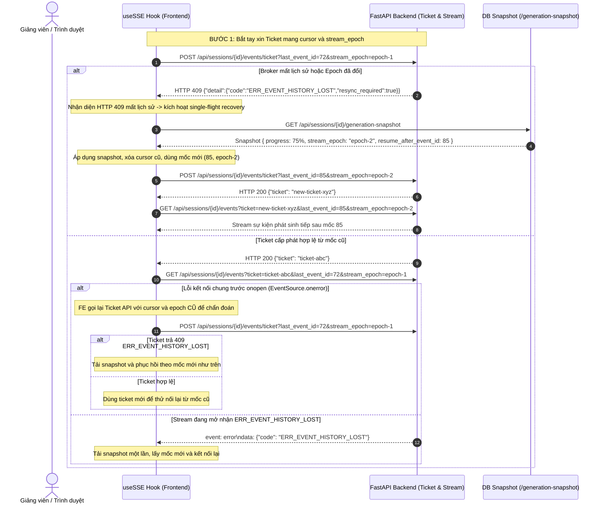

# Technical Feedback & Contract Answers — TASK-208 / TASK-206

**Task:** TASK-206 / TASK-208 — Giao diện Cấu hình Sinh đề & Luồng Tiến trình SSE Thời gian thực  
**Đầu nối tích hợp:** TASK-207a / TASK-207b / TASK-207c (W2 Backend Generation & Runtime Metrics)  
**PR liên quan:** [#30](https://github.com/Computational-Thinking-Project/isomorphic-exam-synthesizer/pull/30), [#32](https://github.com/Computational-Thinking-Project/isomorphic-exam-synthesizer/pull/32), [#22](https://github.com/Computational-Thinking-Project/isomorphic-exam-synthesizer/pull/22), [#40](https://github.com/Computational-Thinking-Project/isomorphic-exam-synthesizer/pull/40)  
**Người phản hồi (Author):** Bội Anh (`@htbaax` — FE2)  
**Phối hợp & Xác nhận:** Nhật Quỳnh (`@nhatquynh1107` — BE2), Philip (`@philip-kkk` — Lead Reviewer), Duy (`@johannguyen015` — Leader)  
**Trạng thái:** **APPROVED by Reviewer Nhật Quỳnh (`@nhatquynh1107`)** tại commit `6fd3784` (247/247 tests đạt, 23/23 ca reviewer đạt)  

---

## Bảng Tình Trạng Bàn Giao Contract (Handoff Status Matrix)

| Hạng mục | Trạng thái | Chi tiết & Phạm vi kiểm |
|---|---|---|
| **1. Payload Config & Ordering** | **Confirmed & FE Verified** | Gửi tường minh `shuffle_questions` và `shuffle_options` dạng boolean; `active_variation_modes` gửi `[]` khi chọn Original Clone (không biến thể). |
| **2. Case-sensitive Mode IDs** | **Confirmed & FE Verified** | Giữ nguyên chữ hoa/thường theo đúng Policy 207a (ví dụ `NUMERICAL` khác `numerical`). |
| **3. Policy Readiness & Modes** | **Confirmed & Aligned** | Chỉ bật cấu hình khi backend trả `is_ready: true` cho Blueprint chuẩn. Nếu thiếu trường này, giữ trạng thái chờ (`is_ready: false`, `supported_modes: null`), không suy đoán readiness từ `source_questions`. Profile hiện tại không cho chọn `STRUCTURAL` hoặc `variable_inversion`. |
| **4. Policy `NONE` trộn mode khác** | **Confirmed & Aligned** | Báo lựa chọn không hợp lệ và chặn gửi (`ERR_CONFIG_CONFLICT`) nếu trộn `NONE` với mode khác, thay vì tự ý âm thầm bỏ `NONE`. Khi chọn Original Clone, gửi `active_variation_modes: []`. |
| **5. Snapshot Reload & Grid Lưới (F02)** | **Verified by Reviewer** | Chuẩn hóa `percent`, `completedCount`, `totalCount`. Dựng lưới từ `exam_versions`, câu `failed` không tăng count. Thiếu snapshot báo *"Chưa có dữ liệu tiến độ"*, chỉ hiện `0/4` khi backend xác nhận đã lưu 0 câu. |
| **6. Nút Sinh Bù (Retry) khi F5 (F03)** | **Verified by Reviewer** | Tách trạng thái kết thúc lượt sinh khỏi SSE `idle` để giữ nút Sinh bù ngay khi F5 phiên `partial_generated`. |
| **7. Trình tự Resync Mất Lịch Sử SSE (F04)** | **Verified by Reviewer** | Single-flight recovery lock: bắt tín hiệu `ERR_EVENT_HISTORY_LOST`, HTTP 409 khi xin ticket hoặc trong stream $\rightarrow$ tải snapshot, dùng mốc `resume_after_event_id` và `stream_epoch` mới cho cả ticket và stream mới. |
| **8. Cô Lập Phiên Trả Muộn A → B → A (F06)** | **Verified by Reviewer** | Hủy bỏ snapshot trả muộn của phiên A nếu đã chuyển sang phiên B hoặc quay lại lượt 2 của A, chặn hoàn toàn việc ghi đè tiến độ và lưới câu hỏi cũ. |
| **9. Hoàn Tất Khi Snapshot Generated (F07)** | **Verified by Reviewer** | Khi snapshot báo `generated` (đủ 100% câu), cho phép kết thúc ngay và chuyển sang Stage 3 mà không cần chờ phát lại sự kiện `done` từ stream. |
| **10. Chống Gọi Snapshot Lặp Khi F5 (F08)** | **Verified by Reviewer** | Tái sử dụng snapshot đã tải trong detail, không gọi lặp endpoint `generation-snapshot` trong 1 lần F5/mở trang. |
| **11. Theo Dõi Khi Tiến Độ 100% Vẫn Generating (F09)** | **Verified by Reviewer** | Khi tiến độ đạt 100% nhưng `session_status` vẫn là `generating`, FE tiếp tục theo dõi, giữ kết nối; chỉ chuyển Stage 3 khi backend xác nhận qua snapshot `generated` hoặc sự kiện kết thúc `done`. |

---

## 1. Chuẩn Hóa Payload JSON Session Detail & Policy Cấu Hình

Cấu trúc phản hồi `GET /api/sessions/{id}` và quy tắc cấu hình biến thể được thống nhất theo các trạng thái chuẩn:

### 1.1. Trạng thái 1: Sẵn sàng và có chế độ biến thể (Ready with Variation Modes)
Khi 100% câu hỏi nguồn đã được bóc tách Blueprint thành công và có ít nhất một chế độ biến thể toán học:

```json
{
  "id": "e0a1b2c3-d4e5-4f6a-8b9c-0d1e2f3a4b5c",
  "title": "Đề thi giữa kỳ môn Giải tích 1",
  "status": "blueprinted",
  "total_source_questions": 10,
  "generation_config": {
    "n_versions": 2,
    "active_variation_modes": [
      "parameter_variation"
    ],
    "ordering_preferences": {
      "shuffle_questions": true,
      "shuffle_options": false
    }
  },
  "blueprint_summary": {
    "is_ready": true,
    "total_questions": 10,
    "questions_with_blueprint": 10,
    "supported_modes": [
      {
        "id": "parameter_variation",
        "label": "Thay đổi số liệu / tham số",
        "description": "Giữ nguyên cấu trúc đề bài toán, thay đổi tham số số học đảm bảo nghiệm đẹp.",
        "question_count": 10,
        "is_available": true
      },
      {
        "id": "context_swap",
        "label": "Đổi ngữ cảnh thực tế",
        "description": "Giữ nguyên mô hình giải tích, thay đổi tình huống hoặc đối tượng thực tiễn.",
        "question_count": 7,
        "is_available": false,
        "unavailable_reason": "Chỉ hỗ trợ 7/10 câu trong đề (yêu cầu toàn bộ câu hỏi hỗ trợ)."
      }
    ]
  },
  "source_questions": [
    {
      "id": "q1",
      "question_no": 1,
      "content": "Tìm nghiệm của phương trình $x^2 - 5x + 6 = 0$",
      "options": { "A": "{2, 3}", "B": "{1, 5}", "C": "{-2, -3}", "D": "{0, 6}" },
      "correct_key": "A",
      "question_blueprints": {
        "variation_modes": ["parameter_variation", "context_swap"]
      }
    }
  ],
  "exam_versions": []
}
```

### 1.2. Trạng thái 2: Chưa sẵn sàng / Đang bóc tách Blueprint (Not Ready)
Khi đề nguồn chưa hoàn tất bóc tách Blueprint hoặc thiếu metadata Blueprint:

```json
{
  "id": "e0a1b2c3-d4e5-4f6a-8b9c-0d1e2f3a4b5c",
  "title": "Đề thi Toán 12",
  "status": "blueprinted",
  "total_source_questions": 10,
  "generation_config": null,
  "blueprint_summary": {
    "is_ready": false,
    "total_questions": 10,
    "questions_with_blueprint": 6,
    "supported_modes": null
  },
  "source_questions": [...]
}
```
* **Hành vi phía Frontend & Policy Readiness:** Chỉ bật form cấu hình khi backend trả `is_ready: true`. Nếu thiếu trường này (`is_ready: false` hoặc `supported_modes: null`), FE giữ nguyên trạng thái chờ và hiển thị cảnh báo: *"Chưa có thông tin Blueprint khả dụng. Đề nguồn đang trong quá trình phân tích hoặc chưa hoàn tất..."*, đồng thời khóa nút **"Lưu cấu hình & Khởi động sinh đề"** (`disabled`). Tuyệt đối không tự suy đoán readiness từ `source_questions`.
* **Giới hạn Profile hiện tại:** Ở profile hiện tại, hệ thống không cho phép chọn `STRUCTURAL` hoặc `variable_inversion`.

### 1.3. Trạng thái 3: Sẵn sàng nhưng CHỈ HỖ TRỢ `NONE` (Original Clone Mode)
Khi 100% câu hỏi đã có Blueprint nhưng các câu hỏi chỉ hỗ trợ `NONE` (không có biến thể toán học):

```json
{
  "id": "e0a1b2c3-d4e5-4f6a-8b9c-0d1e2f3a4b5c",
  "title": "Đề thi Trắc nghiệm Lịch sử",
  "status": "blueprinted",
  "total_source_questions": 10,
  "generation_config": null,
  "blueprint_summary": {
    "is_ready": true,
    "total_questions": 10,
    "questions_with_blueprint": 10,
    "supported_modes": []
  },
  "source_questions": [...]
}
```
* **Hành vi phía Frontend & Policy `NONE`:**
  - `is_ready: true` và `supported_modes: []`. Giao diện hiển thị thông báo thân thiện: *"Đề nguồn giữ nguyên bài toán gốc (sinh đề hoán vị thứ tự câu hỏi)"*.
  - Giảng viên chọn số lượng mã đề $N \in [1, 4]$, hệ thống gửi payload `active_variation_modes: []`.
  - **Policy nghiêm cấm trộn `NONE`:** Khi cấu hình gửi lên chứa cả `NONE` lẫn một mode biến thể khác (ví dụ `["NONE", "parameter_variation"]`), hệ thống báo lựa chọn không hợp lệ (`ERR_CONFIG_CONFLICT`) và chặn gửi, thay vì tự ý âm thầm loại bỏ `NONE`.

### 1.4. Nguyên tắc Bất biến về Ký tự Chữ Hoa / Chữ Thường (Case-Sensitivity)
- Theo **Policy 207a**, định danh của chế độ biến thể (Mode ID) có tính chất phân biệt hoa/thường (ví dụ: `NUMERICAL` khác với `numerical`).
- **Phía Backend:** Không tự ý dùng hàm `.lower()` làm thay đổi ID gốc trong database.
- **Phía Frontend:** Đã bảo toàn 100% ID gốc trong `stage2Service.js`, chỉ sử dụng chuỗi lowercase để tra cứu nhãn hiển thị và mô tả tiếng Việt.

---

## 2. Khôi Phục Tiến Độ Bền Vững Khi F5/Reload (`partial_generated`)

Để giảng viên khi bấm F5/reload trang hoặc mở lại từ Bảng điều khiển (Dashboard) vẫn giữ nguyên đầy đủ trạng thái các câu đã hoàn thành và nhận diện rõ các câu còn thiếu:

### 2.1. Cấu trúc dữ liệu Session Detail phục vụ khôi phục
Backend trả về `status: "partial_generated"` kèm mảng `exam_versions` hoặc snapshot tiến độ:

```json
{
  "id": "e0a1b2c3-d4e5-4f6a-8b9c-0d1e2f3a4b5c",
  "status": "partial_generated",
  "generation_config": {
    "n_versions": 2,
    "active_variation_modes": ["parameter_variation"],
    "ordering_preferences": {
      "shuffle_questions": true,
      "shuffle_options": false
    }
  },
  "progress": {
    "completed_count": 3,
    "total_count": 4,
    "percent_complete": 75,
    "session_status": "partial_generated"
  },
  "exam_versions": [
    {
      "version_index": 1,
      "version_code": "101",
      "questions": [
        { "question_no": 1, "status": "done" },
        { "question_no": 2, "status": "done" }
      ]
    },
    {
      "version_index": 2,
      "version_code": "102",
      "questions": [
        { "question_no": 1, "status": "done" }
      ]
    }
  ]
}
```

### 2.2. Thuật toán khôi phục trên Frontend (`stage2Service.js` & `Stage2ConfigPage.jsx`)
1. **Khởi tạo trực tiếp vào màn hình tiến trình:** Nếu `data.status === 'generating'` hoặc `data.status === 'partial_generated'`, trang tự động bật cờ `isGenerating = true` để render ngay `GenerationProgressView`.
2. **Khôi phục bản đồ câu hỏi:** Duyệt qua các câu hỏi trong `exam_versions[i].questions` hoặc `snapshot.question_statuses`, lập chỉ mục `${version_index}-${question_no}` vào `question_statuses` với trạng thái `done`.
3. **Hiển thị thẻ "Chưa sinh" (missing):** Bất kỳ vị trí câu hỏi nào chưa có trong snapshot/DB sẽ được hiển thị với trạng thái còn thiếu (`missing`).
4. **Phân biệt chưa có dữ liệu với 0 câu:** Chỉ hiển thị `0/4` khi backend xác nhận đã lưu 0 câu. Nếu chưa lấy được snapshot, UI báo *"Chưa có dữ liệu tiến độ"*, `--%`.
5. **Kích hoạt nút Sinh bù:**
   - Phiên `partial_generated` giữ nguyên nút **"Sinh bù các câu còn thiếu"** (`POST /api/sessions/:id/retry-generation`).
   - Tách biệt rõ trạng thái hoàn thành lượt sinh khỏi trạng thái kết nối SSE `idle`.

---

## 3. Quản Lý Cursor SSE & Trình Tự Resync Khi Mất Lịch Sử Sự Kiện

### 3.1. Thách thức kỹ thuật
- Trình duyệt sử dụng `EventSource` không đọc được response body của mã HTTP lỗi 4xx/5xx khi stream bị từ chối kết nối.
- Backend broker chỉ lưu đệm ring-buffer (tối đa 50 sự kiện gần nhất) cho mỗi phiên. Khi mất kết nối kéo dài hoặc broker khởi động lại, cursor `last_event_id` và `stream_epoch` của client trở nên lỗi thời (`ERR_EVENT_HISTORY_LOST`).

### 3.2. Trình tự phục hồi chuẩn hóa (Đã chốt theo Contract BE2 PR #30)



### 3.3. Các nguyên tắc cốt lõi đã hiện thực trong mã nguồn (`useSSE.js` & `Stage2ConfigPage.jsx`)
1. **Single-Flight Recovery Lock (`isRecoveringRef`):**
   Mỗi lỗi mất lịch sử chỉ kích hoạt đúng 1 lượt phục hồi duy nhất, không gọi lặp `onResync` kể cả khi nhiều listener cùng bắt sự kiện lỗi.
2. **Chẩn đoán trước khi tải snapshot:**
   Khi `EventSource` gặp lỗi chung trước khi mở stream (`!hasOpened`), FE chủ động gọi lại Ticket API với cursor và epoch cũ để chẩn đoán. Chỉ khi Ticket API xác nhận HTTP 409 `ERR_EVENT_HISTORY_LOST`, FE mới tải snapshot. Nếu Ticket hợp lệ, FE tái sử dụng mốc cũ để thử kết nối lại.
3. **Bảo tồn Marks từ Snapshot:**
   Khi tải snapshot (lúc mount hoặc lúc phục hồi), các giá trị `resume_after_event_id` (số nguyên) và `stream_epoch` được bảo tồn nguyên vẹn cho cả request ticket lẫn URL stream tiếp theo.
4. **Cô lập phiên trả muộn (F06):**
   Khóa `recoveryFlightTokenRef`, `sessionOpRef`, và `resyncOpRef` đảm bảo snapshot trả về muộn của một phiên cũ (hoặc lượt cũ khi chuyển $A \rightarrow B \rightarrow A$) bị hủy bỏ lập tức, không ghi đè lên phiên hoặc lượt hiện tại.
5. **Snapshot generated hoàn tất không chờ done (F07):**
   Khi snapshot từ backend xác nhận phiên đã hoàn tất (`session_status === 'generated'`), FE chuyển ngay sang Stage 3 mà không cần chờ phát lại sự kiện `done` từ stream.
6. **Tiếp tục theo dõi khi tiến độ 100% nhưng status vẫn generating (F09):**
   Backend phát sự kiện `progress` sau khi lưu câu cuối, trước khi ghi nhận trạng thái kết thúc phiên. Do đó, nếu stream hoặc snapshot báo 100% nhưng `session_status` vẫn là `generating`, FE tuyệt đối không tự ý báo hoàn tất hay chuyển Stage 3; FE tiếp tục giữ kết nối và theo dõi cho đến khi backend xác nhận qua snapshot `generated` hoặc sự kiện kết thúc `done`.

---

## 4. Xác Nhận Tùy Chọn Xáo Trộn (`ordering_preferences`)

- **Chủ đích thiết kế:**
  - `shuffle_questions`: Mặc định là **`true`** (luôn hoán vị thứ tự các câu hỏi giữa các mã đề thi).
  - `shuffle_options`: Mặc định trên giao diện là **`false`** (chưa chọn). Giảng viên có quyền chủ động tick chọn nếu muốn đảo vị trí đáp án đúng A/B/C/D giữa các đề.
- **Cam kết Payload:** Khi gửi yêu cầu `POST /api/sessions/{id}/config`, Frontend **luôn luôn truyền tường minh giá trị boolean cho cả hai trường:**
  ```json
  "ordering_preferences": {
    "shuffle_questions": true,
    "shuffle_options": false
  }
  ```
  Do đó, Backend sẽ không gặp trường hợp thiếu trường (omitted field) từ Frontend.

---

## 5. Thống Nhất Ngữ Nghĩa Chế Độ `[]` / `NONE` (Không Biến Thể)

- **Ngữ nghĩa nghiệp vụ:**
  - Khi đề nguồn chỉ có các câu hỏi hỗ trợ `NONE`, hoặc khi giảng viên chủ động bỏ chọn toàn bộ các chế độ biến thể, `active_variation_modes` là danh sách rỗng `[]`.
  - Đây là trường hợp sử dụng chuẩn sư phạm: **"Tạo các mã đề hoán vị từ đề gốc có sẵn mà không thay đổi bất kỳ số liệu hay câu chữ nào."**
- **Quy tắc phối hợp AI Engine & Backend:**
  - AI Generator (TASK-207b / TASK-402) không thực hiện biến đổi số học/ngữ cảnh; giữ nguyên nội dung bài toán gốc từ `source_questions`.
  - Bộ kiểm tra trùng lặp (Uniqueness Filter) **không được đánh rớt hoặc báo lỗi** khi các câu biến thể giống nguyên văn câu nguồn trong trường hợp `active_variation_modes: []`.
  - Thuật toán Shuffler (TASK-303) sau đó sẽ thực thi hoán vị thứ tự câu và đáp án theo seed của từng mã đề.

---

## 6. Lịch Bàn Giao & Kết Quả Kiểm Thử

- **Đại diện Frontend (FE2):** Bội Anh (`@htbaax`).
- **Head commit:** `6fd37845b1a1d13b4d332591a0b7505612da2b9a` (đã push nhánh `feat/task-208-fe-contract-alignment`).
- **Mã nguồn hoàn thiện:**
  - `frontend/src/services/stage2Service.js`: Hỗ trợ snapshot phục hồi F5, chuẩn hóa tiến độ, bảo toàn case-sensitivity mode IDs, loại bỏ suy đoán `generated` khi chưa có xác nhận từ backend.
  - `frontend/src/features/stage2-config/GenerationProgressView.jsx`: Phân biệt rõ ràng chưa có dữ liệu tiến độ (báo *"Chưa có dữ liệu tiến độ"*, không hiện `0/4`) với trường hợp backend xác nhận lưu 0 câu (`0/4`).
  - `frontend/src/hooks/useSSE.js`: Single-flight recovery lock, chẩn đoán lỗi EventSource bằng mốc cũ qua ticket API, tải snapshot và mang `resume_after_event_id` / `stream_epoch` mới sang kết nối mới; cô lập phiên trả muộn (F06); không kết thúc sớm khi status vẫn là `generating` (F09).
  - `frontend/src/features/stage2-config/Stage2ConfigPage.jsx`: Nạp snapshot khi mở phiên `partial_generated`, cô lập phiên $A \rightarrow B \rightarrow A$ qua `sessionOpRef`/`resyncOpRef`, hoàn tất trực tiếp khi snapshot `generated` (F07), chống gọi lặp snapshot (F08), và bảo đảm chỉ chuyển Stage 3 khi có xác nhận kết thúc từ backend (F09).
- **Bộ kiểm thử tự động:**
  - `npm test`: **247/247 tests pass** (100%).
  - `npm run lint`: **0 errors / 0 warnings**.
  - `npm run build`: Vite production bundle build thành công 100%.
  - **23/23 ca kiểm của Reviewer đạt**, Reviewer State: **APPROVED**.
