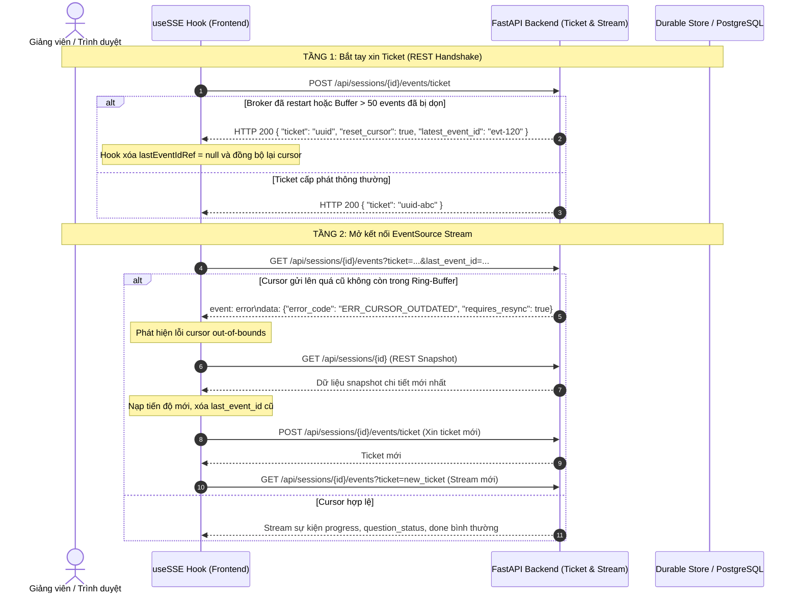

# Technical Feedback & Contract Answers — TASK-208 / TASK-206

**Task:** TASK-206 / TASK-208 — Giao diện Cấu hình Sinh đề & Luồng Tiến trình SSE Thời gian thực  
**Đầu nối tích hợp:** TASK-207a / TASK-207b / TASK-207c (W2 Backend Generation & Runtime Metrics)  
**PR liên quan:** [#30](https://github.com/Computational-Thinking-Project/isomorphic-exam-synthesizer/pull/30), [#32](https://github.com/Computational-Thinking-Project/isomorphic-exam-synthesizer/pull/32), [#22](https://github.com/Computational-Thinking-Project/isomorphic-exam-synthesizer/pull/22)  
**Người phản hồi (Author):** Bội Anh (`@htbaax` — FE2)  
**Phối hợp & Xác nhận:** Nhật Quỳnh (`@nhatquynh1107` — BE2), Philip (`@philip-kkk` — Lead Reviewer), Duy (`@johannguyen015` — Leader)  
**Trạng thái:** Proposed & FE Verified (Đang chờ thống nhất tích hợp BE2/AI)  

---

## Bảng Tình Trạng Bàn Giao Contract (Handoff Status Matrix)

| Hạng mục | Trạng thái | Chi tiết & Phạm vi kiểm |
|---|---|---|
| **1. Payload Config & Ordering** | **Confirmed & FE Verified** | Gửi tường minh `shuffle_questions` và `shuffle_options` dạng boolean; `active_variation_modes` gửi `[]` khi chọn NONE / không biến thể. Đã kiểm 235 tests. |
| **2. Case-sensitive Mode IDs** | **Confirmed & FE Verified** | Giữ nguyên chữ hoa/thường theo đúng Policy 207a (ví dụ `NUMERICAL`). |
| **3. Fallback Modes từ Đề Nguồn** | **Confirmed & FE Verified** | Bóc tách modes từ `source_questions`. Nếu thiếu metadata ở bất kỳ câu nào $\rightarrow$ khóa submit (`is_ready: false`, `supported_modes: null`). |
| **4. Snapshot Reload & Grid Lưới (F02)** | **Confirmed & FE Verified** | Chuẩn hóa `percent`, `completedCount`, `totalCount`. Dựng lưới từ `exam_versions`, câu `failed` không tăng count. Thiếu snapshot báo "Chưa có dữ liệu tiến độ", chỉ hiện `0/4` khi backend xác nhận đã lưu 0 câu. |
| **5. Nút Sinh Bù (Retry) khi F5 (F03)** | **Confirmed & FE Verified** | Tách trạng thái kết thúc lượt sinh khỏi SSE `idle` để giữ nút Sinh bù ngay khi F5 phiên `partial_generated`. |
| **6. Trình tự Resync Mất Lịch Sử SSE (F04)** | **Confirmed & FE Verified** | Single-flight recovery lock: bắt tín hiệu `ERR_EVENT_HISTORY_LOST`, HTTP 409 khi mở stream hoặc trong stream $\rightarrow$ xóa cursor cũ, nạp snapshot, đồng bộ lại theo `resume_after_event_id` và `stream_epoch`. |
| **7. Cô Lập Phiên Trả Muộn (F06)** | **Confirmed & FE Verified** | Hủy bỏ snapshot trả muộn của phiên A nếu đã chuyển sang phiên B hoặc unmount, chặn hoàn toàn rò rỉ state/lưới câu hỏi giữa các phiên. |
| **8. Hành vi Original Clone Mode** | **Proposed (Chờ BE/AI)** | Đề xuất: backend/AI giữ nguyên bài toán verbatim, chỉ chạy xáo trộn câu/đáp án theo ordering preferences. Phần triển khai thực tế thuộc worker của PR #30. |

---

## 1. Chuẩn Hóa Payload JSON Session Detail (`GET /api/sessions/{session_id}`)

Để giải quyết triệt để vướng mắc giữa PR #30, PR #32 và yêu cầu rà soát từ Philip (`@philip-kkk`) và Quỳnh (`@nhatquynh1107`), cấu trúc phản hồi `GET /api/sessions/{id}` được thống nhất theo 3 trạng thái cụ thể:

### 1.1. Trạng thái 1: Sẵn sàng và có chế độ biến thể (Ready with Variation Modes)
Khi 100% câu hỏi nguồn đã được bóc tách Blueprint thành công và có ít nhất một chế độ biến thể toán học:

```json
{
  "id": "e0a1b2c3-d4e5-4f6a-8b9c-0d1e2f3a4b5c",
  "title": "Đề thi giữa kỳ môn Giải tích 1",
  "status": "blueprinted",
  "total_source_questions": 10,
  "generation_config": {
    "n_versions": 2,
    "active_variation_modes": [
      "parameter_variation"
    ],
    "ordering_preferences": {
      "shuffle_questions": true,
      "shuffle_options": false
    }
  },
  "blueprint_summary": {
    "is_ready": true,
    "total_questions": 10,
    "questions_with_blueprint": 10,
    "supported_modes": [
      {
        "id": "parameter_variation",
        "label": "Thay đổi số liệu / tham số",
        "description": "Giữ nguyên cấu trúc đề bài toán, thay đổi tham số số học đảm bảo nghiệm đẹp.",
        "question_count": 10,
        "is_available": true
      },
      {
        "id": "context_swap",
        "label": "Đổi ngữ cảnh thực tế",
        "description": "Giữ nguyên mô hình giải tích, thay đổi tình huống hoặc đối tượng thực tiễn.",
        "question_count": 7,
        "is_available": false,
        "unavailable_reason": "Chỉ hỗ trợ 7/10 câu trong đề (yêu cầu toàn bộ câu hỏi hỗ trợ)."
      }
    ]
  },
  "source_questions": [
    {
      "id": "q1",
      "question_no": 1,
      "content": "Tìm nghiệm của phương trình $x^2 - 5x + 6 = 0$",
      "options": { "A": "{2, 3}", "B": "{1, 5}", "C": "{-2, -3}", "D": "{0, 6}" },
      "correct_key": "A",
      "question_blueprints": {
        "variation_modes": ["parameter_variation", "context_swap"]
      }
    }
  ],
  "exam_versions": []
}
```

### 1.2. Trạng thái 2: Chưa sẵn sàng / Đang bóc tách Blueprint (Not Ready / Fallback)
Khi đề nguồn chưa hoàn tất bóc tách Blueprint hoặc có câu hỏi nguồn thiếu dữ liệu Blueprint:

```json
{
  "id": "e0a1b2c3-d4e5-4f6a-8b9c-0d1e2f3a4b5c",
  "title": "Đề thi Toán 12",
  "status": "blueprinted",
  "total_source_questions": 10,
  "generation_config": null,
  "blueprint_summary": {
    "is_ready": false,
    "total_questions": 10,
    "questions_with_blueprint": 6,
    "supported_modes": null
  },
  "source_questions": [...]
}
```
* **Hành vi phía Frontend:** `Stage2ConfigCard` nhận diện `is_ready: false` (hoặc `supported_modes: null`), hiển thị banner thông báo "Blueprint đang trong quá trình phân tích hoặc chưa hoàn tất", đồng thời khóa nút **"Bắt đầu sinh đề"** (disabled) để ngăn chặn phát sinh lỗi HTTP 400 `ERR_CONFIG_CONFLICT`.

### 1.3. Trạng thái 3: Sẵn sàng nhưng CHỈ HỖ TRỢ `NONE` (Original Clone Mode)
Khi 100% câu hỏi đã có Blueprint nhưng các câu hỏi chỉ hỗ trợ `NONE` (không có biến thể toán học):

```json
{
  "id": "e0a1b2c3-d4e5-4f6a-8b9c-0d1e2f3a4b5c",
  "title": "Đề thi Trắc nghiệm Lịch sử",
  "status": "blueprinted",
  "total_source_questions": 10,
  "generation_config": null,
  "blueprint_summary": {
    "is_ready": true,
    "total_questions": 10,
    "questions_with_blueprint": 10,
    "supported_modes": []
  },
  "source_questions": [...]
}
```
* **Hành vi phía Frontend:** `is_ready: true` và `supported_modes: []`. Giao diện hiển thị thông báo thân thiện: *"Đề thi giữ nguyên bài toán gốc (không áp dụng biến thể tham số). Hệ thống sẽ tạo các mã đề bằng cách hoán vị thứ tự câu hỏi và phương án."* Cho phép người dùng chọn số lượng mã đề $N \in [1, 4]$ và gửi payload `active_variation_modes: []`.

### 1.4. Nguyên tắc Bất biến về Ký tự Chữ Hoa / Chữ Thường (Case-Sensitivity)
- Theo **Policy 207a**, định danh của chế độ biến thể (Mode ID) có tính chất phân biệt hoa/thường (ví dụ: `NUMERICAL` khác với `numerical`).
- **Phía Backend:** Không tự ý dùng hàm `.lower()` làm thay đổi ID gốc trong database.
- **Phía Frontend:** Đã triển khai bảo toàn 100% ID gốc trong `stage2Service.js`, chỉ sử dụng chuỗi lowercase để tra cứu nhãn hiển thị và mô tả tiếng Việt.

---

## 2. Khôi Phục Tiến Độ Bền Vững Khi F5/Reload (`partial_generated`)

Để giảng viên khi bấm F5/reload trang hoặc mở lại từ Bảng điều khiển (Dashboard) vẫn giữ nguyên đầy đủ trạng thái các câu đã hoàn thành và nhận diện rõ các câu còn thiếu:

### 2.1. Cấu trúc dữ liệu Session Detail phục vụ khôi phục
Backend trả về `status: "partial_generated"` kèm mảng `exam_versions`:

```json
{
  "id": "e0a1b2c3-d4e5-4f6a-8b9c-0d1e2f3a4b5c",
  "status": "partial_generated",
  "generation_config": {
    "n_versions": 2,
    "active_variation_modes": ["parameter_variation"],
    "ordering_preferences": {
      "shuffle_questions": true,
      "shuffle_options": false
    }
  },
  "progress": {
    "completed_count": 18,
    "total_count": 20,
    "percent_complete": 90,
    "session_status": "partial_generated"
  },
  "exam_versions": [
    {
      "version_index": 1,
      "version_code": "101",
      "questions": [
        { "question_no": 1, "status": "done" },
        { "question_no": 2, "status": "done" },
        { "question_no": 10, "status": "done" }
      ]
    },
    {
      "version_index": 2,
      "version_code": "102",
      "questions": [
        { "question_no": 1, "status": "done" },
        { "question_no": 3, "status": "done" }
        // Câu 2 bị thiếu do chạm trần API quota hoặc timeout
      ]
    }
  ]
}
```

### 2.2. Thuật toán khôi phục trên Frontend (`stage2Service.js` & `Stage2ConfigPage.jsx`)
1. **Khởi tạo trực tiếp vào màn hình tiến trình:** Nếu `data.status === 'generating'` hoặc `data.status === 'partial_generated'`, trang tự động bật cờ `isGenerating = true` để render ngay `GenerationProgressView`.
2. **Khôi phục bản đồ câu hỏi:** Duyệt qua các câu hỏi trong `exam_versions[i].questions`, lập chỉ mục `${version_index}-${question_no}` vào `question_statuses` với trạng thái `done`.
3. **Hiển thị thẻ "Chưa sinh" (missing):** Bất kỳ vị trí câu hỏi nào trong tổng số $N \times K$ chưa có trong database sẽ được hiển thị với badge màu đỏ nổi bật: `Chưa sinh` (`missing`).
4. **Kích hoạt nút Sinh bù:**
   - Hiển thị banner cảnh báo: *"Tiến trình hoàn thành một phần (partial_generated). Đã tạo được 18 / 20 câu hỏi (90%). Còn thiếu 2 câu."*
   - Cung cấp nút **"Sinh bù các câu còn thiếu"** gọi endpoint `POST /api/sessions/:id/retry-generation` (độc lập với nút "Kết nối lại mạng").
   - Cung cấp nút **"Đến Stage 3 xem các câu đã sinh"** nếu giảng viên muốn xem trước các câu đã hoàn thành.

---

## 3. Quản Lý Cursor SSE & Cơ Chế Khôi Phục Khi Broker Tràn Buffer (> 50 Events)

### 3.1. Thách thức kỹ thuật
- Trình duyệt chuẩn sử dụng `EventSource`, không đọc được response body của mã HTTP lỗi 4xx/5xx khi stream bị ngắt.
- Backend broker chỉ lưu đệm tối đa 50 sự kiện gần nhất cho mỗi phiên. Khi mất kết nối kéo dài hoặc backend khởi động lại (restart), cursor `last_event_id` của client trở nên lỗi thời (stale cursor).

### 3.2. Cơ chế khắc phục 2 tầng (Two-Tier Recovery Architecture)



### 3.3. Hiện thực hóa mã nguồn trong `frontend/src/hooks/useSSE.js`
- **Single-Flight Recovery Lock (`isRecoveringRef`):**
  Đảm bảo mỗi sự kiện mất lịch sử chỉ kích hoạt một lượt phục hồi duy nhất, kể cả khi cả hai handler `addEventListener('error')` và `onerror` cùng phát tín hiệu.
- **Xử lý từ chối mở stream (HTTP 409):**
  Nếu `EventSource` lỗi trước khi `onopen` (`!hasOpenedRef.current`) trong khi đang mang cursor `last_event_id`, hook nhận diện bị từ chối kết nối do con trỏ hết hạn $\rightarrow$ kích hoạt phục hồi, xóa cursor cũ, nạp snapshot và đồng bộ mốc tiếp tục `resume_after_event_id` và `stream_epoch`.
- **Cô lập phiên trả muộn (F06):**
  Kiểm tra token và session ID sau khi `await onResync(...)`. Nếu người dùng đã chuyển sang phiên khác hoặc unmount, kết quả snapshot của phiên cũ bị hủy bỏ hoàn toàn.

---

## 4. Xác Nhận Tùy Chọn Xáo Trộn (`ordering_preferences`)

- **Chủ đích thiết kế:**
  - `shuffle_questions`: Mặc định là **`true`** (luôn hoán vị thứ tự các câu hỏi giữa các mã đề thi).
  - `shuffle_options`: Mặc định trên giao diện là **`false`** (chưa chọn). Giảng viên có quyền chủ động tick chọn nếu muốn đảo vị trí đáp án đúng A/B/C/D giữa các đề.
- **Cam kết Payload:** Khi gửi yêu cầu `POST /api/sessions/{id}/config`, Frontend **luôn luôn truyền tường minh giá trị boolean cho cả hai trường:**
  ```json
  "ordering_preferences": {
    "shuffle_questions": true,
    "shuffle_options": false
  }
  ```
  Do đó, Backend sẽ không gặp trường hợp thiếu trường (omitted field) từ Frontend. Việc Backend đặt giá trị mặc định là `true` khi thiếu trường trong payload gọi trực tiếp từ API/scripts hoàn toàn không ảnh hưởng đến luồng giao diện người dùng.

---

## 5. Thống Nhất Ngữ Nghĩa Chế Độ `[]` / `NONE` (Không Biến Thể)

- **Ngữ nghĩa nghiệp vụ:**
  - Khi đề nguồn chỉ có các câu hỏi hỗ trợ `NONE`, hoặc khi giảng viên chủ động bỏ chọn toàn bộ các chế độ biến thể, `active_variation_modes` là danh sách rỗng `[]`.
  - Đây là trường hợp sử dụng chuẩn sư phạm: **"Tạo các mã đề hoán vị từ đề gốc có sẵn mà không thay đổi bất kỳ số liệu hay câu chữ nào."**
- **Quy tắc phối hợp AI Engine & Backend:**
  - AI Generator (TASK-207b / TASK-402) không thực hiện biến đổi số học/ngữ cảnh; giữ nguyên nội dung bài toán gốc từ `source_questions`.
  - Bộ kiểm tra trùng lặp (Uniqueness Filter) **không được đánh rớt hoặc báo lỗi** khi các câu biến thể giống nguyên văn câu nguồn trong trường hợp `active_variation_modes: []`.
  - Thuật toán Shuffler (TASK-303) sau đó sẽ thực thi hoán vị thứ tự câu và đáp án theo seed của từng mã đề.

---

## 6. Lịch Bàn Giao & Người Phụ Trách

- **Đại diện Frontend (FE2):** Bội Anh (`@htbaax`).
- **Mã nguồn đã cập nhật:**
  - `frontend/src/services/stage2Service.js`: Hỗ trợ snapshot phục hồi F5, bổ sung `fetchGenerationSnapshot`, chuẩn hóa cờ `hasData`, tương thích cả backend summary lẫn fallback bóc tách từ `source_questions`, bảo toàn case-sensitivity.
  - `frontend/src/features/stage2-config/GenerationProgressView.jsx`: Phân biệt rõ ràng chưa có dữ liệu tiến độ (báo "Chưa có dữ liệu tiến độ", không hiện `0/4`) với trường hợp backend xác nhận lưu 0 câu (`0/4`).
  - `frontend/src/hooks/useSSE.js`: Single-flight recovery lock (`isRecoveringRef`), tự động nhận diện từ chối mở stream HTTP 409 qua `!hasOpened`, đồng bộ mốc `resume_after_event_id` / `stream_epoch`, và cô lập tuyệt đối snapshot trả muộn giữa phiên A và B (F06).
  - `frontend/src/features/stage2-config/Stage2ConfigPage.jsx`: Tự động nạp màn hình tiến trình khi mở phiên `partial_generated`, giữ nút Sinh bù và hiển thị đúng dữ liệu snapshot.
- **Bộ kiểm thử tự động:** Toàn bộ 235 tests DOM harness và mock client đạt 100% pass; bổ sung test cases kiểm định F02 (thiếu snapshot vs confirmed zero), F04 (single flight & stream rejection recovery), F06 (session isolation chống ghi đè).
