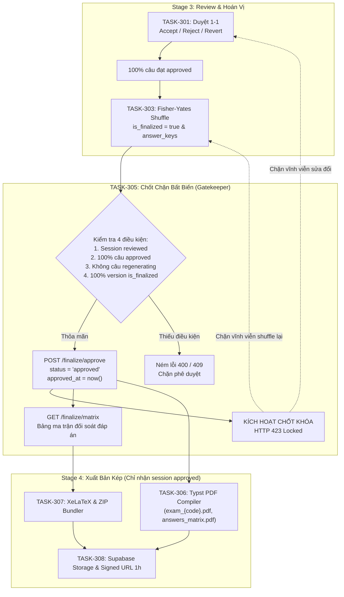

# TASK-305 — Plan và Bàn Giao: API Phê Duyệt Cuối Cùng, Bảng Ma Trận Đáp Án & Khóa Nội Dung Bất Biến (HTTP 423)

- **Nguồn giao việc:** [W3_ASSIGNMENT.md](W3_ASSIGNMENT.md) (v2.1; 28/10/2026), [w3.md](../../w3.md), [docs/planning.md](../../docs/planning.md), [docs/architecture.md](../../docs/architecture.md)
- **Phụ trách:** Duy (`johannguyen015` — Leader & Backend Lead)
- **Reviewer:** Tâm (`AI-WFox` — đề xuất) / Đạt (`Thanhdat3010`)
- **Repo/nhánh:** `feat/duy-task-305-approval-lock`
- **Hạn đợt:** Tối thứ 3 03/11/2026; **ETA task:** Thứ 2 02/11/2026 (Duy xác nhận)
- **Phiên bản:** v2.1 (Đồng bộ Kiến trúc A từ TASK-301, Tích hợp RPC-First Contract cho Content Lock và Crash Safety F01)

---

## 1. Bối Cảnh Toàn Diện & Tổng Quan Dự Án (System Context)

### 1.1. Dự án "Isomorphic Exam Synthesizer" là gì?
Hệ thống **Isomorphic Exam Synthesizer** (Nhóm 04) là nền tảng hỗ trợ giảng viên trung học phổ thông tự động hóa quy trình tạo đề thi trắc nghiệm đẳng cấu (Isomorphic Exams - cùng mức độ tư duy, cùng cấu trúc ma trận kiến thức nhưng thay đổi số liệu/ngữ cảnh và hoán vị thứ tự câu/phương án để chống gian lận).

Hệ thống hoạt động qua **4 Giai Đoạn (Stages)** nghiêm ngặt:
1. **Stage 1 (Ingestion & Blueprinted):** Bóc tách đề thi nguồn `.docx`/`.pdf`, chuẩn hóa toán LaTeX, sinh Blueprint ma trận kiến thức (trạng thái: `draft` $\rightarrow$ `blueprinted`).
2. **Stage 2 (Configuration & Batch Generation):** Giảng viên chọn số lượng mã đề ($N = 1..4$), chế độ biến thể toán học; Background Worker gọi Google Gemini API sinh hàng loạt $N$ bộ câu hỏi biến thể có đối chứng toán học (trạng thái: `configured` $\rightarrow$ `generating` $\rightarrow$ `generated`).
3. **Stage 3 (1-1 Review & Deterministic Shuffle):** Giảng viên thẩm định từng câu biến thể đối sánh 1-1 với câu gốc (Chấp nhận `Accept`, Từ chối `Reject` $\rightarrow$ AI sinh lại câu mới, hoặc Hoàn nguyên `Revert` về câu gốc). Sau khi 100% câu đạt chuẩn $\rightarrow$ chạy thuật toán Fisher-Yates xáo trộn xác định theo seed để tạo $N$ mã đề hoán vị (trạng thái: `generated` $\rightarrow$ `reviewed`).
4. **Stage 4 (Dual Export Engine):** Xuất bản đồng thời file in ấn sắc nét qua **Typst** (`.pdf`), mã nguồn sạch **XeLaTeX** (`.tex`) và **Markdown** (`.md`) đóng gói trong file `.zip` qua Supabase Storage (trạng thái: `approved` $\rightarrow$ `exported`).

---

### 1.2. Vai trò cốt lõi của TASK-305 (The Critical Gatekeeper)
Trong kiến trúc tổng thể, **TASK-305 đóng vai trò là "Cổng Kiểm Soát Chất Lượng Cuối Cùng" (Final Quality Gate)** giữa **Stage 3 (Thẩm định)** và **Stage 4 (Xuất bản)**:



- **Nếu không có TASK-305:** Hệ thống có thể xuất bản những đề thi còn câu hỏi bị lỗi/chưa duyệt, hoặc xuất bản đề thi chưa được xáo trộn mã đề. Nguy hiểm hơn, giảng viên có thể vô tình sửa/reject câu hỏi sau khi file PDF đã được in ra, làm sai lệch toàn bộ đáp án chấm thi.
- **Sau khi TASK-305 hoàn tất:** Dữ liệu đề thi trở thành **Bất biến (Immutable Snapshot)**. Toàn bộ mã đề, thứ tự câu và đáp án được niêm phong tuyệt đối phục vụ cho việc in ấn và chấm thi.

---

## 2. Phân Định Rõ Ràng: Đã Có Sẵn vs Cần Làm Thêm

Để việc triển khai diễn ra nhanh nhất, không bị over-engineering hay viết lại code trùng lặp, bảng dưới đây phân định rạch ròi giữa **những gì dự án đã có sẵn** và **những gì TASK-305 phải làm mới**:

| Thành phần | Hiện trạng trong Codebase | Khả năng Tái Sử Dụng | Nhiệm vụ của TASK-305 |
| :--- | :--- | :--- | :--- |
| **Bảo mật Ownership** | `assert_ownership` trong `backend/app/api/dependencies.py` | ✅ **Tái sử dụng 100%** | Gọi `assert_ownership("exam_sessions", session_id, user.id, db=db)` ở đầu route. |
| **Xử lý Ngoại lệ** | `ReviewDomainException` & handler trong `backend/app/main.py` | ✅ **Tái sử dụng 100%** | Khởi tạo trực tiếp `ReviewDomainException(status_code, error_code, detail)` cho các mã lỗi 400, 404, 409, 423. Không cần viết middleware mới. |
| **Khóa HTTP 423** | Đã viết sẵn trong Service Layer của `TASK-301` (`review/service.py`) | ✅ **Tái sử dụng 100%** | Khi session chuyển sang `status = 'approved'`, các API `/accept`, `/reject`, `/revert` của TASK-301 đã có sẵn đoạn check: `if status in ("approved", "exported"): raise ReviewDomainException(423, "ERR_SESSION_LOCKED", ...)` $\rightarrow$ **Tự động kích hoạt khóa.** |
| **Database Schema** | Bảng `exam_sessions` (cột `approved_at`, `status`), `exam_versions` (`is_finalized`), `answer_keys` | ✅ **Đã có sẵn trong DB** | Không cần viết migration SQL mới. Chỉ thao tác UPDATE/SELECT qua Supabase client. |
| **Pydantic Schemas** | Chưa có schemas cho Approve & Matrix | ❌ **Phải làm mới** | Bổ sung `FinalizeApproveResponse`, `MatrixItem`, `AnswersMatrixResponse` vào `schemas.py`. |
| **Repository Layer** | `ReviewRepository` phục vụ duyệt 1-1, chưa có hàm kiểm tra điều kiện finalize | ❌ **Phải làm mới** | Tạo `FinalizeRepository` để: (1) Kiểm tra 4 điều kiện chốt đề; (2) Update session status sang `approved`; (3) Truy vấn gom nhóm bảng `answer_keys` (với fallback `version_questions`). |
| **Service Layer** | Chưa có service cho Finalize | ❌ **Phải làm mới** | Tạo `FinalizeService` điều phối logic kiểm tra pre-conditions, idempotency và format ma trận đáp án. |
| **API Endpoints** | Chưa có endpoints finalize | ❌ **Phải làm mới** | Tạo `backend/app/api/routes/finalize.py` cho `POST /finalize/approve` và `GET /finalize/matrix`. |
| **App Registration** | `main.py` chưa đăng ký finalize router | ❌ **Phải làm mới** | Đăng ký `app.include_router(finalize.router, prefix="/api/sessions", tags=["Finalize"])`. |
| **Test Suite** | Chưa có unit/integration test cho approve/matrix | ❌ **Phải làm mới** | Viết `backend/tests/api/test_finalize.py` bao phủ toàn bộ ca kiểm thử. |

---

## 3. Mục Tiêu & Tiêu Chí Đạt (Definition of Done - DoD)

### 3.1. Hành vi và tiêu chí hoàn thành
1. **Endpoint `POST /api/sessions/{session_id}/finalize/approve` (Phê duyệt chốt đề):**
   - **Xác thực quyền sở hữu:** User phải là chủ sở hữu session (`assert_ownership`).
   - **Bảo đảm 4 điều kiện nghiêm ngặt (Pre-conditions):**
     1. `session.status` phải ở trạng thái `reviewed` (hoặc `generated` nhưng đã đủ điều kiện).
     2. **100% câu hỏi hiện hành (`is_current = true`) phải có `status = 'approved'`.** Nếu còn bất kỳ câu nào mang `pending_review` hoặc `rejected` $\rightarrow$ ném lỗi `HTTP 400 Bad Request` (`ERR_NOT_ALL_QUESTIONS_APPROVED`).
     3. **Không còn câu hỏi nào đang sinh lại dở dang:** Không có bản ghi nào mang `status = 'regenerating'` $\rightarrow$ ném lỗi `HTTP 409 Conflict` (`ERR_QUESTION_REGENERATING`).
     4. **100% các mã đề (`exam_versions`) phải có `is_finalized = true`:** Nghĩa là đã chạy qua thuật toán xáo trộn Fisher-Yates (TASK-303). Nếu chưa shuffle $\rightarrow$ ném lỗi `HTTP 400 Bad Request` (`ERR_VERSIONS_NOT_FINALIZED`).
   - **Chuyển trạng thái nguyên tử:**
     - Cập nhật `exam_sessions`: `status = 'approved'`, `approved_at = now()`, `updated_at = now()`.
     - Ghi nhật ký kiểm toán vào `review_logs`: `action_type = 'APPROVE_ALL'`.
   - **Tính Idempotent:** Gọi lại trên session đã `approved` trả về `HTTP 200 OK` kèm `approved_at` cũ, không văng lỗi.

2. **Chốt Khóa Nội Dung Bất Biến (`HTTP 423 Locked`):**
   - Khi session đã chuyển sang `approved` (hoặc `exported`), mọi API cố tình sửa đổi:
     - `POST .../accept`, `POST .../reject`, `POST .../revert` (Review câu hỏi)
     - `POST .../finalize/shuffle` (Xáo trộn lại mã đề)
     - `POST .../configuration` (Sửa cấu hình sinh đề)
     - Cập nhật câu hỏi nguồn / blueprint
     $\rightarrow$ Đều bị chặn đứng ngay lập tức tại Service Layer và trả về:
     ```json
     {
       "error_code": "ERR_SESSION_LOCKED",
       "detail": "Phiên đã phê duyệt và bị khóa vĩnh viễn"
     }
     ```
     với HTTP status code **`423 Locked`**.

3. **Endpoint `GET /api/sessions/{session_id}/finalize/matrix` (Bảng Ma trận Đối soát Đáp án):**
   - Trả về danh sách câu hỏi theo thứ tự sau khi xáo trộn (`question_no: 1..M`) kèm theo đáp án đúng tương ứng của từng mã đề thi (ví dụ: `101`, `102`, `103`, `104`):
     ```json
     {
       "session_id": "c1f7b822-7772-4e0e-9411-cf974205c317",
       "total_questions": 20,
       "version_codes": ["101", "102", "103", "104"],
       "matrix": [
         {
           "question_no": 1,
           "answers": { "101": "A", "102": "B", "103": "D", "104": "C" }
         },
         {
           "question_no": 2,
           "answers": { "101": "D", "102": "A", "103": "C", "104": "B" }
         }
       ]
     }
     ```
   - **Cơ chế Fallback thông minh:** Dữ liệu ưu tiên đọc từ bảng `answer_keys` (do TASK-303 của Tâm đồng bộ sau khi shuffle); nếu `answer_keys` chưa có thì đọc trực tiếp từ `version_questions` (`correct_key` của câu `is_current = true`). Điều này đảm bảo API chạy độc lập, không bị nghẽn nếu Tâm chưa merge code.

### 3.2. Ranh giới ngoài phạm vi (Out of Scope)
- Không triển khai thuật toán xáo trộn mã đề Fisher-Yates (đã thuộc trách nhiệm của Tâm trong `TASK-303`).
- Không biên dịch file PDF hay đóng gói ZIP (thuộc trách nhiệm của Tâm `TASK-306` và Đạt `TASK-307`).
- Không tạo cơ chế "Mở khóa đề" (Unlock) — Trong quy trình thi cử chuẩn, một khi đề thi đã phê duyệt để in ấn thì việc mở khóa bị nghiêm cấm để tránh lộ đề / lệch mã đề.

---

## 4. Kiến Trúc Chi Tiết & Hợp Đồng Dữ Liệu (API Contracts)

### 4.1. Hợp đồng Endpoints HTTP

#### Endpoint 1: Phê duyệt Chốt Đề
- **Method & Path:** `POST /api/sessions/{session_id}/finalize/approve`
- **Headers:** `Authorization: Bearer <JWT_TOKEN>`
- **Response `200 OK` (Thành công / Idempotent):**
  ```json
  {
    "session_id": "c1f7b822-7772-4e0e-9411-cf974205c317",
    "status": "approved",
    "approved_at": "2026-11-02T15:30:00Z",
    "message": "Session locked permanently"
  }
  ```
- **Lỗi nghiệp vụ có thể xảy ra:**
  - `400 Bad Request` (`ERR_NOT_ALL_QUESTIONS_APPROVED`): "Không thể phê duyệt: Vẫn còn câu hỏi chưa được duyệt (status != approved)".
  - `400 Bad Request` (`ERR_VERSIONS_NOT_FINALIZED`): "Không thể phê duyệt: Các mã đề chưa được xáo trộn và chốt hoán vị (is_finalized = false)".
  - `409 Conflict` (`ERR_QUESTION_REGENERATING`): "Không thể phê duyệt: Có câu hỏi đang trong tiến trình sinh lại bằng AI".
  - `409 Conflict` (`ERR_INVALID_SESSION_STATE`): "Phiên ở trạng thái không hợp lệ để phê duyệt (hiện tại: generating/draft/failed)".
  - `403 Forbidden`: Người dùng không sở hữu session này.
  - `404 Not Found`: Session không tồn tại.

#### Endpoint 2: Truy Vấn Ma Trận Đáp Án
- **Method & Path:** `GET /api/sessions/{session_id}/finalize/matrix`
- **Headers:** `Authorization: Bearer <JWT_TOKEN>`
- **Response `200 OK`:**
  ```json
  {
    "session_id": "c1f7b822-7772-4e0e-9411-cf974205c317",
    "total_questions": 20,
    "version_codes": ["101", "102", "103", "104"],
    "matrix": [
      {
        "question_no": 1,
        "answers": {
          "101": "A",
          "102": "C",
          "103": "D",
          "104": "B"
        }
      }
    ]
  }
  ```

---

## 5. Kế Hoạch Triển Khai Trong Mã Nguồn (File & Modules Cần Viết Mới)

Hệ thống tuân thủ kiến trúc phân tầng sạch (Clean Architecture): Route $\rightarrow$ Service $\rightarrow$ Repository.

| Thứ tự | File / Module | Mục đích sửa đổi | Đầu ra mong muốn |
|---|---|---|---|
| **1** | `backend/app/models/schemas.py` | Bổ sung Pydantic response models cho approve và matrix. | `FinalizeApproveResponse`, `MatrixItem`, `AnswersMatrixResponse`. |
| **2** | `backend/app/services/finalize/repository.py` | Tạo Repository chuyên trách truy vấn DB Supabase cho pha finalize. | Kiểm tra điều kiện câu hỏi/version, atomic update session, truy vấn bảng `answer_keys`. |
| **3** | `backend/app/services/finalize/service.py` | Tạo Service Layer điều phối nghiệp vụ phê duyệt & khóa. | Kiểm tra 4 pre-conditions, phát sinh exception chuẩn `ReviewDomainException`, format ma trận. |
| **4** | `backend/app/api/routes/finalize.py` | Khai báo API Router FastAPI cho `/finalize/approve` và `/finalize/matrix`. | Endpoints có gắn `assert_ownership` và dependency injection. |
| **5** | `backend/app/main.py` | Đăng ký `finalize.router` vào ứng dụng FastAPI. | `app.include_router(finalize.router, prefix="/api/sessions", tags=["Finalize"])`. |
| **6** | `backend/tests/api/test_finalize.py` | Viết bộ kiểm thử tự động toàn diện (unit & integration tests). | 100% test pass bao gồm happy path, các ca lỗi 400/409/423, và ma trận đáp án. |

---

## 6. Kế Hoạch Tự Kiểm Thử & Tiêu Chuẩn Nghiệm Thu (Test Plan)

Bộ test tự động `backend/tests/api/test_finalize.py` bắt buộc phải bao phủ các ca sau:
1. **Happy Path:**
   - Session ở trạng thái `reviewed`, 100% câu `approved`, 100% version `is_finalized = true`.
   - Gọi `POST /finalize/approve` $\rightarrow$ Trả về `200 OK`, `status = 'approved'`, có `approved_at`.
   - Gọi lại lần thứ 2 $\rightarrow$ Trả về `200 OK` (Tính Idempotent được bảo toàn).
   - Gọi `GET /finalize/matrix` $\rightarrow$ Trả về bảng ma trận đủ 4 mã đề (`101`..`104`), khớp 100% số lượng câu hỏi.
2. **Ca từ chối tiền điều kiện (Pre-condition Rejection):**
   - Còn 1 câu `pending_review` $\rightarrow$ Bị chặn với `HTTP 400 ERR_NOT_ALL_QUESTIONS_APPROVED`.
   - Còn 1 câu `regenerating` $\rightarrow$ Bị chặn với `HTTP 409 ERR_QUESTION_REGENERATING`.
   - Có 1 version chưa shuffle (`is_finalized = false`) $\rightarrow$ Bị chặn với `HTTP 400 ERR_VERSIONS_NOT_FINALIZED`.
3. **Chốt chặn Khóa Nội Dung (`HTTP 423 Locked`):**
   - Sau khi approve thành công $\rightarrow$ Thử gọi `POST .../accept`, `POST .../reject`, `POST .../revert` trên câu hỏi $\rightarrow$ Xác nhận trả về đúng `HTTP 423 Locked` kèm mã `ERR_SESSION_LOCKED`.
4. **Code Quality:**
   - Chạy `python -m ruff check backend/app` $\rightarrow$ Đạt 0 lỗi linting / formatting.

---

## 7. Phối Hợp Nhóm & Mốc Bàn Giao (Handoff Matrix)

- **Input nhận từ thành viên khác:**
  - Từ **TASK-301 (Duy):** Cung cấp cơ chế duyệt câu, đảm bảo 100% câu `approved`.
  - Từ **TASK-303 (Tâm - Fisher-Yates Shuffler):** Cung cấp cờ `is_finalized = true` trên `exam_versions` và dữ liệu đồng bộ vào bảng `answer_keys`.
- **Output bàn giao cho thành viên tiếp theo:**
  - Session trạng thái `approved` đã khóa cứng nội dung cho **Tâm (TASK-306: Typst PDF)** và **Đạt (TASK-307: XeLaTeX ZIP Bundler)**.
  - Bảng ma trận đáp án đối soát phục vụ xuất file `answers_matrix.pdf`.

---

## 8. Kết Quả Nghiệm Thu Thực Tế & Tiến Độ Xử Lý Findings (F01 - F11)

- **F02 (Cartesian Version x Source Question Completeness):** Đã được Reviewer Đạt **VERIFIED**. Bổ sung hàm phát hiện các cặp thiếu và ném `400 ERR_NOT_ALL_QUESTIONS_APPROVED`.
- **F03 (Answer Keys Matrix Coverage & Consistency):** Đã được Reviewer Đạt **VERIFIED**. Đảm bảo phát hiện thiếu hụt ma trận và ném `409 ERR_INCONSISTENT_ANSWER_KEYS`.
- **F04 (Reservation Fail-Closed Validation):** Đã được Reviewer Đạt **VERIFIED**.
- **F05 (Malformed UUID session_id on approve):** Đã khắc phục với guard `try: UUID(session_id)`.
- **F06 (Natural Sort Version Codes):** Đã khắc phục với hàm `_natural_key`.
- **F01 (Missing finalize_approve_session SQL DDL Migration):** 
  - Đã triển khai migration `backend/migrations/007_finalize_approve_session_rpc.sql` và đồng bộ vào `backend/scripts/schema.sql`.
  - Stored procedure thực thi dưới quyền `SECURITY DEFINER`, khóa dòng `SELECT ... FOR UPDATE`, kiểm tra nghiêm ngặt 4 tiền điều kiện và cập nhật nguyên tử `status = 'approved'` cùng audit log `APPROVE_ALL`.
- **F01b (TOCTOU Invalidation Demote Race Guard):**
  - Bổ sung điều kiện `.eq("status", "reviewed")` và recheck guard tại `ReviewRepository.invalidate_shuffle_if_finalized`.
- **F07 (Cross-branch RPC Contract Alignment):**
  - Đồng bộ tham số `p_action_id` và parser payload của `atomic_revert_tx` và `reserve_regeneration` khớp 100% với `docs/api/review-rpc-contract.md`.
- **F08 (Precondition Double-Counting Fix):**
  - Tách bạch `unapproved_count` và `truly_missing_count`.
- **F09 (UUID Guard on get_answers_matrix):**
  - Bổ sung guard xác thực UUID `ERR_INVALID_SESSION_ID` tại `FinalizeService.get_answers_matrix`.
- **F10 (Dead Code Removal):**
  - Xóa bỏ tham số thừa `allowed_statuses` khỏi `update_session_approved`.
- **F11 (Answer Key Normalization):**
  - Chuẩn hóa `.strip().upper()` trong `FinalizeRepository.fetch_matrix_raw`.
- **F01 (Cross-worker Content Lock & Crash Safety):**
  - **Bản chất kỹ thuật:** Chấm dứt triệt để các bản vá rời rạc ở tầng Python và loại bỏ hoàn toàn Silent Query Fallback (vi phạm Fail-Closed).
  - **Giải pháp tận gốc:** Chuẩn hóa sang cơ chế **Database Stored Procedure RPC Hai Đầu Đối Xứng** (`finalize_approve_session` và `review_reserve_regeneration`) có khóa dòng `SELECT ... FOR UPDATE` trên `exam_sessions`.
  - **Ranh giới:** Tầng ứng dụng Python của Duy (`FinalizeRepository`, `ReviewRepository`) loại bỏ toàn bộ fallback âm thầm, thiết lập chính sách Strict Fail-Closed (503 khi thiếu RPC, 504 khi timeout). Migration Stored Procedure DDL nằm trong phạm vi bàn giao của Hùng (TASK-302 - PR #36 Phase B). Chi tiết xem tại [PLAN_FIX_F01_TASK305.md](PLAN_FIX_F01_TASK305.md) v2.2.
  - **Kiểm chứng:** Bộ mock test `MockSupabaseClient` được nâng cấp hỗ trợ RPC thread-safe và kiểm chứng bộ 3 bài test: Controlled Interleaving Repro, Fault Injection Crash Safety và Strict Fail-Closed.
- **Kết quả kiểm thử tự động:**
  - `pytest backend/tests/api/test_finalize.py backend/tests/services/test_review_lifecycle.py backend/tests/api/test_review_api.py -v`: **75/75 tests passed 100%**.
  - `ruff check`: All checks passed!
