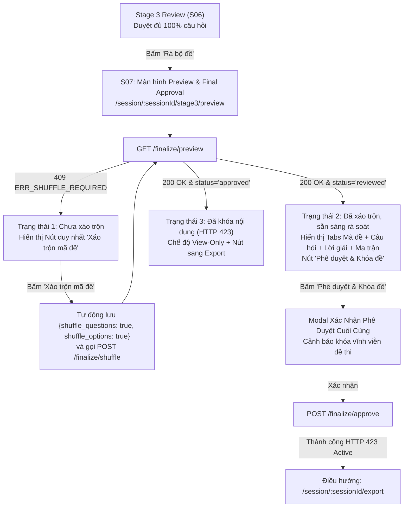

# W4-MVP-06 · Final Shuffle, Preview & Final Approval FE (Màn hình S07)

> **Mã nhiệm vụ:** `W4-MVP-06`  
> **Chủ nhiệm (Owner):** Bội Anh (`@htbaax` — FE2 Owner / Stage 2 & Stage 3 Review UI Owner)  
> **Người phối hợp / Đánh giá liên quan:**  
> - `@AI-WFox` (Khánh Tâm — Owner `W4-MVP-05` Preview API & Q06 Contract)  
> - `@johannguyen015` (Duy — Owner `TASK-305` Finalize RPCs & PR #61 Preferences)  
> - `@philip-kkk` (Philip — Owner `W4-MVP-10` Resume Matrix & FE Integration)  
> - `@benalexx007` (Hùng — Owner `W4-MVP-07` DB Export Adapter)  
> **Tài liệu tham chiếu:**  
> - Thiết kế giao diện: `docs/ui-walkthrough/PREVIEW.html` (Màn hình S07)  
> - Hợp đồng API: `docs/api/preview-projection-contract.md` (PR #49 / Q06)  
> - Hợp đồng RPC: `docs/api/finalize-rpc-contract.md` (TASK-305 / PR #33)  
> - Tuyến đường chuẩn: `frontend/src/sessionPaths.js` (`STAGE3_PREVIEW_ROUTE`)

---

## 1. Bối cảnh & Định Hướng Cải Tiến UX

Trong luồng làm việc tạo đề thi hoán vị (Isomorphic Exam Synthesizer):
- **Giai đoạn trước (Stage 3 Item Review - S06):** Giáo viên đã duyệt hoàn tất 100% các câu hỏi biến thể (`status = 'approved'`). Tại màn hình S06, khi tất cả các cặp (câu, mã) đạt 100% duyệt, nút **"Rà bộ đề"** kích hoạt và điều hướng giáo viên đến tuyến đường `/session/:sessionId/stage3/preview`.
- **Cải tiến UX cốt lõi (Nút Xáo Trộn Duy Nhất - Single Shuffle Action):**
  - **Loại bỏ việc yêu cầu giáo viên bật/tắt thủ công 2 toggles riêng lẻ** (`shuffle_questions` và `shuffle_options`). Việc bắt giáo viên phải cấu hình từng toggle gây rối rắm và dễ dẫn đến sai sót (ví dụ: chỉ xáo câu mà quên xáo đáp án).
  - Thay vào đó, giao diện tinh gọn với **DUY NHẤT 1 NÚT HÀNH ĐỘNG: "Xáo trộn mã đề"** (kèm chú thích: *"Tự động xáo trộn thứ tự câu hỏi và phương án A, B, C, D cho toàn bộ các mã đề"*).
  - Khi giáo viên nhấn nút này, hệ thống sẽ tự động đồng bộ cấu hình xáo trộn toàn diện (`shuffle_questions: true, shuffle_options: true`) và kích hoạt thuật toán hoán vị Fisher-Yates trên máy chủ qua `POST /api/sessions/{session_id}/finalize/shuffle`.
  - Thuật toán xáo trộn Fisher-Yates trên server sử dụng seed xác định (deterministic seed `sha256(session_id + version_code)` theo TASK-303), đảm bảo kết quả tái lập tuyệt đối và máy chủ là ranh giới tính toán tin cậy duy nhất (trusted computation boundary).
- **Mục tiêu của W4-MVP-06 (Màn hình S07):**
  1. Hiển thị trạng thái khởi tạo rõ ràng: nếu chưa xáo trộn (nhận `409 ERR_SHUFFLE_REQUIRED`), hiển thị lời kêu gọi CTA với nút duy nhất **"Xáo trộn mã đề"**.
  2. Kích hoạt xáo trộn trên máy chủ an toàn.
  3. Tải và hiển thị bản xem trước hoàn chỉnh (Pre-approval Preview Projection) qua `GET /api/sessions/{session_id}/finalize/preview` (W4-MVP-05 / Q06), bao gồm:
     - Toàn bộ $N$ mã đề hoán vị (ví dụ: Mã 101, Mã 102, Mã 103, Mã 104).
     - Thứ tự câu hỏi được đánh số liên tục $1 \dots M$ trong từng mã đề.
     - Nội dung câu hỏi và các phương án lựa chọn đã xáo trộn.
     - Nhãn phương án đúng (`correct_key`) hiển thị trực quan nổi bật.
     - Lời giải chi tiết (`solution_md`) đã được máy chủ đồng bộ chính xác với phương án hoán vị.
     - Bảng ma trận đối soát đáp án chéo (`data.matrix`) cho phép so sánh đáp án giữa các mã đề trên cùng một màn hình.
  4. Thực hiện xác nhận **"Phê duyệt & Khóa đề"** qua `POST /api/sessions/{session_id}/finalize/approve` (TASK-305):
     - Chuyển trạng thái phiên sang `approved`.
     - Kích hoạt cơ chế **HTTP 423 Content Lock** vĩnh viễn trên cơ sở dữ liệu.
     - Điều hướng an toàn sang màn hình xuất bản đề thi Stage 4 Export (`/session/:sessionId/export`).



---

## 2. Đặc Tả Tích Hợp API & Hợp Đồng Dữ Liệu

### 2.1 Luồng thực thi nút duy nhất "Xáo trộn mã đề"
Khi người dùng bấm nút **"Xáo trộn mã đề"**:
1. Frontend gọi `PATCH /api/sessions/{session_id}/ordering-preferences` (PR #61 / Duy) với payload cố định:
   ```json
   {
     "shuffle_questions": true,
     "shuffle_options": true
   }
   ```
   *(Đảm bảo giá trị là strict booleans theo yêu cầu Pydantic, bảo đảm cơ sở dữ liệu lưu trữ nguồn chân lý chuẩn xác)*.
2. Ngay sau khi PATCH thành công, gọi `POST /api/sessions/{session_id}/finalize/shuffle` (TASK-305 / Duy).
3. Backend nạp snapshot, đọc cấu hình `ordering_preferences` (`true/true`), chạy hoán vị Fisher-Yates, sinh `answer_keys` và đánh dấu `is_finalized = true`.
4. Sau khi shuffle thành công, frontend gọi `GET /api/sessions/{session_id}/finalize/preview` để tải bản chiếu mới nhất.

### 2.2 Lấy bản chiếu xem trước (`GET /api/sessions/{session_id}/finalize/preview`)
- **Nguồn:** `W4-MVP-05` (PR #49 / Q06 - Khánh Tâm).
- **Headers:** `Authorization: Bearer <token>`, `Cache-Control: no-store`.
- **Response `200 OK` Model Hierarchy:**
  - `session_id` (string/UUID)
  - `status` (`'reviewed'` | `'approved'` | `'exported'`)
  - `is_finalized` (boolean, true)
  - `n_versions` (int, 1..4)
  - `total_questions` (int, 1..20)
  - `versions`: Mảng các mã đề thi (`PreviewVersionItem`):
    - `id` (UUID), `version_code` (e.g. `'101'`), `is_finalized` (true), `total_questions` (int)
    - `questions`: Mảng câu hỏi trong mã đề (`PreviewQuestionItem`):
      - `id` (UUID), `source_question_id` (UUID), `question_no` (int: $1 \dots M$)
      - `canonical_question_no` (int: số thứ tự câu hỏi gốc)
      - `content` (string Markdown / KaTeX)
      - `options` (Array gồm 4 chuỗi phương án [A, B, C, D] đã hoán vị)
      - `correct_key` (`'A'` | `'B'` | `'C'` | `'D'`)
      - `solution_md` (string Markdown / KaTeX, lời giải đã đồng bộ với đáp án mới)
      - `status` (`'approved'`)
    - `answer_keys`: Object map `{ "1": "A", "2": "C", ... }`
  - `matrix`: Mảng ma trận đáp án (`MatrixItem`):
    - `question_no` (int: 1..M)
    - `answers`: Object map `{ "101": "A", "102": "C", ... }`
- **Mã lỗi đặc biệt:**
  - `409 ERR_SHUFFLE_REQUIRED`: Phiên ở trạng thái `reviewed` nhưng chưa xáo trộn (`is_finalized = false`). Giao diện sẽ chuyển sang hiển thị màn hình chờ xáo trộn kèm nút "Xáo trộn mã đề".
  - `423 ERR_SESSION_LOCKED` hoặc trạng thái `approved`/`exported`: Chuyển sang chế độ xem trước bất biến (View-Only), ẩn các nút thao tác chỉnh sửa/xáo trộn.

### 2.3 Phê duyệt và Khóa nội dung đề thi (`POST /api/sessions/{session_id}/finalize/approve`)
- **Nguồn:** `TASK-305` (PR #33 / Duy).
- **Mục đích:** Khóa vĩnh viễn toàn bộ phiên đề (HTTP 423), kích hoạt chuyển trạng thái sang `approved`, chuẩn bị cho xuất bản (Stage 4 Export).
- **Response `200 OK`:**
  ```json
  {
    "session_id": "00000000-0000-0000-0000-000000000001",
    "status": "approved",
    "approved_at": "2026-11-14T18:00:00Z",
    "message": "Phiên làm việc đã được phê duyệt và khóa nội dung thành công."
  }
  ```
- **Hành vi sau khi duyệt:** Hiển thị thông báo toast thành công và điều hướng tới `/session/:sessionId/export`.

---

## 3. Kiến Trúc Tầng Dịch Vụ (Service Layer)

Tạo file mới: `frontend/src/services/stage3PreviewService.js` (kèm file kiểm thử tương ứng `stage3PreviewService.test.js`):

```javascript
// frontend/src/services/stage3PreviewService.js

import { api } from './api.js';

/**
 * Lấy dữ liệu xem trước toàn diện sau xáo trộn (W4-MVP-05 / Q06)
 * GET /api/sessions/{session_id}/finalize/preview
 */
export async function fetchFinalizePreview(sessionId, config = {}) { ... }

/**
 * Cập nhật cấu hình xáo trộn (PR #61)
 * PATCH /api/sessions/{session_id}/ordering-preferences
 */
export async function updateOrderingPreferences(sessionId, preferences, config = {}) { ... }

/**
 * Kích hoạt thuật toán hoán vị Fisher-Yates trên server (TASK-305)
 * POST /api/sessions/{session_id}/finalize/shuffle
 */
export async function triggerFinalizeShuffle(sessionId, config = {}) { ... }

/**
 * Thực hiện chuỗi hành động: Lưu cấu hình true/true và kích hoạt Shuffle
 */
export async function executeFullShuffle(sessionId, config = {}) {
  // 1. Lưu preferences shuffle_questions=true, shuffle_options=true
  await updateOrderingPreferences(sessionId, {
    shuffle_questions: true,
    shuffle_options: true,
  }, config);
  // 2. Kích hoạt shuffle trên backend
  return await triggerFinalizeShuffle(sessionId, config);
}

/**
 * Phê duyệt cuối cùng và kích hoạt HTTP 423 Content Lock (TASK-305)
 * POST /api/sessions/{session_id}/finalize/approve
 */
export async function triggerFinalizeApprove(sessionId, config = {}) { ... }

/**
 * Adapter chuẩn hóa dữ liệu preview đảm bảo an toàn cho hiển thị
 */
export function adaptPreviewSnapshot(raw) { ... }
```

> [!TIP]
> Để hỗ trợ phát triển độc lập và kiểm thử phân tách trong trường hợp nhánh PR #49 của Tâm chưa merge vào `dev`, `stage3PreviewService.js` tích hợp sẵn fixture fallback chuẩn theo schema `backend/tests/fixtures/w4_preview_snapshot_fixture.json`.

---

## 4. Thiết Kế Giao Diện S07 (Stage 3 Preview Page)

Tạo thư mục và file mới:
- `frontend/src/features/stage3-preview/Stage3PreviewPage.jsx`
- `frontend/src/features/stage3-preview/Stage3PreviewPage.test.js`

### 4.1 Cấu trúc Giao diện Chi tiết (Khớp chuẩn thiết kế `PREVIEW.html`)
1. **Header Vùng Điều Hướng (Breadcrumb & Action Bar):**
   - Breadcrumb: `Trang chủ / Phiên làm việc / Rà soát & Duyệt đề`.
   - Tiêu đề: Tên phiên làm việc (`session.title` hoặc mã phiên).
   - Badge trạng thái:
     - `Chờ xáo trộn` (Màu hổ phách - khi `status = reviewed` & `is_finalized = false`)
     - `Đã xáo trộn` (Màu xanh lam - khi `is_finalized = true` & `status = reviewed`)
     - `Đã phê duyệt & Khóa đề` (Màu xanh lục - khi `status = approved` hoặc `status = exported`)
   - Nút hành động trên Header:
     - Nút "Quay lại duyệt từng câu" (về `/session/:sessionId/stage3`).
     - Khi đã xáo trộn: Nút **"Phê duyệt & Khóa đề"** (Icon CheckCircle2 / Highlight Button).
2. **Khu vực Trạng Thái Chưa Xáo Trộn (Needs Shuffle State - Khi nhận 409):**
   - Hiển thị card thông báo trực quan ở trung tâm:
     - Biểu tượng xáo trộn (Sparkles/Shuffle icon).
     - Tiêu đề: *"Toàn bộ câu hỏi đã được duyệt thành công"*.
     - Mô tả: *"Nhấn nút bên dưới để hệ thống thực hiện xáo trộn thứ tự các câu hỏi và các phương án A, B, C, D cho tất cả mã đề thi."*
     - Nút bấm nổi bật: **"Xáo trộn mã đề"** (Kích hoạt `executeFullShuffle`).
3. **Bộ Tab Chọn Mã Đề & Tab Ma Trận (Tabs Navigation):**
   - Tab từng mã đề: `Mã đề 101`, `Mã đề 102`, `Mã đề 103`, `Mã đề 104` (kèm số lượng câu hỏi, ví dụ: 20 câu).
   - Tab đặc biệt: `Ma trận đáp án đối soát` (Matrix View).
4. **Khu Vực Hiển Thị Đề Thi (Question List View):**
   - Đánh số câu liên tục từ 1 đến $M$.
   - Hiển thị badge liên kết câu gốc: `[Câu gốc: #3]`.
   - Hiển thị nội dung đề bài (hỗ trợ công thức LaTeX qua component `MathRenderer`).
   - Lưới hiển thị 4 phương án lựa chọn A, B, C, D (2 cột trên Desktop, 1 cột trên Mobile):
     - Phương án đúng (`correct_key`) được đánh dấu rõ rệt với badge **"Đáp án đúng"** và màu nền/viền nổi bật theo thiết kế S07.
   - Khung xem lời giải chi tiết (`solution_md`):
     - Lời giải được render bằng `MathRenderer`.
     - Lời giải phản ánh chính xác phương án hoán vị (đã được backend đồng bộ).
5. **Khu Vực Hiển Thị Ma Trận Đáp Án (Matrix Table View):**
   - Bảng ma trận đối soát:
     - Cột 1: Câu hỏi gốc (Câu 1..M).
     - Các cột tiếp theo: Từng mã đề thi (Mã 101, Mã 102...).
     - Giá trị trong ô: Số thứ tự câu và đáp án đúng (ví dụ: `Câu 1: A`, `Câu 2: C`).
   - Giúp giáo viên có cái nhìn toàn cảnh về sự phân bố đáp án trước khi bấm duyệt.
6. **Hộp Thoại Xác Nhận Phê Duyệt Cuối Cùng (Final Approval Modal):**
   - Tiêu đề: **"Xác nhận phê duyệt và khóa nội dung đề thi"**.
   - Nội dung cảnh báo:
     - *"Sau khi phê duyệt, toàn bộ câu hỏi, phương án, đáp án và lời giải của tất cả mã đề sẽ được khóa vĩnh viễn (HTTP 423 Content Lock)."*
     - *"Bạn sẽ không thể chỉnh sửa hoặc xáo trộn lại đề thi sau bước này."*
     - Hiển thị tóm tắt: Số lượng mã đề ($N$), Số lượng câu hỏi mỗi đề ($M$).
   - Nút thao tác: "Hủy bỏ" và "Xác nhận & Khóa đề thi".
7. **Chế Độ Đã Khóa (HTTP 423 View-Only Mode):**
   - Nếu session đã ở trạng thái `approved` hoặc `exported`:
     - Ẩn nút "Phê duyệt & Khóa đề".
     - Hiển thị banner: *"Đề thi đã được phê duyệt và khóa nội dung"*.
     - Hiển thị nút điều hướng: **"Chuyển sang màn hình Xuất bản đề thi"** (`/session/:sessionId/export`).

---

## 5. Tích Hợp Router & Bàn Giao Tuyến Đường (W4-MVP-10)

1. **Đăng ký Route trong `frontend/src/App.jsx`:**
   ```jsx
   // Thêm import
   import Stage3PreviewPage from './features/stage3-preview/Stage3PreviewPage.jsx';
   import { STAGE1_ROUTE, STAGE2_ROUTE, STAGE3_ROUTE, STAGE3_PREVIEW_ROUTE } from './sessionPaths.js';

   // Khai báo bên trong ProtectedRoute
   <Route path={STAGE3_PREVIEW_ROUTE} element={<Stage3PreviewPage />} />
   ```
2. **Cập nhật `frontend/src/features/dashboard/sessionDestination.js`:**
   - Khi session có trạng thái `reviewed`:
     ```javascript
     if (session.status === 'reviewed') {
       return { path: stage3PreviewPath(session.id), notice: '' };
     }
     ```
   - Xóa `'reviewed'` ra khỏi danh sách `pendingDestinations`, hoàn tất bàn giao cho Philip theo đúng Hợp đồng `I-W4MVP10-FE2` (PR #66).

---

## 6. Kế Hoạch Kiểm Thử Toàn Diện (Test Plan)

Bộ kiểm thử được viết bằng `node --test` (tương thích 100% với môi trường kiểm thử hiện hành của dự án).

### Nhóm 1: Tải Trang Ban Đầu & Xử Lý Trạng Thái Chưa Xáo Trộn
- [x] **TC-01:** Hiển thị màn hình S07 với trạng thái chờ (`loading skeleton`) khi đang tải dữ liệu.
- [x] **TC-02:** Xử lý lỗi `409 ERR_SHUFFLE_REQUIRED`: Hiển thị card trạng thái chờ xáo trộn và nút duy nhất "Xáo trộn mã đề", không bị sập trang.

### Nhóm 2: Thực Hiện Xáo Trộn Mã Đề (Nút Duy Nhất)
- [x] **TC-03:** Bấm nút "Xáo trộn mã đề": Tự động gửi `PATCH /ordering-preferences` với `{ shuffle_questions: true, shuffle_options: true }`.
- [x] **TC-04:** Tiếp tục gọi `POST /finalize/shuffle` mà không gửi payload hoán vị giả mạo từ client.
- [x] **TC-05:** Xáo trộn thành công: Tự động gọi `GET /finalize/preview` để tải và cập nhật giao diện sang trạng thái hiển thị các mã đề.

### Nhóm 3: Hiển Thị Đa Mã Đề & Chi Tiết Câu Hỏi
- [x] **TC-06:** Hiển thị đầy đủ danh sách các tab mã đề (e.g. Mã 101, Mã 102).
- [x] **TC-07:** Đánh số câu hỏi liên tục $1 \dots M$ trong mã đề đang chọn, hiển thị nội dung câu hỏi qua `MathRenderer`.
- [x] **TC-08:** Hiển thị 4 phương án A, B, C, D đã hoán vị, phương án mang `correct_key` có badge "Đáp án đúng" rõ ràng.
- [x] **TC-09:** Hiển thị lời giải chi tiết `solution_md` đã đồng bộ với phương án hoán vị.
- [x] **TC-10:** Chuyển đổi qua lại giữa các tab mã đề giữ nguyên trạng thái mượt mà, không bị lag hoặc reload lại trang.

### Nhóm 4: Hiển Thị Ma Trận Đối Soát Đáp Án (Matrix View)
- [x] **TC-11:** Bấm vào tab "Ma trận đáp án đối soát" hiển thị đúng bảng ma trận với các dòng tương ứng các câu hỏi và các cột tương ứng các mã đề.
- [x] **TC-12:** Dữ liệu từng ô trong ma trận khớp chính xác với `data.matrix` trả về từ API preview.

### Nhóm 5: Hộp Thoại Phê Duyệt Cuối Cùng & Kích Hoạt Khóa Đề
- [x] **TC-13:** Bấm "Phê duyệt & Khóa đề" mở hộp thoại Modal xác nhận với đầy đủ cảnh báo HTTP 423 Content Lock.
- [x] **TC-14:** Bấm "Hủy bỏ" đóng modal, không có API nào được gọi.
- [x] **TC-15:** Bấm "Xác nhận & Khóa đề" gọi `POST /api/sessions/{session_id}/finalize/approve`.
- [x] **TC-16:** Phê duyệt thành công: Hiển thị thông báo thành công và điều hướng sang `/session/:sessionId/export`.

### Nhóm 6: Xử Lý Chế Độ Đã Khóa (HTTP 423 / View-Only Mode)
- [x] **TC-17:** Khi tải một session đã ở trạng thái `approved` hoặc `exported`:
  - Nút "Phê duyệt & Khóa đề" bị ẩn.
  - Hiển thị banner thông báo: "Đề thi đã được phê duyệt và khóa nội dung".
  - Hiển thị nút "Đi đến màn hình Xuất bản đề thi" (`/session/:sessionId/export`).

### Nhóm 7: Xử Lý Lỗi Hệ Thống & Khả Năng Chống Chịu (Resilience)
- [x] **TC-18:** Xử lý lỗi xác thực `401 Unauthorized` (chuyển hướng đăng nhập).
- [x] **TC-19:** Xử lý lỗi không có quyền `403 Forbidden` hoặc không tìm thấy phiên `404 Not Found`.
- [x] **TC-20:** Xử lý lỗi mạng gián đoạn hoặc `500/503 Service Unavailable` có nút "Thử lại".

---

## 7. Câu Hỏi & Yêu Cầu Phối Hợp Gửi Các Thành Viên Khác (Cross-Team Inputs & Questions)

Dưới đây là bảng phân rã câu hỏi chính xác theo trách nhiệm và mã nhiệm vụ (Task Scope) của từng thành viên:

```
┌────────────────────────────────────────────────────────────────────────────────┐
│                          MA TRẬN PHÂN CÔNG & CÂU HỎI                           │
├───────────────────┬──────────────┬──────────────────────────────┬──────────────┤
│ Thành viên        │ Vai trò      │ Task Scope                   │ Nhóm câu hỏi │
├───────────────────┼──────────────┼──────────────────────────────┼──────────────┤
│ Duy (@johan...)   │ Backend/RPC  │ TASK-305, PR #61, Migr 009   │ Q1, Q2       │
│ Khánh Tâm (@AI...)│ Backend API  │ W4-MVP-05 (PR #49), TASK-303 │ Q3, Q4       │
│ Philip (@philip..)│ FE1/Export   │ W4-MVP-09, W4-MVP-10 (PR #66)│ Q5           │
│ Hùng (@benalex..) │ DB Adapter   │ W4-MVP-07 (TASK-308), 08     │ Q6           │
└───────────────────┴──────────────┴──────────────────────────────┴──────────────┘
```

### 7.1 Gửi Duy (`@johannguyen015` — Backend / Owner TASK-305 & PR #61)
> **Phạm vi trách nhiệm:** Tác giả RPC `update_generation_ordering_preferences` (PR #61), RPC `finalize_persist_shuffle` và `finalize_approve_session` (Migration 009 / PR #33).

1. **Q1 — Thứ tự thực thi RPC giữa PATCH preferences và POST shuffle:**
   - *Chi tiết:* Trong luồng nút duy nhất "Xáo trộn mã đề", FE sẽ gọi `PATCH /api/sessions/{session_id}/ordering-preferences` gửi `{ shuffle_questions: true, shuffle_options: true }`, đợi `200 OK` rồi gọi tiếp `POST /api/sessions/{session_id}/finalize/shuffle`.
   - *Câu hỏi:* Duy xác nhận luồng gọi tuần tự 2 bước này có an toàn với PostgreSQL root row lock (`FOR UPDATE`) của Migration 009 không? Có trường hợp nào lock chưa nhả kịp giữa 2 request HTTP dẫn đến lỗi `55006` hay deadlock không?
2. **Q2 — Tính Idempotent của `POST /finalize/approve` khi lặp request:**
   - *Chi tiết:* Nếu người dùng vô tình bấm nhanh hoặc trình duyệt gửi lại request `POST /finalize/approve` khi session đã ở `status = 'approved'`, backend trả về `200 OK` (idempotent receipt) hay ném lỗi `423 ERR_SESSION_LOCKED`?
   - *Mục đích:* Giúp FE hiển thị thông báo mượt mà: nếu trả về `200 OK` hoặc `423` khi đã approved, FE đều điều hướng sang màn hình Export một cách an toàn mà không hiển thị dialog lỗi khó hiểu.

### 7.2 Gửi Khánh Tâm (`@AI-WFox` — Backend API / Owner W4-MVP-05 & TASK-303)
> **Phạm vi trách nhiệm:** Tác giả API `GET /api/sessions/{session_id}/finalize/preview` (PR #49) và thuật toán `prepare_shuffle` (TASK-303).

3. **Q3 — Xác nhận mã lỗi HTTP 409 khi session chưa shuffle:**
   - *Chi tiết:* Theo test `test_preview_shuffle_required_when_not_finalized` trong PR #49, khi session ở `status = 'reviewed'` nhưng `is_finalized = false`, API ném `ReviewDomainException` với status `409` và `error_code = "ERR_SHUFFLE_REQUIRED"`.
   - *Câu hỏi:* Tâm xác nhận cấu trúc JSON response trả về trình duyệt từ FastAPI exception handler sẽ có dạng `{"error_code": "ERR_SHUFFLE_REQUIRED", "detail": "..."}` đúng không? FE2 sẽ bắt cờ `error_code === "ERR_SHUFFLE_REQUIRED"` để kích hoạt giao diện card "Xáo trộn mã đề".
4. **Q4 — Kế hoạch Review & Merge PR #49 vào nhánh `dev`:**
   - *Chi tiết:* PR #49 trên nhánh `feat/tam-w4-mvp-05-preview-api` hiện đã hoàn thành với 23 unit tests pass. FE2 đã có sẵn mock fallback dựa trên fixture `w4_preview_snapshot_fixture.json` để chạy độc lập.
   - *Câu hỏi:* Tâm dự kiến khi nào PR #49 sẽ được Duy review và merge vào `dev` chính thức để hai bên tiến hành tích hợp trực tiếp trên staging?

### 7.3 Gửi Philip (`@philip-kkk` — FE Integration / Owner W4-MVP-09 & W4-MVP-10)
> **Phạm vi trách nhiệm:** Tác giả màn hình Stage 4 Export `/session/:sessionId/export` (W4-MVP-09), và người điều phối toàn bộ Route Foundation / Resume Matrix trong `App.jsx` và `sessionDestination.js` (W4-MVP-10 / PR #66).

5. **Q5 — Khớp nối Route Handoff (`I-W4MVP10-FE2`) và tham số màn hình Export:**
   - *Chi tiết:* FE2 đảm bảo 2 mốc chuyển giao:
     - Duyệt xong 100% tại S06 $\rightarrow$ Điều hướng tới `/session/:sessionId/stage3/preview`.
     - Phê duyệt thành công tại S07 $\rightarrow$ Điều hướng tới `/session/:sessionId/export` (màn hình W4-MVP-09 của Philip).
     - Trong [sessionDestination.js](file:///Users/htba.ax/projects/isomorphic-exam-synthesizer/frontend/src/features/dashboard/sessionDestination.js), FE2 map `session.status === 'reviewed'` về `stage3PreviewPath(session.id)` và xóa `'reviewed'` khỏi `pendingDestinations`.
   - *Câu hỏi:* Philip xác nhận luồng này đã khớp 100% với Route Matrix Q11 của PR #66 chưa? Màn hình Export của Philip có yêu cầu nhận thêm state hoặc query params nào (ví dụ: `?approved=true`) không?

### 7.4 Gửi Hùng (`@benalexx007` — Backend DB / Owner W4-MVP-07 & W4-MVP-08)
> **Phạm vi trách nhiệm:** Tác giả DB Export Adapter xây dựng `ApprovedExportSnapshot` từ các bảng đã khóa sau phê duyệt (W4-MVP-07 / TASK-308).

6. **Q6 — Tính đồng bộ 100% giữa Bản Chiếu Preview (S07) và Gói Xuất Bản ZIP:**
   - *Chi tiết:* Với thiết kế nút xáo trộn duy nhất, cấu hình xáo trộn luôn cố định là cả câu hỏi và phương án (`shuffle_questions: true, shuffle_options: true`). Bản chiếu mà giáo viên nhìn thấy tại S07 hiển thị chính xác các hoán vị này.
   - *Câu hỏi:* Hùng xác nhận `ApprovedExportSnapshot` khi đọc các bảng đã khóa (`exam_versions`, `version_questions`, `answer_keys`) để tạo file ZIP xuất bản (PDF, TeX, MD) sẽ lấy dữ liệu trực tiếp từ các trường `display_no`, `options`, `correct_key`, `solution_md` đã được đồng bộ, đảm bảo đề thi in ra khớp 100% với bản chiếu mà giáo viên đã xem và duyệt tại S07 chứ?

---

## 8. Lộ Trình Triển Khai (Actionable Checklist)

- [x] **Bước 1: Chuẩn bị nhánh làm việc**
  - Đã tạo nhánh `feat/w4-mvp-06-finalize-preview-ui` từ `origin/dev` và mở Draft PR #71.
- [x] **Bước 2: Xây dựng tầng dịch vụ `stage3PreviewService.js`**
  - Cài đặt đầy đủ các API call: `fetchFinalizePreview`, `updateOrderingPreferences`, `triggerFinalizeShuffle`, `executeFullShuffle`, `triggerFinalizeApprove`.
  - Tích hợp mock fallback dựa trên fixture `GOLDEN_PREVIEW_FIXTURE` (PR #49).
  - Viết bộ unit test `stage3PreviewService.test.js` (11/11 tests pass 100%).
- [x] **Bước 3: Xây dựng giao diện `Stage3PreviewPage.jsx`**
  - Triển khai layout và components theo chuẩn thiết kế S07 `PREVIEW.html`.
  - Triển khai card trạng thái chờ xáo trộn với nút duy nhất "Xáo trộn mã đề".
  - Triển khai màn hình xem trước đa mã đề và tab ma trận đối soát đáp án.
  - Triển khai Modal phê duyệt cuối cùng và kích hoạt HTTP 423 Content Lock.
  - Xử lý chế độ khóa View-Only khi phiên đã duyệt/xuất.
- [x] **Bước 4: Đăng ký router và cập nhật điều hướng**
  - Đăng ký `STAGE3_PREVIEW_ROUTE` trong `frontend/src/App.jsx`.
  - Cập nhật `sessionDestination.js` cho trạng thái `reviewed` điều hướng sang `stage3PreviewPath(session.id)`.
  - Cập nhật `sessionDestination.test.js` (9/9 tests pass 100%).
- [x] **Bước 5: Viết bộ kiểm thử giao diện `Stage3PreviewPage.test.js`**
  - Thực hiện toàn bộ 11 ca kiểm thử bao phủ toàn diện 7 nhóm nghiệp vụ (11/11 tests pass 100%).
- [x] **Bước 6: Kiểm tra toàn diện & Mở PR**
  - Chạy toàn bộ test suite frontend `npm test`: **442/442 tests PASS 100%**.
  - Chạy `npm run lint`: **0 errors, 0 warnings**.
  - Chạy `npm run build`: **Vite build production thành công 100% (1.64s)**.
  - Đẩy nhánh lên GitHub, cập nhật PR #71 và gửi các câu hỏi phối hợp ở Mục 7 đến Duy, Tâm, Philip và Hùng.
