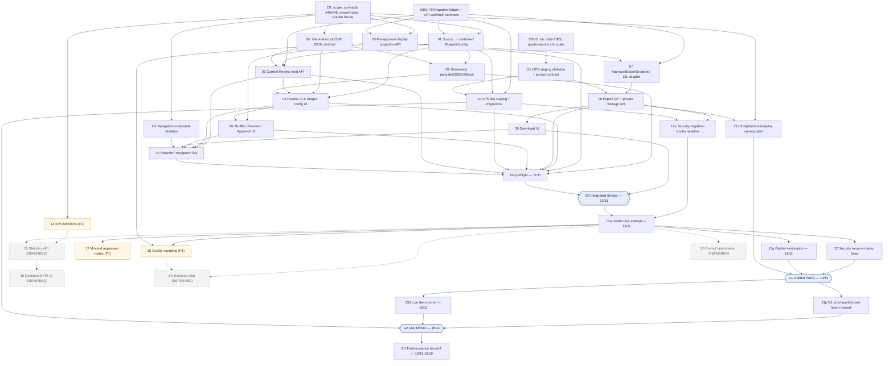

# W4_TASK_DETAIL — đặc tả task, dependency DAG và quyết định còn mở

> **Trạng thái: BẢN ĐẶC TẢ CHÍNH THỨC ĐỂ TRÌNH DUYỆT — v2.0, chưa được owner phê duyệt và chưa commit/merge vào GitHub.** Phụ lục triển khai cho [`W4_ASSIGNMENT.md`](./W4_ASSIGNMENT.md), không thay thế phân công gốc. Dựa trên W4_ASSIGNMENT v2.0 và bản v1.1 người dùng cung cấp, [`description.md` trên `docs/update`](https://github.com/Computational-Thinking-Project/isomorphic-exam-synthesizer/blob/docs/update/docs/description.md), ADR/RPC/Issues và code `dev` kiểm ngày **06/11/2026**. Mọi tên endpoint, field hoặc tệp ghi là **[PROPOSED]** đều là giao diện đề xuất, không được tự động coi là API đang tồn tại.
>
> **Phạm vi thời gian:** 06–15/11/2026 (UTC+7), 10 ngày kể cả cuối tuần. **P0:** `W4-MVP-01…13`, phần tối thiểu của `21`. **P1 tùy năng lực:** `14`, `17`, `18`, phần mở rộng của `21`. **DEFERRED:** `15`, `16`, `19`, `20` (không có deadline W4). Owner/due date là **đề xuất theo W4_ASSIGNMENT**, cần từng người xác nhận.

## 0. ĐỒ THỊ PHỤ THUỘC — TOPOLOGICAL ORDER (ĐỌC TRƯỚC)

**Quy ước:** Mũi tên **`A --> B`** nghĩa là **B phải nhận đủ output/handoff bắt buộc của A trước khi được đánh `integrated-done`**, không nhất thiết phải chờ toàn bộ implementation A mới được bắt đầu viết code. Các node `02c`, `10r`, `11s`, `12a`, `13a`, `13g`, `13d`, `21s`, `21p`, `21f` là **checkpoint bên trong task**, không phải task mới; chúng được tách để giải quyết sự khác nhau giữa deadline contract/fixture và deadline live implementation. Mũi tên nét đứt đi tới công việc **DEFERRED**, không làm block P0.



### 0.1 Bảng thứ tự topo (một thứ tự hợp lệ, KHÔNG phải lịch chạy tuần tự)

| Lớp topo | Những node có thể làm song song sau input tương ứng | Bàn giao/gate |
|---|---|---|
| **L0 / D1** | `C0`, `DB0`, `ENV0` | Quyết định giao diện + roster; migration ledger; OPS access owner. Không có bước nào được giả định đã sign-off. |
| **L1 / D1–D3** | `01`, `02c`, `05` (fixture/contract), `10r`, `11s`, `14` (P1) | Contract stable, Stage1/Stage2/preview fixture, route matrix, staging skeleton. |
| **L2 / D3–D5** | `02` (full), `03`, `07`, `11` (live) | Job receipt/current candidate, export adapter, môi trường thật. `03` chỉ chờ `02c`, **không** chờ `02` hoàn thiện ngày 10/11. |
| **L3 / D4–D6** | `04`, `08`; sau đó `06`, `09`; kết nối `10` | FE Review/Approval/Download + Storage API, tất cả theo contract. Prototype các FE có thể khởi tạo sớm bằng fixture. |
| **L4 / D6–D7** | `12a` và **G0 preflight** 11/11; **G0** 12/11 sau FE live | Preflight 11/11; smoke tích hợp 12/11 sau FE Download/Resume live. Nếu FAIL/BLOCKED thì Golden-attempt-1 không được coi live pass. `12a` có thể chạy song song chuẩn bị G0. |
| **L5 / D8–D9** | `13a`; sau đó `12`, `13`, `17` (P1), `18` (P1), `21s` | Golden-attempt-1 ngày 13; bug triage, G1 regression/QA và demo script. |
| **L6 / D9** | **G1**, sau đó `21p` proof pack | Chỉ PASS khi real E2E, answer/solution matrix kiểm đủ 3×2, cùng SHA. |
| **L7 / D10** | `13d` live rerun → **G2** → `21f` evidence cuối | Live demo trước 16:00, hồ sơ 19:00, hard stop 23:59 ngày 15/11. |
| **Nhánh ngoài W4** | `14 → 15 → 16`, `13a/18 → 19`, `13a → 20` | Chỉ là prerequisite để kích hoạt trong sprint sau; **không block G0/G1/G2**. |

**Các quan hệ có vẻ vòng nhưng thực tế không phải vòng:** `03` cần **hợp đồng và schema job (`02c`)** trước 09/11; cần full SSE (`02`) để **integration testing** 10–11/11, không phải để viết endpoint. `10r` (routes/fixture) giao 10/11 trước `06/09` live ngày 11; `10` (resume thật) mới cần `06/09`. `11s` staging skeleton chạy trước `08`; `08` cần bucket contract/credentials staging để smoke chứ **không** chờ toàn bộ `11` Done. `21s` script có thể viết trước Golden; `21p` proof pack mới có sau G1 và `21f` evidence hoàn tất sau demo G2. Nếu owner biến các checkpoint này thành dependency full task, lịch gốc tự mâu thuẫn.

### 0.2 Critical path, blocker và thứ tự tích hợp

`C0/DB0 → 01 → 02c → 03 → 04 → 06 → 10 → G0 → 13a → 13g → G1 → 13d → G2 → 21f`, cùng nhánh hội tụ `DB0 → 05 → 07 → 08 → 09 → 10`, và nhánh hạ tầng `ENV0 → 11s → 11 → G0`. **Task 12** là gate an toàn song song trước G1, không bị bỏ qua chỉ vì Golden vui vẻ chạy được.

**Rủi ro zero-slack trong kế hoạch gốc:** `01` và `03` cùng deadline 09/11 18:00 dù `03` cần source/schema contract của `01`; `02` full và `04` API-bound cùng 10/11 18:00; `08`, `09`, `06` và **G0** cùng 11/11 18:00 trong bản v1.1 dù phải tích hợp lần lượt; `13g` G1 và regression security 14/11 chỉ cách nhau vài giờ. Đây **không phải ước lượng đã được chứng minh khả thi**. Duy phải phê duyệt mốc handoff sớm hơn hoặc giảm scope, theo dõi `blocked` ngay khi trễ và tuyệt đối không thay live checks bằng mock để giữ lịch.

**Integration order kiểm tra chứ không phải lệnh merge mặc định:** (a) xác nhận behavior #45/#46 và ADR; (b) giải quyết overlap migrations/PR #30/#32/#36/#41/#42, đòi fresh-install **và** upgrade test; (c) chốt writers/auth; (d) merge handlers/service theo contract; (e) deploy cùng mã nguồn/migrations; (f) smoke; (g) Golden + evidence. Theo `docs/api/finalize-rpc-contract.md`, lineage liên quan Finalize phải giữ `006 → 007 → 008 → 009`; các migration `010/011` từ PR #32 và migration ở #36 **cần Hùng/Duy xác thực thứ tự và mục đích**; tuyệt đối không suy ra chỉ từ tên số.

---

## 1. Khung chung áp dụng cho 21 task

- **Golden fixture dùng chung:** một bộ đề **Markdown 3 câu trắc nghiệm một đáp án đúng**, đáp án + lời giải nguồn đã đối chiếu, có quyền dùng; `N=2`; `shuffle_questions=false`, `shuffle_options=false`. Mọi assert 100% chỉ áp dụng **6 vị trí hiển thị của fixture này**, không suy rộng thành chứng minh chất lượng toán học tổng quát.
- **Schema contract tối thiểu [PROPOSED, cần BE xác nhận]:** `session_id`, `user_id` (chỉ server/RLS), `source_revision`, `source_question_id`, `version_id`/`version_index`, `candidate_id`, `status`, `is_current`, `question_text`, `options[4]`, `correct_key`, `solution_md`, `validation_report` + `has_warning`, `fallback_source`, `ordering_preferences`, timestamps/seed/lineage, `request_id` hoặc `idempotency_key`. Trường nào đã có tên khác trong schema thì dùng tên thực; không tạo hai nguồn chân lý.
- **Review invariant:** mỗi `(version_id, source_question_id)` chỉ có **một** `is_current=true`; update theo transaction/audit; stale action trả 409, session khóa trả 423; không nhận owner identity từ browser; các tác vụ retry không tạo hai current candidate.
- **Audit & evidence mỗi task:** PR/commit + test command/log; owner/reviewer; dữ liệu fixture (không bí mật); CI status; nếu liên quan staging thì `deployed SHA` + URL/nơi lưu sanitized log/screenshot; kết quả `LOCAL_READY` ≠ `INTEGRATED_DONE`. Người được đề xuất làm owner chưa mặc nhiên xác nhận lịch.
- **Source-of-truth:** `description.md` cung cấp yêu cầu sản phẩm tổng quát (trong đó còn đoạn chưa cập nhật), ADR 0001 chốt confirmation order, Issues #45/#46 chốt thay đổi gần đây **đang OPEN**, `finalize-rpc-contract.md` chốt trust boundary của RPC, W4_ASSIGNMENT chốt **đề xuất scope/owner/dates**. Khi mâu thuẫn, Duy phải ghi *quyết định sản phẩm được owner xác nhận*, không tự nâng một PR draft hoặc một Issue thành code hoàn chỉnh.
- **Mọi deadline dưới đây:** UTC+7; việc hoàn thành độc lập không thay G0/G1/G2. `Who decides` trong bảng cuối = **người cần thảo luận/ký**, không hàm ý họ đã đồng ý.

## 2. TASK P0 — đặc tả triển khai chi tiết

### W4-MVP-01 — Source confirmation → canonical Blueprint → generation configuration

**Owner:** Duy (`johannguyen015`); module phụ thuộc FE1 PR #42/#43 và BE config PR #32; Quỳnh hỗ trợ mode mapping, `htbaax` hỗ trợ Stage 2. **Deadline:** 09/11 18:00. **Đợi:** `C0`, `DB0`, PR #42/#43 / #32 / #41 tương thích; **giao cho:** `02c/02`, `03`, `04`, `11`.

**Tác dụng:** Tạo tuyến tin cậy từ đề nguồn được người dùng duyệt đến canonical blueprints và cấu hình generation, ngăn sinh AI trên đề chưa xác nhận/đã đổi revision; không làm Blueprint editor.

**Input:** JWT người dùng/session draft; đề đã parse gồm stem/4 options/key/solution (đối với Golden); `source_revision` + source hash; action xác nhận với idempotency key; canonical Blueprint schema hiện hữu; `n_versions∈{1,2,3,4}` và 2 shuffle bool mặc định OFF; Issue #45/#46, ADR 0001.

**Xử lý/Output:** RPC/API xác nhận lưu revision/hash và source snapshot bền vững; extraction canonical chạy **sau confirmation** và có readiness status; config lưu `n_versions` và `ordering_preferences`, **không tin** `active_variation_modes` client; BE suy ra allowed modes từ canonical Blueprint. Cung cấp endpoint/fixture/response lỗi cho 02/03/04 và ledger migrations cho OPS. Stage 3 có cách cập nhật 2 shuffle flags **trước final shuffle**; nếu thiếu, chốt API [PROPOSED] trước khi code.

**DoD:** [ ] Import không tự sinh canonical Blueprint trước xác nhận; [ ] xác nhận lặp lại an toàn, sửa source yêu cầu xác nhận/revision mới; [ ] generation trước ready bị chặn theo status rõ ràng; [ ] N ngoài 1–4 bị từ chối; [ ] cả 4 tổ hợp shuffle hợp lệ, default OFF tại FE/API/DB; [ ] không có user-selected modes trong request bắt buộc; [ ] test ownership/RLS/409, config change-before-shuffle, khóa sau finalization; [ ] BE-H1 có migration fresh+upgrade report + JSON contract, reviewer Hùng.

**Vướng mắc chưa quyết:** Source solution là *optional* theo `description.md` nhưng fallback/export bắt buộc `solution_md` (#46): chọn reject lúc confirm, sinh lời giải rồi giáo viên xác nhận, hay chặn đến khi đủ? **Duy + Quỳnh + Tâm (QA/UX)** chốt trước 06/11; ghi ở `Q01`. Trên `dev` hiện `sessions.py` vẫn gọi `trigger_blueprint_pipeline` sau `/ingest-file` và `/ingest-text` — cần phân biệt legacy pipeline và canonical; **không đánh Done nếu canonical vẫn chạy sớm**.

### W4-MVP-02 — Persisted generation jobs, SSE/reconnect, 4-attempt fallback

**Owner:** Quỳnh. **Deadline:** contract/fixture cho Duy 09/11; full 10/11 18:00. **Đợi:** `01`, `02c` hợp đồng, PR #30/#32/#41, DB ledger; **giao:** `03` (fixture + receipt), `04`, `13`.

**Tác dụng:** Sinh N bản đề không mất tiến độ khi UI reload/stream reconnect; đối xử rõ ràng với lỗi AI và bảo toàn provenance nguồn.

**Input:** confirmed revision/hash, canonical Blueprint, server-derived modes, `n_versions`, deterministic target `(version, source_id)` + seed, job/session id, quota/deadline, Gemini/validator, snapshot source có thể clone, idempotency key.

**Xử lý/Output:** Job persisted trong DB, state/total/completed/current slot và SSE event IDs/replay hoặc status re-fetch; mỗi slot sinh câu/4 đáp án/key/solution + validation report; request fingerprint & prompt version được log. Sau tối đa **4 attempts (1+3 retry)** thất bại, tạo **confirmed-source fallback** pending_review có `GENERATION_RETRIES_EXHAUSTED` và warning; nếu source thiếu solution/key thì **fail closed**, không đánh completed hợp lệ. Tạo test fixture `generated`, `partial_generated`, `failed`, fallback, reconnect.

**DoD:** [ ] N=1…4 có stable IDs; [ ] hai request khởi động/retry trùng không nhân bản job/current rows; [ ] SSE disconnect/reconnect hoặc reload đọc lại trạng thái DB nhất quán; [ ] provider 429/timeout/schema invalid/duplicate/unsupported phân loại; [ ] có 4-attempt test kiểm chính xác số lượt; [ ] fallback copy **đúng confirmed revision**, không phải AI root, không autoapprove; [ ] seed/prompt version/budget recorded; [ ] unit + DB tests và integration smoke cùng deployed SHA. Lưu ý `unknown/unsupported` không được ghi `SymPy verified`.

**Vướng mắc:** Protocol SSE event names, replay cursor, duration/quota và cách đánh `partial_generated` khi thiếu slot chưa chuẩn hóa trong `description.md`; **Quỳnh + Duy**, phối hợp Philip/`htbaax`, chốt `Q02`. Chính sách no-mode `modes=[]`/original clone từ PR #32 cần quyết định mức độ hợp lệ của "isomorphic" (`Q03`).

### W4-MVP-03 — API đọc current Review snapshot (không rewrite Review write RPC)

**Owner:** Duy. **Deadline:** 09/11 18:00 contract + endpoint; live test 10–11/11. **Đợi:** `01`, migration/canonical schema, **`02c`** (không cần chờ 02 full); **giao:** `04`, `10`, `13`.

**Tác dụng:** UI luôn đọc đúng current candidate (không hiển thị question root/legacy hoặc version rỗng) kể cả sau targeted regeneration và F5.

**Input:** session owner auth, session id, `exam_versions`, `source_questions`, `version_questions`, review logs, statuses; constraints `is_current`, approved lock; generated/fallback snapshots.

**Xử lý/Output:** Một GET phiên hoặc endpoint review snapshot riêng **[PROPOSED path nếu chưa chốt]** trả session state, source canonical order, mỗi version và mỗi source đúng current candidate với ID ổn định, answer/solution, validation warnings, approval status, missing slot metadata và event/version freshness. 401/403/404/409 có semantics nhất quán, response shape công bố bằng JSON fixtures.

**DoD:** [ ] Không dùng `exam_versions[*].questions` giả định khi DB không trả; [ ] chỉ đọc `is_current=true`, đúng `(version_id,source_question_id)`; [ ] SQL unique invariant hoặc phát hiện dữ liệu vi phạm fail-closed; [ ] 401/403 cross-user tests; [ ] after accept/reject/regenerate/revert đọc được lịch sử hiện hành và trạng thái phù hợp; [ ] F5 không đổi mapping; [ ] handoff JSON thực và review test cho `htbaax`/Philip.

**Vướng mắc:** Không xác định duy nhất endpoint shape và policy cho `partial_generated` (xem được? accept được?) từ `description.md`; **Duy + Quỳnh + `htbaax`** chốt `Q04`. Tách BE read API ra khỏi 02 full là mốc bắt buộc để không trễ deadline 09/11.

### W4-MVP-04 — Stage 3 Review FE + sửa Stage 2 config UI

**Owner:** `htbaax`. **Deadline:** 08/11 local prototype; 10/11 18:00 API-bound candidate; 11/11 12:00 final. **Đợi:** `01`, `02c/02`, `03`, existing Review write RPC; **giao:** `06`, Philip `10`.

**Tác dụng:** Giáo viên so sánh 1–1 câu nguồn với từng candidate và duyệt từng câu, không mất quy trình review sau mỗi lần sinh lại.

**Input:** session/review GET contract, `/accept`, `/reject`, `/revert`, targeted regeneration status/receipt, warning metadata, errors, two shuffle flags và `N`; authenticated API client.

**Xử lý/Output:** UI source/candidate side by side + version tabs, current status, warning badges, actions Accept/Reject/Regenerate/Revert theo trạng thái; disable during write, refetch sau action, stale-concurrent handling. Stage 2 `Stage2ConfigCard.jsx` **xóa hoàn toàn** `selectedModes` và mọi validation/list modes cho giáo viên, N=1..4 + hai checkbox OFF mặc định. Nếu nguồn đã confirm mà mode nội bộ rỗng, hiển thị thông báo cấu hình hợp lệ theo quyết định BE, không lộ modes.

**DoD:** [ ] Có 1–1 mapping và no direct edit; [ ] rejected candidate không auto-pass; [ ] mỗi regenerated candidate lại hiện `pending_review`; [ ] fallback hiển thị cảnh báo riêng, accept mới qua gate; [ ] hành động không áp dụng cho wrong slot/stale candidate; [ ] tests loading/partial/failed/401/403/409/423, reload, mobile basic; [ ] FE không gửi `active_variation_modes`; [ ] handoff component/props/route to Philip; [ ] live staging smoke trước đánh Integrated Done.

**Vướng mắc:** Chính xác sự kiện nào tự kích hoạt targeted regenerate (Reject rồi trigger tự động hay nút riêng), xử lý repeated reject/call limit và quyền review trong `partial_generated` cần **Duy + Quỳnh + `htbaax`** thống nhất `Q05`.

### W4-MVP-05 — Read-only post-shuffle, pre-approval preview projection API

**Owner:** Tâm (`AI-WFox`). **Deadline:** 07/11 fixture/contract; **10/11 12:00** API thật. **Đợi:** `DB0`, TASK-303/PR #33 finalized shuffle writer, Duy chốt snapshot contract; **giao:** `06`, `07`, `18`.

**Tác dụng:** Trước khi bấm final approval, giáo viên xem **đúng** đề được in, thứ tự câu, thứ tự A–D, đáp án và lời giải sau shuffle; tránh FE dựng bản xem không giống ZIP.

**Input:** session ở `reviewed` với tất cả current items accepted, finalized shuffle receipt (kể cả identity permutation khi shuffle OFF), trusted canonical/display questions, answer_keys, owner RLS.

**Xử lý/Output:** GET **[PROPOSED: path phải chốt]** read-only snapshot trước approval: mỗi version có display slot order, source/canonical IDs, displayed options, mapped correct key, solution content và cross-version answer matrix; F5 đọc cùng seed/snapshot, không reorder lại ở client. Snapshot dùng chung semantic/IDs với `ApprovedExportSnapshot` của 07; không tái sử dụng `GET /finalize/matrix` nếu endpoint đó vẫn chỉ cho `approved/exported`.

**DoD:** [ ] 403 cross-user, 409 chưa shuffle/chưa reviewed, 423 chỉ với mutation (GET locked nếu được phép) rõ ràng; [ ] repeat GET deterministic, không có side effect; [ ] đáp án đúng theo display order cả OFF/OFF và ON cases; [ ] key/solution consistency test cho từng slot; [ ] JSON fixture ký với Hùng/`htbaax`; [ ] API thực có DB test.

**Vướng mắc:** Bắt buộc chốt API path/field projection, schema `solution_md` khi reorder option labels, semantics regenerate-after-shuffle, OFF/OFF có tạo finalized receipt hay không; **Tâm + Duy + Hùng** chốt `Q06`. Không thiết kế vòng "07 phải xong mới 05"; Hùng đọc fixture 05 trước.

### W4-MVP-06 — Final shuffle / preview / final approval FE

**Owner:** `htbaax`. **Deadline:** 11/11 18:00. **Đợi:** `04`, `05` API, Finalize RPC/guard đã ký; **giao:** `10`, Golden `13`.

**Tác dụng:** Ràng buộc một quyết định cuối của giáo viên trước khi lock đề; không cho nhầm `reviewed` với `approved` hoặc export khi còn review.

**Input:** fully reviewed session, API update-preferences (PR #61), `POST /finalize/shuffle`, GET pre-approval projection `05`, `POST /finalize/approve`, authoritative `status`/error response.

**Xử lý/Output:** Bám sát nguyên mẫu thiết kế `docs/ui-walkthrough/PREVIEW.html` (Màn hình S07 - `Wm`), giao diện loại bỏ 2 checkbox/toggle riêng lẻ và gom thành duy nhất 1 nút hành động **"Xáo trộn mã đề"** (tự động áp dụng cả `shuffle_questions: true, shuffle_options: true`). Bản xem trước hiển thị tất cả versions + keys/solutions, bảng ma trận đối soát đáp án chéo, nút "Xáo trộn lại" và modal xác nhận phê duyệt (HTTP 423 Content Lock); sau khi lock chuyển sang chế độ View-Only / điều hướng Export route.

**DoD:** [x] Session partial/generating/failed hoặc còn pending/rejected không approve; [x] POST shuffle đúng config (gửi đồng thời `true`/`true`), không nhận permutation từ browser; [x] preview từ 05, không tự re-shuffle phía client; [x] confirm approval và locked state (HTTP 423); [x] 403/409/423/retry/refresh test; [x] locked state sau F5; [x] props/routes giao Philip (`I-W4MVP10-FE2`).

**Vướng mắc / Chốt UX:** Đã giải quyết theo Q07 & `PREVIEW.html`: Giao diện tinh gọn với 1 nút "Xáo trộn mã đề" duy nhất và 1 nút "Xáo trộn lại" (re-shuffle) trước khi chốt duyệt, loại bỏ sự phức tạp và rủi ro lệch cấu hình của 2 checkbox độc lập.

### W4-MVP-07 — DB adapter tạo `ApprovedExportSnapshot` từ dữ liệu đã khóa

**Owner:** Hùng. **Deadline:** 10/11 18:00. **Đợi:** `05` fixture/projection + DB0 approved/finalized semantics; **giao:** `08`. Đây là sub-deliverable TASK-308, **không** tạo issue trùng.

**Tác dụng:** Cô lập nguồn dữ liệu exporter phía server khỏi payload client; giữ đúng mapping đáp án/solution sau shuffle trong mọi format.

**Input:** session owner/authorized export context, locked DB session in `approved`/`exported`, current display rows, canonical rows, answer_keys, preview projection/seed/snapshot hashes, export model thực `backend/app/services/exporter/bundle_models.py`.

**Xử lý/Output:** Transactional/consistent DB read adapter → `ApprovedExportSnapshot` validated: N versions, mỗi version đủ slots, 4 options, một key, current candidate approved, metadata/solution. Từ chối missing/duplicate/incorrect mapping, stale receipt, unapproved state. Log sanitized snapshot identity để so ZIP với preview.

**DoD:** [ ] Chỉ export từ persisted approved snapshot; [ ] 100% 3×2 Golden keys/solutions đối chiếu với preview; [ ] không nhận client-supplied keys/questions/permutations; [ ] fail-closed nếu `solution_md` trống; [ ] unit/DB tests gồm 403/409, mismatch, duplicated current; [ ] typed fixture & code handoff cho 08.

**Vướng mắc:** Canonical key và displayed key sau shuffle nên nằm ở field nào, source of truth về đồng bộ lời giải, snapshot isolation/immutability sau approval cần **Hùng + Tâm + Duy** chốt `Q06`/`Q08`.

### W4-MVP-08 — Export + private Storage + signed URL + state transition

**Owner:** Hùng; Duy review DB/RPC. **Deadline:** 11/11 18:00. **Đợi:** `07`, `11s` bucket/secret interface, artifact compiler/bundler hiện có; **giao:** `09`, `12`, `13`, `21s`.

**Tác dụng:** Từ một session approved, tạo ZIP thực cho người sở hữu, lưu private; không phát artifact chưa đầy đủ hoặc đánh exported khi upload lỗi.

**Input:** `ApprovedExportSnapshot`, Typst compiler, LaTeX/Markdown bundler, private Supabase Storage SDK/config, server auth, idempotency/packaging key, existing artifact metadata; constraints TTL 3600s.

**Xử lý/Output:** HTTP contract cho POST export/GET status/issue download URL **[PROPOSED path chi tiết cần chốt]**; ZIP chứa exams PDF, clean `.tex`, `.md`, answer matrix, detailed solutions, manifest/checksums; upload private object, verify existence/checksum, **authorized transactional `approved → exported` RPC** sau upload, issue signed URL **3600 giây**. Retry dùng artifact đã có nếu snapshot giống nhau; hết hạn cấp URL mới qua auth; không lộ service key.

**DoD:** [ ] ZIP mở được và PDF magic bytes/Typst render thành công; [ ] cả PDF, TeX, MD, answers, solutions có thực; [ ] private bucket ACL, cross-user API 403; [ ] upload failure không chuyển exported; [ ] trùng request không tạo ZIP/DB rows mâu thuẫn; [ ] signed URL TTL đúng 3600s, revoked/expired URL UI được refresh qua auth; [ ] transaction/guard tested approved→exported; [ ] status/error contract công bố; [ ] staging live output + tests.

**Vướng mắc:** State machine `exporting`/failed artifact, storage object path, idempotency token, object cleanup và recovery cho "upload success nhưng DB transition fail" chưa được `description.md` định nghĩa; **Hùng + Duy + Đạt** chốt `Q09`. Signed URL là bearer token trong 1h, không tuyên bố owner check cho mỗi lần download qua URL đã phát.

### W4-MVP-09 — Download ZIP FE / session export screen

**Owner:** Philip (`philip-kkk`). **Deadline:** 12/11 12:00. **Đợi:** `08`, `10r`; **giao:** `10`, `13`.

**Tác dụng:** Giáo viên nhận được đúng artifact đã duyệt, có thể tải lại khi trang reload hoặc signed URL hết hạn.

**Input:** authenticated session state approved/exported, POST/GET export/status contract, signed URL + `expires_at`, error/status codes, route `/session/:id/export` (W4 đề xuất).

**Xử lý/Output:** Screen hiển thị preparing/ready/error, Download ZIP, retry export/reissue URL, back to dashboard; chỉ lấy URL sau owner-authorized API. Không nhúng bucket secret hoặc reuse signed URL qua một session khác.

**DoD:** [ ] Click tải ZIP thực và giải nén/kiểm file; [ ] pending polling hoặc explicit refresh (không vòng vô hạn); [ ] expired URL gọi API authenticated để cấp lại; [ ] double click không tạo hai job; [ ] cross-owner request hiển thị 403, 401 prompt auth, 409 not approved, 423 locked mutation; [ ] reload approved/exported vào đúng screen; [ ] staging smoke + screenshots + route handoff.

**Vướng mắc:** API contract trạng thái async/poll interval, tên file, cách xử lý trình duyệt chặn download/cross-origin signed URL cần **Philip + Hùng** chốt `Q10`.

### W4-MVP-10 — Resume, navigation và FE integration owner

**Owner:** Philip. **Deadline:** `10r` route matrix/PR 10/11 18:00; live `10` và FE-H2 **12/11 12:00**. **Đợi:** `03`, `04`, `06`, `09` cho live; có thể tạo `10r` từ C0 trước các API. **Giao:** `G0`, `13`.

**Tác dụng:** Mở lại từ dashboard hoặc refresh luôn vào bước hợp lệ của session, không thất lạc job/review state.

**Input:** status enum từ BE, session detail API, auth/ProtectedRoute, `App.jsx`, `sessionDestination.js`, Stage 1/2/3/preview/export components.

**Xử lý/Output:** route-state matrix chính thức: `draft→Stage1`; `blueprinted/configured/generating→Stage2`; `partial_generated/generated→Stage3` (quyền thao tác theo 03/04); `reviewed→finalize preview`; `approved/exported→locked/export`; `failed→retry/info`; unknown→safe fallback. `App.jsx` do Philip độc quyền điều phối merge và ghi rõ blocked screens thay vì mock Done.

**DoD:** [ ] 1 route đích chuẩn/trạng thái và owner; [ ] deep-link/F5/back/forward/ProtectedRoute; [ ] no race khi click 2 session liên tiếp; [ ] source navigation không bypass confirmation; [ ] 401/403/404/409/423 xử lý; [ ] CI test route matrix; [ ] staging smoke với session thật ở nhiều trạng thái; [ ] handoff FE-H0/H1/H2 theo W4.

**Vướng mắc:** Enum chưa được `description.md` liệt kê đầy đủ, `sessionDestination.js` trên `dev` mới route draft/blueprinted/configured/generating, còn lại notice thay vì route; **Philip + Duy + `htbaax`** chốt matrix `Q11`.

### W4-MVP-11 — Staging, OPS, deploy/rollback & G0 environment

**Owner đề xuất:** Đạt (`Thanhdat3010`) **CHỈ SAU XÁC NHẬN QUYỀN + CA TRỰC**; nếu không, Duy chỉ định OPS khác có tên. **Deadline:** OPS-H0 06/11 18:00; `11s` 08/11 18:00; live 10/11 12:00; G0 preflight 11/11, G0 PASS/FAIL/BLOCKED 12/11; demo 15/11. **Đợi:** `ENV0`, BE-H1 `DB0/01`; **giao:** `08`, `12`, G0/G2.

**Tác dụng:** Một staging/head có dịch vụ thật và log có thể phát lại, tránh test module trên nhiều máy/commit rồi kết luận sai là integrated.

**Input:** repository/branch SHA, Docker/Nginx/HTTPS hoặc môi trường test tương đương, env var **names** và chủ sở hữu secrets, Google OAuth callback, backend health, migrations manifest, Postgres/Supabase, Gemini quota, Typst runtime, private Storage bucket, test-account permissions.

**Xử lý/Output:** `11s`: URL/health, CI/env inventory, bucket interface + access status. `11`: staging với migrated DB verified, OAuth/Auth, FastAPI, Gemini, Typst, Storage + SPA refresh; deployment runbook từ clean checkout, CI/deploy SHA, minimal rollback/forward-fix plan. Có sanitized logs và health dashboard hoặc report.

**DoD:** [ ] OPS owner và backup thực sự xác nhận quyền + các ngày 07–08/14–15; [ ] migrations thử fresh **và** upgrade, không trùng DDL; [ ] UI HTTPS/SPA deep-link refresh và OAuth callback PASS; [ ] real service health và quota accessible; [ ] secret không commit/log; [ ] storage private và signed URL được test; [ ] deploy pinned SHA, rerun scripts, failure modes; [ ] G0 preflight 11/11, G0 PASS/FAIL/BLOCKED 12/11, OPS-H3 15/11.

**Vướng mắc:** Quyền deployment, domain, quota, OAuth test account, người giữ service-role key, rollback/migration restore và lịch OPS **không có trong `description.md`**. **Đạt (chấp nhận?) + Duy + Hùng** chốt `Q12`; không tự điền tên người thay thế.

### W4-MVP-12 — Security/negative smoke + frozen-head regression

**Owner:** Hùng; OPS hỗ trợ environment, Quỳnh SSE, Duy review auth/RPC. **Deadline:** `12a` **12/11 15:00** baseline; bản chính thức 14/11 15:00 demo head. **Đợi:** `08`, `11`, code states `01`–`07`; **giao:** G1 / `21`.

**Tác dụng:** Chứng minh happy path không bypass quyền người dùng, lock, concurrency và lỗi AI/storage.

**Input:** 2 test accounts với quyền kiểm soát, session của hai users, approved/unapproved/partial fixtures, stale `candidate_id`, duplicate requests, fallback result, signed URL test, deployed SHA.

**Xử lý/Output:** Bộ test/report có request-id/case-id, expected/actual HTTP/state/DB: 401 no token, 403 cross-user session/export URL issuance, 409 stale/conflict, 423 mutation after approval, 422 input invalid nếu endpoint dùng 422, retry/idempotency/race, export-before-approval, fallback warning, lack of solution, missing service role/fail-closed, SSE reconnect, object upload fail.

**DoD:** [ ] Matrix test ghi Pass/Fail/Blocked từng case và version SHA; [ ] không leak signed URL còn hiệu lực/PII trong bằng chứng; [ ] failed checks có PR/owner & retest; [ ] cross-user API không trả artifact; [ ] 423 khóa update content sau approval, 409 xung đột; [ ] rerun trên **frozen demo head** (không dùng kết quả từ SHA khác); [ ] độc lập reviewer ký baseline.

**Vướng mắc:** Không có threat model và coverage exact trong `description.md`; bearer URL đã cấp không thể tái kiểm quyền khi mở trực tiếp, do đó chỉ kiểm soát **issuance**. **Hùng + Duy + Đạt** chốt `Q13` về lưu/hiển thị evidence.

### W4-MVP-13 — Golden live E2E (G0 → attempt-1 → G1 → G2)

**Owner:** Quỳnh, Duy sign-off; tất cả P0 owners phụ trách triage. **Deadline:** 13/11 live attempt đầu; 14/11 18:00 G1; 15/11 trước 16:00 demo live. **Đợi:** G0, `12a` và toàn bộ 01–11 P0; **giao:** `17`, `18`, `21p/21f`, G1/G2. G1 đánh giá ở checkpoint `13g` (14/11), còn task 13 chỉ đóng khi `13d` demo 15/11 đã có kết quả.

**Tác dụng:** Kiểm chứng website thật từ trình duyệt đến Postgres/Gemini/Typst/private Storage, thay cho việc chắp vá screenshots từ các mock/service riêng lẻ.

**Input:** frozen Golden Markdown 3 câu có đáp án+lời giải verified + license; `N=2`, shuffle OFF/OFF; test account; staging pinned SHA; prompt version/model/deploy config; checklist script, logging correlation ID, QA checker cho 6 displayed slots.

**Xử lý/Output:** Login → tạo session → ingest/confirm → canonical ready → config → job persist/SSE → review + test thao tác Accept/Reject/Regenerate/Revert (các action không tương thích chạy trên **câu hoặc phiên riêng** và đánh dấu) → shuffle identity/preview → approve → export → tải ZIP → open PDF/TeX/MD/key/solution → F5/resume. So sánh displayed answer key + solution mapping giữa DB/preview và artifact **từng slot**; lưu `session_id` đã che bớt, SHA, timestamps, request trace, screen recording, file ZIP sample hợp lệ.

**DoD:** [ ] G0 real smoke trước attempt; [ ] G1 ít nhất 1 session live end-to-end, 6/6 answer/solution mapping đúng, đầy đủ ZIP; [ ] review/regen/revert và lỗi retry có testcase riêng nếu không thể gộp vào Golden; [ ] explicit PASS/FAIL/BLOCKED và known limitations, không fake SymPy/quality; [ ] G1 chạy trên SHA được ghi, G2 ngày 15 UI live trên frozen SHA có tải ZIP mới/thật; [ ] nếu G2 lỗi thì **G2 FAIL** ngay cả khi G1 PASS; [ ] handoff file/log cho Đạt/`21`.

**Vướng mắc:** Bộ câu cụ thể, nguồn/permission, oracle đáp án/lời giải, cách gây lỗi để test 4-attempt fallback, quota/latency budget và recording consent chưa được cung cấp; **Quỳnh + Tâm + Duy + Đạt** chốt `Q14` trước D1 kết thúc. Không gán PASS từ fixture chưa được lập.

## 3. TASK P1 — KHÔNG CHẶN GOLDEN

### W4-MVP-14 — Định nghĩa 4 KPI và nguồn dữ liệu

**Priority/Owner:** P1, Tâm. **Deadline đề xuất:** 12/11; chỉ dùng slot không làm chậm 05/18/G1. **Đợi:** `C0`, danh mục status/event và schema hiện có; **giao khi kích hoạt:** `15`.

**Tác dụng:** Thống nhất ý nghĩa nghiệp vụ của chỉ số thống kê trước khi có API/dashboard, tránh hiển thị tỷ lệ sai vì denominator hoặc retry bị đếm nhiều lần.

**Input:** `description.md` UC04 và evaluation plan; session/version/review/job/export event schema; stable event ID; provenance của status; metadata timezone.

**Xử lý/Output:** File KPI-spec **[PROPOSED path: `docs/metrics/w4-kpi-definitions.md`]**, gồm 4 KPI được owner duyệt; với mỗi KPI có tên, lý do, sự kiện nguồn, tử số/mẫu số, cửa sổ thời gian, duplicate/retry policy, behavior `null`/zero, unit, ví dụ 2–3 records. **Bốn KPI cụ thể chưa được chốt trong nguồn**. Ví dụ *để thảo luận*, không phải yêu cầu đã duyệt: số versions sinh; first-pass acceptance rate; regeneration attempts per accepted item; export success rate. Time saved không được tự tính khi chưa có baseline thủ công.

**DoD:** [ ] Chốt 4 định nghĩa với Duy; [ ] numerator/denominator và `null`/zero cho mỗi KPI; [ ] replay 2–3 fixtures, review được số đúng; [ ] chỉ ra thiếu event instrumentation; [ ] không claim live KPI API hoặc kết quả thống kê thật. Nếu P0 trễ, ghi `P1_BLOCKED` chứ không tạo dashboard mock.

**Quyết định còn thiếu:** Chọn đúng 4 KPI, per-session vs per-user, timezone/time-range, ai được xem stats và denominator tính fallback/clone như thế nào — **Tâm (đề xuất), Duy (product/BE), Philip (FE consumer)**, `Q15`.

### W4-MVP-17 — Bộ regression tối thiểu cho trạng thái & luồng live

**Priority/Owner:** P1, Quỳnh. **Deadline:** baseline 13/11; bản kiểm 14/11 18:00; đối chiếu demo 15/11. **Đợi:** `13a`, `12a` để tái sử dụng test corpus; **giao:** 21 (phụ lục evidence), có thể hỗ trợ phát hiện lỗi P0 nhưng không là gate độc lập.

**Tác dụng:** Ngăn các fix G0/G1 làm hỏng việc đã chạy được, nhưng không tuyên bố đã phủ toàn bộ loại đề/định dạng nhập.

**Input:** Golden logs, 3-câu Markdown fixture, test fixtures (tối đa 2) khả dụng, API/DB status matrix, CI SHA, expected assertions.

**Xử lý/Output:** Regression matrix mỗi dòng: case ID, phạm vi `LIVE`/`FIXTURE`/`RECORDED`, input & revision, n_versions, shuffle flags, expected transition, expected artifact, observed, SHA, log; được phép chạy thêm N=4 khi không chiếm thời gian P0.

**DoD:** [ ] At least one actual live Golden case liên kết `13a/13`; [ ] tối đa 2 fixtures/recorded regression được gắn nhãn trung thực; [ ] test reload, retry, mismatch và export path theo bằng chứng đã có; [ ] failed case có owner; [ ] không tuyên bố đây là ma trận 5 đề × 4 input formats; [ ] nếu thiếu thời gian/không đủ samples ghi `NOT_RUN`/`UNMEASURED`.

**Quyết định còn thiếu:** Hai test bổ sung nào là rủi ro cao nhất? **Quỳnh + Duy + Hùng/Tâm** chốt sau attempt-1 (`Q16`); không làm hoãn fix G1.

### W4-MVP-18 — Quality/isomorphism sample và provenance rubric

**Priority/Owner:** P1, Tâm. **Deadline:** setup 13/11; nhận xét 14/11 18:00; kết luận 15/11. **Đợi:** `05` projection/preview và `13a` output thật; **giao khi kích hoạt:** 19/21.

**Tác dụng:** Tách đúng tính kỹ thuật của answer mapping khỏi nhận định sư phạm về tương đương cấu trúc/độ khó.

**Input:** tối đa 10 câu/đầu ra thực có source/candidate/Blueprint lineage, displayed options/key/solution và validation report; rubric mô tả ở `description.md` (learning objectives, intended solving method, calculation burden, distractor plausibility).

**Xử lý/Output:** Sample sheet: item id đã che nhạy cảm, tiêu chí định tính/nhị phân, đánh giá reason và reviewer, sai khác so source, hệ quả, severity, số mẫu có thể kiểm, `unsupported/unknown` và bảng tổng số lỗi; nếu không có đủ câu thật thì ghi mẫu số thực.

**DoD:** [ ] Rubric rõ từng tiêu chí (không coi cùng Blueprint là cùng difficulty); [ ] review <=10 câu thật, minh bạch cỡ mẫu; [ ] đối chiếu correct_key/solution và structural similarity theo khả năng review; [ ] liệt kê lỗi + đề nghị cải thiện cho sprint sau; [ ] không báo đã đánh giá 20–30 mẫu, không kết luận psychometric equivalence từ Golden 3 câu; [ ] có phương án `UNMEASURED`.

**Quyết định còn thiếu:** Ai là chuyên gia toán đánh giá độc lập, cách chấm thang/rater disagreement, dữ liệu cho rubric có quyền dùng? **Tâm + Duy; cần giảng viên/SME xác nhận nếu claim chất lượng giáo dục**, `Q17`.

## 4. TASK DEFERRED — SPEC/HANDOFF ONLY, KHÔNG TRIỂN KHAI TRONG W4

### W4-MVP-15 — Statistics backend API (DEFERRED)

**Owner dự kiến khi kích hoạt:** Duy; **deadline W4: KHÔNG CÓ**. **Đợi:** `14` KPI spec đã ký, event instrumentation đáng tin và kết quả corpus sau G1 (để test); **giao:** `16`.

**Tác dụng nếu kích hoạt:** Server tổng hợp các chỉ số thật từ event session/job/review/export phục vụ UC04 và đánh giá hiệu quả sử dụng.

**Input dự kiến:** approved KPI definitions, data model + event history, user-scoped auth, aggregate query plan, range/timezone policies. **Output dự kiến:** GET metrics API theo quyền instructor, response có value, numerator/denominator, range, sample size, `unmeasured` flags; test migrations/queries. **DoD khi kích hoạt:** truy vấn chính xác từ DB, không double count retry, 401/403 isolation, empty sample `null` không biến thành 0%, SQL/performance tests và API contract consumer. **DoD của W4 hiện tại:** chỉ ghi `DEFERRED`, lý do, prerequisite, owner tương lai; **không viết endpoint giả**.

**Chưa rõ cần quyết:** Event log đủ lấy denominator chưa? privacy/time retention? **Duy + Tâm + Hùng** (`Q15`).

### W4-MVP-16 — Dashboard KPI UI (DEFERRED)

**Owner dự kiến khi kích hoạt:** Philip; **deadline W4: KHÔNG CÓ**. **Đợi:** `15` API thật, `14` spec ký; **giao:** dashboard release ở sprint tương lai.

**Tác dụng nếu kích hoạt:** Hiển thị UC04 thống kê đã được server tính thay vì mock/inference từ client.

**Input dự kiến:** GET stats API, quyền user, time filters, loading/error/no-data contract. **Output dự kiến:** KPI cards/charts với source/timeframe/definitions, states unavailable/empty. **DoD khi kích hoạt:** giá trị UI đúng API, zero vs null, retries, 401/403, accessibility, FE tests; **DoD W4:** dashboard không hiển thị fake KPI, giữ `DEFERRED`.

**Chưa rõ:** Bộ lọc ngày, UX sample size và cách giải thích KPI cho giảng viên — **Philip + Tâm + Duy** (`Q15`).

### W4-MVP-19 — Pilot 1–2 instructor (DEFERRED)

**Owner dự kiến khi kích hoạt:** Tâm; **deadline W4: KHÔNG CÓ**. **Đợi:** một bản Golden/G1 ổn định (`13`), rubric (`18`), người dùng tự nguyện và quyền sử dụng đề thật. **Không block G1/G2.**

**Tác dụng nếu kích hoạt:** Thu thập feedback usability/quality và thời gian sửa đề của người dùng thật; không nhầm review nội bộ với feedback giảng viên.

**Input dự kiến:** consent, đề được phép dùng, task scenario, time budget, bảng câu hỏi/rubric, phiên bản deploy rõ ràng. **Output dự kiến:** observations đã ẩn danh, task success/failure, feedback trích dẫn có consent, danh sách issue ưu tiên. **DoD khi kích hoạt:** user thực xác nhận tham gia, consent và data handling, phiên/session log đúng SHA, tổng hợp cả nhận xét tiêu cực; **DoD W4:** `DEFERRED` minh bạch, không tạo synthetic feedback.

**Chưa rõ:** Ai tuyển người dùng, consent form, có cần ethics approval? **Tâm + Duy + giảng viên phụ trách/đơn vị tổ chức** (`Q18`).

### W4-MVP-20 — Controlled prompt optimization (DEFERRED)

**Owner dự kiến khi kích hoạt:** Đạt; **deadline W4: KHÔNG CÓ**. **Đợi:** Golden fixed prompt/version evidence (`13`), corpus chất lượng được xác nhận và eval baseline. **Không đổi prompt ở sát G1 nếu không rerun.**

**Tác dụng nếu kích hoạt:** Cải thiện chất lượng/chi phí/latency bằng so sánh có kiểm soát, tránh thay model/prompt làm mất khả năng tái tạo Golden.

**Input dự kiến:** baseline prompt/model/seed, quality rubric, cases/provenance, quota/cost limits, offline evaluator. **Output dự kiến:** versioned prompt diff, before-after controlled eval/cost/error table, rollback decision, new version pin. **DoD khi kích hoạt:** comparison cùng corpus + validation contract, không leak test samples, có degradation tracking và rollback; **DoD W4:** duy nhất chốt/pin `PROMPT_VERSION` trong `02`/`13`, task `DEFERRED`.

**Chưa rõ:** metric tối ưu, ngân sách Gemini, holdout fixture và người ký deployment prompt — **Đạt + Quỳnh + Tâm + Duy** (`Q19`).

## 5. TASK DÙNG CHUNG — P0 EVIDENCE + P1 TÀI LIỆU MỞ RỘNG

### W4-MVP-21 — Runbook, README, demo script, report, evidence pack

**Owner dự kiến:** Đạt (điều kiện OPS acceptance như task 11). **Deadline:** script 12/11; rehearsal runbook 13/11; G1 proof pack 14/11; handoff **15/11 19:00**. **Đợi:** `21s` có thể soạn sau contract từ 01/05/08, `21p` hoàn thành proof pack sau G1, `21f` hoàn thiện sau G2. **Người ký:** Duy. Philip cung cấp screenshots/route; Quỳnh job/Golden logs; Hùng ZIP/security; Tâm QA/matrix.

**Tác dụng:** Người ngoài nhóm có thể tái hiện luồng demo bằng một head cụ thể, đánh giá các gate, truy ngược lỗi và hiểu điều chưa hoàn thành.

**Input:** README hiện hành, env var names (không phải secret), deployment plan/log SHA, dataset Golden có license/answer oracle, FE routes, API status, G0/G1/G2 scripts, sanitized video/log, ZIP thực, CI links, 21 task tracker.

**Xử lý/Output:** Một runbook từ clean checkout đến staging (migration order, start/test commands, config owner, health check, rollback), **script demo 8 bước** tối thiểu (Auth/Import/Confirm, Config, Generation, Review, Shuffle/Preview, Approval, Export, Reload/Resume), QA answer matrix cho 6 slots, archive ZIP sample, G0/G1/G2 results, issues/PR/commit mapping, known limitations, decision log, status tất cả 21 task. Tài liệu mở rộng/changelog dài là P1; runbook, script, proof pack là P0.

**DoD P0:** [ ] clean runbook tái hiện được hoặc ghi rõ có blocker; [ ] staging URL + deployed SHA + DB migration ledger + prompt version; [ ] script đúng UI/contract đang chạy; [ ] evidence G0/G1/G2 cùng SHA, thời gian UTC+7; [ ] bản ZIP thật tải được, có checksum và đối chiếu 6/6 key/solution, không leak secret/PII/valid bearer URL; [ ] mỗi task có `LOCAL_READY / INTEGRATED_DONE / BLOCKED / DEFERRED / UNMEASURED` phù hợp; [ ] Duy ký kết quả `DEMO PASS/FAIL/BLOCKED` **sau** demo 15/11. **DoD P1:** cập nhật docs mở rộng nếu còn thời gian.

**Vướng mắc:** Nơi lưu video và ZIP an toàn, ai có quyền xem, policy xóa logs và người có mặt demo; **Đạt + Duy + Hùng + giảng viên/đơn vị nghiệm thu** chốt `Q20`. Không để video chứa signed URL 3600s đang còn hiệu lực.

---

## 6. DECISION REGISTER — CÁC ĐIỂM `description.md` CHƯA QUY ĐỊNH / KHÔNG NHẤT QUÁN

**Mỗi quyết định cần lưu:** `Qxx | Status (OPEN/AGREED/BLOCKED) | Người quyết cuối cùng | Người được tham vấn | Câu hỏi | Phương án/đề xuất | API/schema/test bị ảnh hưởng | Deadline để không chặn path | Link issue/PR/ADR/comment xác nhận`. Ghi `AGREED` chỉ khi có xác nhận của người chịu trách nhiệm, không dựa vào file này. Deadline là mốc **cần chốt**, không tự nhận đã chốt.

| ID, mức | Câu hỏi chưa rõ hoặc mâu thuẫn | Ai phải quyết định/thống nhất | Mốc chốt và tác động nếu chưa chốt |
|---|---|---|---|
| **Q01 · BLOCKER P0** | `description.md` nói **source solutions optional**; #46/exporer đòi `solution_md` đầy đủ khi fallback/revert. Có cho confirm nguồn thiếu lời giải không? Nếu có, ai tạo/xác nhận lời giải và khi nào khóa revision? | **Duy** (source/API), **Quỳnh** (fallback), **Tâm** (quality/teacher UX), Hùng (export guard) | **06/11 BE-H0**; chặn 01/02/07/13 nếu chưa có policy. Tạm áp dụng **Golden bắt buộc có lời giải**, các case thiếu solution fail-closed, **không** tự suy ra rằng sản phẩm dài hạn bắt buộc upload solution. |
| **Q02 · BLOCKER P0** | SSE/job contract: event types, resume cursor, schema `job_id/slot_id`, `partial_generated` completeness, cancellation/timeout/budget và retry concurrency? | **Quỳnh** (producer) + **Duy** (DB/API), Philip/`htbaax` (consumer) | **09/11 12:00** `02c`; nếu chưa chốt, 03/04 chỉ Local Ready. |
| **Q03 · PRODUCT/TECH** | #45 cấm client chọn modes, nhưng `description.md` §2.2 và workflow Stage 2 nói cho chọn modes; PR #32 có nhánh `modes=[]`/Original Clone. Khi Blueprint không cho biến thể, N bản copy source có được gọi "isomorphic generated"/cảnh báo không? | **Duy** (quyết sản phẩm), **Quỳnh + Đạt** (AI/backend), **Tâm** (QA), `htbaax` (FE) | **06/11**. Tạm dùng #45 làm **định hướng đang đề xuất W4**, chờ product sign-off; cần sửa tài liệu/UX cho đồng nhất. Không cho user vượt bằng modes tùy ý. |
| **Q04 · BLOCKER P0** | Read snapshot path/shape, revision/current ID, và ở `partial_generated`: xem thôi hay được Accept? Làm gì khi slot còn missing, `generating`? | **Duy** quyết BE; **Quỳnh + `htbaax` + Philip** đồng bộ | **09/11 12:00**; chặn 03/04/10 và test G0. |
| **Q05 · BLOCKER P0** | Reject có tự trigger regenerate hay Reject và Regenerate là hai API/action riêng? Retry limit review vs generation khác nhau? Quy tắc revert khi current candidate đã Accepted nhưng chưa shuffle? | **Duy** review RPC, **Quỳnh** AI, **`htbaax`** UX; Hùng xác minh DB locks | **08/11** fixture, **10/11** API; chặn 04 và Golden review branch. |
| **Q06 · BLOCKER P0** | Trước approval preview lấy từ đâu? Exact JSON projection, key mapping/solution label rewrite, identity shuffle OFF/OFF, same immutable snapshot for export? `GET /finalize/matrix` hiện post-approval only. | **Tâm** preview API, **Hùng** export, **Duy** Finalize/DB | **07/11** fixture, **10/11 12:00** endpoint; chặn 05/06/07/08. |
| **Q07 · BLOCKER P0** | 4 tổ hợp 2 shuffle toggles mặc định OFF ở FE/API/DB, Stage 3 sửa được **trước** final shuffle; contract cập nhật preferences cho session `reviewed` trước shuffle là gì? Sau finalize nhưng chưa approve có cho sửa không? | **Duy** RPC/API, **Tâm** shuffler, **`htbaax`** FE, Quỳnh config | **06/11** contract, **09/11** migration, **11/11** live; chặn 01/06. Không reset shuffle ngầm sau finalize. |
| **Q08 · BLOCKER P0** | DB migrations #32/#36 (010/011 và foundation) vs `dev` 006–009: migration nào trùng DDL/RPC, staging fresh & upgrade path chính xác, rollback/forward-fix nếu prod-like ledger khác nhau? | **Duy** owner tích hợp/merge, **Hùng** owner schema/reviewer, **Đạt** OPS | **07/11** ledger draft, **09/11 18:00** proof; chặn 01–03/05/07/11. Review `006→007→008→009` nhưng không tự merge PR có conflict. |
| **Q09 · BLOCKER P0** | DB `approved → exported` authorized RPC sau upload, idempotency key/DB transaction, reissue URL và recovery khi DB fail sau Storage success, artifact checksum/path? | **Hùng** API/Storage, **Duy** RPC/transaction, **Đạt** secrets/storage | **10/11** contract, **11/11** live; chặn 08/09/12/13. |
| **Q10 · INTEGRATION** | Export async status codes/field, API để cấp lại signed URL, frontend polling vs explicit retry, file naming/manifest/checksum, CORS/download behavior? | **Hùng + Philip**, Đạt kiểm cấu hình origin | **08/11** JSON fixture, **11/11** live; chặn 09/10. |
| **Q11 · INTEGRATION** | State enum và route table cho `failed`, `partial_generated`, `reviewed`, `approved`, `exported` và status chưa biết; `GET /sessions/{id}` có trả dữ liệu cần UI không? | **Philip** FE coordinator, **Duy** status owner, **`htbaax`** review/finalize | **06/11 FE-H0**, live **12/11 12:00**; chặn 10/G0. |
| **Q12 · PEOPLE/OPS BLOCKER** | Ai có quyền deployment, HTTPS domain, OAuth test callback, Supabase service role, Gemini quota, private bucket, migration execution/restore? Quyết định theo [Issue #53](https://github.com/Computational-Thinking-Project/isomorphic-exam-synthesizer/issues/53) (08/11): Production-first / Private Beta nội bộ nhóm, ưu tiên hạ tầng 0đ (không bắt buộc staging server riêng biệt), vẫn cần local CI, isolated DB tests, security gates và live demo evidence. | **Duy** phân công và quyết go/no-go; **Đạt** xác nhận quyền/availability; **Hùng** storage, **Quỳnh** Gemini | **06/11 18:00** (cập nhật 08/11 theo Issue #53); ảnh hưởng môi trường triển khai và live Golden. |
| **Q13 · SECURITY** | Phạm vi authorization test đối với signed URL sau issuance (bearer token 1h), session ownership, privacy log, evidence sanitization, DB direct mutation/role boundary? | **Hùng** security + **Duy** auth/RPC + **Đạt** OPS | **11/11** test plan, **14/11 15:00** frozen-head regression; chặn G1 khi P0 security invariant FAIL. |
| **Q14 · DATA/DEMO BLOCKER** | Golden Markdown **3 câu cụ thể là gì**? Ai có license/permission, ai duyệt 3 key/solution trước D1? Test 4-attempt fallback bằng cách nào để không tiêu phí quota/ngụy tạo kết quả live? Ai có quyền ghi hình? | **Quỳnh** demo owner, **Tâm** answer/quality oracle, **Duy** acceptance, **Đạt** recording/OPS | **06/11 18:00** fixture và oracle, **12/11** demo script; chặn 13/G1 nếu thiếu corpus hoặc quyền. |
| **Q15 · P1 / PRODUCT** | Bốn KPI cụ thể là gì? denominator cho first-pass acceptance/regen count, null vs 0, sample window, data retention/ownership? | **Tâm** spec, **Duy** owner/product, Philip consumer, Hùng data | **12/11 P1 nếu còn thời gian**; nếu chưa chốt, 14 P1_BLOCKED và 15/16 DEFERRED, **không block G1**. |
| **Q16 · P1 / TEST** | Hai fixtures regression bổ sung rủi ro cao nhất là gì (input format, N=4, shuffle ON, retry race...) và test trực tiếp hay recorded? | **Quỳnh + Duy + Hùng/Tâm** | **13/11 sau attempt-1**, chặn 17 P1 chứ không chặn sửa Golden. |
| **Q17 · P1 / EVALUATION** | Chuyên gia toán/SME nào chấm structural similarity và distractor plausibility? Rubric/rater disagreement/chất lượng mẫu có consent? | **Tâm + Duy + giảng viên/SME** | **13/11**; 18 ghi `UNMEASURED` nếu chưa có reviewer. |
| **Q18 · DEFERRED** | Tuyển 1–2 giảng viên, consent, phép dùng đề, bảo mật dữ liệu, kịch bản pilot và lịch thật? | **Tâm + Duy + giảng viên phụ trách** | Không ấn ETA W4, 19 chỉ kích hoạt khi được quyết định riêng. |
| **Q19 · DEFERRED** | Prompt optimization goal, A/B corpus/holdout, cost ceiling, version pin và ai phê duyệt rollout? | **Đạt + Quỳnh + Tâm + Duy** | Không ấn ETA W4; chỉ pin prompt hiện hành cho 02/13. |
| **Q20 · OPERATIONS** | Video/ZIP sanitized lưu ở đâu, ai có quyền xem, retention/consent, secret/signed URL đã còn hạn xử lý thế nào, ai ký nghiệm thu? | **Đạt + Duy + Hùng + người nghiệm thu** | **12/11** script/evidence plan; **15/11 19:00** proof pack. |

### 6.1 Những mâu thuẫn phải ghi quyết định thay vì đoán

1. **Confirmation order:** `description.md` pipeline Figure 2 đặt *Auto-Blueprint extraction* trước *Source Verification*; ADR 0001 và W4 yêu cầu **instructor confirm source trước canonical Blueprint**. `backend/app/api/routes/sessions.py` trên `dev` lúc kiểm vẫn `background_tasks.add_task(trigger_blueprint_pipeline, ...)` ngay trong cả ingest-file và ingest-text. Đây là **điểm kiểm mã** của `01`, không được coi như đã sửa chỉ vì route `/confirm-source` tồn tại. Duy cùng FE1/AI phải phân biệt legacy extraction/preview với canonical ready và chứng minh bằng test.
2. **Variation modes:** `description.md` §2.2/Stage2 Figure 2 nói giáo viên chọn mode; Issue #45 (open) và W4 muốn **không hiển thị/gửi**. Code `Stage2ConfigCard.jsx` trên `dev` lúc kiểm còn `selectedModes` và `shuffle_questions ?? true`. Cần sản phẩm ký `Q03/Q07`, code + docs sửa nhất quán.
3. **Fallback:** `description.md` nói sau retry có cảnh báo trên draft; Issue #46 yêu cầu copy **confirmed source** với `pending_review` sau 4 attempts, không xuất candidate AI invalid, Revert đúng confirmed source. Source solutions *optional* ở khâu import mâu thuẫn với exporter requiring solution. Ghi `Q01` và fail-closed cho Golden.
4. **Preview timing:** `description.md` và W4 đều yêu cầu preview trước final approve, nhưng `GET /finalize/matrix` hiện dành cho `approved/exported`; thiết kế `05` separate read-only pre-approval projection với identical exporter mapping. Chưa coi endpoint đề xuất đã tồn tại.
5. **Progress & routing:** `description.md` nói resume saved exams; `sessionDestination.js` hiện chỉ route draft/blueprinted/configured/generating, các trạng thái khác trả notice. `03` phải trả current snapshot và `10` phải nối thật; không báo Done dựa vào nút dashboard.
6. **Merged != accepted:** Tại lần kiểm 06/11, PR #33 và #43 báo `merged`; #30/#42 còn draft; #32 open; #36/#41 open, `mergeable=false`. Đây chỉ là **snapshot**, không đồng nghĩa schema/FE/E2E đã ổn. Reviewer cần re-check HEAD, threads, CI trước khi merge/khẳng định Done.

---

## 7. Mẫu handoff/acceptance cho từng task

```text
Task ID: W4-MVP-__     Owner: __     Reviewer: __     Priority: P0|P1|DEFERRED
Scope/Source decision: [W4 link / issue / ADR]     Latest contract version: __
Dependencies (block until): [task.checkpoint, required artifact, owner]
Inputs received: [JSON fixture/schema SHA, code/docs links, date +07]
Output delivered: [PR SHA, API path+schema, migration ref, UI route, ZIP/report]
Local-ready: YES/NO; tests + CI: [command, passed/failed, run URL]
Integrated-done: YES/NO; deployed SHA: __; staging: __; real test trace: __
Negative cases: 401 __ 403 __ 409 __ 423 __ timeout __ duplicate __
Open decisions: Q__ [owner/next action/required by]
Status: PASS|FAIL|BLOCKED|DEFERRED|UNMEASURED
Handoff planned (+07): __ Actual (+07): __ Receiver acknowledgement: __
```

**Quy tắc nghiệm thu cuối:** P0 01–13 và phần thiết yếu 21 phải có **evidence cùng staging/head**; P1 không được trình bày như đã triển khai nếu chỉ có spec/fixture; deferred không được ghi Done. G0 preflight **11/11**, G0 live **12/11**, Golden attempt ngày **13/11**, G1 ngày **14/11 18:00**, G2 demo ngày **15/11 16:00**, bằng chứng chốt **15/11 19:00**, hard-stop **15/11 23:59 UTC+7**.

## 8. Nguồn đối chiếu và trạng thái tài liệu

- Phân công/date/owner/scope/gates: tệp người dùng cung cấp `W4_ASSIGNMENT.md` v1.1 (06/11/2026); ưu tiên file này khi quyết định W4 scope; **không** giả định phê duyệt tập thể.
- Product definition: [`docs/description.md` — `docs/update`](https://github.com/Computational-Thinking-Project/isomorphic-exam-synthesizer/blob/docs/update/docs/description.md) (W2 proposal: UC01–13, Stage 1–3, input/output/evaluation, có phần cần sửa theo Issues).
- Confirmation timing / canonical schema: [`docs/adr/0001-confirm-before-blueprint.md`](https://github.com/Computational-Thinking-Project/isomorphic-exam-synthesizer/blob/dev/docs/adr/0001-confirm-before-blueprint.md).
- No user-selected modes / default shuffle / Stage 3 late preference: [Issue #45](https://github.com/Computational-Thinking-Project/isomorphic-exam-synthesizer/issues/45).
- Four attempts and confirmed-source fallback/revert: [Issue #46](https://github.com/Computational-Thinking-Project/isomorphic-exam-synthesizer/issues/46).
- Deployment strategy (Production-first / Private Beta 0đ): [Issue #53](https://github.com/Computational-Thinking-Project/isomorphic-exam-synthesizer/issues/53).
- Trusted Finalize service-role RPC / migration authority: [`docs/api/finalize-rpc-contract.md`](https://github.com/Computational-Thinking-Project/isomorphic-exam-synthesizer/blob/dev/docs/api/finalize-rpc-contract.md).
- Legacy Stage3 assignments / TASK-301…308: [`docs/tasks/W3_ASSIGNMENT.md`](https://github.com/Computational-Thinking-Project/isomorphic-exam-synthesizer/blob/dev/docs/tasks/W3_ASSIGNMENT.md).
- Implementation-state checks (snapshot 08/11): PRs #32, #36, #41, #43 đã merged vào `dev`; PR #30 (generation lifecycle của Quỳnh) đang mở có PR #52 cung cấp DB contract; PR #50 (docs baseline) đang review M4/M5; PR #51 (OPS runbook của Đạt) đang mở.
- PR integration watchlist: [#30](https://github.com/Computational-Thinking-Project/isomorphic-exam-synthesizer/pull/30), [#50](https://github.com/Computational-Thinking-Project/isomorphic-exam-synthesizer/pull/50), [#51](https://github.com/Computational-Thinking-Project/isomorphic-exam-synthesizer/pull/51), [#52](https://github.com/Computational-Thinking-Project/isomorphic-exam-synthesizer/pull/52).

**Nơi đặt tệp nếu nhóm duyệt:** `docs/tasks/W4_TASK_DETAIL.md` trên nhánh docs/feature PR, **không commit trực tiếp vào `dev` từ bản draft**. Bất kỳ thay đổi nào so với `W4_ASSIGNMENT.md` (owner/deadline/scope) phải được thông qua bằng một cập nhật bản phân công gốc hoặc decision log, không để hai tài liệu trở thành hai nguồn điều hành cạnh tranh.

## 9. Phụ lục kiểm soát lịch v2.0 — bắt buộc áp dụng khi duyệt

| Checkpoint | Ngày giờ UTC+7 | Điều kiện nhận bàn giao | Nếu không đạt |
|---|---|---|---|
| C0/DB0/ENV0 | 06/11 18:00 | Owner/roster/OPS/Golden fixture + Q01/Q03/Q07/Q11/Q12/Q14 có link quyết định | NO-GO/AT-RISK, không giả đã được đồng ý |
| 02c SSE/job contract | 07/11 18:00 | Schema event/slot/status, retry/fallback fixture cho 03/04 | 03/04 chỉ LOCAL_READY |
| 03 read contract | 08/11 18:00 | JSON current-only candidate + 401/403/409 | FE không tự đoán response |
| BE-H1 | 09/11 18:00 | Migration ledger fresh+upgrade, source-confirm/config, reviewer DB | OPS không tự chạy migrations xung đột |
| 02/03/05 live | 10/11 12:00 | Generation, current read, preview projection API thực | Stage3/Export adapter chưa Integrated Done |
| 07 adapter | 10/11 18:00 | DB locked snapshot với preview order/key/solution | 08 chưa tích hợp thật |
| 04 FE Review | 11/11 12:00 | Review actions API-bound, pending/warnings/locked | 06 chưa live |
| 06/08 + G0 preflight | 11/11 18:00 | Approval UI, Export API, SHA/log, blocker list | **Không được gọi G0 PASS** |
| 09/10 FE live | 12/11 12:00 | Download ZIP thật, resume/F5, route tests | G0 BLOCKED |
| 12a negative baseline | 12/11 15:00 | Auth/ownership/lock/export-before-approval tests | G0/G1 AT-RISK |
| **G0 Integrated Smoke** | **12/11 18:00** | Một staging/SHA, real UI/API/DB/AI/Storage smoke | 13a chỉ ghi BLOCKED/điều tra |
| 13a first Golden | 13/11 18:00 | Live attempt report + defects/owner | Không nâng G1 từ fixture |
| Demo candidate SHA | 14/11 13:00 | Deploy candidate + config/migration/prompt pinned | Security/G1 không thể so cùng SHA |
| 12 regression | 14/11 15:00 | Security negatives trên candidate SHA | Không freeze nếu P0 FAIL |
| G1 | 14/11 18:00 | Live Golden 6/6 + ZIP + resume cùng SHA | G1 FAIL/BLOCKED |
| Freeze/proof pack | 14/11 19:00 | G1 + security PASS cùng SHA | Không coi frozen; sửa thì rerun |
| G2 demo | 15/11 16:00 | Live UI/ZIP thật/resume trên frozen SHA | G2 FAIL dù G1 trước đó PASS |
| 21f handoff | 15/11 19:00 | Sanitized ZIP/checksum/video/runbook/21 statuses | Không ký DEMO PASS thiếu proof |

**Quy tắc ưu tiên:** mốc tại phụ lục này và W4_ASSIGNMENT v2.0 thay các deadline cũ bị xung đột trong mô tả task; không thay đổi owner, scope, DoD hay Q01–Q20. Bất kỳ thay đổi nào phải sửa đồng thời hai tài liệu, ghi decision link và xin owner xác nhận.
