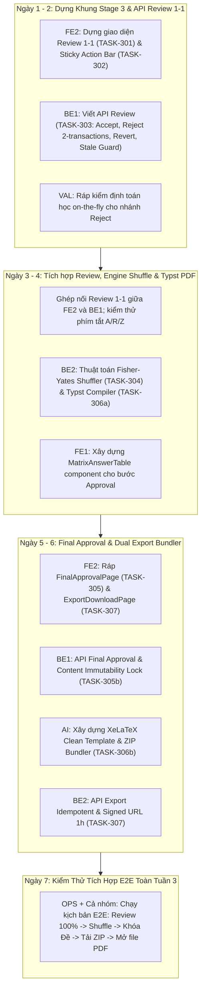

# Isomorphic Exam Synthesizer — Kế Hoạch Triển Khai Tuần 3 (W3)

> **Giai đoạn 3: Stage 3 — Review 1-1, Shuffle & Dual Export Bundling**  
> **Thời gian:** Tuần 3 (01/11/2026 – 07/11/2026)  
> **Nguyên tắc cốt lõi:** Single Ownership · Canonical Invariance · Contract-first · Quality Gates & Safe Invalidation  
> **Mục tiêu tối thượng:** Đưa sản phẩm từ trạng thái đã sinh đề thô (Stage 2) sang trạng thái **thẩm định sư phạm hoàn tất 100% $\rightarrow$ hoán vị đề thi & bảng đáp án xác định $\rightarrow$ xuất bản kép (Dual Export: PDF in ấn chuẩn Typst & gói mã nguồn XeLaTeX/Markdown)**.

---

## 1. Phân Công Nhân Sự & Ma Trận Trách Nhiệm Tuần 3

| Vai trò | Thành viên | Trọng tâm phụ trách chính trong Tuần 3 | Danh sách Task |
| :--- | :--- | :--- | :--- |
| **FE2** | Frontend Core 2 *(Chủ trì Stage 3 UI)* | Giao diện Review 1-1, Action Bar cố định đáy (phím tắt A/R/Z), Final Approval Page, Export Download Center | **TASK-301, TASK-302, TASK-305 (Lead), TASK-307** |
| **FE1** | Frontend Core 1 *(Hỗ trợ Component)* | Component Bảng ma trận đáp án 4 mã đề (`MatrixAnswerTable.jsx`), chuẩn bị Dashboard thống kê | **TASK-305 (Contributor), TASK-401 (Khởi động sớm)** |
| **BE1** | Backend Lead | API Thẩm định câu hỏi 1-1 (Accept/Reject/Revert với vòng đời `is_current`, 2 short transactions, Stale Guard), API Phê duyệt cuối cùng & Khóa nội dung | **TASK-303, TASK-305b** |
| **BE2** | Backend Engine | Thuật toán Fisher-Yates Shuffle xác định dựa trên Canonical Data Model, Typst PDF Compiler Engine trong subprocess an toàn | **TASK-304, TASK-306a** |
| **AI** | AI Specialist | Jinja2 Template cho XeLaTeX (`fontspec` + UTF-8), Markdown Bundler, đóng gói ZIP đa tài liệu, Signed URL 1h | **TASK-306b** |
| **VAL** | Math & Validation | Thẩm định lại tức thời (On-the-fly Validation) cho các câu sinh lại tại Stage 3, đối soát tính toàn vẹn toán học sau Shuffle | **TASK-303 (Contributor), TASK-304 (Contributor)** |
| **OPS** | DevOps & QA | Cấu hình Bucket Supabase Storage `exam-export-bundles`, kiểm thử binary Typst trong Docker, xây dựng kịch bản kiểm thử E2E Stage 3 | **Hạ tầng, CI/CD, Golden Test Stage 3** |

---

## 2. Định Nghĩa Hoàn Thành Tuần 3 (Definition of Done — DoD W3)

Hệ thống được xác nhận hoàn thành Tuần 3 khi vượt qua trọn vẹn kịch bản thực tế (End-to-End):
1. **Thẩm định 1-1:** Giảng viên truy cập `/session/:id/stage3`, đối chiếu song song câu gốc (cột trái) và câu biến thể (cột phải) bằng KaTeX; thao tác Accept, Reject (kèm lý do và sinh lại thành công), và Revert (hoàn nguyên câu gốc) mượt mà bằng cả chuột lẫn phím tắt (`A`, `R`, `Z`).
2. **Khóa Invariant Database:** Cơ chế `is_current` hoạt động chính xác 100%, bảo vệ bởi Partial Unique Index; mọi sự thay đổi câu hỏi sau khi shuffle đều tự động vô hiệu hóa trạng thái (`is_finalized = false`) và buộc shuffle lại.
3. **Hoán vị Xác định (Deterministic Shuffle):** Sau khi duyệt đủ 100% câu, backend thực thi thuật toán Fisher-Yates theo seed, xáo trộn thứ tự câu và thứ tự 4 đáp án (nếu cấu hình), tự động cập nhật bảng `answer_keys` và đồng bộ lời giải chi tiết.
4. **Phê duyệt Cuối cùng (Approval):** Xem trước bản in từng mã đề thi và Bảng ma trận đối chiếu đáp án; bấm Phê duyệt $\rightarrow$ phiên chuyển sang `approved` và bị khóa cứng nội dung vĩnh viễn (`HTTP 423 Locked`).
5. **Xuất bản Kép (Dual Export):**
   * Biên dịch tự động ra các file PDF in ấn sắc nét qua **Typst** (`exam_{code}.pdf`, `answers.pdf`, `solutions.pdf`).
   * Đóng gói mã nguồn **XeLaTeX** `.tex` (chuẩn UTF-8, `fontspec`) và văn bản **Markdown** `.md`.
   * Tải về file `.zip` hoàn chỉnh thông qua Signed URL có hiệu lực trong 1 giờ.

---

## 3. Đặc Tả Chi Tiết Từng Nhiệm Vụ Tuần 3

---

### TASK-301 · Giao diện Review 1-1 & Chốt chặn Trạng thái Đồng thời (FE-07)
- **Người làm:** FE2 (Owner)
- **Phụ thuộc:** TASK-105, TASK-208; Phụ thuộc tích hợp: TASK-303
- **Vị trí tệp:** `frontend/src/features/stage3-review/Stage3ReviewPage.jsx`, `SideBySideReview.jsx`
- **Mục tiêu:** Màn hình cốt lõi của Stage 3 — so sánh đối chiếu trực tiếp 1-1 câu gốc và câu biến thể, phân tách rõ ràng theo từng mã đề thi.

**Yêu cầu cụ thể:**
- [ ] **Bố cục 2 cột song song (Side-by-Side Grid):**
  * **Cột trái (Câu hỏi nguồn):** Cố định hiển thị câu hỏi gốc và 4 phương án A/B/C/D đã bóc tách từ Stage 1 bằng KaTeX `MathRenderer`.
  * **Cột phải (Câu hỏi biến thể):** Hiển thị câu hỏi đẳng cấu tương ứng của mã đề đang chọn, bao gồm: thân câu, 4 phương án, đáp án đúng và lời giải chi tiết (collapsible).
- [ ] **Bộ chọn chuyển đổi mã đề thi (Version Switcher Tabs):**
  * Tab chuyển đổi trực quan giữa các mã đề ($N \in [1, 4]$, ví dụ: Đề 101, Đề 102, Đề 103, Đề 104).
  * Hiển thị số lượng câu đã duyệt trên từng tab (ví dụ: `Đề 101: 20/20 ✓`, `Đề 102: 18/20`).
- [ ] **Chốt chặn Review đồng thời (Frontend Safety Guard):**
  * Nếu `session.status === "generating"`: Hiển thị banner cảnh báo xanh *"Phiên đề đang trong tiến trình sinh nền, vui lòng chờ hoàn tất"* và vô hiệu hóa toàn bộ Action Bar.
  * Nếu `session.status === "partial_generated"`: Hiển thị cảnh báo vàng *"Phiên đề chưa sinh đủ số câu do chạm trần API hoặc timeout"*, hiển thị nút *"Sinh bù các câu còn thiếu"* trỏ tới `POST /api/sessions/{session_id}/retry-generation`.
  * Nếu `session.status in ["approved", "exported"]`: Hiển thị banner xám *"Phiên đề đã được phê duyệt và khóa nội dung vĩnh viễn"* (chuyển toàn bộ giao diện sang chế độ Read-only).
- [ ] **Huy hiệu cảnh báo toán học (Pedagogical Warning Badge):**
  * Nếu câu biến thể có `has_warning == true` hoặc `validation_status !== "passed"`: Hiển thị huy hiệu màu cam/vàng *"⚠️ Cần lưu ý thẩm định"*. Nhấp vào huy hiệu mở drawer/popover tóm tắt chi tiết kiểm tra sư phạm (ví dụ: SymPy CAS không giải tích được hoặc nghi ngờ nghiệm cận biên).
  * **Tuyệt đối KHÔNG hiển thị bất kỳ cảnh báo kỹ thuật/hệ thống hoặc an ninh nào** lên giao diện người dùng theo ADR-004.
- [ ] **Nguyên tắc Zero-Editing:** Tuyệt đối không bố trí bất kỳ ô nhập văn bản (`input`, `textarea`, `contenteditable`) nào để sửa nội dung câu hỏi — tuân thủ triệt để nguyên tắc chỉ thẩm định (Accept, Reject & Regenerate, hoặc Revert câu gốc).

---

### TASK-302 · Giao diện Action Bar Review Cố Định & Phím Tắt Sư Phạm (FE-08)
- **Người làm:** FE2 (Owner)
- **Phụ thuộc:** TASK-301
- **Vị trí tệp:** `frontend/src/features/stage3-review/StickyActionBar.jsx`
- **Mục tiêu:** Thanh công cụ hành động luôn ghim chặt ở đáy màn hình, tối ưu hóa tốc độ duyệt bài của giảng viên qua chuột và phím tắt.

**Yêu cầu cụ thể:**
- [ ] **Bố cục Sticky Bottom Bar:** Luôn cố định ở chân màn hình (`fixed bottom-0 left-0 right-0`), nền mờ đổ bóng cao cấp, không bị che khuất khi cuộn nội dung.
- [ ] **Bộ 3 nút hành động nghiệp vụ:**
  1. **Nút "✓ Chấp nhận" (màu xanh lá — Phím tắt `A`):**
     * Gọi API `accept` $\rightarrow$ trạng thái câu chuyển sang `approved`.
     * Hiệu ứng visual tức thì (tick xanh) và tự động cuộn/chuyển mượt sang câu tiếp theo chưa duyệt.
  2. **Nút "✗ Từ chối & Sinh lại" (màu đỏ — Phím tắt `R`):**
     * Mở modal/popover yêu cầu chọn hoặc nhập lý do từ chối (ví dụ: *"Số liệu chưa đẹp"*, *"Nghiệm cồng kềnh"*, *"Lỗi ngữ cảnh"*).
     * Bấm xác nhận $\rightarrow$ gọi API `reject` $\rightarrow$ hiển thị loading spinner tại chỗ trên thẻ câu hỏi.
     * **Xử lý sự cố khi sinh lại thất bại (V3-05 Guard):** Nếu API trả về lỗi hoặc timeout, hiển thị Toast đỏ *"Hệ thống AI đang bận hoặc sinh lại thất bại, vui lòng thử lại"*, khôi phục trạng thái câu về `pending_review` (không để câu bị kẹt khóa `regenerating`).
  3. **Nút "↺ Dùng lại câu gốc" (màu cam — Phím tắt `Z`):**
     * Mở modal xác nhận hoàn nguyên: *"Bạn có chắc chắn muốn thay thế câu biến thể này bằng đúng nguyên văn câu hỏi gốc?"*.
     * Bấm xác nhận $\rightarrow$ gọi API `revert` $\rightarrow$ câu hỏi được thay bằng câu gốc với trạng thái `approved` ngay lập tức.
- [ ] **Hỗ trợ phím tắt bàn phím toàn diện (Keyboard Shortcuts):**
  * Lắng nghe sự kiện `keydown` toàn cục khi không focus vào modal: `A` (Accept), `R` (Reject), `Z` (Revert), Mũi tên `←` / `→` (Chuyển câu trước/sau).
  * Hiển thị tooltip gợi ý phím tắt ngay trên từng nút bấm.
- [ ] **Thanh tiến độ thẩm định tổng quát:**
  * Hiển thị chỉ số tiến độ: `"Đã duyệt: 38/40 câu (95%)"`.
  * Khi đạt 100% câu `approved` $\rightarrow$ Action Bar sáng bừng nút **"Tiến hành Xáo trộn & Phê duyệt đề thi ➔"** dẫn tới bước tiếp theo.

---

### TASK-303 · API Thẩm Định 1-1, Vòng Đời `is_current`, Revert Nguyên Tử & Safe Re-shuffle Invalidation (BE-07, SEC-P0.4)
- **Người làm:** BE1 (Owner) + VAL (Contributor)
- **Phụ thuộc:** TASK-207b (Generation Core)
- **Vị trí tệp:** `backend/app/api/routes/review.py`, `backend/app/services/review/service.py`
- **Mục tiêu:** Cung cấp bộ endpoints xử lý quyết định thẩm định, bảo vệ Database Invariant qua cờ `is_current`, quản lý chuỗi lịch sử phiên bản và chống treo giao diện.

**Yêu cầu cụ thể:**
- [ ] **Chốt chặn Review đồng thời (Backend Guard):**
  * Kiểm tra `session.status`. Nếu `generating` $\rightarrow$ trả về `HTTP 409 Conflict`. Nếu `approved` hoặc `exported` $\rightarrow$ trả về `HTTP 423 Locked`.
  * Luôn gọi `assert_ownership` xác minh quyền sở hữu phiên làm việc.
- [ ] **Endpoint Chấp nhận câu hỏi (`POST /api/sessions/{session_id}/questions/{version_question_id}/accept`):**
  * Kiểm tra bản ghi phải có `is_current = true`.
  * Cập nhật `status = "approved"`, ghi vết vào `review_logs` (`action_type = "ACCEPT"`).
- [ ] **Endpoint Từ chối & Sinh lại (`POST /api/sessions/{session_id}/questions/{version_question_id}/reject`):**
  * **Hạn mức Quota Thẩm định độc lập (Dedicated Review Quota Ceiling):** Kiểm tra `exam_sessions.gemini_review_calls < 30`. Nếu đã chạm 30 calls $\rightarrow$ từ chối và trả về mã `ERR_REVIEW_QUOTA_EXHAUSTED` (HTTP 429), hướng dẫn người dùng bấm Hoàn nguyên (Revert) câu gốc hoặc chấp nhận phiên bản hiện tại. Mọi lượt gọi thực tế tới Gemini đều tăng `gemini_review_calls += 1`.
  * **Kiểm soát đồng thời (Concurrency Lock):** Áp dụng `asyncio.Semaphore(1)` theo phiên, chỉ cho phép sinh lại 1 câu tại một thời điểm trên mỗi phiên.
  * **Mô hình 2 Transaction Ngắn (Chống cạn kiệt Connection Pool):**
    * *Short DB Transaction 1:* Kiểm tra câu đang có `is_current = true`, cập nhật `status = "regenerating"`, `updated_at = now()` để tạm khóa câu hỏi.
    * *Xử lý AI ngoài Transaction (10–30s):* Gọi Gemini sinh biến thể mới kèm lý do từ chối $\rightarrow$ chạy kiểm định toán học qua `CandidateValidator` $\rightarrow$ sinh lời giải chi tiết. Tuyệt đối không giữ DB connection trong lúc chờ AI!
    * *Short DB Transaction 2:*
      - Đánh dấu câu cũ: `is_current = false`, `status = "rejected"`.
      - Chèn câu mới vào `version_questions`: `is_current = true`, `regenerated_from_id = old_id`, `status = "pending_review"`.
      - Ghi bản ghi kiểm toán vào `review_logs`: `action_type = "REJECT"`, `reason = reason`.
  * **Cơ chế Tự động Mở Khóa khi Server Crash (Stale Regeneration Guard):**
    * Nếu trong quá trình sinh lại bị lỗi hoặc server tắt đột ngột khiến câu bị kẹt `regenerating`: API `GET /review/progress` và API nạp danh sách câu hỏi tự động quét mọi câu có `status = "regenerating"` mà `updated_at < now() - interval '3 minutes'` $\rightarrow$ tự động giải phóng về `pending_review` kèm log `REJECT_FAILED`.
- [ ] **Quy trình Hoàn nguyên Nguyên tử (Atomic Revert Flow):**
  * Endpoint `POST /api/sessions/{session_id}/questions/{version_question_id}/revert`:
  * Mở 1 PostgreSQL Transaction duy nhất:
    1. Đánh dấu bản ghi biến thể hiện tại: `is_current = false`.
    2. Chèn bản ghi mới sao chép nguyên văn từ câu gốc (`source_questions`): gán `is_current = true`, `is_reverted = true`, `status = "approved"`, `regenerated_from_id = old_id`.
    3. Ghi `review_logs` (`action_type = "REVERT"`).
- [ ] **Tự động Vô hiệu hóa Trạng thái Hoán vị (Safe Re-shuffle Invalidation):**
  * Nếu giảng viên thực hiện Reject hoặc Revert khi phiên đã từng bấm Shuffle (`exam_versions.is_finalized = true`) $\rightarrow$ backend tự động hạ trạng thái session về `generated` và reset `exam_versions.is_finalized = false`. Bắt buộc phải bấm Shuffle lại trước khi phê duyệt.
- [ ] **Endpoint Theo dõi Tiến độ Duyệt (`GET /api/sessions/{session_id}/review/progress`):**
  * Trả về JSON: tổng số câu yêu cầu (`required_count`), tổng số câu hiện hành (`current_count`), số câu đã duyệt (`approved_count`), danh sách câu chưa duyệt.
  * Chỉ cho phép chuyển session sang `reviewed` khi: `session.status == "generated"`, `current_count == required_count` và `approved_count == required_count`.

---

### TASK-304 · API Shuffle Xác Định Dựa Trên Canonical Data Model & Đồng Bộ Lời Giải (BE-09)
- **Người làm:** BE2 (Owner) + VAL (Contributor)
- **Phụ thuộc:** TASK-303
- **Vị trí tệp:** `backend/app/services/shuffler/service.py`, `backend/app/api/routes/finalize.py`
- **Mục tiêu:** Xáo trộn ngẫu nhiên xác định thứ tự câu hỏi và thứ tự phương án A/B/C/D theo cấu hình `ordering_preferences`, đồng bộ ma trận đáp án và lời giải chi tiết.

**Yêu cầu cụ thể:**
- [ ] `POST /api/sessions/{session_id}/finalize/shuffle` — gọi `assert_ownership`. Chỉ cho phép thực hiện khi phiên làm việc ở trạng thái `reviewed` (100% câu hiện hành đã đạt `approved`).
- [ ] **Nguyên tắc Mô hình Dữ liệu Chuẩn Bất Biến (Canonical Data Model):**
  * Trong bảng `version_questions`, các trường `canonical_question_no`, `canonical_options`, `canonical_correct_key`, `canonical_solution_md` là **Bất biến tuyệt đối**.
  * Quá trình shuffle luôn luôn đọc từ dữ liệu `canonical_*` của các câu có `is_current = true`, không bao giờ shuffle lặp đè lên dữ liệu đã bị đảo trước đó.
- [ ] **Thuật toán Hoán vị Xác định (Deterministic Fisher-Yates):**
  * Tạo seed xác định cho từng mã đề: `seed = hash(session_id + str(version_index))`.
  * Áp dụng hoán vị:
    * Nếu `ordering_preferences.shuffle_questions == true`: Đảo thứ tự câu hỏi và gán lại `question_no` hiển thị (1..M).
    * Nếu `ordering_preferences.shuffle_options == true`: Hoán vị thứ tự 4 đáp án A/B/C/D, xác định chữ cái đáp án đúng mới (`correct_option`), và cập nhật trường `options`.
    * Đồng bộ lời giải chi tiết (`solution_md`): Tự động thay thế các chỉ dẫn đáp án cũ bằng chữ cái đáp án mới tương ứng.
- [ ] **Lưu trữ Cấu hình Hoán vị & Đồng bộ Bảng `answer_keys`:**
  * Lưu ma trận hoán vị vào cột `exam_versions.permutations` (JSONB) và `exam_versions.shuffle_seed`.
  * Xóa và tạo mới toàn bộ bản ghi trong bảng `answer_keys`:
    ```sql
    INSERT INTO public.answer_keys (version_id, display_no, display_correct_key, canonical_question_no)
    VALUES (...);
    ```
  * Cập nhật `exam_versions.is_finalized = true`.

---

### TASK-305 · Giao diện Phê Duyệt Cuối Cùng & Bảng Ma Trận Đáp Án (FE2 + FE1) (FE-09)
- **Người làm:** FE2 (Owner) + FE1 (Contributor: `MatrixAnswerTable.jsx`)
- **Phụ thuộc:** TASK-302, TASK-304
- **Vị trí tệp:**
  * `frontend/src/features/approval/FinalApprovalPage.jsx` (FE2)
  * `frontend/src/features/approval/MatrixAnswerTable.jsx` (FE1)
- **Mục tiêu:** Màn hình nghiệm thu trước xuất bản — xem trước từng mã đề thi hoàn chỉnh và bảng ma trận đối chiếu đáp án toàn bộ các mã đề.

**Yêu cầu cụ thể:**
- [ ] **FE1 — Xây dựng Component `MatrixAnswerTable.jsx`:**
  * Nhận props: `{ matrixData: MatrixAnswerDTO }`.
  * Hiển thị bảng lưới sắc nét: Cột dọc là Thứ tự câu (Câu 1, 2, ..., 20); Cột ngang là Các mã đề (Đề 101, 102, 103, 104).
  * Các ô đáp án hiển thị chữ cái A, B, C, D rõ ràng, có màu sắc phân biệt trực quan, hỗ trợ tối ưu cho việc in ấn đối soát.
- [ ] **FE2 — Xây dựng Trang `FinalApprovalPage.jsx` (`/session/:id/approval`):**
  * Hiển thị 2 Tab chuyển đổi:
    * **Tab 1 ("Xem trước đề thi"):** Hiển thị bản in đề thi của từng mã đề sau khi đã hoán vị (được đánh số câu từ 1..M, các phương án đã đảo vị trí).
    * **Tab 2 ("Ma trận đáp án"):** Nhúng component `MatrixAnswerTable` của FE1 để kiểm tra độ phân bố đáp án.
  * **Nút bấm "Khóa & Phê duyệt toàn bộ đề thi":**
    * Mở Modal cảnh báo trang trọng: *"Sau khi phê duyệt, toàn bộ N mã đề thi sẽ bị khóa cứng vĩnh viễn và không thể chỉnh sửa. Hệ thống sẽ tiến hành xuất bản tài liệu."*.
    * Bấm xác nhận $\rightarrow$ gọi API `POST /api/sessions/{id}/finalize/approve` (`TASK-305b`) $\rightarrow$ chuyển hướng sang màn hình Tải về (`/session/:id/export`).

---

### TASK-305b · API Phê Duyệt Cuối Cùng & Khóa Nội Dung Bất Biến (BE-09, SEC-08)
- **Người làm:** BE1 (Owner) + BE2 (Contributor)
- **Phụ thuộc:** TASK-304
- **Vị trí tệp:** `backend/app/api/routes/finalize.py`
- **Mục tiêu:** Endpoint phê duyệt chính thức toàn bộ gói đề thi, kiểm tra điều kiện nghiệm thu và kích hoạt chốt khóa nội dung (Content Lock).

**Yêu cầu cụ thể:**
- [ ] `POST /api/sessions/{session_id}/finalize/approve` — gọi `assert_ownership`.
- [ ] **Kiểm tra Điều kiện Tiên quyết (Strict Preconditions Check):**
  * Phiên làm việc phải có đủ 100% số câu hỏi yêu cầu (`current_count == required_count`).
  * 100% câu hỏi hiện hành (`is_current = true`) của tất cả các mã đề phải có trạng thái `approved`.
  * Toàn bộ mã đề thi phải có `exam_versions.is_finalized == true` (đã qua bước shuffle thành công).
  * Nếu không thỏa mãn $\rightarrow$ trả về `HTTP 422 Unprocessable Entity` kèm thông báo chi tiết.
- [ ] **Kích hoạt Khóa Bất Biến (Content Immutability Lock):**
  * Cập nhật `exam_sessions.status = "approved"`, `exam_sessions.approved_at = now()`.
  * Sau thời điểm này, bất kỳ request nào can thiệp sửa đổi câu hỏi (accept, reject, revert, shuffle) đều bị chặn cứng với mã **`HTTP 423 Locked`**.
  * Đảm bảo tính Idempotent: Nếu gọi lại khi session đã `approved` $\rightarrow$ trả về HTTP 200 kèm trạng thái hiện tại.

---

### TASK-306a · Export Engine — Biên Dịch PDF In Ấn Bằng Typst An Toàn (EXP-02, EXP-03, SEC-03)
- **Người làm:** BE2 (Owner)
- **Phụ thuộc:** TASK-001, TASK-305b
- **Vị trí tệp:** `backend/app/services/exporter/typst_compiler.py`, `backend/app/services/exporter/templates/exam.typ`
- **Mục tiêu:** Pipeline 1 trong cơ chế Dual Export — Biên dịch đề thi, ma trận đáp án và lời giải chi tiết ra các file PDF in ấn chuyên nghiệp bằng công cụ Typst siêu nhẹ.

**Yêu cầu cụ thể:**
- [ ] **Thiết kế Typst Template (`templates/exam.typ`):**
  * Trình bày chuẩn format đề thi trắc nghiệm Việt Nam: Khổ giấy A4, tiêu đề kỳ thi/trường học, khung mã đề, 4 cột hoặc 2 cột câu hỏi tối ưu trang in, công thức toán học sắc nét.
  * Template riêng cho Bảng đáp án (`answers.typ`) và Lời giải chi tiết từng bước (`solutions.typ`).
- [ ] **Thực thi Subprocess An toàn Tuyệt đối (SEC-03):**
  * Tuyệt đối **KHÔNG sử dụng `shell=True`** khi gọi lệnh biên dịch. Luôn truyền mảng tham số rõ ràng:
    ```python
    cmd = ["/usr/local/bin/typst", "compile", str(input_file), str(output_file)]
    proc = await asyncio.create_subprocess_exec(*cmd, stdout=asyncio.subprocess.PIPE, stderr=asyncio.subprocess.PIPE)
    ```
  * Giới hạn kích thước file markup Typst đầu vào $\le 5\text{MB}$.
  * Giới hạn thời gian chạy subprocess: timeout cứng **30 giây / file PDF**.
  * Kiểm tra kết quả đầu ra: File PDF phải tồn tại và bắt đầu bằng Magic Bytes chuẩn `%PDF-`.
- [ ] Quản lý tài nguyên an toàn bằng `tempfile.TemporaryDirectory` để tự động dọn sạch file tạm sau khi biên dịch xong.
- [ ] Xuất ra đầy đủ: `exam_{code}.pdf` cho từng mã đề, `answers_matrix.pdf`, và `solutions_{code}.pdf`.

---

### TASK-306b · Clean LaTeX & Markdown Export Bundler (EXP-01, SEC-15)
- **Người làm:** AI (Owner) + BE2 (Contributor)
- **Phụ thuộc:** TASK-305b, TASK-306a
- **Vị trí tệp:** `backend/app/services/exporter/bundle_builder.py`, `backend/app/services/exporter/templates/exam.tex`
- **Mục tiêu:** Pipeline 2 trong cơ chế Dual Export — Đóng gói mã nguồn tài liệu sạch (XeLaTeX và Markdown) kèm các file PDF thành gói nén ZIP hoàn chỉnh và lưu trữ an toàn.

**Yêu cầu cụ thể:**
- [ ] **Đóng gói mã nguồn XeLaTeX độc lập:**
  * Xây dựng Jinja2 Template cho file LaTeX `.tex` chuyên biệt dành cho **XeLaTeX + `fontspec`** (hỗ trợ hiển thị tiếng Việt UTF-8 chuẩn xác không lỗi font).
  * Tích hợp đầy đủ các gói: `amsmath`, `amssymb`, `geometry`, `enumitem`.
  * File `.tex` được định dạng UTF-8 không BOM, sạch sẽ, có thể mang sang máy tính khác biên dịch độc lập bằng TeX Live / Overleaf.
- [ ] **Đóng gói văn bản Markdown (.md):** Tạo file `.md` cho từng mã đề thi lưu trữ cấu trúc câu hỏi và công thức toán học chuẩn KaTeX.
- [ ] **Tạo tệp lưu trữ nén (.ZIP) hoàn chỉnh:**
  * Cấu trúc gói ZIP:
    ```
    exam_bundle_{session_id}/
    ├── pdf/
    │   ├── de_thi_ma_101.pdf
    │   ├── de_thi_ma_102.pdf
    │   ├── ma_tran_dap_an.pdf
    │   └── loi_giai_chi_tiet.pdf
    ├── latex/
    │   ├── de_thi_ma_101.tex
    │   └── template_huong_dan.txt
    ├── markdown/
    │   └── de_thi_ma_101.md
    └── README.txt
    ```
- [ ] **Lưu trữ Supabase Storage & Signed URL 1 Giờ (SEC-15):**
  * Tải file ZIP lên Supabase Storage bucket `exam-export-bundles`.
  * Tạo Signed URL với thời hạn sống ngắn: **TTL = 3600 giây (1 giờ)** nhằm thu hẹp tối đa cửa sổ rủi ro rò rỉ liên kết tải tài liệu.

---

### TASK-307 · Giao diện & Hợp đồng API Tải Gói Đề Thi — Export Download Center (FE-10)
- **Người làm:** FE2 (Owner) + BE2 (Contributor)
- **Phụ thuộc:** TASK-305, TASK-305b, TASK-306a, TASK-306b
- **Vị trí tệp:** `frontend/src/features/export/ExportDownloadPage.jsx`, `backend/app/api/routes/export.py`
- **Mục tiêu:** Màn hình kết thúc hành trình — hiển thị tóm tắt gói đề thi, danh mục tài liệu và nút bấm tải file ZIP an toàn.

**Yêu cầu cụ thể:**
- [ ] **API Khởi tạo Xuất bản Idempotent (`POST /api/sessions/{session_id}/export`):**
  * Kiểm tra session phải ở trạng thái `approved` hoặc `exported`.
  * **Cơ chế Tái cấp Signed URL tức thì:** Nếu session đã có file ZIP trong Storage (chưa hết hạn hoặc link cũ đã hết hạn) $\rightarrow$ chỉ tái tạo Signed URL mới 1 giờ (`expires_in = 3600`) và trả về ngay trong 100ms mà không tốn tài nguyên biên dịch lại Typst hay nén lại ZIP.
  * Cập nhật `session.status = "exported"`.
  * Trả về JSON:
    ```json
    {
      "download_url": "https://...supabase.co/storage/v1/object/sign/exam-export-bundles/...",
      "expires_in_seconds": 3600,
      "bundle_size_bytes": 2457812,
      "file_name": "exam_bundle_toan12_4made.zip"
    }
    ```
- [ ] **Endpoint tra cứu trạng thái xuất bản (`GET /api/sessions/{session_id}/export-status`):** Phục vụ kiểm tra nhanh tiến độ tạo bundle nếu file có dung lượng lớn.
- [ ] **Giao diện Trung tâm Tải về (`/session/:id/export`):**
  * Gọi API export ngay khi vào trang và lưu thông tin tải về vào state.
  * Thẻ tóm tắt gói tài liệu: Tên kỳ thi, số lượng mã đề ($N$), tổng số câu hỏi, dung lượng file.
  * Danh sách tài liệu thành phần trực quan:
    * 📄 $N$ File PDF Đề thi in ấn (Typst)
    * 📊 1 File PDF Bảng ma trận đáp án tổng hợp
    * 💡 1 File PDF Lời giải chi tiết từng bước
    * 📦 Gói mã nguồn XeLaTeX `.tex` & Markdown `.md`
  * **Nút bấm lớn "Tải về trọn bộ gói đề thi (.ZIP)":** Nhấp để mở Signed URL và tải file trực tiếp về máy tính.
  * Nút "Quay về Dashboard" để tiếp tục quản lý hoặc tạo phiên đề thi mới.

---

## 4. Hợp Đồng API & Dữ Liệu Chuẩn Tuần 3 (Canonical Contracts)

### 4.1. Hợp đồng Thẩm định 1-1 (Review Contracts)
```http
POST /api/sessions/{session_id}/questions/{version_question_id}/accept
Headers: Authorization: Bearer <token>
Response 200: { "status": "approved", "question_id": "...", "updated_at": "..." }

POST /api/sessions/{session_id}/questions/{version_question_id}/reject
Headers: Authorization: Bearer <token>
Body: { "reason": "Nghiệm chứa căn thức cồng kềnh, cần số nguyên đẹp" }
Response 200: { 
  "status": "pending_review", 
  "new_question_id": "...", 
  "regenerated_from_id": "...",
  "stem_latex": "...", 
  "options": [...] 
}
Error 429: { "error_code": "ERR_REVIEW_QUOTA_EXHAUSTED", "detail": "Đã dùng hết 30 lượt AI sinh lại của buổi review" }

POST /api/sessions/{session_id}/questions/{version_question_id}/revert
Headers: Authorization: Bearer <token>
Response 200: { "status": "approved", "is_reverted": true, "question_id": "..." }

GET /api/sessions/{session_id}/review/progress
Headers: Authorization: Bearer <token>
Response 200: {
  "required_count": 80,
  "current_count": 80,
  "approved_count": 78,
  "is_complete": false,
  "can_finalize": false
}
```

### 4.2. Hợp đồng Xáo trộn & Phê duyệt (Finalize Contracts)
```http
POST /api/sessions/{session_id}/finalize/shuffle
Headers: Authorization: Bearer <token>
Response 200: {
  "session_id": "...",
  "status": "reviewed",
  "is_finalized": true,
  "versions": [
    { "version_id": "...", "version_code": "101", "total_questions": 20 }
  ]
}

POST /api/sessions/{session_id}/finalize/approve
Headers: Authorization: Bearer <token>
Response 200: {
  "session_id": "...",
  "status": "approved",
  "approved_at": "2026-11-04T15:30:00Z",
  "message": "Session locked permanently"
}
Error 423: { "error_code": "ERR_SESSION_LOCKED", "detail": "Phiên đã phê duyệt và bị khóa vĩnh viễn" }
```

### 4.3. Hợp đồng Xuất bản Tài liệu (Export Contracts)
```http
POST /api/sessions/{session_id}/export
Headers: Authorization: Bearer <token>
Response 200: {
  "download_url": "https://.../exam-export-bundles/...token=...",
  "expires_in_seconds": 3600,
  "bundle_size_bytes": 1845000,
  "file_name": "exam_bundle_toan12_4made.zip"
}
```

---

## 5. Kế Hoạch Triển Khai Tuần 3 Theo Từng Ngày (Daily Timeline)



---

## 6. Chốt Chặn Chất Lượng & Danh Mục Kiểm Thử (Quality Gates)

Trước khi đóng Tuần 3 để chuyển sang Tuần 4, toàn bộ các tiêu chí sau bắt buộc phải đạt 100%:

- [ ] **Chốt chặn Review Invariant:** Chạy kiểm thử tự động xác nhận không bao giờ có 2 câu cùng mang `is_current = true` trên cùng một vị trí câu hỏi của một mã đề thi.
- [ ] **Chốt chặn Recovery sau Crash:** Mô phỏng tiến trình backend bị kill giữa chừng khi đang sinh lại câu hỏi $\rightarrow$ kiểm tra câu hỏi tự động được giải phóng khỏi trạng thái `regenerating` sau 3 phút.
- [ ] **Chốt chặn Ngân sách Review Quota:** Thử nghiệm gọi reject liên tục 30 lần $\rightarrow$ lần thứ 31 bắt buộc trả về HTTP 429 và hệ thống vẫn an toàn, không bị crash.
- [ ] **Chốt chặn Re-shuffle:** Duyệt xong $\rightarrow$ Shuffle $\rightarrow$ Reject lại 1 câu $\rightarrow$ xác minh `exam_versions.is_finalized` bị hạ về `false` và hệ thống chặn phê duyệt cho đến khi shuffle lại.
- [ ] **Chốt chặn An toàn Typst Subprocess:** Thử nghiệm truyền file markup lỗi hoặc chứa ký tự đặc biệt $\rightarrow$ xác minh subprocess bắt lỗi an toàn trong 30 giây, không gây treo worker server.
- [ ] **Chốt chặn Khóa Nội Dung (Content Lock):** Sau khi bấm Phê duyệt $\rightarrow$ thử gửi request sửa đổi từ API client $\rightarrow$ xác minh trả về đúng mã lỗi `HTTP 423 Locked`.
- [ ] **Kiểm tra File Xuất bản:** Tải file `.zip` từ Signed URL $\rightarrow$ giải nén $\rightarrow$ mở từng file PDF kiểm tra không bị lỗi tràn trang hay vỡ công thức toán $\rightarrow$ kiểm tra file `.tex` biên dịch thành công với XeLaTeX.

